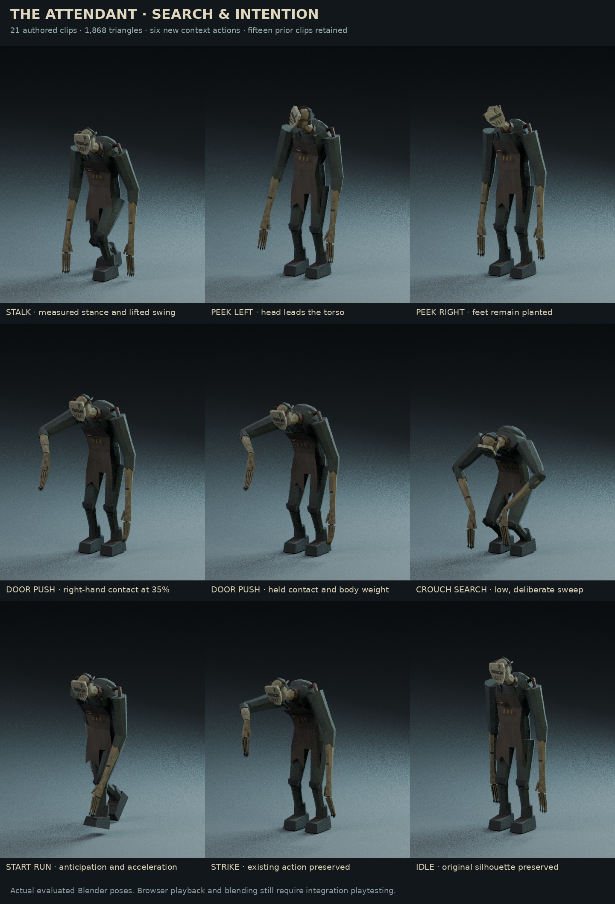
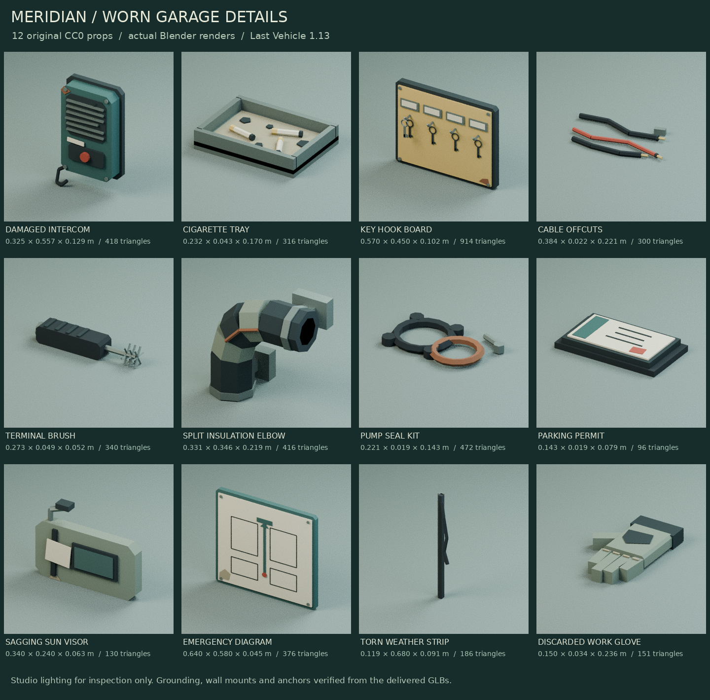
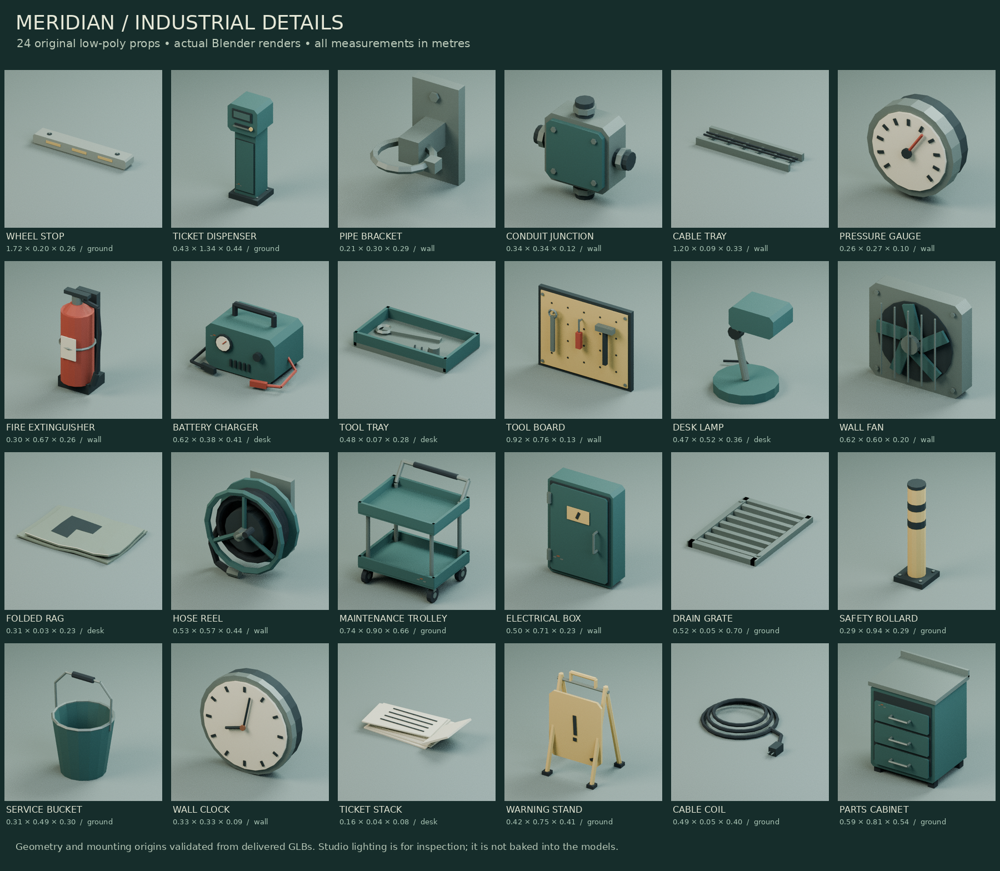

# Last Vehicle 1.14 — complete commented source

Edit the actual files. This is a reading copy of the runtime, launchers, packaging tools and tests. Vendor libraries, models, music and sound recordings are supplied separately with their notices. Read UPDATE_1_14.md and BUILD_AND_EDIT_GUIDE.md for the walkthrough.

## dist/index.html

```html
<!doctype html>
<html lang="en">
  <head>
    <meta charset="utf-8" />
    <meta
      name="viewport"
      content="width=device-width,initial-scale=1,viewport-fit=cover"
    />
    <meta name="theme-color" content="#10191b" />
    <meta
      name="description"
      content="Last Vehicle. A short, atmospheric low-poly horror game. A GingrSnaps Project."
    />
    <title>Last Vehicle — A GingrSnaps Project</title>
    <link rel="icon" href="icon.svg" type="image/svg+xml" />
    <link rel="stylesheet" href="style.css?v=1.14.0" />
  </head>
  <body>
    <canvas id="game" aria-label="Last Vehicle game view" tabindex="0"></canvas>
    <div id="impact-edge" aria-hidden="true"></div>
    <div id="vignette" aria-hidden="true"></div>
    <div id="loading">
      <div class="studio-mark">GS<span></span></div>
      <p class="eyebrow">A GingrSnaps Project</p>
      <div class="load-track"><i id="load-fill"></i></div>
      <p id="load-label" role="status">Opening Meridian…</p><span id="load-percent">0%</span>
      <div id="load-actions" class="hidden button-row"><button id="load-retry" class="btn">Retry loading</button><button id="load-simple" class="btn accent">Retry with simpler graphics</button></div>
    </div>
    <div id="intro" class="hidden" aria-hidden="true">
      <div id="intro-content" class="intro-content">
        <div class="studio-mark">GS<span></span></div>
        <p>A GingrSnaps Project</p>
      </div>
      <button id="intro-skip" class="btn intro-skip">Skip intro</button>
    </div>
    <main id="menu" class="hidden screen">
      <div class="menu-shade"></div>
      <div class="topline">
        <span class="brand">GINGRSNAPS</span
        ><span>MERIDIAN PARKING <i></i> 00:17</span>
      </div>
      <div class="menu-content">
        <span class="ticket-stamp" aria-hidden="true">LAST EXIT / 042</span>
        <p class="eyebrow">
          <span class="line"></span> A SHORT HORROR EXPERIENCE
        </p>
        <h1>LAST<br /><span>VEHICLE</span></h1>
        <p class="tagline">Everyone has left.<br />Someone stayed.</p>
        <nav class="menu-buttons" aria-label="Main menu">
          <button id="continue" class="hidden primary">
            <span>Continue</span><span>↗</span>
          </button>
          <div id="continue-summary" class="continue-summary hidden"></div>
          <button id="new-game" class="primary">
            <span>Enter the garage</span><span>↗</span>
          </button>
          <button id="settings-button">Settings <span>＋</span></button>
          <button id="credits-button">Credits <span>＋</span></button>
        </nav>
      </div>
      <div class="menu-caption">
        <span class="tiny-square"></span>
        <div>
          <span>B2 / BAY 042</span>
          <p>The last ticket of the night.</p>
        </div>
      </div>
      <footer>
        <span>HEADPHONES RECOMMENDED</span
        ><span>EXPLORATION <b>·</b> SURVIVAL</span><span>v1.13 · CANDIDATE</span>
      </footer>
    </main>
    <div id="hud" class="hidden">
      <div class="hud-top">
        <div id="objective-block" class="hidden">
          <span id="chapter" class="eyebrow">01 / THE LAST TICKET</span>
          <p id="objective"></p>
          <small id="objective-hint"></small>
        </div>
        <button id="pause-button" aria-label="Pause game">Ⅱ</button>
      </div>
      <div id="tutorial" class="hidden"></div>
      <button id="journal-button" class="journal-indicator"><kbd id="journal-key">J</kbd> Journal <i id="journal-dot" class="unread-dot hidden"></i></button>
      <div id="hint-card" class="hidden" role="status"></div>
      <div id="note-preview" class="hidden" role="status"></div>
      <div id="crosshair" aria-hidden="true"><i></i></div>
      <div id="world-prompt" class="hidden" aria-hidden="true">
        <kbd id="world-prompt-key">E</kbd>
      </div>
      <div id="interaction" class="hidden">
        <kbd id="interact-key">E</kbd><span id="interaction-label"></span>
      </div>
      <div id="action-progress" class="hidden" role="status">
        <span id="action-label"></span>
        <div><i id="action-fill"></i></div>
      </div>
      <div id="subtitle" class="hidden" role="status"></div>
      <div class="hud-bottom">
        <span id="location">MERIDIAN / B2</span
        ><span id="difficulty-label">MEDIUM</span>
        <div id="stamina-meter" class="stamina" role="progressbar" aria-label="Sprint stamina" aria-valuemin="0" aria-valuemax="100"><span id="stamina-label">STAMINA</span><i id="stamina-fill"></i></div>
        <span id="bolt-status"></span>
        <span id="flash-status">F · FLASHLIGHT</span>
      </div>
      <div id="fps" class="hidden" data-corner="top-right"><span id="fps-text"></span><canvas id="fps-graph" width="240" height="60" class="hidden" aria-label="Recent gameplay frame times"></canvas><small id="fps-legend" class="hidden"></small></div>
      <div id="touch-controls">
        <div id="move-pad"><span>MOVE</span><i id="move-knob"></i></div>
        <div id="look-pad"></div>
        <div class="touch-actions">
          <button id="touch-run" aria-label="Toggle sprint">RUN</button
          ><button id="touch-light" aria-label="Flashlight">LIGHT</button
          ><button id="touch-use" aria-label="Interact">USE</button><button id="touch-hint" aria-label="Open journal hints">HINT</button><button id="touch-throw" aria-label="Throw a bolt">THROW</button><button id="touch-objective" aria-label="Show current objective">TASK</button>
        </div>
      </div>
    </div>
    <div id="toast" class="hidden" role="status"></div>
    <div id="danger" aria-hidden="true"></div>
    <section id="overlay" class="hidden screen">
      <div class="overlay-scrim"></div>
      <div
        id="panel"
        class="panel"
        role="dialog"
        aria-modal="true"
        aria-label="Game menu"
        tabindex="-1"
      ></div>
    </section>
    <input id="settings-file" type="file" accept="application/json,.json" hidden />
    <input id="save-file" type="file" accept="application/json,.json" hidden />
    <noscript
      >This game requires JavaScript and a browser with WebGL support.</noscript
    >
    <script src="vendor/babylon.js"></script>
    <script src="vendor/babylonjs.loaders.min.js"></script>
    <script type="module" src="js/main.js?v=1.14.0"></script>
  </body>
</html>
```

## dist/style.css

```css
:root {
  color-scheme: dark;
  --ink: #111b1d;
  --paper: #e2e7dc;
  --muted: #a1b1ad;
  --accent: #c9b382;
  --line: #d4decd26;
  --ui: Arial, Helvetica, sans-serif;
  font-family: var(--ui);
  font-synthesis: none;
}
* {
  box-sizing: border-box;
}
body {
  margin: 0;
  background: #101719;
  color: var(--paper);
  overflow: hidden;
}
button,
input,
select {
  font: inherit;
}
button {
  cursor: pointer;
  color: inherit;
  border: 0;
}
button:disabled {
  opacity: 0.35;
  cursor: not-allowed;
}
button:focus-visible,
input:focus-visible,
select:focus-visible {
  outline: 2px solid var(--accent);
  outline-offset: 5px;
}
button:active {
  transform: translateY(1px);
}
.hidden {
  display: none !important;
}
#game {
  position: fixed;
  inset: 0;
  width: 100%;
  height: 100%;
  outline: none;
  touch-action: none;
}
#vignette {
  position: fixed;
  inset: 0;
  background: radial-gradient(
    ellipse at 52% 48%,
    transparent 20%,
    #03101427 67%,
    #02090db0
  );
  pointer-events: none;
}
#loading,
#intro {
  position: fixed;
  inset: 0;
  background: #10191b;
  z-index: 30;
  display: flex;
  align-items: center;
  justify-content: center;
  flex-direction: column;
}
#loading p {
  font-size: 11px;
  letter-spacing: 2px;
  color: var(--muted);
}
.studio-mark {
  width: 70px;
  height: 70px;
  display: grid;
  place-items: center;
  font-family: Georgia, serif;
  font-size: 29px;
  font-weight: 400;
  letter-spacing: -3px;
  color: var(--accent);
  position: relative;
  margin-bottom: 30px;
}
.studio-mark:before,
.studio-mark:after {
  content: "";
  position: absolute;
  border: 1px solid #c9b38277;
  width: 65px;
  height: 65px;
  transform: rotate(45deg);
}
.studio-mark:after {
  width: 56px;
  height: 56px;
  border-color: #c9b38226;
}
.studio-mark span {
  position: absolute;
  bottom: -8px;
  left: 33px;
  width: 4px;
  height: 4px;
  background: var(--accent);
}
.intro-content {
  display: flex;
  flex-direction: column;
  align-items: center;
  animation: studio 3s both;
}
.intro-content p {
  letter-spacing: 5px;
  text-transform: uppercase;
  font-size: 12px;
}
.load-track {
  height: 1px;
  width: 180px;
  background: #ffffff20;
  margin: 16px;
}
.load-track i {
  display: block;
  width: 0;
  height: 100%;
  background: var(--accent);
  transition: width 0.3s;
}
@keyframes studio {
  0% {
    opacity: 0;
    transform: translateY(8px);
  }
  20%,
  75% {
    opacity: 1;
    transform: translateY(0);
  }
  100% {
    opacity: 0;
    transform: translateY(-3px);
  }
}
.screen {
  position: fixed;
  inset: 0;
  z-index: 5;
}
.menu-shade {
  position: absolute;
  inset: 0;
  background:
    linear-gradient(
      90deg,
      #081316ed 0%,
      #0d191bce 31%,
      #07121628 65%,
      #050c0e40
    ),
    linear-gradient(0deg, #081316d9, transparent 23%);
  pointer-events: none;
}
.topline {
  position: absolute;
  top: 38px;
  left: 4.5vw;
  right: 4.5vw;
  display: flex;
  justify-content: space-between;
  align-items: center;
  font-size: 10px;
  letter-spacing: 2px;
  color: #bac5ba;
}
.brand {
  font-weight: 700;
  letter-spacing: 4px;
  color: var(--accent);
}
.topline i {
  display: inline-block;
  width: 4px;
  height: 4px;
  background: var(--accent);
  margin: 0 15px;
  vertical-align: middle;
}
.menu-content {
  position: absolute;
  top: 19%;
  left: 8%;
  width: 340px;
}
.eyebrow {
  color: var(--accent);
  font-size: 10px;
  font-weight: 500;
  letter-spacing: 2.5px;
  line-height: 1.7;
}
.line {
  display: inline-block;
  width: 27px;
  height: 1px;
  background: var(--accent);
  vertical-align: middle;
  margin-right: 12px;
}
h1 {
  font-family: Impact, "Arial Narrow", sans-serif;
  font-weight: 400;
  font-stretch: condensed;
  font-size: clamp(66px, 7.6vw, 114px);
  line-height: 0.92;
  letter-spacing: 1px;
  margin: 24px 0;
  color: #e5e8dd;
}
h1 span {
  color: #c9d1c5;
}
.tagline {
  font-family: Georgia, serif;
  font-size: 16px;
  line-height: 1.6;
  color: #adbcb5;
  margin: 25px 0 30px;
}
.menu-buttons {
  width: 260px;
  display: flex;
  flex-direction: column;
  gap: 1px;
}
.menu-buttons button {
  display: flex;
  justify-content: space-between;
  align-items: center;
  text-align: left;
  background: transparent;
  padding: 13px 0;
  color: #a7b6b0;
  font-size: 12px;
  letter-spacing: 1px;
  border-bottom: 1px solid var(--line);
  transition:
    padding 0.2s,
    color 0.2s,
    background 0.2s;
}
.menu-buttons button span:last-child {
  font-size: 17px;
  font-weight: 300;
  color: var(--accent);
}
.menu-buttons button:hover {
  padding-left: 12px;
  padding-right: 8px;
  color: #fff;
  background: #c9b38208;
}
.menu-buttons .primary {
  color: var(--paper);
  font-weight: 700;
  font-size: 14px;
  padding-bottom: 18px;
}
.menu-caption {
  position: absolute;
  right: 7vw;
  bottom: 15%;
  display: flex;
  gap: 14px;
  align-items: flex-start;
}
.tiny-square {
  width: 7px;
  height: 7px;
  border: 1px solid var(--accent);
  margin-top: 3px;
}
.menu-caption span {
  font-size: 10px;
  letter-spacing: 3px;
  color: var(--accent);
}
.menu-caption p {
  font-family: Georgia, serif;
  font-size: 13px;
  color: #b9c6be;
  margin: 9px 0;
}
footer {
  position: absolute;
  bottom: 29px;
  left: 4.5vw;
  right: 4.5vw;
  display: flex;
  justify-content: space-between;
  gap: 10px;
  font-size: 9px;
  letter-spacing: 1.8px;
  color: #8b9b98;
}
footer b {
  color: var(--accent);
  padding: 0 13px;
}
#hud {
  position: fixed;
  inset: 0;
  pointer-events: none;
  z-index: 3;
}
.hud-top {
  position: absolute;
  top: 28px;
  left: 32px;
  right: 32px;
  display: flex;
  justify-content: space-between;
  gap: 20px;
  text-shadow: 0 2px 7px #000;
}
.hud-top p {
  font-size: 16px;
  margin: 7px 0;
  color: #ebeddf;
  letter-spacing: 0.2px;
}
.hud-top small {
  font-size: 11px;
  line-height: 1.5;
  color: #b2c1b9;
  display: block;
  max-width: 440px;
}
.hud-top button {
  pointer-events: auto;
  background: #101b1cb0;
  border: 1px solid var(--line);
  border-radius: 50%;
  width: 35px;
  height: 35px;
}
.hud-bottom {
  position: absolute;
  left: 32px;
  right: 32px;
  bottom: 24px;
  display: flex;
  justify-content: space-between;
  align-items: center;
  font-size: 9px;
  letter-spacing: 2px;
  color: #adbbb6;
}
.stamina {
  width: 105px;
  height: 2px;
  background: #d9dfce30;
}
.stamina i {
  display: block;
  width: 100%;
  height: 100%;
  background: var(--accent);
  transition: width 0.1s;
}
#crosshair {
  position: absolute;
  left: 50%;
  top: 50%;
  width: 4px;
  height: 4px;
  border-radius: 50%;
  background: #e6eddf88;
  box-shadow: 0 0 4px #000;
  transform: translate(-50%, -50%);
}
#crosshair.active {
  width: 11px;
  height: 11px;
  background: transparent;
  border: 1px solid var(--accent);
  border-radius: 50%;
}
#interaction {
  position: absolute;
  left: 50%;
  top: 58%;
  transform: translateX(-50%);
  display: flex;
  align-items: center;
  gap: 12px;
  background: #0c161bd9;
  padding: 10px 17px;
  border: 1px solid #d4decd28;
  font-size: 12px;
  letter-spacing: 0.4px;
  white-space: nowrap;
}
kbd {
  border: 1px solid #d4decd60;
  color: var(--accent);
  padding: 4px 7px;
  font-size: 11px;
  min-width: 24px;
  text-align: center;
  background: #152224;
}
#subtitle {
  position: absolute;
  bottom: 13%;
  left: 50%;
  transform: translateX(-50%);
  max-width: 650px;
  width: max-content;
  text-align: center;
  padding: 12px 18px;
  background: #071114e6;
  line-height: 1.65;
  font-size: 15px;
  letter-spacing: 0.3px;
  border-bottom: 1px solid #c9b38255;
}
#toast {
  position: fixed;
  bottom: 60px;
  right: 30px;
  z-index: 20;
  font-size: 11px;
  letter-spacing: 0.7px;
  color: #cad9cd;
  background: #152324ed;
  padding: 12px 18px;
  border-left: 2px solid var(--accent);
  max-width: 370px;
  line-height: 1.6;
}
#fps {
  position: absolute;
  right: 32px;
  top: 80px;
  font: 11px monospace;
  color: #bacaba;
}
#danger {
  position: fixed;
  inset: 0;
  pointer-events: none;
  z-index: 2;
  box-shadow: inset 0 0 130px 10px #631b1900;
  transition: box-shadow 0.3s;
}
.overlay-scrim {
  position: absolute;
  inset: 0;
  background: #061015bc;
  backdrop-filter: blur(9px);
}
.panel {
  position: absolute;
  top: 50%;
  left: 50%;
  transform: translate(-50%, -50%);
  width: min(780px, calc(100% - 36px));
  max-height: calc(100% - 50px);
  overflow: auto;
  background: linear-gradient(145deg, #1a292cfa, #111d20fa);
  border: 1px solid #d4decd28;
  box-shadow: 0 30px 100px #0005;
  padding: 38px 44px;
  scrollbar-width: thin;
  scrollbar-color: #65766b transparent;
}
.panel h2 {
  font-family: Georgia, serif;
  font-weight: 400;
  font-size: 32px;
  color: #e1e5d8;
  margin: 8px 0 24px;
}
.panel p {
  color: #b9c7be;
  font-size: 13px;
  line-height: 1.8;
}
.panel .note-copy {
  font-family: Georgia, serif;
  white-space: pre-wrap;
  font-size: 16px;
  line-height: 1.75;
  color: #d0d6c8;
  margin-bottom: 28px;
}
.panel .close-button {
  position: absolute;
  top: 24px;
  right: 26px;
  background: none;
  font-size: 22px;
  color: #a2b3ac;
}
.button-row {
  display: flex;
  gap: 10px;
  flex-wrap: wrap;
  margin-top: 24px;
}
.btn {
  padding: 12px 18px;
  border: 1px solid #a9bba144;
  background: #bfd2b20a;
  font-size: 12px;
  letter-spacing: 0.5px;
  color: #ccd7c9;
}
.btn:hover {
  background: #bfd2b21a;
}
.btn.accent {
  background: #ccb98b;
  color: #152020;
  border-color: #ccb98b;
}
.btn.danger {
  border-color: #a5635344;
  color: #d7a28f;
}
.tabs {
  display: flex;
  border-bottom: 1px solid var(--line);
  gap: 22px;
  margin-bottom: 25px;
}
.tabs button {
  background: none;
  padding: 0 0 13px;
  font-size: 11px;
  letter-spacing: 1px;
  color: #869c92;
}
.tabs button.selected {
  border-bottom: 2px solid var(--accent);
  color: var(--accent);
}
.settings-group {
  display: grid;
  grid-template-columns: 1fr 1fr;
  gap: 22px 30px;
}
.setting {
  display: flex;
  flex-direction: column;
  gap: 10px;
}
.setting label {
  display: flex;
  justify-content: space-between;
  color: #cad5c9;
  font-size: 12px;
}
.setting output {
  color: var(--accent);
  font: 11px monospace;
}
.setting select {
  background: #0d1a1c;
  padding: 9px;
  color: #bdcbbf;
  border: 1px solid #aabbab30;
  font-size: 12px;
}
.setting input[type="range"] {
  accent-color: var(--accent);
  width: 100%;
  height: 3px;
}
.setting.check {
  flex-direction: row;
  align-items: center;
  justify-content: space-between;
}
.setting.check label {
  line-height: 1.7;
}
.setting.check input {
  accent-color: var(--accent);
  width: 17px;
  height: 17px;
}
.setting .bind {
  padding: 8px 10px;
  background: #0e1d20;
  border: 1px solid #aabbab30;
  color: var(--accent);
  font-size: 11px;
}
.settings-note {
  font-size: 11px !important;
  color: #82988c !important;
  border-top: 1px solid var(--line);
  padding-top: 16px;
  margin-top: 24px;
}
.note-list {
  display: grid;
  grid-template-columns: 1fr 1fr;
  gap: 12px;
}
.note-list button {
  text-align: left;
  background: #0e1a1b;
  border: 1px solid var(--line);
  padding: 17px;
  font-family: Georgia, serif;
  font-size: 16px;
  line-height: 1.5;
}
.note-list button small {
  display: block;
  font: 9px var(--ui);
  letter-spacing: 1px;
  color: var(--accent);
  margin-bottom: 8px;
}
.puzzle-row {
  display: flex;
  gap: 12px;
  margin: 20px 0;
}
.puzzle-row button {
  flex: 1;
  background: #0c191c;
  border: 1px solid var(--line);
  padding: 25px 5px;
  font-size: 11px;
  letter-spacing: 1px;
  color: #c1ccc1;
}
.puzzle-row button.on {
  border-color: #a8ce9c;
  color: #bcdfa9;
  background: #273c2b;
}
.keypad-input {
  width: 100%;
  padding: 16px;
  text-align: center;
  letter-spacing: 16px;
  font: 28px monospace;
  color: var(--accent);
  background: #0b181a;
  border: 1px solid var(--line);
}
.keypad {
  display: grid;
  grid-template-columns: repeat(3, 1fr);
  gap: 8px;
  margin-top: 12px;
}
.keypad button {
  background: #223233;
  padding: 13px;
  color: #cdd6c8;
  border: 1px solid var(--line);
}
.keypad button:hover {
  background: #344541;
}
.ending-title {
  font-size: 44px !important;
}
.stat-grid {
  display: grid;
  grid-template-columns: repeat(3, 1fr);
  gap: 12px;
  margin: 25px 0;
}
.stat-grid div {
  padding: 18px;
  border: 1px solid var(--line);
  font-size: 25px;
  color: var(--accent);
}
.stat-grid small {
  display: block;
  font-size: 9px;
  letter-spacing: 1px;
  color: #9eafa2;
  margin-top: 7px;
}
.credits-list {
  font-size: 12px;
  line-height: 1.9;
  color: #aebfaf;
}
.credits-list a,
.panel a {
  color: #c9b382;
}
#touch-controls {
  display: none;
  pointer-events: none;
  position: absolute;
  inset: 0;
}
#move-pad {
  position: absolute;
  left: 25px;
  bottom: 68px;
  width: 130px;
  height: 130px;
  border: 1px solid #cad2c336;
  border-radius: 50%;
  background: #15252550;
  pointer-events: auto;
  touch-action: none;
  display: grid;
  place-items: center;
  font-size: 9px;
  color: #cad2c34a;
  letter-spacing: 2px;
}
#move-knob {
  position: absolute;
  width: 40px;
  height: 40px;
  border-radius: 50%;
  border: 1px solid #cad2c355;
  background: #cad2c31a;
}
#look-pad {
  position: absolute;
  left: 40%;
  right: 0;
  top: 130px;
  bottom: 80px;
  pointer-events: auto;
  touch-action: none;
}
.touch-actions {
  position: absolute;
  right: 22px;
  bottom: 80px;
  display: flex;
  flex-direction: column;
  gap: 10px;
  pointer-events: auto;
}
.touch-actions button {
  background: #142526b0;
  border: 1px solid #cad2c344;
  border-radius: 50%;
  width: 53px;
  height: 53px;
  font-size: 10px;
  touch-action: none;
}
.touch-actions #touch-use {
  background: #bca779;
  color: #162321;
}
@media (pointer: coarse) {
  #touch-controls {
    display: block;
  }
  .hud-bottom {
    bottom: 18px;
    font-size: 8px;
  }
  .stamina {
    width: 70px;
  }
  #interaction {
    top: 54%;
  }
}
@media (max-width: 700px) {
  .topline {
    top: 25px;
    font-size: 8px;
  }
  .topline .brand {
    letter-spacing: 2px;
  }
  .menu-content {
    top: 20%;
    left: 8%;
    width: 270px;
  }
  h1 {
    font-size: 80px;
  }
  .tagline {
    font-size: 14px;
    margin: 20px 0;
  }
  .menu-caption {
    display: none;
  }
  footer span:nth-child(2) {
    display: none;
  }
  .panel {
    padding: 28px 24px;
    max-height: calc(100% - 24px);
  }
  .panel h2 {
    font-size: 28px;
  }
  .settings-group {
    gap: 22px;
    grid-template-columns: 1fr;
  }
  .tabs {
    gap: 16px;
  }
  .tabs button {
    font-size: 10px;
  }
  .hud-top {
    left: 18px;
    right: 18px;
    top: 20px;
  }
  .hud-top small {
    max-width: 270px;
    font-size: 10px;
  }
  .hud-top p {
    font-size: 14px;
  }
  #subtitle {
    max-width: 90%;
    font-size: 13px;
    bottom: 21%;
  }
  .hud-bottom {
    left: 20px;
    right: 20px;
  }
  .note-list {
    grid-template-columns: 1fr;
  }
  .stat-grid {
    gap: 6px;
  }
  .stat-grid div {
    padding: 12px;
    font-size: 20px;
  }
  .stat-grid small {
    font-size: 8px;
  }
  #toast {
    right: 15px;
    max-width: calc(100% - 30px);
    bottom: 46px;
  }
}
@media (max-height: 650px) {
  .menu-content {
    top: 14%;
  }
  h1 {
    font-size: 65px;
    margin: 15px 0;
  }
  .tagline {
    margin: 15px 0;
    font-size: 13px;
  }
  .menu-buttons button {
    padding: 9px 0;
  }
  .topline {
    top: 20px;
  }
  footer {
    bottom: 18px;
  }
  .panel {
    max-height: 94%;
  }
}
@media (prefers-reduced-motion: reduce) {
  * {
    animation-duration: 0.01ms !important;
    transition-duration: 0.01ms !important;
  }
}

@media (prefers-reduced-motion: reduce) {
  .intro-content {
    animation: none !important;
    opacity: 1;
    transform: none;
  }
}

/* The HUD stays sharp even when the WebGL render scale is reduced. */
#subtitle {
  font-size: calc(16px * var(--subtitle-scale, 1));
}
#action-progress {
  position: absolute;
  left: 50%;
  top: 62%;
  transform: translateX(-50%);
  width: 220px;
  text-align: center;
  color: #e3d9bd;
  font-size: 10px;
  letter-spacing: 1.8px;
}
#action-progress div {
  height: 2px;
  background: #ffffff26;
  margin-top: 10px;
}
#action-fill {
  display: block;
  height: 100%;
  background: #c9b382;
  width: 0;
}

/* Nearby, line-of-sight interaction cues stay at full UI resolution. */
#world-prompt {
  position: fixed;
  transform: translate(-50%, -100%);
  pointer-events: none;
  z-index: 4;
}
#world-prompt kbd {
  display: block;
  min-width: 30px;
  padding: 6px 9px;
  text-align: center;
  border: 1px solid #e6cf95;
  background: #142728e8;
  color: #f8eccd;
  box-shadow: 0 3px 18px #0008;
  font: 600 13px monospace;
  border-radius: 3px;
}
#interaction.unavailable {
  color: #acbbb5;
}
#world-prompt.unavailable {
  opacity: 0.5;
}
#difficulty-label {
  color: #9dafa6;
  font-size: 10px;
  letter-spacing: 1.7px;
}
.difficulty-cards {
  display: grid;
  grid-template-columns: repeat(3, 1fr);
  gap: 12px;
  margin: 24px 0;
}
.difficulty-card {
  padding: 21px 16px;
  min-height: 170px;
  background: #18282b;
  border: 1px solid #34474a;
  text-align: left;
  color: #cad8d1;
  cursor: pointer;
  transition:
    background 0.18s,
    border-color 0.18s;
}
.difficulty-card strong {
  display: block;
  font:
    24px Georgia,
    serif;
  color: #ede6d2;
  margin-bottom: 12px;
}
.difficulty-card span {
  font-size: 12px;
  line-height: 1.7;
  display: block;
}
.difficulty-card.selected {
  border-color: #c9b382;
  background: #273633;
  box-shadow: inset 0 2px #c9b382;
}
button:disabled {
  cursor: wait;
  opacity: 0.6;
}
@media (max-width: 620px) {
  .difficulty-cards {
    grid-template-columns: 1fr;
  }
  .difficulty-card {
    min-height: 0;
  }
  .difficulty-card strong {
    font-size: 21px;
    margin-bottom: 6px;
  }
  #difficulty-label {
    display: none;
  }
}

.tabs {
  flex-wrap: wrap;
  row-gap: 12px;
}

/* Guidance stays outside the aiming area and never consumes mouse input. */
#tutorial, #hint-card, #note-preview { position: fixed; pointer-events: none; max-width: min(490px, calc(100vw - 48px)); color: #e2e6d8; font-size: 14px; line-height: 1.55; text-shadow: 0 1px 3px #000; }
#tutorial { left: 32px; bottom: 98px; border-left: 2px solid #bca875; padding: 6px 12px; background: #102023bb; }
#hint-card { left: 32px; top: 154px; padding: 15px 18px; background: #102023ed; border: 1px solid #bca87566; border-radius: 5px; }
#note-preview { right: 32px; top: 154px; max-width: min(340px, calc(100vw - 48px)); padding: 16px; background: #102023ed; border-top: 2px solid #bca875; }
#interaction { font-size: calc(15px * var(--prompt-scale, 1)); }
#world-prompt kbd { font-size: calc(15px * var(--prompt-scale, 1)); }
.diagnostics { margin-top: 22px; color: #a8b9b2; font-size: 12px; }
.diagnostics summary { cursor: pointer; }
.diagnostics pre { white-space: pre-wrap; overflow-wrap: anywhere; max-height: 160px; overflow: auto; font-size: 11px; }
@media (max-width: 760px) { #tutorial, #hint-card { left: 20px; } #note-preview { top: auto; bottom: 145px; right: 20px; max-width: 280px; font-size: 12px; } #hint-card { top: 122px; font-size: 13px; } #tutorial { bottom: 85px; } }

/* v1.4: menus remain crisp, scrollable, and inexpensive while the scene rests. */
.intro-content { animation: none; }
.intro-skip { position: absolute; bottom: 28px; right: 30px; opacity: .7; }
.overlay-scrim { background: #081114f2; backdrop-filter: none; }
.graphics-preview .overlay-scrim { background: #06101573; }
.graphics-preview .panel { left: 22px; transform: translateY(-50%); width: min(580px, calc(100% - 44px)); }
.graphics-confirm { position: sticky; top: -1px; z-index: 2; display: flex; flex-wrap: wrap; align-items: center; gap: 12px; padding: 14px; background: #293b37; border: 1px solid #c9b38270; }
.graphics-confirm strong { flex: 1; }
#sensitivity-preview { height: 115px; position: relative; border: 1px solid #687b6d; background: radial-gradient(ellipse, #30443c, #152120); overflow: hidden; margin: 18px 0; touch-action: none; }
#sensitivity-preview small { position: absolute; inset: auto 12px 8px; color: #bfc9c2; font-size: 11px; }
#preview-reticle { position: absolute; left: 50%; top: 30%; font-size: 26px; color: #dec798; pointer-events: none; }
#fps { white-space: pre-line; padding: 8px 10px; background: #07100ee8; border: 1px solid #bdd5bd35; border-radius: 3px; pointer-events: none; line-height: 1.55; z-index: 4; font-size: calc(11px * var(--fps-scale, 1)); max-width: 310px; }
#fps[data-corner="top-left"] { left: 28px; right: auto; top: 160px; bottom: auto; }
#fps[data-corner="top-right"] { right: 28px; left: auto; top: 85px; bottom: auto; }
#fps[data-corner="bottom-left"] { left: 28px; right: auto; bottom: 95px; top: auto; }
#fps[data-corner="bottom-right"] { right: 28px; left: auto; bottom: 95px; top: auto; }
#fps-graph { display: block; width: calc(200px * var(--fps-scale, 1)); height: 60px; margin-top: 7px; }
#fps-legend { font-size: .8em; color: #9eafa5; }
#fps .hidden { display: none !important; }
#crosshair { width: calc(5px * var(--crosshair-scale, 1)); height: calc(5px * var(--crosshair-scale, 1)); }
#crosshair.high-contrast { background: white; outline: 1px solid #000d; box-shadow: 0 0 0 2px #0004; }
#hud, .menu-content, .panel, #toast { zoom: var(--ui-scale, 1); }
.cinematic-panel { animation: panel-arrive .7s cubic-bezier(.2,.7,.2,1) both; }
@keyframes panel-arrive { from { opacity: 0; margin-top: 8px; } to { opacity: 1; margin-top: 0; } }
.reduced-motion .cinematic-panel { animation: panel-fade .4s linear both; }
@keyframes panel-fade { from { opacity: 0; } to { opacity: 1; } }
.reduced-motion #danger { transition: none; }
@media (max-width: 600px) {
  #fps { max-width: 230px; font-size: calc(9px * var(--fps-scale, 1)); }
  #fps[data-corner="top-left"] { top: 190px; left: 12px; }
  #fps[data-corner="top-right"] { top: 72px; right: 12px; }
  .graphics-confirm { top: 0; }
}
#crosshair.active { width: calc(11px * var(--crosshair-scale, 1)); height: calc(11px * var(--crosshair-scale, 1)); background: transparent; }
.capture-help { display: inline-block; padding: 8px 12px; border: 1px solid var(--accent); color: #ecdfbb !important; }
.cinematic-overlay { animation: ending-fade .9s ease both; }
@keyframes ending-fade { from { opacity: 0; } to { opacity: 1; } }
.reduced-motion .cinematic-overlay { animation-duration: .4s; }

/* v1.5: the journal carries guidance; gameplay keeps only a small access cue. */
.hud-top #pause-button { margin-left: auto; }
.journal-indicator { position: absolute; top: 28px; left: 32px; display: flex; align-items: center; gap: 9px; background: #101c1bb0; border: 1px solid #d6c59b30; padding: 9px 13px; color: #d5dfd4; font: 12px sans-serif; pointer-events: auto; }
.unread-dot { display: inline-block; width: 6px; height: 6px; border-radius: 50%; background: #d5ba7c; margin: 0 7px; vertical-align: middle; }
.journal-body { min-height: 220px; }
.journal-task { padding: 24px; background: #aab89e0b; border-left: 2px solid #c9b382; }
.journal-task h3, .journal-body>h3 { font: 25px/1.25 Georgia,serif; margin: 12px 0; color: #ece8d5; }
.journal-reason { color: #aebeb4 !important; font-size: 14px !important; }
.journal-inventory { border-top: 1px solid #ffffff15; padding-top: 14px; font-size: 12px; color: #c6b685; }
.journal-note { display: flex; flex-direction: column; gap: 7px; padding: 15px 18px; width: 100%; text-align: left; border: 1px solid #ffffff1b; background: #0b171a60; color: #dce4d8; margin: 9px 0; }
.journal-note small { color: #9aac9f; letter-spacing: 1px; font-size: 10px; }
.journal-clue { padding: 12px 18px; margin: 14px 0; border-left: 2px solid #91a497; background: #9bb19d09; }
.journal-clue small { color: #c9b382; font-size: 10px; letter-spacing: 1px; }
.journal-history { padding: 18px 0; border-top: 1px solid #ffffff20; margin-top: 22px; color: #aebeb4; }
.journal-history li, .journal-controls li { margin: 11px 0; line-height: 1.6; }
.journal-footer { padding-top: 18px; border-top: 1px solid #ffffff15; }
#load-percent { font: 11px monospace; color: #b7c6b9; }
#load-actions { max-width: 500px; justify-content: center; }
#load-label { max-width: 500px; padding: 0 22px; text-align: center; line-height: 1.7; }
#danger { box-shadow: inset 0 0 120px 10px rgba(95,27,23,.52); opacity: 0; transition: opacity .2s; will-change: opacity; }
#stamina-fill { width: 100%; transform-origin: left; transition: none; }
#objective-block:not(.hidden) { margin-top: 44px; }
@media (max-width:600px) { .journal-indicator {left:15px;top:20px;} .journal-task {padding:16px;} }

/* Keep the actual 3D wall visible during brightness/beam calibration. */
#overlay.contrast-preview{background:transparent;justify-items:end;align-items:center;padding:24px}
.contrast-preview #panel{width:min(380px,90vw);margin-right:2vw;background:rgba(13,25,27,.93)}
.driving #crosshair,.driving #interaction,.driving #world-prompt,.driving #journal-button,.driving #flash-status,.driving .stamina{visibility:hidden}
@media(max-width:600px){#overlay.contrast-preview{align-items:end;padding:12px}.contrast-preview #panel{max-height:44vh}}

/* Car parts retain their status after installation; no extra gameplay HUD. */
.journal-inventory{display:grid;grid-template-columns:repeat(auto-fit,minmax(155px,1fr));gap:8px;margin-top:16px}
.item-state{display:flex;flex-direction:column;padding:10px;border:1px solid #829b8840;border-radius:3px}
.item-state b{font-size:13px;font-weight:500}.item-state small{font-size:11px;opacity:.75;margin-top:4px}
.item-state.installed{border-color:#89b99c80}.item-state.missing{opacity:.65}
/* v1.13: compact, legible workshop controls; the 3D render scale never affects text. */
.setting-help { display:block; color:#a7b3a4; font-size:12px; line-height:1.5; margin-top:7px; }
.setting.check { flex-wrap:wrap; }
.setting.check .setting-help { flex-basis:100%; }
.settings-search { display:block; margin:0 0 14px; color:#d9d6c6; }
.settings-search input { display:block; width:100%; margin-top:8px; padding:12px; background:#111c1c; color:#eee8d7; border:1px solid #667268; border-radius:4px; font:inherit; }
#settings-results { display:flex; flex-wrap:wrap; gap:8px; margin-bottom:12px; }
.search-result { padding:9px; border:1px solid #59665e; background:#22332e; color:#e1d8be; border-radius:3px; cursor:pointer; }
#subtitle { background:rgba(7,13,13,var(--subtitle-background,.8)); padding:10px 16px; border-radius:4px; }
.continue-summary { margin:0 0 22px; padding:12px 15px; border-left:2px solid #ad9b74; background:#0c1716c9; color:#c9c9b6; font-size:13px; line-height:1.65; max-width:430px; }
.continue-summary strong { display:block; color:#f0e4cd; }
#impact-edge { position:fixed; inset:0; pointer-events:none; z-index:7; opacity:0; background:radial-gradient(ellipse at center,transparent 40%,#020504 100%); }

/* Parking-ticket identity: static surfaces preserve readable menus and avoid
   animation/compositing work while the game is paused. */
.ticket-stamp{display:inline-block;border:1px solid #a48b59;color:#ccb682;padding:6px 11px;letter-spacing:.17em;font:10px monospace;transform:rotate(-3deg);margin-bottom:14px;opacity:.8}
.panel{border-top:3px solid #a88c55;background-image:repeating-linear-gradient(0deg,transparent 0 7px,rgba(170,180,150,.018) 7px 8px)}
.panel>.eyebrow{padding-right:55px;border-bottom:1px dashed #43534a;padding-bottom:12px;display:block}
.menu-buttons button{border-left:2px solid transparent}
.menu-buttons button:hover,.menu-buttons button:focus-visible{border-left-color:#c5ad74}
#objective-block:not(.hidden){margin-top:44px;max-width:min(340px,70vw);border-left:2px solid #b9a36c;padding:8px 13px;background:linear-gradient(90deg,rgba(10,19,19,.76),transparent)}
#objective-block .eyebrow{font-size:9px;opacity:.65}
#objective{font-size:15px;line-height:1.35;margin:5px 0}
#objective-hint{font-size:10px;color:#c5ccba;line-height:1.5}
#stamina-meter{position:relative;width:140px;height:7px;min-width:85px;background:#1c2925;border:1px solid #5b6a59;overflow:visible}
#stamina-fill{display:block;height:100%;background:#c5bd87}
#stamina-label{position:absolute;bottom:12px;left:0;white-space:nowrap;font:9px monospace;color:#c5ccba;letter-spacing:.08em}
#stamina-meter.low #stamina-fill{background:#d59263}
#bolt-status{font:10px monospace;color:#bac4b5}
.driving #bolt-status,.driving #objective-block{visibility:hidden}
@media(max-width:600px){#stamina-meter{width:85px}#stamina-label{font-size:8px}#bolt-status{font-size:9px}.hud-bottom{gap:10px}.touch-actions{flex-wrap:wrap;max-width:180px}}
```

## dist/js/acoustics.js

```javascript
// These are real openings, not synthetic sound sources. Obstructed sounds can
// arrive via a visible doorway; closed doors are checked against live geometry.
const PORTALS=[[-17,18],[-17,45],[-17,76],[-17,98],[17,39],[17,98],[-24,29],[-24,33],[-24,57],[-24,62]].map(([x,z])=>({x,y:1.3,z}));
const distance=(a,b)=>Math.hypot(a.x-b.x,a.z-b.z);
export function acousticRoute(listener,source,occluded){
 if(!occluded(listener,source))return {gain:1,frequency:18000,point:source,kind:'direct',distance:distance(listener,source)};
 let best=null,cost=Infinity;
 for(const p of PORTALS){const d=distance(listener,p)+distance(p,source);
   if(d<cost&&d<45&&!occluded(listener,p)&&!occluded(p,source)){best=p;cost=d;}
 }
 if(best)return {gain:Math.max(.18,.62/(1+Math.max(0,cost-distance(listener,source))*.08)),frequency:3200,point:best,kind:'doorway',distance:cost};
 return {gain:.24,frequency:850,point:source,kind:'muffled',distance:distance(listener,source)};
}
```

## dist/js/anchors.js

```javascript
const B=globalThis.BABYLON;
export const signNormal=yaw=>({x:-Math.sin(yaw),y:0,z:-Math.cos(yaw)});

/** Placement happens once before static batching. A sign is attached to a real
 * supporting face, or receives a complete suspended bracket. The same records
 * feed the development overlay and exported placement audit. */
export class PlacementRegistry {
  constructor(world){this.w=world;this.signs=[];this.records=[];this.debugMeshes=[];}
  sign(mesh,spec){this.signs.push({mesh,...spec});}
  resolve(){
    const w=this.w,signs=new Set(this.signs.map(s=>s.mesh));
    const surfaces=w.scene.meshes.filter(m=>m.geometry&&!signs.has(m)&&m.isEnabled()&&!m.isDescendantOf(w.worker)&&!m.isDescendantOf(w.visuals.hand));
    for(const s of this.signs){
      if(s.floor){this.records.push({id:s.mesh.uniqueId,label:s.text,type:'floor',x:s.mesh.position.x,y:s.mesh.position.y,z:s.mesh.position.z});continue;}
      const n=signNormal(s.yaw),axis=Math.abs(n.x)>.7?'x':'z',side=axis==='x'?n.x:n.z,lateral=axis==='x'?'z':'x';
      let support=null,face=0,best=Infinity;
      for(const m of surfaces){
        // Moving objects retain their own authored attachments. Static signs
        // must not accidentally mount to the enemy, a door leaf or held props.
        if(/glass|shutter|door leaf|screen|dust|ripple|drop/.test(m.name))continue;
        m.computeWorldMatrix(true);const b=m.getBoundingInfo().boundingBox,lo=b.minimumWorld,hi=b.maximumWorld;
        const f=side>0?hi[axis]:lo[axis],gap=(s.mesh.position[axis]-f)*side;
        if(gap<-.08||gap>1.0||s.mesh.position.y-s.h/2<lo.y-.04||s.mesh.position.y+s.h/2>hi.y+.04)continue;
        if(s.mesh.position[lateral]-s.w/2<lo[lateral]-.04||s.mesh.position[lateral]+s.w/2>hi[lateral]+.04)continue;
        if(Math.abs(gap)<best){best=Math.abs(gap);support=m;face=f;}
      }
      // A 24 mm physical plate keeps the print consistently 3 mm clear of it.
      if(support)s.mesh.position[axis]=face+side*.027;
      const p=s.mesh.position,plate=w.box('plaque backing · '+s.text,p.x-n.x*.015,p.y,p.z-n.z*.015,s.w+.06,s.h+.06,.024,'dark');
      plate.rotation.y=s.yaw;
      const right={x:Math.cos(s.yaw),z:-Math.sin(s.yaw)};
      for(const x of [-1,1])for(const y of [-1,1]){
        const screw=w.box('plaque fastener',p.x+right.x*x*(s.w/2-.045)+n.x*.002,p.y+y*(s.h/2-.035),p.z+right.z*x*(s.w/2-.045)+n.z*.002,.018,.018,.008,'steel');screw.rotation.y=s.yaw;
      }
      if(!support&&p.y>2.8){
        const length=Math.max(.05,4.18-(p.y+s.h/2));
        for(const side of [-1,1])w.box('ceiling sign hanger',p.x+right.x*side*s.w*.35,p.y+s.h/2+length/2,p.z+right.z*side*s.w*.35,.035,length,.035,'steel');
      }
      // Unmounted low labels are reported rather than silently called aligned.
      this.records.push({id:s.mesh.uniqueId,label:s.text,type:support?'surface':p.y>2.8?'suspended':'authored',support:support?.name||null,x:p.x,y:p.y,z:p.z,yaw:s.yaw,width:s.w,height:s.h,normal:n,offset:support?.027:null});
    }
    this.resolved=true;
  }
  record(id,root,{support='floor',supportY=0,kind='prop'}={}){
    const b=root.metadata?.placement;
    this.records.push({id,label:root.name,type:kind,support,supportY,...b});
  }
  report(){return {resolved:!!this.resolved,count:this.records.length,unresolved:this.records.filter(r=>r.type==='authored').map(r=>r.label),records:this.records};}
  showDebug(on){
    // Development-only view: allocated once on explicit request, never in play.
    if(on&&!this.debugMeshes.length){
      const mat=this.w.material('placement debug','#d3b34d',1,'#d3b34d');
      for(const r of this.records){if(!Number.isFinite(r.x))continue;
        const m=B.MeshBuilder.CreateBox('anchor '+r.label,{size:.065},this.w.scene);m.position.set(r.x,r.y||.04,r.z);m.material=mat;m.isPickable=false;this.debugMeshes.push(m);
      }
    }
    for(const m of this.debugMeshes)m.setEnabled(on);
    return this.report();
  }
}
```

## dist/js/animation.js

```javascript
/** Small deterministic tween scheduler. Pausing stops its clock. A new run clears
 * pending callbacks, so a completed animation from an old game cannot alter a save. */
export const ease = {
  linear: (t) => t,
  cinematic: (t) => t * t * t * (t * (t * 6 - 15) + 10),
  smooth: (t) => t * t * (3 - 2 * t),
  out: (t) => 1 - (1 - t) ** 3,
  weight: (t) =>
    t < 0.8 ? (t / 0.8) ** 2 : 1 + Math.sin((t - 0.8) * Math.PI * 10) * 0.018,
};
export class Animator {
  constructor() {
    this.channels = new Map();
  }
  to(key, from, to, duration, apply, done = () => {}, curve = "smooth") {
    this.channels.set(key, {
      from,
      to,
      duration: Math.max(0.001, duration),
      time: 0,
      apply,
      done,
      curve,
    });
    apply(from);
  }
  tick(dt) {
    for (const [key, a] of [...this.channels]) {
      if (this.channels.get(key) !== a) continue;
      a.time += dt;
      const t = Math.min(1, a.time / a.duration);
      a.apply(a.from + (a.to - a.from) * ease[a.curve](t));
      if (t === 1 && this.channels.get(key) === a) {
        this.channels.delete(key);
        a.done();
      }
    }
  }
  clear() {
    this.channels.clear();
  }
}
export function dampAngle(current, target, rate, dt) {
  const delta = Math.atan2(
    Math.sin(target - current),
    Math.cos(target - current),
  );
  return current + delta * (1 - Math.exp(-rate * dt));
}
```

## dist/js/atmosphere.js

```javascript
import { roomAt } from "./guidance.js?v=1.14.0";
const B=globalThis.BABYLON;
const smooth=t=>{t=Math.max(0,Math.min(1,t));return t*t*(3-2*t);};

/** Small authored environmental details. Static objects join the normal batching
 * pass. Only the hatch, loose lamp and shared dust instances remain dynamic.
 * Nothing is created or downloaded when a scare fires. */
export class Atmosphere {
  constructor(world){
    this.w=world;this.v=world.visuals;this.time=0;this.dustLimit=0;this.dust=[];
    world.material("canvas","#59635b",.98);world.material("stain","#242f2e",.98);
    world.material("labelInk","#142925",.95);world.material("dust","#b5b9a4",1);
    world.materials.dust.alpha=.25;
    this.dressRooms();this.makeEncounters();this.makeStorySets();this.makeContactDetails();this.makeDust();
  }
  dressRooms(){
    const w=this.w;
    // The desk's interactive note and key retain clear space in front of them.
    w.box("ticket tray",-24.9,.97,18.1,.5,.09,.32,"dark");
    for(let i=0;i<4;i++)w.box("stacked shift tickets",-24.9,1.02+i*.008,18.1,.35,.008,.21,"paper");
    w.cylinder("abandoned coffee",-23.1,1.06,17.6,.13,.22,"paper",10);
    w.box("wall rota backing",-29.64,1.9,13, .08,1.3,2,"teal");
    w.sign("SHIFT ROTA / B2",-29.58,2.27,13,1.75,.22,-Math.PI/2);
    for(let i=0;i<4;i++)w.box("rota page",-29.57,1.8,12.3+i*.45,.012,.63,.35,"paper");
    // Small physical details, not additional puzzles or false interaction targets.
    for(const [x,z,top] of [[-25.9,82,1.6],[-26.7,82,1.6],[-22.6,69,.925]]){
      w.box("workshop oil cloth",x,top+.006,z,.48,.012,.35,"canvas");
      const wrench=w.box("spare spanner",x,top+.0295,z,.07,.035,.32,"steel");wrench.rotation.y=.65;
    }
    for(const [x,z] of [[-20,35],[-20,52]]){
      w.box("covered equipment",x,.65,z,1.2,1.3,1.5,"canvas",true);
      w.box("cloth folded edge",x,.74,z+.76,1.23,.2,.04,"canvas");
    }
    // Narrow surface marks share opaque materials and merge with static sectors.
    for(let i=0;i<16;i++){
      const z=14+i*5.3;
      for(const x of [-1.15,1.15]){
        const mark=w.box("faded tyre scuff",x,.026,z,.11,.005,1.1,"stain");mark.rotation.y=.04*Math.sin(i);
      }
    }
    for(const [x,z] of [[-21,19],[-21,71],[24,45],[22,95]]){
      for(let i=0;i<3;i++)w.box("utility cable",x+i*.06,3.48,z,.035,.035,4,"black");
    }
    // Small drip rings share one geometry; no screen-wide reflective surface.
    for(let i=0;i<3;i++){
      const ring=B.MeshBuilder.CreateTorus("drip ring",{diameter:.2+i*.18,thickness:.007,tessellation:16},w.scene);
      ring.position.set(20.8,.03,101.2);ring.material=w.materials.puddle;ring.isPickable=false;
    }
  }
  makeStorySets(){
    const w=this.w,v=this.v;
    // Security's inspection window is behind the key desk, with open routes at
    // both ends. The single real enemy starts behind it; there is no duplicate.
    w.material("wiredGlass","#1c3031",.38);w.materials.wiredGlass.alpha=.22;
    w.material("crackedGlass","#82928b",.7);w.material("safetyGlow","#7b3a16",.8,"#8f4216");
    w.box("security window base",-23.5,.53,16.45,4.7,1.06,.16,"teal",true);
    w.box("security wired window",-23.5,1.77,16.45,4.7,1.42,.04,"wiredGlass");
    w.rects.push({x:-23.5,z:16.45,w:4.7,d:.16,y:1.77,h:1.42,enabled:true,name:"security window"});
    for(const x of [-25.85,-23.5,-21.15])w.box("window mullion",x,1.77,16.45,.05,1.45,.08,"steel");
    for(const y of [1.06,2.49])w.box("window frame",-23.5,y,16.45,4.8,.055,.09,"steel");
    this.securityShutter=v.root("security privacy blind");this.securityShutter.position.set(-23.5,1.78,16.38);
    for(let i=0;i<9;i++)v.box("blind slat",this.securityShutter,0,-.62+i*.155,0,4.62,.105,.045,"canvas");
    this.windowDamage=v.root("window impact cracks");this.windowDamage.position.set(-23.45,1.44,16.48);
    for(let i=0;i<9;i++){const m=v.box("radial glass fracture",this.windowDamage,Math.sin(i*.7)*.17,Math.cos(i*.7)*.2,0,.007,.45,.008,"crackedGlass");m.rotation.z=-i*.7;}
    this.windowDamage.setEnabled(false);
    this.securityPosition={x:-23.45,y:1.44,z:16.5};this.securityActor={x:-23.25,z:15.35};
    // A spring-loaded electrical cover stays clear of the actual breaker handles.
    w.box("auxiliary relay housing",27.68,1.85,40.3,.42,1,.9,"steel",true);
    this.panelCover=v.root("electrical auxiliary door");this.panelCover.position.set(27.4,2.3,40.7);
    v.box("electrical cover leaf",this.panelCover,0,-.45,-.4,.07,.9,.8,"teal");
    v.box("panel warning stripe",this.panelCover,-.045,-.2,-.4,.015,.12,.6,"yellow");
    this.surgePosition={x:27.3,y:1.8,z:40.25};
    // The indicator changes emission only: no light or particle allocation at impact.
    this.surgeIndicator=v.box("failed relay indicator",null,27.33,2.14,40.25,.04,.09,.22,"red");
    this.surgeIndicator.material=w.material("relayFlash","#441d0a",.6,"#61320e");v.dynamicRoots.add(this.surgeIndicator);
    this.emergency=[];
    for(const [x,z] of [[-16.5,18],[-16.5,45],[-16.5,76],[16.5,39],[16.5,98],[0,8]]){
      const m=w.box("emergency route marker",x,.12,z,.08,.06,.5,"safetyGlow");
      this.emergency.push(m);
    }
    // Thick cables, drain channels and worn patches are opaque geometry; they
    // merge with static materials instead of adding transparent decal overdraw.
    for(const x of [-15.1,15.1])for(let z=14;z<106;z+=12){
      w.box("drain channel",x,.021,z,.23,.007,2.4,"dark");
      for(let i=0;i<9;i++)w.box("drain crossbar",x,.027,z-1+i*.25,.22,.006,.025,"steel");
    }
    for(const [x,z] of [[-29.3,40],[-29.3,53],[29.2,31],[29.2,47],[-29.3,66]]){
      w.box("utility wall conduit",x,1.3,z,.045,2.6,.045,"steel");
      w.box("cable junction",x,2.45,z,.15,.32,.26,"dark");
    }
    for(const [x,z] of [[-26.8,38],[-26.8,54],[-21,84]])for(let i=0;i<3;i++){
      const tyre=B.MeshBuilder.CreateTorus("stored tyre",{diameter:.67,thickness:.16,tessellation:12},w.scene);
      tyre.position.set(x,.13+i*.21,z);tyre.material=w.materials.rubber;tyre.isPickable=false;
    }
    for(const [x,z,turn] of [[-29.62,25,0],[-29.62,82,0],[29.62,45,Math.PI]]){
      for(let i=0;i<6;i++){
        const streak=w.box("weathered wall streak",x,1.05+i*.19,z+i*.13,.018,.65,.025+i*.009,"stain");streak.rotation.x=.08;streak.rotation.y=turn;
      }
    }
    // Broken camera, labelled fuse storage and restrained floor clutter tell the
    // story without introducing misleading interactables or blocking the lane.
    w.box("CCTV mounting arm",-18.3,3.1,18,.7,.06,.08,"steel");
    this.cctv=v.root("damaged CCTV head");this.cctv.position.set(-18,3.08,18);
    v.box("CCTV casing",this.cctv,0,0,0,.26,.18,.44,"paper");
    v.box("CCTV black lens",this.cctv,0,0,.23,.15,.11,.015,"black");
    for(let i=0;i<5;i++){
      const paper=w.box("wind-blown ticket",-20.5+(i%2)*.3,.029,24+i*.35,.17,.006,.25,"paper");paper.rotation.y=i*.7;
    }
    w.sign("NO NIGHT ATTENDANT",-29.57,1.45,11.8,1.6,.25,-Math.PI/2,"#c6b897","#26312f");
    w.sign("EMERGENCY CIRCUIT",27.67,2.46,39,1.45,.14,Math.PI/2,"#bea16e","#222e2b");
    // An actual shielded door light supplies the side-lit electrical reveal.
    w.box('electrical doorway light bracket',17.55,2.75,41,.34,.08,.12,'steel');
    w.box('electrical doorway amber lens',17.55,2.7,41,.26,.035,.08,'warm');
    w.lights.push({x:17.55,y:2.65,z:41,base:1.6,range:4.5,color:B.Color3.FromHexString('#b7b88c')});
  }
  makeContactDetails(){
    const w=this.w,v=this.v;this.nearMotion=[];
    // Small work lights share the existing four fixture slots. They expose the
    // battery/cabinet locally while the driving lane remains dark.
    w.lights.push({x:7.8,y:2.7,z:82,base:3,range:5,color:B.Color3.FromHexString("#e1b873")});
    w.box("cabinet lamp bracket",-28.05,2.5,76,.9,.06,.12,"steel");
    w.box("cabinet work tube",-27.67,2.45,76,.08,.06,.55,"warm");
    w.lights.push({x:-27.5,y:2.35,z:76,base:1.8,range:4,color:B.Color3.FromHexString("#e1c28e")});
    // A protected inspection lamp clips to the engine-bay lip, supported at both ends.
    v.box("inspection lamp frame",w.stage.car,.55,1.07,1.35,.08,.14,.42,"yellow");
    v.box("inspection lamp lens",w.stage.car,.5,1.07,1.35,.02,.09,.28,"warm");
    const p=B.Vector3.TransformCoordinates(new B.Vector3(.46,1.15,1.35),w.stage.car.computeWorldMatrix(true));
    w.lights.push({x:p.x,y:p.y,z:p.z,base:.18,range:2.2,color:B.Color3.FromHexString("#ebc992")});
    for(const [x,z] of [[-28.2,81.5],[-23.8,81.5],[-28.2,82.5],[-23.8,82.5]]){
      w.cylinder("bench fastening bolt",x,1.611,z,.034,.022,"steel",6);
      w.box("rust halo below fastening",x,1.602,z,.07,.004,.06,"stain");
    }
    // Hanging insulation begins at an existing overhead cable, not in midair.
    const cable=v.root("frayed cable tail");cable.position.set(-21,3.48,84);
    for(let i=0;i<4;i++)v.box("hanging cable segment",cable,Math.sin(i*.3)*.04,-.12-i*.23,0,.023,.25,.023,"black");
    this.nearMotion.push({node:cable,axis:'z',base:0,amount:.025,rate:.7});
    const vent=v.root("loose pump vent slat");vent.position.set(29.69,2.83,96);
    v.box("hinged vent edge",vent,0,-.06,0,.04,.12,1.22,"steel");
    this.nearMotion.push({node:vent,axis:'z',base:0,amount:.018,rate:1.1});
    // Saved encounter aftermath: worn metal and a fresh dragged mark remain.
    this.returnScuff=v.root("return encounter floor scrape");this.returnScuff.position.set(9,.021,67.4);
    for(let i=0;i<3;i++){const mark=v.box("fresh drag scratch",this.returnScuff,i*.11,.001+i*.001,0,.018,.004,1.15,"steel");mark.rotation.y=.7;}
    this.returnScuff.setEnabled(false);
  }
  playSecurity(onImpact=()=>{},onDone=()=>{}){
    let struck=false;this.securityActive=true;this.securityPhase=0;
    this.v.animator.to("security-breach",0,1,3.2,t=>{
      this.securityPhase=t;
      // The slats lift first, revealing the actual actor winding up behind glass.
      this.securityShutter.position.y=1.78+1.45*smooth(t/.36);
      if(t>=.58&&!struck){struck=true;this.windowDamage.setEnabled(true);onImpact();}
      if(struck)this.securityShutter.rotation.x=Math.sin(t*75)*Math.exp(-(t-.58)*13)*.025;
    },()=>{this.securityActive=false;this.securityShutter.rotation.x=0;onDone();},"linear");
  }
  playSurge(onImpact=()=>{}){
    let struck=false;this.surgeActive=true;
    this.v.animator.to("electrical-surge",0,1,1.8,t=>{
      this.panelCover.rotation.y=1.25*smooth((t-.22)/.18)+(t>.4?Math.sin(t*36)*Math.exp(-(t-.4)*8)*.12:0);
      const pulse=t>.25&&t<.42?1:0;
      this.surgeIndicator.material.emissiveColor.set(.38+pulse*(this.settings?.reducedFlashes?.05:.5),.13,.025);
      if(t>=.4&&!struck){struck=true;this.emergencyMode=true;onImpact();}
    },()=>{this.surgeActive=false;this.panelCover.rotation.y=1.25;},"linear");
  }
  makeEncounters(){
    const w=this.w,v=this.v;
    w.box("service duct housing",-27.85,1.12,74.5,.66,2.24,.98,"teal",true);
    this.hatch=v.root("loose service hatch");this.hatch.position.set(-27.45,2.12,74.5);
    v.box("hinged service panel",this.hatch,0,-.44,0,.07,.88,.82,"steel");
    for(let i=0;i<4;i++)v.box("hatch louvre",this.hatch,.045,-.2-i*.12,0,.025,.03,.62,"dark");
    w.box("hatch dark recess",-27.51,1.68,74.5,.07,.91,.86,"black");
    this.lamp=v.root("loose work lamp");this.lamp.position.set(7.8,3.77,82);
    v.box("lamp suspension",this.lamp,0,-.45,0,.035,.9,.035,"black");
    v.box("work lamp housing",this.lamp,0,-.98,0,.6,.13,.28,"yellow");
    v.box("work lamp tube",this.lamp,0,-1.05,0,.47,.025,.19,"warm");
    w.box("lamp support",7.8,3.78,82,1.8,.08,.12,"steel");
    w.box("lamp impact guard",8.45,2.8,82,.06,.6,.36,"steel");
    this.hatchPosition={x:-27.35,y:1.7,z:74.5};this.lampPosition={x:7.8,y:2.8,z:82};
  }
  makeDust(){
    const w=this.w;
    const source=B.MeshBuilder.CreateSphere("dust mote",{diameter:.018,segments:2},w.scene);
    source.material=w.materials.dust;source.isPickable=false;
    for(let i=0;i<18;i++){
      const mesh=i?source.createInstance("dust mote "+i):source;
      mesh.isPickable=false;w.visuals.dynamicRoots.add(mesh);mesh.setEnabled(false);
      const anchor=[{x:-25,z:75},{x:10,z:80},{x:23,z:97}][i%3];
      mesh.position.set(anchor.x,1.5,anchor.z);
      this.dust.push({mesh,anchor,phase:i*1.71});
    }
  }
  setSettings(settings){this.settings=settings;this.dustLimit=settings.quality==="high"?18:settings.quality==="medium"?9:0;}
  prepare(enabled){this.preparing=enabled;for(const {mesh} of this.dust)mesh.setEnabled(enabled);if(enabled){this.returnBeforeWarmup=this.returnScuff.isEnabled();this.returnScuff.setEnabled(true);this.damageBeforeWarmup=this.windowDamage.isEnabled();this.windowDamage.setEnabled(true);}else {this.windowDamage.setEnabled(!!this.damageBeforeWarmup);this.returnScuff.setEnabled(!!this.returnBeforeWarmup);}}
  reset(state){
    this.returnScuff.setEnabled(state.scares.includes("carReturn"));
    this.blackoutTime=0;this.hatch.rotation.z=(state.scares.includes("cabinet")||state.scares.includes("workshopBreach"))?.95:0;this.lamp.rotation.z=0;
    this.hatchActive=false;this.lampActive=false;this.securityActive=false;this.surgeActive=false;
    this.securityShutter.position.y=state.scares.includes("securityBreach")?3.23:1.78;
    this.securityShutter.rotation.x=0;this.windowDamage.setEnabled(state.scares.includes("securityBreach"));
    this.emergencyMode=state.scares.includes("powerSurge");this.panelCover.rotation.y=this.emergencyMode?1.25:0;
  }
  playHatch(onImpact=()=>{}){
    if(this.hatchActive)return false;this.hatchActive=true;let sounded=false;
    this.v.animator.to("hatch-scare",0,1,1.25,t=>{
      // Brief anticipation, a fast fall, then a restrained physical bounce.
      const fall=smooth((t-.22)/.22);
      this.hatch.rotation.z=.95*fall+(t>.44?Math.sin((t-.44)*35)*Math.exp(-(t-.44)*9)*.09:0);
      if(t>=.44&&!sounded){sounded=true;onImpact();}
    },()=>{this.hatch.rotation.z=.95;this.hatchActive=false;},"linear");return true;
  }
  playLamp(onImpact=()=>{}){
    if(this.lampActive)return false;this.lampActive=true;let sounded=false;
    this.v.animator.to("lamp-scare",0,1,2.2,t=>{
      this.lamp.rotation.z=Math.sin(t*Math.PI*5)*Math.exp(-t*3)*.45;
      if(t>=.1&&!sounded){sounded=true;onImpact();}
    },()=>{this.lamp.rotation.z=0;this.lampActive=false;},"linear");return true;
  }
  tick(dt,time,player,playing){
    if(!playing||!player)return;
    this.blackoutTime=Math.max(0,(this.blackoutTime||0)-dt);
    const near=node=>Math.hypot(node.position.x-player.pos.x,node.position.z-player.pos.z)<12&&roomAt(node.position)===roomAt(player.pos);
    if(near(this.cctv)){this.cctv.rotation.y=Math.sin(time*.17)*.14;this.cctv.rotation.x=.35+Math.sin(time*.41)*.015;}
    if(!this.settings?.reducedMotion)for(const motion of this.nearMotion)if(near(motion.node))motion.node.rotation[motion.axis]=motion.base+Math.sin(time*motion.rate)*motion.amount;
    for(let i=0;i<this.dust.length;i++){
      const d=this.dust[i],dx=d.anchor.x-player.pos.x,dz=d.anchor.z-player.pos.z;
      const visible=i<this.dustLimit&&player.flashlight&&!player.hiding&&!player.vehicle&&dx*dx+dz*dz<64&&roomAt(d.anchor)===roomAt(player.pos);
      if(d.mesh.isEnabled()!==visible)d.mesh.setEnabled(visible);
      if(visible)d.mesh.position.set(d.anchor.x+Math.sin(time*.13+d.phase)*1.5,1.5+Math.sin(time*.19+d.phase)*.7,d.anchor.z+Math.cos(time*.11+d.phase)*1.4);
    }
  }
}
```

## dist/js/attention.js

```javascript
const B=globalThis.BABYLON;
const clamp=(n,limit)=>Math.max(-limit,Math.min(limit,n));
const CONTACT_CLIPS=new Set(['Attack','Strike','DoorPush','InspectClose','Brace','Backstep']);
/** A small additive look response layered after skeletal animation. Each render
 * restores the previous sampled pose BEFORE animation, so offsets never build
 * up during paused frames or phase-controlled one-shots. */
export class AttentionOverlay {
 constructor(scene,root,nodes){
  this.root=root;this.head=0;this.shoulders=0;this.blocked=false;this.lean=0;this.forward=new B.Vector3();
  this.parts=[['Head',1],['Chest',.28]].map(([name,weight])=>{
   const node=nodes.find(n=>n.name===name&&n.rotationQuaternion);
   return node?{node,weight,base:node.rotationQuaternion.clone(),axis:new B.Vector3(),inverse:new B.Matrix(),offset:new B.Quaternion()}:null;
  }).filter(Boolean);
  this.before=scene.onBeforeAnimationsObservable.add(()=>this.restore());
  this.after=scene.onAfterAnimationsObservable.add(()=>this.apply());
 }
 restore(){for(const p of this.parts)p.node.rotationQuaternion.copyFrom(p.base);}
 reset(){this.restore();this.head=this.shoulders=this.lean=0;}
 update(dt,target,yaw,clip,lean=0){
  const wanted=target?Math.atan2(target.x-this.root.position.x,target.z-this.root.position.z)-yaw:0;
  this.blocked=CONTACT_CLIPS.has(clip);
  const angle=this.blocked?0:clamp(Math.atan2(Math.sin(wanted),Math.cos(wanted)),.78);
  this.head+=(angle-this.head)*(1-Math.exp(-dt*10));
  this.shoulders+=(this.head-this.shoulders)*(1-Math.exp(-dt*3.5));
  this.lean+=((this.blocked?0:lean||0)-this.lean)*(1-Math.exp(-dt*7));this.forward.set(Math.sin(yaw),0,Math.cos(yaw));
 }
 apply(){
  for(const p of this.parts){
   p.base.copyFrom(p.node.rotationQuaternion);
   const angle=this.blocked?0:clamp(p.weight===1?this.head*.72:this.shoulders*p.weight,p.weight===1?.58:.17);
   const roll=this.blocked?0:this.lean*(p.weight===1?.12:1);
   if(Math.abs(angle)<.0001&&Math.abs(roll)<.0001)continue;
   // Convert world up through the animated joint basis. glTF's reflected root
   // reverses handedness, so the axial vector must also reverse its sign.
   const matrix=p.node.computeWorldMatrix(true);matrix.invertToRef(p.inverse);
   B.Vector3.TransformNormalToRef(B.Axis.Y,p.inverse,p.axis);p.axis.normalize();
   if(matrix.determinant()<0)p.axis.scaleInPlace(-1);
   B.Quaternion.RotationAxisToRef(p.axis,angle,p.offset);
   p.base.multiplyToRef(p.offset,p.node.rotationQuaternion);
   if(roll){B.Vector3.TransformNormalToRef(this.forward,p.inverse,p.axis);p.axis.normalize();if(matrix.determinant()<0)p.axis.scaleInPlace(-1);B.Quaternion.RotationAxisToRef(p.axis,roll,p.offset);p.node.rotationQuaternion.multiplyToRef(p.offset,p.node.rotationQuaternion);}
  }
 }
}
```

## dist/js/audio.js

```javascript
import { snapshotPosition, setSpatialPosition } from "./spatial-audio.js?v=1.14.0";
import { acousticRoute } from "./acoustics.js?v=1.14.0";
import { segmentHits } from "./navigation.js?v=1.14.0";

/** Local, licensed recordings through a Web Audio mixer. World effects use real
 * 3D emitters; headphones, distance and walls all affect their perceived source. */
export class AudioMixer {
  constructor() {
    this.ctx = null;
    this.buffers = {};
    this.buses = {};
    this.loops = {};
    this.voices = new Set();
    this.ready = false;
    this.failures = [];
    this.settings = null;
    this.occlusionTimer = 0;
    this.listenerTimer=0; this.listenerPosition={x:0,y:0,z:0};
    this.worldLoops = [];
    this.maxVoices=24;this.decodedBytes=0;
    this.faults=[];this.faultCount=0;this.positionScratch={};
  }
  async unlock() {
    try {
      if (!this.ctx) {
        this.ctx = new (window.AudioContext || window.webkitAudioContext)();
        this.master = this.ctx.createGain();
        this.master.connect(this.ctx.destination);
        this.limiter = this.ctx.createDynamicsCompressor();
        this.limiter.threshold.value = -6;
        this.limiter.knee.value = 6;
        this.limiter.ratio.value = 16;
        this.limiter.attack.value = 0.003;
        this.limiter.release.value = 0.18;
        this.limiter.connect(this.master);
        this.range = this.ctx.createDynamicsCompressor();
        this.range.connect(this.limiter);
        this.worldGain = this.ctx.createGain();
        this.worldGain.connect(this.range);
        for (const type of ["music", "ambience", "sfx", "ui"]) {
          const gain = this.ctx.createGain();
          gain.connect(
            type === "music" || type === "ui" ? this.range : this.worldGain,
          );
          this.buses[type] = gain;
        }
        // A deterministic synthetic room impulse is DSP, not another sound asset.
        this.reverb = this.ctx.createConvolver();
        this.reverb.buffer = this.makeImpulse(1.25);
        this.wet = this.ctx.createGain();
        this.wet.gain.value = 0.08;
        this.reverb.connect(this.wet);
        this.wet.connect(this.buses.ambience);
        if (this.settings) this.apply(this.settings);
      }
      await this.ctx.resume();
      if(!this.ready){
        if(!this.loading)this.loading=this.load().finally(()=>{this.loading=null;});
        await this.loading;
      }
      return this.ready;
    } catch (error) {
      console.warn("Audio unavailable", error);
      return false;
    }
  }
  makeImpulse(seconds) {
    const length = Math.floor(this.ctx.sampleRate * seconds),
      b = this.ctx.createBuffer(2, length, this.ctx.sampleRate);
    let seed = 42;
    for (let c = 0; c < 2; c++) {
      const data = b.getChannelData(c);
      for (let i = 0; i < length; i++) {
        seed = (Math.imul(seed, 1664525) + 1013904223) >>> 0;
        data[i] =
          ((seed / 4294967296) * 2 - 1) * Math.pow(1 - i / length, 3) * 0.38;
      }
    }
    return b;
  }
  async load() {
    const names = [
      "ambience",
      "music",
      "metal",
      "rattle",
      "footstep",
      "alarm",
      "scare",
      "click",
      "switch",
      "ui-open",
      "drip",
      "service",
      "tension",
      "hatch-impact",
      "door-close",
      "unease", "aftermath", "creature-breath", "creature-attack", "creature-recover", "surge",
    ];
    names.push("door-open","lock-turn","tool-handling","metal-stress","wood-crack","wood-creak","footstep-wet","creature-footstep");
    names.push('water-step-1','water-step-2','water-step-3','water-step-4','water-step-5','panel-scrape','handle-strain','door-strike');
    names.push("concrete-step-1","concrete-step-2","concrete-step-3","debris-step-1","debris-step-2","debris-step-3","grate-step-1","grate-step-2","hinge-creak-1","hinge-creak-2");
    names.push('lv113-motif','lv113-return','lv113-cloth-shift','lv113-cart-wheel','lv113-cart-impact','lv113-pressure-burst','lv113-fan-stop','lv113-exit-rain');
    names.push('lv114-city-night','lv114-entrance-rain','lv114-distant-thunder','lv114-bolt-impact','lv114-electric-cutoff','lv114-player-breath');
    this.loadAbort=new AbortController();const signal=this.loadAbort.signal;
    let next=0;
    const worker=async()=>{
      while(next<names.length&&!signal.aborted){
        const name=names[next++];if(this.buffers[name])continue;
        const request=new AbortController(),abort=()=>request.abort();
        signal.addEventListener("abort",abort,{once:true});const timer=setTimeout(abort,7000);
        try {
          // New exploration/aftermath recordings replace their old decoded buffers.
          // Only two decode jobs run together; cold-start peaks stay bounded.
          const file=name==="music"?"confined-ambience":name==="aftermath"?"nobody-aftermath":name;
          const response=await fetch(`assets/audio/${file}.ogg`,{signal:request.signal});
          if(!response.ok)throw Error(response.status);
          const buffer=await this.ctx.decodeAudioData(await response.arrayBuffer());
          if(!signal.aborted){this.buffers[name]=buffer;this.decodedBytes+=buffer.length*buffer.numberOfChannels*4;}
        }catch(error){if(!signal.aborted){this.failures.push(name);console.warn("Missing sound",name);}}
        finally{clearTimeout(timer);signal.removeEventListener("abort",abort);}
      }
    };
    await Promise.all([worker(),worker()]);this.ready=!signal.aborted;return this.ready;
  }
  cancelPreparation(){this.loadAbort?.abort();}
  apply(settings) {
    this.settings = settings;
    if (!this.ctx) return;
    const now = this.ctx.currentTime;
    // Explicit one-channel mixing folds stereo before the output. Switching back
    // to max restores the normal stereo graph without recreating any voices.
    this.master.channelCount=settings.monoAudio?1:2;
    this.master.channelCountMode=settings.monoAudio?'explicit':'max';
    this.master.gain.setTargetAtTime(settings.master, now, 0.05);
    for (const name of ["music", "ambience", "sfx"])
      this.buses[name].gain.setTargetAtTime(settings[name], now, 0.05);
    this.buses.ui.gain.setTargetAtTime(settings.uiVolume ?? settings.sfx * 0.7, now, 0.05);
    for (const voice of this.voices) if (voice.loud) {
      voice.volume = voice.baseVolume * (settings.loudEffects ?? 1);
      this.setVoiceGain(voice,voice.volume*(voice.acousticGain??1),.05);
    }
    const night = settings.dynamicRange === "night";
    this.range.threshold.value = night ? -29 : -12;
    this.range.knee.value = night ? 25 : 10;
    this.range.ratio.value = night ? 5 : 1;
    this.range.attack.value = 0.008;
    this.range.release.value = 0.25;
  }
  play(
    name,
    {
      volume = 1,
      rate = 1,
      pan = 0,
      bus = "sfx",
      loop = false,
      position = null,
      refDistance = 2,
      maxDistance = 45,
      reverb = true,
    } = {},
  ) {
    if (!this.ctx || !this.buffers[name]) return null;
    // Snapshot before an item is lifted/disposed. Never follow its mesh fields.
    const point=position===null?null:snapshotPosition(position);
    if(position!==null&&!point){this.reportFault(name,"invalid emitter");return null;}
    if(![volume,rate,pan,refDistance,maxDistance].every(Number.isFinite)||rate<=0||refDistance<=0||maxDistance<refDistance){this.reportFault(name,"invalid sound parameters");return null;}
    let src,gain,filter,panner,send=null,voice=null;
    try {
    if(this.voices.size>=this.maxVoices){
      const oldest=[...this.voices].find(v=>!v.loop);
      if(!oldest)return null;this.releaseVoice(oldest);
    }
    // The separate loud-effects control scales authored stingers and metal/alarm
    // events before spatialization. Night mode additionally compresses the mix.
    const baseVolume = volume, loud = ["scare", "metal", "alarm", "rattle", "hatch-impact", "creature-attack", "surge", "metal-stress", "wood-crack",'door-strike','lv113-cart-impact','lv113-pressure-burst','lv114-distant-thunder','lv114-electric-cutoff'].includes(name);
    if (loud) volume *= this.settings?.loudEffects ?? 1;
    src = this.ctx.createBufferSource();
    gain = this.ctx.createGain();
    filter = this.ctx.createBiquadFilter();
    src.buffer = this.buffers[name];
    src.loop = loop;
    src.playbackRate.value = rate;
    gain.gain.value = volume;
    filter.type = "lowpass";
    filter.frequency.value = 20000;
    panner = point
      ? this.ctx.createPanner()
      : this.ctx.createStereoPanner();
    if (point) {
      panner.panningModel = "HRTF";
      panner.distanceModel = "inverse";
      panner.refDistance = refDistance;
      panner.maxDistance = maxDistance;
      panner.rolloffFactor = 1.1;
      setSpatialPosition(panner,point,this.ctx.currentTime);
    } else panner.pan.value = Math.max(-1, Math.min(1, pan));
    src.connect(gain);
    gain.connect(filter);
    filter.connect(panner);
    panner.connect(this.buses[bus] || this.buses.sfx);
    if (point && reverb) {
      send = this.ctx.createGain();
      send.gain.value = 0.12;
      panner.connect(send);
      send.connect(this.reverb);
    }
    voice = {
      name,
      src,
      gain,
      panner,
      filter,
      position: point,
      volume, baseVolume, loud,
      bus,
      loop,
      send,
    };
    this.voices.add(voice);
    src.onended=()=>this.releaseVoice(voice,false);
    src.start();
    return voice;
    } catch(error) {
      this.reportFault(name,error.message);
      if(voice)this.releaseVoice(voice);
      else {try{src?.stop();}catch{}for(const node of [src,gain,filter,panner,send])try{node?.disconnect();}catch{}}
      return null;
    }
  }
  setVoiceGain(voice,target,tau=.1){
    if(!voice||!Number.isFinite(target)||!this.ctx)return;
    // A stationary listener must not append hundreds of identical automation
    // events per minute. Real fades still run in the audio thread.
    if(Math.abs((voice.gainTarget??Infinity)-target)<.002&&voice.gainTau===tau)return;
    voice.gain.gain.setTargetAtTime(target,this.ctx.currentTime,tau);
    voice.gainTarget=target;voice.gainTau=tau;
  }
  reportFault(name,reason){
    this.faultCount++;
    // Bounded diagnostics, once per unique reason. No console flood per frame.
    if(this.faults.some(f=>f.name===name&&f.reason===reason))return;
    const fault={name,reason:String(reason).slice(0,180)};
    if(this.faults.length===12)this.faults.shift();this.faults.push(fault);
    console.warn("Skipped audio event",fault.name,fault.reason);
  }
  releaseVoice(voice,stop=true){
    if(!this.voices.delete(voice))return;
    if(voice.src)voice.src.onended=null;
    if(stop)try{voice.src.stop();}catch{}
    for(const node of [voice.src,voice.gain,voice.filter,voice.panner,voice.send])try{node?.disconnect();}catch{}
  }
  position(voice, pos) {
    if (!voice?.position) return;
    const point=snapshotPosition(pos,this.positionScratch);
    if(!point){this.reportFault(voice.name,"invalid moving emitter");return;}
    try {
      setSpatialPosition(voice.panner,point,this.ctx.currentTime,true);
      snapshotPosition(point,voice.position);
    }catch(error){this.reportFault(voice.name,error.message);this.releaseVoice(voice);}
  }
  footstep(point,profile,creature=false){
    let name=creature?'creature-footstep':'footstep';
    if(profile.water){
      this.waterBag ||= [];
      if(!this.waterBag.length){
        this.waterBag=[1,2,3,4,5];
        for(let i=4;i>0;i--){const j=Math.floor(Math.random()*(i+1));[this.waterBag[i],this.waterBag[j]]=[this.waterBag[j],this.waterBag[i]];}
        if(this.waterBag[4]===this.lastWater)[this.waterBag[0],this.waterBag[4]]=[this.waterBag[4],this.waterBag[0]];
      }
      this.lastWater=this.waterBag.pop();name='water-step-'+this.lastWater;
    }
    if(!profile.water&&!creature){
      const kind=profile.kind||'concrete',count=kind==='grate'?2:3;
      this.stepLast ||= {};let n=1+Math.floor(Math.random()*count);if(n===this.stepLast[kind])n=n%count+1;this.stepLast[kind]=n;
      name=profile.wetness>.2?'footstep-wet':`${kind}-step-${n}`;
    }
    return this.play(name,{volume:profile.volume*(profile.water?1.3:1),rate:profile.rate*(.96+Math.random()*.08),position:creature?point:null,refDistance:3,reverb:creature});
  }
  startAmbience() {
    if (!this.loops.ambience)
      this.loops.ambience = this.play("ambience", {
        bus: "ambience",
        volume: 0.17,
        loop: true,
      });
    if (!this.loops.music)
      this.loops.music = this.play("music", {
        bus: "music",
        volume: 0.23,
        loop: true,
      });
    for(const name of ["service","tension","unease","aftermath"])if(!this.loops[name])this.loops[name]=this.play(name,{bus:name==="service"?"ambience":"music",volume:0,loop:true,reverb:false});
    for(const [key,file,bus] of [['motif','lv113-motif','music'],['returnTheme','lv113-return','music'],['exitRain','lv113-exit-rain','ambience']])if(!this.loops[key])this.loops[key]=this.play(file,{bus,volume:0,loop:true,reverb:false});
    for(const [key,file,bus] of [['city','lv114-city-night','ambience'],['entranceRain','lv114-entrance-rain','ambience'],['breath','lv114-player-breath','sfx']])if(!this.loops[key])this.loops[key]=this.play(file,{bus,volume:0,loop:true,reverb:false});
    this.thunderTimer=65;this.mixDirty=true;
    if (!this.worldLoops.length) {
      this.worldLoops.push(
        this.play("drip", {
          bus: "ambience",
          volume: 0.45,
          position: { x: 20.8, y: 2, z: 101.2 },
          loop: true,
          refDistance: 2.5,
        }),
      );
      this.worldLoops.push(
        this.play("ambience", {
          bus: "ambience",
          volume: 0.23,
          position: { x: 26, y: 2, z: 39 },
          loop: true,
          refDistance: 3,
        }),
      );
      this.worldLoops.push(
        this.play("ambience", {
          bus: "ambience",
          volume: 0.18,
          position: { x: -24, y: 3.5, z: 80 },
          loop: true,
          refDistance: 2,
        }),
      );
    }
  }
  updateListener(player, rects, dt) {
    if (!this.ctx) return;
    const t=this.ctx.currentTime, l=this.ctx.listener, p=this.listenerPosition;
    if(!snapshotPosition({x:player.pos?.x,y:player.height??1.68,z:player.pos?.z},this.positionScratch)||![player.yaw,player.pitch,dt].every(Number.isFinite)){
      this.reportFault("listener","invalid player transform");return;
    }
    snapshotPosition(this.positionScratch,p);
    this.listenerTimer-=dt;
    if(this.listenerTimer<=0) {
      this.listenerTimer=1/30;
      const sy=Math.sin(player.yaw),cy=Math.cos(player.yaw),sp=Math.sin(player.pitch),cp=Math.cos(player.pitch);
      try {
      setSpatialPosition(l,p,t,true);
      if(l.forwardX) {
        l.forwardX.setTargetAtTime(sy*cp,t,.01); l.forwardY.setTargetAtTime(-sp,t,.01); l.forwardZ.setTargetAtTime(cy*cp,t,.01);
        l.upX.setTargetAtTime(sy*sp,t,.01); l.upY.setTargetAtTime(cp,t,.01); l.upZ.setTargetAtTime(cy*sp,t,.01);
      } else l.setOrientation(sy*cp,-sp,cy*cp,sy*sp,cp,cy*sp);
      }catch(error){this.reportFault("listener",error.message);}
      const room=Math.abs(p.x)>17;
      if(room!==this.listenerRoom) {this.listenerRoom=room;this.wet.gain.setTargetAtTime(room ? .06 : .12,t,.4);}
    }
    this.occlusionTimer-=dt;
    if(this.occlusionTimer>0)return;
    this.occlusionTimer=.08;
    // One positional voice per slice. Persistent Set iteration avoids allocating
    // a filtered blocker array or checking every emitter on the same frame.
    this.occlusionIterator ||= this.voices.values();
    let voice;
    for(let n=0;n<=this.voices.size;n++) {
      let entry=this.occlusionIterator.next();
      if(entry.done) {this.occlusionIterator=this.voices.values();entry=this.occlusionIterator.next();}
      if(entry.done)break;
      if(entry.value.position && this.voices.has(entry.value)) {voice=entry.value;break;}
    }
    if(!voice)return;
    try {
    if(!snapshotPosition(voice.position,this.positionScratch))throw new TypeError("invalid stored emitter");
    const route=acousticRoute(p,this.positionScratch,(a,b)=>audioOccluded(a,b,rects));
    voice.occluded=route.kind!=='direct';
    // Do not restart an identical automation ramp at every obstruction slice.
    if(voice.acousticFrequency!==route.frequency){voice.filter.frequency.setTargetAtTime(route.frequency,t,.12);voice.acousticFrequency=route.frequency;}
    if(voice.acousticGain!==route.gain){this.setVoiceGain(voice,voice.volume*route.gain,.12);voice.acousticGain=route.gain;}
    const q=route.point,py=q.y??1;
    if(voice.panX!==q.x||voice.panY!==py||voice.panZ!==q.z){
      setSpatialPosition(voice.panner,q,t,true);voice.panX=q.x;voice.panY=py;voice.panZ=q.z;
    }
    }catch(error){this.reportFault(voice.name,error.message);this.releaseVoice(voice);}
  }

  /** Original procedural engine tone: no recording or additional download.
   * Oscillators feed the existing SFX/master buses, so all volume controls apply. */
  startEngine(){
    if(!this.ctx || this.engineNodes)return;
    let gain,filter;const oscillators=[];
    try{
      gain=this.ctx.createGain();filter=this.ctx.createBiquadFilter();
      filter.type="lowpass";filter.frequency.value=190;gain.gain.value=.055;
      filter.connect(gain);gain.connect(this.buses.sfx);
      for(const harmonic of [1,2,3]){const o=this.ctx.createOscillator();oscillators.push(o);o.type=harmonic===1?"triangle":"sine";o.frequency.value=34*harmonic;o.connect(filter);o.start();}
      this.engineNodes={gain,filter,oscillators};this.engineNext=0;
    }catch(error){
      this.reportFault("car engine",error.message);
      for(const o of oscillators)try{o.stop();}catch{}
      for(const n of [...oscillators,gain,filter])try{n?.disconnect();}catch{}
    }
  }

  updateEngine(seconds){
    if(!this.engineNodes || seconds<this.engineNext)return;this.engineNext=seconds+.08;
    const rpm=34+Math.min(1,Math.max(0,(seconds-2.2)/5))*34;
    this.engineNodes.oscillators.forEach((o,i)=>o.frequency.setTargetAtTime(rpm*(i+1),this.ctx.currentTime,.12));
  }
  stopEngine(){
    if(!this.engineNodes)return;
    for(const o of this.engineNodes.oscillators){try{o.stop();o.disconnect();}catch{}}
    this.engineNodes.filter.disconnect();this.engineNodes.gain.disconnect();this.engineNodes=null;
  }
  /** Mix states follow actual AI state; a hidden enemy does not emit fake
   * directional footsteps. All loops were decoded before play. */
  setTension(mode) {
    this.musicMode=mode===true?"chase":mode===false?"patrol":mode;this.mixDirty=true;
  }
  prepareBeat(seconds=1.25){this.duckTimer=seconds;this.mixDirty=true;}
  updateScene(dt,room,mode,player=null,state=null,equipment=null){
    const wasChased=["chase","attack"].includes(this.musicMode);
    if(wasChased&&!["chase","attack","recover"].includes(mode))this.reliefTime=12;
    const relief=this.reliefTime>0;this.reliefTime=Math.max(0,(this.reliefTime||0)-dt);
    if(relief!==(this.reliefTime>0))this.mixDirty=true;
    const wasDucked=this.duckTimer>0;this.duckTimer=Math.max(0,(this.duckTimer||0)-dt);
    if(room!==this.musicRoom||mode!==this.musicMode||wasDucked!==(this.duckTimer>0))this.mixDirty=true;
    this.musicRoom=room;this.musicMode=mode;
    this.storyMixTime=(this.storyMixTime||0)+dt;
    if(player&&state&&this.storyMixTime>=.25){
      this.storyMixTime=0;this.carProximity=Math.max(0,Math.min(1,(18-Math.hypot(player.pos.x-13,player.pos.z-78))/14));
      this.returning=state.flags.includes('gate');this.exitProximity=this.returning?Math.max(0,Math.min(1,(16-player.pos.z)/12)):0;
      this.pressureRelief=(equipment?.reliefTime||0)>0;this.mixDirty=true;
      this.fansStopped=state.scares.includes('powerSurge');
      this.weatherProximity=Math.max(0,Math.min(1,(35-player.pos.z)/30));
      this.breathLevel=player.vehicle?0:Math.max(0,1-(player.stamina??1))*(player.sprinting?1:.55);
    }
    this.thunderTimer=(this.thunderTimer??65)-dt;
    if(this.thunderTimer<=0&&!this.mixPaused&&!(this.duckTimer>0)&&!['chase','attack','recover'].includes(mode)){
      this.play('lv114-distant-thunder',{bus:'ambience',volume:.24,reverb:false});this.thunderTimer=80+Math.random()*35;
    }
    if(this.mixDirty)this.applySceneMix();
  }
  applySceneMix(){
    if(!this.ctx)return;this.mixDirty=false;
    const levels=sceneMix(this.musicRoom||"garage",this.musicMode,this.duckTimer>0,this.mixPaused,this.reliefTime>0);
    const calm=this.mixPaused||this.duckTimer>0||['chase','attack','recover'].includes(this.musicMode)?0:1;
    levels.motif=calm*(this.returning?0:(this.carProximity||0)*.4);
    levels.returnTheme=calm*(this.returning?(this.carProximity||0)*.45:0);
    levels.exitRain=(this.mixPaused?0:1)*(this.exitProximity||0)*.65;
    const weather=this.weatherProximity||0;
    levels.city=this.mixPaused?0:.1+weather*.18;
    levels.entranceRain=this.mixPaused?0:weather*.34*(1-(this.exitProximity||0));
    levels.breath=this.mixPaused?0:(this.breathLevel||0)*.9;
    levels.ambience=this.fansStopped?.07:.17;
    for(const [name,level] of Object.entries(levels)){
      const voice=this.loops[name];if(!voice)continue;
      voice.volume=level;this.setVoiceGain(voice,level,this.duckTimer>0?.08:.8);
    }
    const drip=this.worldLoops[0];if(drip){drip.volume=this.pressureRelief?.16:.45;this.setVoiceGain(drip,drip.volume*(drip.acousticGain??1),.8);}
    for(let i=1;i<this.worldLoops.length;i++){const voice=this.worldLoops[i];if(!voice)continue;voice.volume=this.fansStopped?0:i===1?.23:.18;this.setVoiceGain(voice,voice.volume*(voice.acousticGain??1),.5);}
  }
  setPaused(paused) {
    this.mixPaused=paused;this.applySceneMix();
    if (this.ctx)
      this.worldGain.gain.setTargetAtTime(
        paused ? 0.2 : 1,
        this.ctx.currentTime,
        0.15,
      );
  }
  endingFade() {
    if (!this.ctx) return;
    const t = this.ctx.currentTime;
    this.worldGain.gain.setTargetAtTime(0, t, .45);
    this.loops.music?.gain.gain.setTargetAtTime(.12, t, .65);
    for(const name of ["service","tension","unease","aftermath","motif","returnTheme","exitRain","city","entranceRain","breath"])this.loops[name]?.gain.gain.setTargetAtTime(0,t,.45);
  }
  async soundTest() {
    if (!await this.unlock()) return false;
    this.play("click", { bus: "ui", volume: .4, reverb: false });
    this.play("footstep", { bus: "sfx", volume: .3, reverb: false });
    return true;
  }
  async stereoTest(){
    if(!await this.unlock())return false;
    this.play('click',{bus:'ui',pan:-1,volume:.35,reverb:false});
    const ctx=this.ctx;
    setTimeout(()=>{if(this.ctx===ctx&&ctx.state==='running')this.play('click',{bus:'ui',pan:1,volume:.35,reverb:false});},700);
    return true;
  }
  suspend() {
    if (this.ctx?.state === "running") this.ctx.suspend().catch(() => {});
  }
  resume() {
    if (this.ctx?.state === "suspended") this.ctx.resume().catch(() => {});
  }
  stop() {
    this.stopEngine();
    for(const voice of this.voices)this.releaseVoice(voice);
    this.occlusionIterator=null;
    this.loops = {};
    this.worldLoops = [];
  }
}

/** Source geometry containing an emitter must not muffle its own sound. */
export function audioOccluded(listener,source,rects) {
  for(const b of rects) {
    if(Math.abs(source.x-b.x)<b.w/2 && Math.abs(source.z-b.z)<b.d/2)continue;
    if(segmentHits(listener,source,b,.05))return true;
  }
  return false;
}

/** Pure targets make audio transitions testable without claiming an audible QA pass. */
export function sceneMix(room,mode,duck=false,paused=false,relief=false){
  const service=["workshop","electrical","pump","storage"].includes(room);
  const chase=["chase","attack","recover"].includes(mode),search=["search","inspect","investigate","listen","stalk","watch"].includes(mode);
  const gain=(duck?.2:1)*(paused?.35:1);
  return {music:(room==="security"?.045:service?.035:.14)*gain,
    service:(service?.13:.025)*gain,tension:(chase?.27:search?.07:.008)*gain,
    unease:(chase||relief?0:search?.11:service?.065:.025)*gain,aftermath:(relief&&!chase?.12:0)*gain};
}
```

## dist/js/capture.js

```javascript
/** Pointer lock is asynchronous, including browsers whose request method returns
 * void. The event, not a short delay or a resolved Promise, confirms capture.
 * This controller never changes iframe permissions or tries to bypass a denial. */
export class MouseCapture {
  constructor(canvas, onState, doc = document) {
    this.canvas = canvas;
    this.doc = doc;
    this.onState = onState;
    this.state = "idle";
    this.wanted = false;
    this.serial = 0;
    this.pending = null;
    this.history = [];
    doc.addEventListener("pointerlockchange", () => {
      if (doc.pointerLockElement === canvas) {
        if (!this.wanted) {
          doc.exitPointerLock?.();
          return;
        }
        this.finish(true);
      } else if (this.state === "locked") {
        this.wanted = false;
        this.state = "idle";
        this.record("released");
        this.onState("released");
      }
    });
    doc.addEventListener("pointerlockerror", () => {
      if (this.pending)
        this.finish(
          false,
          this.pending.raw
            ? "Raw mouse input was not accepted. Try Enter game for standard controls."
            : "The browser blocked mouse capture. Try again, open the game in its own tab, or use drag controls.",
        );
    });
  }
  record(event, detail = "") {
    this.history.push({ event, detail, time: Math.round(performance.now()), state: this.state, focused: this.doc.hasFocus?.() ?? null, visibility: this.doc.visibilityState || "unknown" });
    if (this.history.length > 24) this.history.shift();
  }
  request({ raw = false } = {}) {
    if (this.pending) return this.pending.promise;
    this.wanted = true;
    if (this.doc.pointerLockElement === this.canvas) {
      this.state = "locked";
      this.onState("locked");
      return Promise.resolve(true);
    }
    const id = ++this.serial;
    let resolve;
    const promise = new Promise((r) => (resolve = r));
    this.pending = { id, raw, promise, resolve, timer: null };
    this.state = "requesting";
    this.record("request", raw ? "raw" : "standard");
    this.onState("requesting");
    // This is a watchdog for a browser that reports neither event. A slow grant
    // (>180 ms) remains valid; gameplay stays paused until it actually arrives.
    this.pending.timer = setTimeout(() => {
      if (this.pending?.id === id)
        this.finish(
          false,
          "No capture response arrived. Click Enter game again or choose drag controls.",
        );
    }, 5000);
    try {
      this.canvas.focus?.({ preventScroll: true });
      if (!this.canvas.requestPointerLock)
        throw new Error("Mouse capture is unavailable in this browser.");
      // Keep the request on the original trusted button-click stack. Standard
      // capture deliberately omits options for broad Firefox/Chromium support.
      const result = raw
        ? this.canvas.requestPointerLock({ unadjustedMovement: true })
        : this.canvas.requestPointerLock();
      if (result?.then)
        result.then(
          () => {
            if (
              this.pending?.id === id &&
              this.doc.pointerLockElement === this.canvas
            )
              this.finish(true);
          },
          (error) => {
            if (this.pending?.id !== id) return; // Ignore an old request's rejection.
            const message =
              error?.name === "NotSupportedError"
                ? "Raw input is unsupported here. Click Enter game to use standard controls."
                : "Mouse capture was denied or the page lost focus. Click Enter game again, or use drag controls.";
            this.finish(false, message);
          },
        );
      // A synchronous legacy implementation can already have granted it.
      if (
        this.pending?.id === id &&
        this.doc.pointerLockElement === this.canvas
      )
        this.finish(true);
    } catch (error) {
      this.finish(
        false,
        error?.message ||
          "Mouse capture could not start. Use drag controls or retry.",
      );
    }
    return promise;
  }
  finish(ok, message = "") {
    const pending = this.pending;
    if (!pending && this.state === "locked" && ok) return;
    if (pending) {
      clearTimeout(pending.timer);
      this.pending = null;
      pending.resolve(ok);
    }
    this.state = ok ? "locked" : "error";
    this.wanted = ok;
    this.record(ok ? "granted" : "failed", message);
    this.onState(ok ? "locked" : "failed", message);
  }
  cancel() {
    this.record("cancel");
    this.serial++;
    this.wanted = false;
    if (this.pending) {
      clearTimeout(this.pending.timer);
      this.pending.resolve(false);
      this.pending = null;
    }
    this.state = "idle";
    if (this.doc.pointerLockElement === this.canvas)
      this.doc.exitPointerLock?.();
  }
}
```

## dist/js/controller.js

```javascript
/** Standard-mapped pads only. Disabled controls never touch the browser API:
 * hosts may deny getGamepads() with SecurityError, even when no pad is attached. */
export function stick(x=0,y=0,deadzone=.18,curve=1.5){
  if(!Number.isFinite(x)||!Number.isFinite(y))return {x:0,y:0};
  const length=Math.hypot(x,y);if(length<=deadzone)return {x:0,y:0};
  const gain=Math.pow(Math.min(1,(length-deadzone)/(1-deadzone)),curve)/length;
  return {x:x*gain,y:y*gain};
}
export class ControllerInput {
  constructor(){this.index=null;this.previous=[];this.connected=false;this.armed=false;this.blocked=false;this.error=null;this.available=false;this.enabled=false;
    this.idle={disconnected:false,move:{x:0,y:0},look:{x:0,y:0},pressed:[],held:[]};}
  clear(){this.armed=false;}
  retry(){this.blocked=false;this.error=null;this.clear();}
  neutral(){const disconnected=this.connected;this.index=null;this.connected=false;this.previous.length=0;this.armed=false;this.idle.disconnected=disconnected;return this.idle;}
  poll(settings,pads){
    if(!settings.controllerEnabled){this.enabled=false;return this.neutral();}
    if(!this.enabled){this.enabled=true;this.retry();}
    if(this.blocked)return this.neutral();
    try {
      // Evaluate lazily inside try, not in a default argument outside it.
      if(pads===undefined)pads=globalThis.navigator?.getGamepads?.()||[];
      let pad=null;
      for(const p of pads)if(p?.connected&&p.mapping==='standard'&&(this.index===null||p.index===this.index)){pad=p;break;}
      if(!pad)return this.neutral();
      this.index=pad.index;this.connected=true;this.available=true;
      const held=Array.from(pad.buttons,b=>!!b?.pressed),pressed=[];
      for(let i=0;i<held.length;i++)if(held[i]&&!this.previous[i]&&this.armed)pressed.push(i);
      if(!held.some(Boolean))this.armed=true;this.previous=held;
      return {disconnected:false,move:stick(pad.axes[0],pad.axes[1],settings.controllerDeadzone,1),look:stick(pad.axes[2],pad.axes[3],settings.controllerDeadzone,settings.controllerCurve),pressed,held};
    } catch(error) {
      // Fail only this optional input source. No retry storm on later frames.
      this.blocked=true;this.error=String(error?.name||'ControllerUnavailable')+': '+String(error?.message||'Controller access unavailable').slice(0,180);
      return this.neutral();
    }
  }
}
```

## dist/js/creature-scenes.js

```javascript
import { reachableGoal } from './navigation.js?v=1.14.0';
import { dampAngle } from './animation.js?v=1.14.0';
import { roomAt } from './guidance.js?v=1.14.0';
const dist=(a,b)=>Math.hypot(a.x-b.x,a.z-b.z);
const smooth=t=>{t=Math.max(0,Math.min(1,t));return t*t*(3-2*t);};
export const CREATURE_SCENES={
  cartPush:{room:'storage',goal:{x:-24,z:42.65},yaw:Math.PI,duration:2.6,impact:.72},
  carReturn:{room:'garage',goal:{x:9,z:67.4},yaw:Math.PI,duration:1.6,impact:.65,retreat:[{x:15,z:67.2},{x:15,z:72}]},
  workshopBreach:{room:'workshop',goal:{x:-15.85,z:76},yaw:-Math.PI/2,duration:3.4,impact:1.6},
  powerSurge:{room:'electrical',goal:{x:16.05,z:39},yaw:Math.PI/2,duration:2.7,impact:.85},
  closePass:{room:'storage',goal:{x:-22,z:60},yaw:Math.PI,duration:2.2,impact:.65},
};

/** One real actor owns every encounter. This director walks it to the scene,
 * waits for a readable view, and releases it into ordinary evidence-based AI.
 * Walking away cancels staging. Story progression and player input never wait.
 * Every timer is advanced by the paused gameplay clock. */
export class CreatureScenes {
  constructor(game){this.g=game;this.reset();}
  reset(){this.active=null;this.cooldown=0;this.pose=null;this.waiting=new Map();}
  fallbackReady(id){return (this.waiting.get(id)||0)>=12;}
  cancel(requeue=true){
    const g=this.g,a=this.active;if(!a)return;
    if(a.wheelVoice)g.audio.releaseVoice?.(a.wheelVoice);
    if(a.id==='workshopBreach')g.world.visuals.setGrille(0);
    if(g.threat.mode==='staged')g.threat.releaseStage(a.evidence,1.2);
    if(g.director.active===a.id)g.director.active=null;
    if(requeue&&!g.state.scares.includes(a.id))g.director.request(a.id);
    this.active=null;this.pose=null;this.cooldown=8;
  }
  tick(dt){
    const g=this.g,t=g.threat,p=g.player,d=g.director;this.cooldown=Math.max(0,this.cooldown-dt);
    for(const id of d.queue){const spec=CREATURE_SCENES[id];
      if(spec&&roomAt(p.pos)===spec.room&&!p.hiding&&!p.vehicle&&!g.pendingAction)
        this.waiting.set(id,(this.waiting.get(id)||0)+dt);
    }
    if(typeof t.stageRoute!=='function')return false;
    if(!this.active){
      if(this.cooldown||d.quiet>0||d.recovery>0||d.active||p.hiding||p.vehicle||g.pendingAction||['dormant','waiting','reveal','attack','recover','chase','inspect','trapped','lured'].includes(t.mode))return false;
      const room=roomAt(p.pos);
      let id=d.queue.find(id=>CREATURE_SCENES[id]?.room===room);
      if(!id&&g.state.flags.includes('key')&&!g.state.scares.includes('closePass')&&p.pos.x<-18&&p.pos.z>51&&p.pos.z<68&&dist(t.pos,CREATURE_SCENES.closePass.goal)<14){id='closePass';d.request(id);}
      if(!id&&g.state.flags.includes('gate')&&!g.state.scares.includes('carReturn')&&room==='garage'&&p.pos.z>55&&p.pos.z<82&&dist(p.pos,CREATURE_SCENES.carReturn.goal)>4&&dist(p.pos,CREATURE_SCENES.carReturn.goal)<18&&dist(t.pos,CREATURE_SCENES.carReturn.goal)<20){id='carReturn';d.request(id);}
      if(!id&&g.state.flags.includes('key')&&!g.state.scares.includes('cartPush')&&room==='storage'&&g.world.equipment?.clearCartSweep(p)&&dist(t.pos,CREATURE_SCENES.cartPush.goal)<18){id='cartPush';d.request(id);}
      if(!id)return false;
      if(this.fallbackReady(id)&&!['closePass','carReturn','cartPush'].includes(id))return false;
      const spec=CREATURE_SCENES[id];
      if(dist(p.pos,spec.goal)<2.4||dist(t.pos,spec.goal)>28)return false;
      // Planning is only attempted once per eligibility interval, not every
      // frame while the player stands near an unreachable closed doorway.
      this.cooldown=2;
      const route=reachableGoal(t.pos,spec.goal,g.world.rects);
      if(!route)return false;
      if(spec.retreat){let start=spec.goal;for(const goal of spec.retreat){if(!reachableGoal(start,goal,g.world.rects))return false;start=goal;}}
      this.active={id,spec,time:0,phase:'approach',cue:0,impact:false,evidence:{...(t.lastKnown||spec.goal)}};
      d.queue=d.queue.filter(x=>x!==id);d.active=id;
      t.stageRoute([spec.goal],id==='workshopBreach'?'Brace':'Listen');
      if(id!=='carReturn')g.audio.play(id==='closePass'?'panel-scrape':'handle-strain',{volume:.25,position:{...t.pos,y:1.4},refDistance:4});
      if(id!=='carReturn')g.ui.subtitle(id==='cartPush'?'[A hand closes around the storage cart.]':id==='closePass'?'[Metal scrapes in the service passage.]':id==='workshopBreach'?'[The workshop grille strains.]':'[Something moves at the Electrical doorway.]',3);
    }
    const a=this.active;a.time+=dt;
    if(p.vehicle||p.hiding||dist(p.pos,a.spec.goal)>19||t.mode!=='staged'||(a.phase==='approach'&&a.time>15)){
      this.cancel();return false;
    }
    if(a.phase==='withdraw'){
      this.pose=null;
      if(t.scriptArrived||a.time>8){t.releaseStage(a.evidence,t.rules.id==='easy'?3:2);this.active=null;this.cooldown=45;}
      return true;
    }
    if(a.phase==='approach'){
      if(!t.scriptArrived)return true;
      t.yaw=dampAngle(t.yaw,a.spec.yaw,8,dt);
      a.cue+=dt;
      if(a.cue>3){a.cue=0;g.audio.play('creature-breath',{volume:.3,position:{...t.pos,y:1.7},refDistance:4});}
      if(!g.visualReadable({...t.pos,y:1.5},1.8,18))return true;
      a.phase='beat';a.time=0;g.audio.prepareBeat?.(a.spec.impact+.3);
      if(a.id==='workshopBreach'&&Math.abs(p.pos.x+17)>1.1)g.world.visuals.setGrille(1);
      if(a.id==='powerSurge')g.world.atmosphere.playSurge(()=>{g.audio.play('lv113-fan-stop',{volume:.38,position:{x:23,y:3.73,z:42},refDistance:4});});
    }
    const time=a.time;
    if(a.id==='powerSurge'){
      a.relayStep??=0;
      if(a.relayStep<3&&time>=[.04,.24,.45][a.relayStep]){a.relayStep++;g.audio.play('switch',{volume:.22,position:g.world.atmosphere.surgePosition,refDistance:3});}
    }
    t.yaw=dampAngle(t.yaw,a.spec.yaw,10,dt);
    if(a.id==='workshopBreach'){
      this.pose=time<1?{clip:'Brace',phase:.5*smooth(time)}:{clip:'Strike',phase:Math.min(1,(time-1)/1.2)};
      // Actual palm at phase .5: (-.20,1.44,+1.10), rotated to the grille.
      if(time>2.4)g.world.visuals.setGrille(1-smooth((time-2.4)/1));
    }else if(a.id==='cartPush'){
      this.pose={clip:'DoorPush',phase:Math.min(1,time/1.8)};
      if(time>=a.spec.impact){
        const moved=g.world.equipment.moveCart((time-a.spec.impact)/.85,p);
        if(a.wheelVoice&&moved)g.audio.position?.(a.wheelVoice,{x:-24,y:.35,z:g.world.equipment.cart.position.z});
        if(!moved&&time>a.spec.impact+.05&&a.wheelVoice){g.audio.releaseVoice?.(a.wheelVoice);a.wheelVoice=null;}
      }
    }else if(a.id==='powerSurge')this.pose={clip:'InspectClose',phase:.15+.6*smooth(time/a.spec.duration)};
    else this.pose={clip:'Listen',phase:Math.min(1,time/a.spec.duration)};
    if(!a.impact&&time>=a.spec.impact){
      a.impact=true;g.recordEncounter(a.id);
      if(a.id==='cartPush'){
        g.world.equipment.scrape.setEnabled(true);
        a.wheelVoice=g.audio.play('lv113-cart-wheel',{volume:.48,position:{x:-24,y:.35,z:g.world.equipment.cart.position.z},refDistance:4});
        g.audio.play('lv113-cart-impact',{volume:.55,position:{x:-24,y:1.25,z:41.5},refDistance:4});
        g.ui.subtitle('[It shoves the cart across the empty aisle. The wheels screech.]',3);
      }
      if(a.id==='carReturn')g.world.atmosphere.returnScuff.setEnabled(true);
      const source=a.id==='workshopBreach'?{x:-16.95,y:1.44,z:75.8}:{...t.pos,y:1.65};
      if(a.id!=='cartPush')g.audio.play(a.id==='carReturn'?'panel-scrape':a.id==='workshopBreach'?'door-strike':'creature-breath',{volume:a.id==='workshopBreach'?.62:.45,position:source,refDistance:5});
      if(a.id==='workshopBreach')g.world.atmosphere.playHatch(()=>{});
      if(a.id!=='cartPush')g.ui.subtitle(a.id==='carReturn'?'[Metal drags beside the parked car. It watches, then pulls back.]':a.id==='workshopBreach'?'[Its hand hits the grille. The latch starts to lift.]':a.id==='powerSurge'?'[The restored lights reveal it at the doorway.]':'[It stops in the passage. Listening.]',3);
    }
    if(time>=a.spec.duration){
      if(a.spec.retreat){a.phase='withdraw';a.time=0;this.pose=null;t.stageRoute(a.spec.retreat,'Listen');return true;}
      const known=t.canSee(p)?{...p.pos}:a.evidence;
      if(a.id==='workshopBreach')g.world.visuals.setGrille(0);
      t.releaseStage(known,t.rules.id==='easy'?3:t.rules.id==='hard'?1.3:2);
      if(['powerSurge','workshopBreach'].includes(a.id)&&t.pursueIfSeen(p,t.rules.id==='easy'?1.8:.9))g.ui.subtitle('It sees you in the light. Break sight behind solid cover.',3.5);
      this.pose=null;this.active=null;this.cooldown=45;
    }
    return true;
  }
}
```

## dist/js/decay.js

```javascript
import { groundModel } from "./placement.js?v=1.14.0";
import { PUDDLES } from "./surfaces.js?v=1.14.0";
const B=globalThis.BABYLON;

/** Authored decay follows water, gravity and room function. These meshes are
 * built once and sector-batched with the architecture. Four small wall-paint
 * planes are the only added alpha layers; no realtime reflections or lights. */
export class Decay {
  constructor(world){
    this.w=world;this.paint=[];
    world.material("decayMoss","#8c9c77",.97);
    world.material("decayMold","#475548",.98);
    world.material("decayRust","#b2b5ab",.88);
    world.material("decayPeel","#929e97",.98);
    this.build();
  }
  async load(){
    const w=this.w;
    const texture=file=>new Promise(resolve=>{
      // A failed optional surface map falls back to its subdued base material.
      // The explicit timeout prevents a stalled request from blocking Start.
      let timer,settled=false,t;
      const finish=ok=>{if(settled)return;settled=true;clearTimeout(timer);if(!ok){t?.dispose();w.failedAssets??=[];w.failedAssets.push(file);}resolve(ok?t:null);};
      t=new B.Texture("assets/textures/"+file,w.scene,false,false,B.Texture.TRILINEAR_SAMPLINGMODE,()=>finish(true),()=>finish(false));
      t.anisotropicFilteringLevel=2;timer=setTimeout(()=>finish(false),7000);
    });
    for(const [prefix,names] of [["moss",["decayMoss","decayMold"]],["rust",["decayRust"]],["peeling",["decayPeel"]]]){
      const [color,rough]=await Promise.all([texture(prefix+"-albedo.jpg"),texture(prefix+"-roughness.jpg")]);
      if(rough)rough.gammaSpace=false;
      for(const name of names){const m=w.materials[name];m.albedoTexture=color;m.metallicTexture=rough;
        m.useRoughnessFromMetallicTextureGreen=true;m.useRoughnessFromMetallicTextureAlpha=false;
        m.useMetallnessFromMetallicTextureBlue=false;}
    }
    await this.loadPaint(texture);
  }
  async loadPaint(texture){
    for(const mark of this.paint){const map=await texture(mark.file);if(map){map.hasAlpha=true;mark.material.alpha=1;mark.material.diffuseTexture=map;mark.material.useAlphaFromDiffuseTexture=true;}}
  }
  build(){
    const w=this.w;
    // Irregular opaque stain geometry avoids rectangular decal edges and extra
    // transparent render passes. All patches join the static material batches.
    const stain=(name,x,y,z,sx,sy,material,yaw,seed)=>{
      const mesh=B.MeshBuilder.CreateDisc(name,{radius:1,tessellation:11,updatable:true},w.scene);
      const points=mesh.getVerticesData(B.VertexBuffer.PositionKind);
      for(let i=3;i<points.length;i+=3){const variation=.72+.28*Math.sin(seed+i*2.399)**2;points[i]*=variation;points[i+1]*=variation;}
      mesh.updateVerticesData(B.VertexBuffer.PositionKind,points);mesh.position.set(x,y,z);mesh.scaling.set(sx,sy,1);mesh.rotation.y=yaw;mesh.material=w.materials[material];mesh.isPickable=false;return mesh;
    };
    // Mineral deposits and dark growth outline actual leaks. Small irregular
    // opaque patches batch with the floor; they do not add reflection passes.
    for(const puddle of PUDDLES)for(let i=0;i<7;i++){
      const a=i*2.39996,x=puddle.x+Math.cos(a)*puddle.rx*.96,z=puddle.z+Math.sin(a)*puddle.rz*.96;
      const mark=w.box('mineral edge at '+puddle.id,x,.006,z,.16+(i%3)*.09,.008,.28,'decayMold');mark.rotation.y=a;
    }
    // Peeling plaster at the room perimeter leaves doors, signs and clues clear.
    for(const [side,z] of [[-1,11],[-1,15],[-1,22],[-1,26],[-1,39],[-1,50],[-1,67],[-1,83],[1,31],[1,44],[1,93],[1,102]]){
      stain("irregular flaking wall finish",side*29.749,1.85,z,1.8,1.5,"decayPeel",side>0?Math.PI/2:-Math.PI/2,z);
      stain("damp lower wall",side*29.742,.38,z,1.7,.37,"decayMold",side>0?Math.PI/2:-Math.PI/2,z+8);

    }
    // Runoff starts at real pipe brackets/junctions and follows gravity; labels
    // and handles are kept clear. The bottom patch connects to damp wall edges.
    for(const [side,z,top] of [[-1,25,2.7],[-1,61,2.8],[1,35,2.6],[1,45,2.8],[1,97,1.65]]){
      for(let i=0;i<3;i++)w.box("runoff below pipe fixing",side*29.737,top-.45-i*.48,z+i*.025,.005,.5,.055+i*.024,"decayRust");
      stain("damp patch under leaking pipe",side*29.733,.25,z,.55,.24,"decayMold",side>0?Math.PI/2:-Math.PI/2,z);
    }
    // Outdoor growth appears at the ramp/drains; dark damp growth in the pump room.
    for(const [x,z,sx,sz] of [[-4,5,1.1,2.2],[4,5,.9,1.6],[-15.1,15,.8,2.3],[15.1,102,.7,2.1],[28.3,100,1.6,3.8],[28.3,94,1.4,2.3]])
      w.box("growth around drainage",x,.004,z,sx,.008,sz,x>20?"decayMold":"decayMoss");
    for(const [x,z] of [[-28.4,65],[-28.5,84],[28.5,46]]){
      w.box("corroded cabinet",x,.78,z,1.2,1.56,.75,"decayRust",true);
      w.box("missing cabinet drawer",x,.95,z+.384,.9,.37,.015,"dark");
      const door=w.box("bent cabinet panel",x-.5,.54,z+.49,.25,1.06,.07,"decayRust");door.rotation.y=.23;
      w.box("cabinet foot",x-.42,.07,z+.25,.15,.14,.15,"black");
      w.box("cabinet foot",x+.42,.07,z+.25,.15,.14,.15,"black");
    }
    for(const [x,z] of [[-28.7,23],[-28.6,52],[28.7,93],[-28.6,81]]){
      for(let i=0;i<5;i++){
        const chip=B.MeshBuilder.CreatePolyhedron("fallen plaster",{type:0,size:.13+i*.017},w.scene);
        chip.material=w.materials.decayPeel;chip.rotation.set(i*.73,i*.94,i*.31);chip.scaling.y=.38;
        groundModel(chip,x+(i%2)*.31,z+(i-2)*.33,0);chip.isPickable=false;
      }
    }
    for(const [x,z] of [[-14.9,89],[28.6,105]]){
      const root=new B.TransformNode("damaged drain cover",w.scene);
      for(let i=0;i<6;i++){const bar=w.box("rusted drain slat",i*.12-.3,0,0,.06,.035,.7,"decayRust");bar.parent=root;}
      root.rotation.x=.13;root.rotation.y=.17;groundModel(root,x,z,0);
    }
    // Wall paint sits 4 mm above known perimeter faces. Four small lit planes
    // stay on Low too; they have no interaction prompt or collision.
    for(const [file,side,z,y,width] of [
      ['v114-graffiti-low-tide.svg',1,103,2.1,1.7],
      ['v114-graffiti-night.svg',-1,49,2.25,1.6],
      ['v114-inspection-surface.svg',-1,82,2.7,.72],
      ['v114-inspection-meridian.svg',-1,26.5,1.6,.72],
    ]){
      const material=new B.StandardMaterial('weathered wall ink '+file,w.scene);material.diffuseColor.setAll(.7);material.specularColor.setAll(0);material.emissiveColor.setAll(0);material.maxSimultaneousLights=7;
      const plane=B.MeshBuilder.CreatePlane('wall mark '+file,{width,height:width/2},w.scene);
      plane.position.set(side*29.746,y,z);plane.rotation.y=side*Math.PI/2;plane.material=material;plane.isPickable=false;material.alpha=0;
      plane.metadata={placement:{x:plane.position.x,y,z,w:.001,h:width/2,d:width}};
      this.paint.push({file,material,plane});w.placements.record('paint:'+file,plane,{support:'perimeter wall',kind:'wall-paint',supportY:y});
    }
    // Intact lower bars and the broken corner make the vent readable at low detail.
    for(const [x,z] of [[-29.75,74],[29.75,96]]){
      w.box("abandoned ventilation opening",x,2.65,z,.05,.65,1.3,"dark");
      for(let i=0;i<5;i++){const bar=w.box("damaged vent slat",x+(x<0?.04:-.04),2.4+i*.11,z,.06,.035,1.25,"decayRust");bar.rotation.x=i===4?.12:0;}
    }
  }
}
```

## dist/js/detail-layout.js

```javascript
/** Metres and actual support planes. These are cosmetic, never extra tasks. */
export const RICH_LAYOUT=[
  {
    "id": "damaged-intercom",
    "support": "wall",
    "position": [
      -29.75,
      1.3,
      22.0
    ],
    "yaw": 1.5707963267948966,
    "anchor": "rear_mount",
    "quality": "medium"
  },
  {
    "id": "cigarette-tray",
    "support": "desk",
    "position": [
      -23.0,
      0.925,
      18.37
    ],
    "yaw": 0.12,
    "quality": "high"
  },
  {
    "id": "key-hook-board",
    "support": "wall",
    "position": [
      -29.75,
      1.43,
      15.0
    ],
    "yaw": 1.5707963267948966,
    "anchor": "rear_mount",
    "quality": "medium"
  },
  {
    "id": "cable-offcuts",
    "support": "bench",
    "position": [
      -24.45,
      1.6,
      81.7
    ],
    "yaw": 0.25,
    "quality": "high"
  },
  {
    "id": "terminal-brush",
    "support": "bench",
    "position": [
      -24.4,
      1.6,
      82.12
    ],
    "yaw": 0.2,
    "quality": "medium"
  },
  {
    "id": "split-insulation-elbow",
    "support": "wall",
    "position": [
      29.75,
      2.15,
      99.6
    ],
    "yaw": -1.5707963267948966,
    "anchor": "rear_mount",
    "quality": "medium"
  },
  {
    "id": "pump-seal-kit",
    "support": "desk",
    "position": [
      23.5,
      0.925,
      91.2
    ],
    "yaw": 0.3,
    "quality": "high"
  },
  {
    "id": "parking-permit",
    "support": "car dashboard",
    "yaw": 0.08,
    "parent": "world.stage.cockpit",
    "local_position": [
      0.36,
      1.14,
      0.45
    ],
    "quality": "medium"
  },
  {
    "id": "sagging-sun-visor",
    "support": "car roof underside",
    "yaw": 0,
    "parent": "world.stage.car",
    "anchor": "roof_pivot",
    "anchor_target_local": [
      0.38,
      1.615,
      0.2
    ],
    "quality": "medium"
  },
  {
    "id": "emergency-diagram",
    "support": "wall",
    "position": [
      -29.75,
      1.55,
      24.3
    ],
    "yaw": 1.5707963267948966,
    "anchor": "rear_mount",
    "quality": "medium"
  },
  {
    "id": "torn-weather-strip",
    "support": "wall",
    "position": [
      29.75,
      0.25,
      92.0
    ],
    "yaw": -1.5707963267948966,
    "anchor": "rear_mount",
    "quality": "high"
  },
  {
    "id": "discarded-work-glove",
    "support": "bench",
    "position": [
      -24.4,
      1.6,
      82.42
    ],
    "yaw": -0.4,
    "quality": "high"
  }
];
```

## dist/js/details.js

```javascript
import { groundModel, PARKED_CARS } from './placement.js?v=1.14.0';
import { DRAIN_COVERS } from './surfaces.js?v=1.14.0';
import { yieldTask } from './preparation.js?v=1.14.0';
const B=globalThis.BABYLON;
// Ground/support Y and wall back planes are explicit, in metres. The same
// measured instance supplies its collider and its placement-audit record.
export const DETAIL_LAYOUT=[
 ['ticket-dispenser',4.9,0,6,Math.PI],['safety-bollard',4.1,0,4.4,0],['safety-bollard',-4.1,0,4.4,0],
 ['desk-lamp',-25.1,.925,18,0],['ticket-stack',-24.7,.925,18.3,.2],
 ['wall-clock',-29.75,2.5,20,Math.PI/2,'wall'],['fire-extinguisher',-16.795,.75,23,Math.PI/2,'wall'],
 ['conduit-junction',-29.75,2.7,25,Math.PI/2,'wall'],['wall-fan',-29.75,2.9,49,Math.PI/2,'wall'],
 ['parts-cabinet',-28.9,0,46,Math.PI/2],['cable-coil',-28.4,0,43,0],['warning-stand',-28.2,0,53,.3],
 ['tool-board',-29.75,1.4,70,Math.PI/2,'wall'],['battery-charger',-23.8,.925,68.7,0],
 ['tool-tray',-21.8,.925,69,.2],['folded-rag',-23.4,.925,69.35,-.3],
 ['maintenance-trolley',-24.2,0,79.6,Math.PI/2],['service-bucket',-28.7,0,79,0],
 ['electrical-box',29.75,1.4,33,-Math.PI/2,'wall'],['conduit-junction',29.75,2.6,35,-Math.PI/2,'wall'],
 ['cable-tray',29.75,3.3,40,-Math.PI/2,'wall'],['pipe-bracket',29.75,2.8,45,-Math.PI/2,'wall'],
 ['pressure-gauge',29.75,1.65,97,-Math.PI/2,'wall'],['hose-reel',29.75,.85,94,-Math.PI/2,'wall'],
 ...DRAIN_COVERS.map(d=>['drain-grate',d.x,0,d.z,0]),['service-bucket',28.4,0,102,0],['warning-stand',26.6,0,95,-.2],
 ['cable-tray',-29.75,3.3,59,Math.PI/2,'wall'],['pipe-bracket',-29.75,2.8,61,Math.PI/2,'wall'],
 ...PARKED_CARS.map(c=>['wheel-stop',c.side*15.3,0,c.z,Math.PI/2]),
];

export class Details {
 constructor(w){this.w=w;this.instances=[];this.palette=new Map();}
 async load(){
   const w=this.w,names=[...new Set(DETAIL_LAYOUT.map(r=>r[0]))];let next=0;
   const work=async()=>{while(next<names.length){const name=names[next++];try{
     const c=await B.SceneLoader.LoadAssetContainerAsync('assets/models/details/',name+'.glb',w.scene);c.removeAllFromScene();w.containers['detail-'+name]=c;
   }catch{w.failedAssets??=[];w.failedAssets.push('detail-'+name);}await yieldTask();}};
   await Promise.all([work(),work()]);
   for(const [index,row] of DETAIL_LAYOUT.entries()){
     const [name,x,y,z,yaw,support='floor']=row,c=w.containers['detail-'+name];if(!c)continue;
     const inst=c.instantiateModelsToScene(n=>'detail '+name+' '+n,false,{doNotInstantiate:true});
     const root=new B.TransformNode('detail '+name,w.scene);for(const node of inst.rootNodes)node.parent=root;
     root.rotation.y=yaw;const bounds=groundModel(root,x,z,y);
     if(support==='wall'){
       const axis=Math.abs(Math.sin(yaw))>.7?'x':'z',normal=axis==='x'?Math.sin(yaw):Math.cos(yaw),size=axis==='x'?bounds.w:bounds.d;
       root.position[axis]+=normal*(size/2+.003);bounds[axis]+=normal*(size/2+.003);
     }
     for(const m of root.getChildMeshes()){
       m.isPickable=false;m.receiveShadows=true;m.metadata={...m.metadata,lvCaster:bounds.h>.3};
       const share=material=>{if(!material)return material;
         if(material.subMaterials){material.subMaterials=material.subMaterials.map(share);return material;}
         const key=material.name.replace(/\.[0-9]+$/,'');if(this.palette.has(key))return this.palette.get(key);
         material.maxSimultaneousLights=7;this.palette.set(key,material);return material;};
       m.material=share(m.material);
     }
     const anchor=id=>{const node=root.getDescendants().find(n=>n.name.endsWith(name+'__'+id));if(!node)return null;node.computeWorldMatrix(true);return node.getAbsolutePosition();};
     // Connect functional-looking fittings to actual pipes/conduits. Named
     // anchors include the loader's handedness conversion and authored offsets.
     if(name==='pressure-gauge'){const p=anchor('connection');if(p)w.cylinder('gauge supply pipe',p.x,p.y/2,p.z,.045,p.y,'steel',10);}
     if(name==='pipe-bracket'){const p=anchor('pipe_centre');if(p)w.cylinder('clamped utility pipe',p.x,p.y,p.z,.09,1.15,'steel',10);}
     if(name==='conduit-junction'){const p=anchor('conduit_top');if(p){const h=Math.max(.05,4.18-p.y);w.cylinder('connected wall conduit',p.x,p.y+h/2,p.z,.045,h,'steel',8);}}
     if(name==='drain-grate')w.box('drain inset darkness',bounds.x,.001,bounds.z,.46,.002,.64,'black');
     // Read the model's actual emitter anchor after handedness conversion and
     // grounding. It uses an existing light slot rather than adding a new light.
     if(name==='desk-lamp'){
       const emitter=root.getDescendants().find(n=>n.name.endsWith('desk-lamp__light_emitter'));
       if(emitter){emitter.computeWorldMatrix(true);const p=emitter.getAbsolutePosition();w.lights.push({x:p.x,y:p.y,z:p.z,base:.12,range:2.4,color:B.Color3.FromHexString('#e7c690')});}
     }
     if(bounds.h>.3&&y<1.8)w.rects.push({...bounds,name:'detail '+name,enabled:true});
     w.placements.record('detail:'+index,root,{support,supportY:y});this.instances.push({name,root,bounds,support,yaw});
     await yieldTask();
   }
 }
}
```

## dist/js/difficulty.js

```javascript
/** Difficulty affects perception and movement, not story gates or save access.
 * All three modes preserve clues and checkpoints; only pursuit pressure changes. */
export const DIFFICULTIES = Object.freeze({
  easy: Object.freeze({
    id: "easy", intercept:false,
    label: "Easy",
    description:
      "More breathing room. Slower pursuit, quieter footsteps, and generous stamina.",
    attackWindup: .9, attackRecovery: 1.2, listen: 1.5, searchRadius: 5, searchChecks: 3, predictDistance: 1.8, predictTime: 1.2, lureRetention: .88,
    chase: 3.05,
    investigate: 1.5,
    lure: 2.35,
    standingVision: 16,
    crouchVision: 10,
    awareness: 0.75,
    hearing: 0.65,
    search: 6,
    memory: 5,
    grace: 12,
    checkRadius: 0,
    inspection: 3.6,
    staminaDrain: 0.075,
    staminaRecovery: 0.22,
  }),
  medium: Object.freeze({
    id: "medium", intercept:true,
    label: "Medium",
    description:
      "The intended balance. Listen, break line of sight, and plan your escape.",
    attackWindup: .72, attackRecovery: .95, listen: 1.1, searchRadius: 8, searchChecks: 5, predictDistance: 3.4, predictTime: 2, lureRetention: .7,
    chase: 3.7,
    investigate: 1.85,
    lure: 2.7,
    standingVision: 21,
    crouchVision: 13,
    awareness: 1,
    hearing: 1,
    search: 10,
    memory: 7,
    grace: 9,
    checkRadius: 3,
    inspection: 3,
    staminaDrain: 0.115,
    staminaRecovery: 0.14,
  }),
  hard: Object.freeze({
    id: "hard", intercept:true,
    label: "Hard",
    description:
      "A faster, more alert Attendant. Longer searches and less sprint endurance.",
    attackWindup: .58, attackRecovery: .75, listen: .8, searchRadius: 11, searchChecks: 7, predictDistance: 5, predictTime: 2.6, lureRetention: .55,
    chase: 4.25,
    investigate: 2.1,
    lure: 3.05,
    standingVision: 25,
    crouchVision: 16,
    awareness: 1.35,
    hearing: 1.3,
    search: 16,
    memory: 9,
    grace: 7,
    checkRadius: 5,
    inspection: 2.6,
    staminaDrain: 0.16,
    staminaRecovery: 0.11,
  }),
});
export function difficultyId(value) {
  return typeof value === "string" && Object.hasOwn(DIFFICULTIES, value)
    ? value
    : "medium";
}
export function difficultyRules(value) {
  return DIFFICULTIES[difficultyId(value)];
}
```

## dist/js/distractions.js

```javascript
import { segmentHits } from './navigation.js?v=1.14.0';
const B=globalThis.BABYLON;
/** Swept movement prevents a low frame rate from throwing a bolt through a
 * wall. First contact is one sound/event; the supplied cue contains its tail. */
export function stepBolt(body,dt,rects){
 if(!body.active)return false;
 let contact=false;
 const steps=Math.max(1,Math.ceil(Math.min(.1,dt)/.012));
 for(let i=0;i<steps;i++){
  const h=Math.min(.1,dt)/steps,from={x:body.x,y:body.y,z:body.z};
  body.vy-=9.8*h;
  const to={x:body.x+body.vx*h,y:body.y+body.vy*h,z:body.z+body.vz*h};
  const wall=rects.find(r=>Number.isFinite(r.y)&&Number.isFinite(r.h)&&segmentHits(from,to,r,.025,true));
  if(wall){
   if(!body.contacted){contact=true;body.contacted=true;}
   // Slide down after a wall strike. Never leave a prop suspended at impact.
   body.vx*=-.18;body.vz*=-.18;to.x=from.x;to.z=from.z;
   const top=wall.y+wall.h/2+.026;
   if(from.y>=top&&to.y<=top){to.y=top;body.active=false;}
  }
  if(to.y<=.025){
   if(!body.contacted){contact=true;body.contacted=true;}
   to.y=.025;body.active=false;body.vx=body.vy=body.vz=0;
  }
  Object.assign(body,to);
  if(!body.active)break;
 }
 return contact;
}
/** Three reusable physical bolts. Saved ammunition prevents unlimited supplies
 * by reloading; no physics engine, mesh creation or asset fetch during play. */
export class Distractions {
 constructor(w){
  this.w=w;this.slots=[];this.cooldown=0;this.handTime=0;
  for(let i=0;i<3;i++){
   const root=w.visuals.root('throwable bolt '+i);
   const shaft=w.visuals.cylinder('bolt shaft',root,0,0,0,.018,.11,'steel',6);shaft.rotation.z=Math.PI/2;
   const head=w.visuals.cylinder('hex bolt head',root,-.055,0,0,.037,.017,'steel',6);head.rotation.z=Math.PI/2;
   root.setEnabled(false);this.slots.push({root,active:false,life:0});
  }
 }
 reset(){this.cooldown=0;this.handTime=0;for(const b of this.slots){b.active=false;b.life=0;b.root.setEnabled(false);}}
 throw(player,state){
  if(this.cooldown||player.hiding||player.vehicle||!state.bolts)return false;
  const body=this.slots.find(b=>!b.active&&b.life<=0)||this.slots.find(b=>!b.active);if(!body)return false;
  const pitch=Math.max(-1,Math.min(.8,player.pitch)),c=Math.cos(pitch);
  Object.assign(body,{x:player.pos.x,y:player.height-.12,z:player.pos.z,vx:Math.sin(player.yaw)*c*8,vz:Math.cos(player.yaw)*c*8,vy:-Math.sin(pitch)*8+2.0,active:true,contacted:false,life:6});
  body.root.position.set(body.x,body.y,body.z);body.root.setEnabled(true);
  state.bolts--;this.cooldown=.7;this.handTime=.38;return true;
 }
 tick(dt,onImpact){
  this.cooldown=Math.max(0,this.cooldown-dt);this.handTime=Math.max(0,this.handTime-dt);
  for(const b of this.slots){
   if(b.life<=0)continue;b.life-=dt;
   if(b.active){if(stepBolt(b,dt,this.w.rects))onImpact({x:b.x,y:b.y,z:b.z});b.root.position.set(b.x,b.y,b.z);b.root.rotation.z+=dt*12;}
   if(b.life<=0){b.active=false;b.root.setEnabled(false);}
  }
 }
}
```

## dist/js/encounters.js

```javascript
/** Story beats are saved once, while timing remains transient. A pause freezes
 * this controller. Required-task beats have priority over optional ambience;
 * close attacks and witnessed locker inspections always win the frame. */
export const MAJOR_ENCOUNTERS = ["securityBreach", "workshopBreach", "powerSurge"];
export const QUALITY_ENCOUNTERS=[...MAJOR_ENCOUNTERS,'closePass','shelterInspection','carReturn','cartPush','pressureBurst'];
export const ENCOUNTER_IDS = [...QUALITY_ENCOUNTERS,"watcher","cabinet","crossing","pursuit","locker","window"];
export class EncounterDirector {
  constructor(state) { this.reset(state); }
  reset(state) {
    this.state=state;this.queue=[];this.active=null;this.quiet=0;this.recovery=0;this.chasing=false;
    this.chaseDuration=0;this.progress=state.flags.length;this.failures=0;
    // Resume an interrupted beat at the task's checkpoint, but never replay a
    // committed impact. Saves from older releases keep their legacy records.
    const recent=[["power","powerSurge"],["fuse","workshopBreach"],["key","securityBreach"]].find(([flag])=>state.flags.includes(flag));
    if(recent&&!state.scares.includes(recent[1]))this.request(recent[1]);
  }
  request(id) { if(!ENCOUNTER_IDS.includes(id)||this.state.scares.includes(id)||this.active===id||this.queue.includes(id))return false;this.queue.push(id);return true; }
  tick(dt,mode,failures=0) {
    this.quiet=Math.max(0,this.quiet-dt);this.recovery=Math.max(0,this.recovery-dt);
    const chase=["chase","attack","recover"].includes(mode);
    if(chase)this.chaseDuration+=dt;
    if(this.chasing&&!chase){this.recovery=Math.max(this.recovery,6+Math.min(18,this.chaseDuration*.6));this.chaseDuration=0;}
    if(failures>this.failures){this.recovery=Math.max(this.recovery,Math.min(36,12+failures*6));this.failures=failures;}
    if(this.state.flags.length!==this.progress){this.progress=this.state.flags.length;this.recovery=Math.max(this.recovery,3);}
    this.chasing=chase;
  }
  next({mode,hiding=false,vehicle=false,busy=false,ready=()=>true}) {
    if(this.active||hiding||vehicle||busy||this.chasing||this.recovery>0||["chase","attack","recover","inspect"].includes(mode))return null;
    const index=this.queue.findIndex(id=>ready(id)&&(MAJOR_ENCOUNTERS.includes(id)?this.quiet<=0:this.quiet<=0&&this.recovery<=0&&!this.chasing));
    if(index<0)return null;return this.active=this.queue.splice(index,1)[0];
  }
  commit(id) { if(!this.state.scares.includes(id))this.state.scares.push(id);this.active=null;this.quiet=QUALITY_ENCOUNTERS.includes(id)?45:28; }
}
```

## dist/js/equipment-scenes.js

```javascript
import { moveCircle } from './navigation.js?v=1.14.0';
const B=globalThis.BABYLON;
const smooth=t=>{t=Math.max(0,Math.min(1,t));return t*t*(3-2*t);};
/** Prebuilt physical aftermath. The cart has one dynamic collider, and the
 * burst's visible puddle is also its footstep surface. No runtime asset loads. */
export class EquipmentScenes {
 constructor(w){
  this.w=w;this.source={x:29.52,y:2.48,z:99.6};const v=w.visuals;
  this.cart=v.root('storage cart encounter');this.cart.position.set(-24,0,41);
  v.box('cart lower tray',this.cart,0,.25,0,1.05,.08,1.05,'steel');
  v.box('cart upper tray',this.cart,0,.82,0,1.05,.08,1.05,'teal');
  for(const x of [-.47,.47])for(const z of [-.45,.45])v.box('cart upright',this.cart,x,.56,z,.04,.7,.04,'steel');
  for(const x of [-.47,.47])v.box('cart handle stem',this.cart,x,1.05,.5,.04,.44,.04,'steel');
  v.box('cart push handle',this.cart,0,1.25,.5,1.0,.04,.04,'rubber');
  this.wheels=[];
  for(const x of [-.43,.43])for(const z of [-.4,.4]){v.box('cart caster stem',this.cart,x,.2,z,.035,.12,.035,'steel');const wheel=v.cylinder('cart rolling wheel',this.cart,x,.1,z,.2,.08,'rubber',10);wheel.rotation.z=Math.PI/2;this.wheels.push(wheel);}
  this.cartRect={name:'dynamic storage cart',x:-24,z:41,w:1.12,d:1.12,y:.68,h:1.36,dynamic:true,enabled:true};w.rects.push(this.cartRect);
  this.cart.metadata={placement:{...this.cartRect,bottom:0},supportY:0};w.placements.record('encounter:cart',this.cart,{support:'floor'});
  this.scrape=v.root('cart aftermath scratches');this.scrape.position.set(-24,.025,40.6);
  for(const x of [-.43,.43])v.box('wheel scrape',this.scrape,x,0,0,.025,.003,1.4,'steel');this.scrape.setEnabled(false);
  this.water={id:'burst-leak',x:28.65,z:99.65,rx:1.05,rz:1.15,depth:.025,enabled:false};w.extraWater=[this.water];
  this.puddle=B.MeshBuilder.CreateDisc('pressure burst puddle',{radius:1,tessellation:20},w.scene);this.puddle.rotation.x=Math.PI/2;this.puddle.position.set(this.water.x,.026,this.water.z);this.puddle.scaling.set(this.water.rx,this.water.rz,1);this.puddle.material=w.materials.puddle;this.puddle.isPickable=false;this.puddle.setEnabled(false);v.dynamicRoots.add(this.puddle);
  this.drops=[];
  for(let i=0;i<12;i++){const d=v.box('prebuilt pressure spray',null,29.5,2.4,99.6,.012,.06,.012,'puddle');d.setEnabled(false);v.dynamicRoots.add(d);this.drops.push(d);}
  this.paper=[];
  for(let i=0;i<4;i++){const m=v.box('exit moving ticket',null,-2+i*1.25,.03,2.6+i*.12,.15,.004,.21,'paper');v.dynamicRoots.add(m);this.paper.push({mesh:m,x:m.position.x,z:m.position.z,phase:i*1.6});}
  this.rain=[];
  for(let i=0;i<16;i++){const m=v.box('outside rain streak',null,-3.5+i*.46,2, -1.5-(i%3)*.5,.008,.22,.008,'puddle');m.setEnabled(false);v.dynamicRoots.add(m);this.rain.push(m);}
  this.reset({scares:[]});
 }
 bindSource(){this.source=this.w.richDetails?.leakSource||{x:29.52,y:2.48,z:99.6};}
 clearCartSweep(player){return Math.abs(player.pos.x+24)>1.35||player.pos.z<38.9||player.pos.z>42.1;}
 moveCart(fraction,player){
  const target=41-.9*smooth(fraction),dz=target-this.cart.position.z;
  if(Math.abs(player.pos.x-this.cartRect.x)<this.cartRect.w/2+.35&&Math.abs(player.pos.z-target)<this.cartRect.d/2+.35)return false;
  // Other walls/props constrain the cart too. Its own collider is omitted.
  this.cartBlockers ||= this.w.rects.filter(r=>r!==this.cartRect);
  const point={x:this.cart.position.x,z:this.cart.position.z};
  moveCircle(point,0,dz,this.cartBlockers,.56);const moved=point.z-this.cart.position.z;
  this.cart.position.z=point.z;this.cartRect.z=point.z;
  for(const wheel of this.wheels)wheel.rotation.x+=moved/.1;
  return Math.abs(moved)>.00001;
 }
 burst(){this.burstTime=0;this.water.enabled=true;this.puddle.setEnabled(true);}
 reset(state){this.reliefTime=0;this.cart.position.z=state.scares.includes('cartPush')?40.1:41;this.cartRect.z=this.cart.position.z;this.scrape.setEnabled(state.scares.includes('cartPush'));this.water.enabled=state.scares.includes('pressureBurst');this.puddle.setEnabled(this.water.enabled);this.burstTime=100;for(const d of this.drops)d.setEnabled(false);}
 prepare(on){this.puddle.setEnabled(on||this.water.enabled);for(const d of this.drops)d.setEnabled(on);}
 tick(dt,time,player,settings){
  this.burstTime+=dt;const source=this.source||{x:29.52,y:2.48,z:99.6},near=Math.hypot(player.pos.x-source.x,player.pos.z-source.z)<14;
  this.reliefTime=Math.max(0,this.reliefTime-dt);
  const burst=this.burstTime<1.35,limit=settings.quality==='low'?4:12;
  for(let i=0;i<this.drops.length;i++){
   const active=near&&this.water.enabled&&i<limit&&(burst||i<(this.reliefTime>0?1:2));this.drops[i].setEnabled(active);if(!active)continue;
   const age=burst?(this.burstTime+i*.035)%.52:(time+i*.4)%.72;
   this.drops[i].position.set(source.x-age*(burst?2.0:.12),Math.max(.04,source.y-age*2.6-4.9*age*age),source.z+Math.sin(i*2.4)*age*.55);
  }
  const exit=this.w.exitOpen&&player.pos.z<16;
  for(const [i,m] of this.rain.entries()){m.setEnabled(exit&&i<(settings.quality==='low'?6:16));if(exit)m.position.y=3.4-((time*5+i*.37)%3.4);}
  for(const p of this.paper){if(!exit)continue;p.mesh.position.x=p.x+Math.sin(time*.7+p.phase)*.22;p.mesh.position.z=p.z+Math.sin(time*.4+p.phase)*.12;p.mesh.rotation.y=Math.sin(time*.8+p.phase)*.16;}
 }
}
```

## dist/js/evidence.js

```javascript
const distance=(a,b)=>Math.hypot(a.x-b.x,a.z-b.z);
const LIFE={sight:12,sound:9,beam:7,door:12,track:10};

/** A bounded notebook of observations, not access to the player's hidden state.
 * Positions come only from sight/hearing or a visible footprint. Older and
 * uncertain clues lose weight. Nearby repeat observations update one entry. */
export class EvidenceMemory {
  constructor(limit=12){this.limit=limit;this.reset();}
  reset(){this.items=[];this.serial=0;}
  observe(kind,position,time,{confidence=.5,source=kind,uncertainty=0}={}){
    if(!position||!Number.isFinite(position.x)||!Number.isFinite(position.z))return null;
    let item=this.items.find(e=>e.source===source&&distance(e,position)<2);
    if(!item){item={id:++this.serial};this.items.push(item);}
    Object.assign(item,{kind,source,x:position.x,z:position.z,time,
      confidence:Math.max(.05,Math.min(1,confidence)),uncertainty});
    if(this.items.length>this.limit)this.items.shift();return item;
  }
  score(e,time){return e.confidence*Math.max(0,1-(time-e.time)/(LIFE[e.kind]||8));}
  prune(time){this.items=this.items.filter(e=>this.score(e,time)>.025);}
  best(time,origin=null){
    let result=null,score=0;
    for(const e of this.items){const value=this.score(e,time)/(1+(origin?distance(e,origin)*.018:0));if(value>score){score=value;result=e;}}
    return result?{...result,score}:null;
  }
  near(point,time,radius=5){return this.items.filter(e=>distance(e,point)<radius&&this.score(e,time)>.15);}
  lockerCase(spot,time){
    const nearby=this.near(spot.entry,time,3.5);
    const door=nearby.find(e=>e.kind==='door'&&e.source===`door:${spot.id}`&&this.score(e,time)>.35);
    const corroboration=nearby.find(e=>e!==door&&['sight','track'].includes(e.kind)&&this.score(e,time)>.3);
    // Hearing any random locker is not enough to identify an occupant.
    return !!(door&&corroboration&&Math.abs(door.time-corroboration.time)<6);
  }
  report(time){return this.items.map(e=>({...e,score:Number(this.score(e,time).toFixed(3))}));}
}

/** Small utility selector with hysteresis: a similar-scoring distraction cannot
 * make the opponent change its mind on every sensing tick. Direct sight can
 * interrupt immediately. Goals are selected only from the evidence notebook. */
export class DecisionPolicy {
  reset(){this.choice=null;this.until=0;this.reason='No evidence';}
  constructor(){this.reset();}
  choose(memory,time,{visible=false,suspicion=0,origin=null}={}){
    const evidence=memory.best(time,origin);
    if(!evidence){if(time>=this.until){this.choice=null;this.reason='Search exhausted';}return this.choice;}
    const behavior=visible?(suspicion>=1?'chase':'stalk'):
      evidence.kind==='door'?'check-door':evidence.kind==='track'?'track':evidence.score>.65?'investigate':'stalk';
    const urgent=visible||!this.choice||time>=this.until||evidence.score>(this.choice.score||0)+.3;
    if(urgent){this.choice={behavior,evidenceId:evidence.id,goal:{x:evidence.x,z:evidence.z},score:evidence.score};this.until=time+(visible?.35:1.25);this.reason=`${behavior}: ${evidence.kind} (${Math.round(evidence.score*100)}%)`;}
    return this.choice;
  }
}
```

## dist/js/game.js

```javascript
import { Footwear } from "./surfaces.js?v=1.14.0";
import { RecoveryLog } from "./recovery.js?v=1.14.0";
import { footContact, stepProfile } from "./surfaces.js?v=1.14.0";
import { CreatureScenes } from "./creature-scenes.js?v=1.14.0";
import { ControllerInput } from "./controller.js?v=1.14.0";
import { EncounterDirector, MAJOR_ENCOUNTERS } from "./encounters.js?v=1.14.0";
import { lineClear, sightClear } from "./navigation.js?v=1.14.0";
import { yieldTask } from "./preparation.js?v=1.14.0";
import { PRESETS } from "./preferences.js?v=1.14.0";
import { FrameStats, AdaptiveScale, nextFrameDeadline, HitchRecorder, PerformanceSetup, renderSizing } from "./performance.js?v=1.14.0";
import { GraphicsPreview } from "./preferences.js?v=1.14.0";
import { playIntro } from "./presentation.js?v=1.14.0";
import { availability, Guidance, destination, roomAt } from "./guidance.js?v=1.14.0";
import { prepareNavigationAsync } from "./navigation.js?v=1.14.0";
import { difficultyRules } from "./difficulty.js?v=1.14.0";
import { World } from "./world.js?v=1.14.0";
import { Player } from "./player.js?v=1.14.0";
import { AudioMixer } from "./audio.js?v=1.14.0";
import { UI, $, keyName, escapeHTML } from "./ui.js?v=1.14.0";
import {
  newGame,
  has,
  mark,
  collectNote,
  NOTES,
  objective,
  SaveStore,
  validateSave,
  checkpointSave,
  safeCheckpoint,
} from "./state.js?v=1.14.0";
import { Threat } from "./threat.js?v=1.14.0";
const B = globalThis.BABYLON;
/** The game owns progression; the scene only displays its state. This separation
 * makes checkpoints deterministic and keeps all story locks in one place. */
export class Game {
  constructor() {
    // Accessing localStorage itself can throw in restricted iframes.
    let storage;
    try {
      storage = window.localStorage;
    } catch {
      storage = {
        getItem() {
          throw Error();
        },
        setItem() {
          throw Error();
        },
      };
    }
    this.store = new SaveStore(storage);
    this.settings = this.store.readSettings();
    if (!this.store.get("settings") && globalThis.matchMedia?.("(prefers-reduced-motion: reduce)").matches) this.settings.reducedMotion = true;
    this.graphics = new GraphicsPreview();
    this.stats = new FrameStats();
    this.hitches = new HitchRecorder();
    this.adaptive = new AdaptiveScale();
    this.state = newGame();
    this.recoveryLog = new RecoveryLog();
    this.lastGoodSave = this.store.readGame();
    this.notes = NOTES;
    this.canvas = $("game");
    this.audio = new AudioMixer();
    this.audio.apply(this.settings);
    this.ui = new UI(this);
    this.started = false;
    this.playing = false;
    this.target = null;
    this.scareTime = 0;this.impactTime=0;
    this.gameTime = 0;
    this.lastTime = 0;
    this.lastRender = 0;
    this.fpsFrames = 0;
    this.fpsTime = 0;
    this.runToken = 0;
    this.pendingAction = null;
    this.scareActorTime = 0;
    this.autosaveTime = 0;
    this.cpuMs = 0; this.gpuMs = null;
    this.guidance = new Guidance(this.state);
    this.controller=new ControllerInput();
  }
  async boot() {
    if (!B.Engine.isSupported())
      throw new Error(
        "WebGL is unavailable. Enable hardware acceleration in your browser, then reload.",
      );
    this.engine = new B.Engine(
      this.canvas,
      false,
      {
        preserveDrawingBuffer: false,
        stencil: true,
        powerPreference: "high-performance",
      },
      false,
    );
    this.resize(); // Limit framebuffer allocation before building any scene targets.
    this.bindGraphicsRecovery();
    this.loadingProgress("Building the garage", .01); await yieldTask();
    this.world = new World(this.engine, {defer:true});
    await this.world.buildAsync((label,p)=>this.loadingProgress(label,p));
    this.instrumentation = new B.EngineInstrumentation(this.engine);
    this.instrumentation.captureShaderCompilationTime = true;
    this.sceneInstrumentation = new B.SceneInstrumentation(this.world.scene);
    this.sceneInstrumentation.captureActiveMeshesEvaluationTime = true;
    this.sceneInstrumentation.captureRenderTime = true;
    this.threat = new Threat(this.world.rects, this.settings.difficulty, this.world.stage.spots);
    this.player = new Player(
      this.world,
      this.canvas,
      this.settings,
      (a) => this.action(a),
      (status, message) => this.handleCapture(status, message),
    );
    await this.world.loadAssets(p=>this.loadingProgress("Loading vehicle assets", .22+p*.2));
    this.loadingProgress("Preparing weathered surfaces", .43);
    await this.world.decay.load();
    this.loadingProgress("Loading character animations", .44); await yieldTask();
    await this.world.visuals.loadActor();
    this.loadingProgress("Preparing static geometry", .5); await yieldTask();
    await this.world.optimizeAsync();
    this.loadingProgress("Preparing routes", .6); await yieldTask();
    await prepareNavigationAsync(this.world.rects);
    this.threat.prepareRoutes();
    this.applySettings();
    this.world.sync(this.state);
    this.bindEvents();
    this.resize();
    await this.world.warmup((label,p)=>this.loadingProgress(label,p));
    if(this.contextLost)throw new Error("Graphics interrupted during preparation. Reload in Low mode to retry.");
    this.world.sync(this.state);
    this.loadingProgress("Ready", 1); await yieldTask();
    this.loadingReady=true;
    $("loading").classList.add("hidden");
    this.engine.runRenderLoop(() => {
      if (this.renderFault || this.contextLost) return;
      try { this.frame(); } catch (error) {
        this.renderFault = true;
        console.error("Game frame failed", error);
        this.ui.recovery(error);
      }
    });
    if (this.store.get("recover")!=="1" && (!this.settings.skipIntro || !this.store.get("introSeen"))) await this.intro();
    this.ui.menu();
    if(this.store.get("recover")==="1"){this.store.set("recover","0");this.ui.toast("Scene rebuilt. Choose Continue to restore your checkpoint.",7000);}
    if (this.world.failedAssets?.length || !this.world.visuals.actorLoaded)
      this.ui.toast(
        "Some models could not load. Reload to restore the full scene.",
        7000,
      );
  }
  loadingProgress(label, progress) {
    $("load-label").textContent=label;
    $("load-fill").style.width=Math.round(progress*100)+"%";
    $("load-percent").textContent=Math.round(progress*100)+"%";
  }
  loadingFailed(error) {
    this.loadingReady=false;
    $("loading").classList.remove("hidden");
    $("load-label").textContent=error.message;
    $("load-actions").classList.remove("hidden");
    $("load-retry").onclick=()=>window.location.reload();
    $("load-simple").onclick=()=>{
      Object.assign(this.settings, PRESETS.low, {quality:"low",resolution:"720",scale:1,adaptive:false});
      this.store.writeSettings(this.settings); window.location.reload();
    };
  }
  queueAutosave() {
    if(this.autosavePending)return;
    this.autosavePending=true;
    const write=()=>{this.autosavePending=false;if(this.started&&!this.renderFault)this.save(false);};
    // Objective saves stay immediate. Routine clock/discovery saves prefer idle
    // time and are flushed by pause/pagehide; no promise of asynchronous storage.
    if(globalThis.requestIdleCallback) requestIdleCallback(write,{timeout:2000});
    else setTimeout(write,150);
  }
  async intro() {
    this.presenting = true;
    try { await playIntro($("intro"), $("intro-content"), $("intro-skip"), this.settings.reducedMotion); }
    finally { this.presenting = false; this.store.set("introSeen", "1"); this.renderDirty = true; }
  }
  async replayIntro() {
    this.ui.hide(); $("menu").classList.add("hidden");
    await this.intro();
    if (!this.started) this.ui.menu();
    this.ui.credits();
  }
  bindEvents() {
    $("touch-throw").onclick=()=>this.action("throw");
    $("touch-objective").onclick=()=>this.action("objective");
    window.addEventListener("gamepadconnected",e=>{this.controller.available=e.gamepad?.mapping==='standard';if(this.ui.overlay==='capture'&&$('controller-status'))$('controller-status').textContent='Controller detected · select Use controller';});
    $("touch-hint").onclick = () => this.action("hint");
    window.addEventListener("resize", () => this.resize());
    document.addEventListener("visibilitychange", () => {
      if (document.hidden) {
        if (this.graphics.baseline) { this.cancelGraphics(); if (this.ui.overlay === "settings") this.ui.settings(); }
        if (this.playing) this.pause();
        this.audio.suspend();
      } else if (!this.playing) this.audio.suspend();
    });
    window.addEventListener("blur", () => {
      if (this.playing && document.hasFocus?.() === false && !this.player.mouseCapture.pending) this.pause();
    });
    window.addEventListener("pagehide", () => {
      if (this.started&&!this.renderFault) this.save(false);
    });
    this.bindGraphicsRecovery();
    // Two independent touch regions: one move joystick and one look surface.
    let moveId = null,
      lookId = null,
      last = { x: 0, y: 0 };
    const move = (e) => {
      const r = $("move-pad").getBoundingClientRect(),
        dx = (e.clientX - r.left - r.width / 2) / 45,
        dy = (e.clientY - r.top - r.height / 2) / 45,
        len = Math.max(1, Math.hypot(dx, dy));
      this.player.touchMove = { x: dx / len, y: dy / len };
      $("move-knob").style.transform =
        `translate(${(dx / len) * 35}px,${(dy / len) * 35}px)`;
    };
    $("move-pad").onpointerdown = (e) => {
      moveId = e.pointerId;
      e.currentTarget.setPointerCapture(moveId);
      move(e);
    };
    $("move-pad").onpointermove = (e) => {
      if (e.pointerId === moveId) move(e);
    };
    const stopMove = () => {
      moveId = null;
      this.player.touchMove = { x: 0, y: 0 };
      $("move-knob").style.transform = "";
    };
    $("move-pad").onpointerup = stopMove;
    $("move-pad").onpointercancel = stopMove;
    $("look-pad").onpointerdown = (e) => {
      lookId = e.pointerId;
      last = { x: e.clientX, y: e.clientY };
      e.currentTarget.setPointerCapture(lookId);
    };
    $("look-pad").onpointermove = (e) => {
      if (e.pointerId === lookId && this.playing) {
        this.player.look(
          (e.clientX - last.x) * 1.8,
          (e.clientY - last.y) * 1.8,
        );
        last = { x: e.clientX, y: e.clientY };
      }
    };
    $("look-pad").onpointerup = () => (lookId = null);
    $("look-pad").onpointercancel = () => (lookId = null);
    $("touch-use").onclick = () => this.action("interact");
    $("touch-light").onclick = () => this.action("flashlight");
    $("touch-run").onclick = () => {
      this.player.touchSprint = !this.player.touchSprint;
      $("touch-run").style.borderColor = this.player.touchSprint
        ? "#c9b382"
        : "";
    };
  }
  bindGraphicsRecovery(){
    if(this.graphicsRecoveryBound||!this.engine?.onContextLostObservable)return;
    this.graphicsRecoveryBound=true;
    this.engine.onContextLostObservable.add(()=>{
      this.contextLost=true;
      const error=new Error('Graphics context lost. Reload with Low graphics to reduce GPU memory use.');
      if(this.loadingReady)this.ui.recovery(error);else this.loadingFailed(error);
    });
    this.engine.onContextRestoredObservable.add(()=>{
      this.contextLost=false;this.recoveryLog.record('graphics-context-restored');
      this.ui.toast('Graphics restored. Reload your checkpoint for a clean scene.',7000);
    });
  }
  resize() {
    if (!this.engine) return;
    const s = this.settings;
    const factor = s.adaptive ? (this.adaptive?.factor ?? 1) : 1;
    const size=renderSizing(window.innerWidth,window.innerHeight,s,this.engine.getCaps?.()||{},factor);
    const signature=`${window.innerWidth}:${window.innerHeight}:${size.width}:${size.height}`;
    if(signature===this.renderSize)return;
    this.renderSize=signature;this.renderSizing=size;
    this.engine.setHardwareScalingLevel(size.scaling);
    this.engine.resize(); this.renderDirty = true;
    if(this.ui)this.ui.canvasRect=null;
  }
  applySettings() {
    const s = this.settings;
    this.audio.apply(s);
    if (this.world) {
      this.world.setSettings(s); this.player.settings = s;
      const rules = difficultyRules(this.started ? this.state.difficulty : s.difficulty);
      this.player.rules = this.threat.rules = rules;
      if (!s.adaptive) this.adaptive?.reset();
      this.resize(); this.renderDirty = true;
    }
    if (this.instrumentation) this.instrumentation.captureGPUFrameTime = s.adaptive || ["detailed", "graph"].includes(s.fpsMode);
    $("fps").classList.toggle("hidden", s.fpsMode === "off");
    $("fps").setAttribute("data-corner", s.fpsCorner);
    $("fps").style.setProperty("--fps-scale", s.fpsSize);
    $("crosshair").classList.toggle("hidden", !s.crosshair);
    $("crosshair").classList.toggle("high-contrast", s.crosshairContrast);
    s.objectiveHUD=s.objectiveMode!=="journal";
    this.refreshObjectiveVisibility();
    if (!s.subtitles) $("subtitle").classList.add("hidden");
    for (const [key,value] of Object.entries({"subtitle-scale":s.subtitleSize,"prompt-scale":s.promptScale,"ui-scale":s.uiScale,"crosshair-scale":s.crosshairSize}))
      document.documentElement.style.setProperty("--"+key,value);
    document.documentElement.classList.toggle("reduced-motion", s.reducedMotion);
    document.documentElement.style.setProperty('--subtitle-background',s.subtitleBackground??.8);
    this.store.writeSettings(this.graphics?.persisted(s) ?? s);
  }
  previewContrast(){
    const c=this.world.camera;this.contrastPose={position:c.position.clone(),rotation:c.rotation.clone()};this.previewBeam=false;
    c.position.set(11,1.68,65);c.rotation.set(0,Math.PI/2,0);this.world.updateLights(c.position,this.gameTime,false,0,true);
    this.ui.show("contrast",this.ui.head("LIGHTING CHECK", "Darkness & flashlight")+'<p>Look at the wall outside this panel. With the beam off, edges should be faintly visible. With it on, details should be clear. Adjust for your display.</p><label for="contrast-brightness">Brightness</label><input id="contrast-brightness" type="range" min="0.6" max="1.8" step="0.05" value="'+this.settings.brightness+'"><div class="button-row"><button id="contrast-toggle" class="btn accent">Switch beam on</button><button id="contrast-done" class="btn">Back to settings</button></div>');
    $("overlay").classList.add("contrast-preview");
    $("contrast-toggle").onclick=()=>{this.previewBeam=!this.previewBeam;$("contrast-toggle").textContent=this.previewBeam?"Switch beam off":"Switch beam on";};
    $("contrast-brightness").oninput=()=>{this.settings.brightness=Number($("contrast-brightness").value);this.applySettings();};
    $("contrast-done").onclick=()=>this.closeContrast();
  }
  closeContrast(){
    if(this.contrastPose){this.world.camera.position.copyFrom(this.contrastPose.position);this.world.camera.rotation.copyFrom(this.contrastPose.rotation);this.contrastPose=null;}
    this.previewBeam=false;this.world.flash.intensity=this.world.spill.intensity=0;
    $("overlay").classList.remove("contrast-preview");this.ui.settings("basics");
  }
  previewGraphics() {
    this.settings = this.graphics.apply(this.settings, performance.now());
    this.adaptive.reset(); this.applySettings();
  }
  keepGraphics() { this.graphics.keep(); this.applySettings(); }
  cancelGraphics() {
    if (!this.graphics.draft && !this.graphics.baseline) return;
    this.settings = this.graphics.revert(this.settings);
    this.adaptive.reset(); this.applySettings();
  }
  currentObjective() {
    return objective(this.state);
  }
  confirmNew() {
    this.ui.newGameSetup(!!this.store.readGame());
  }
  async start(continuing, difficulty = this.settings.difficulty) {
    if(!continuing)this.sessionFailures=0;
    this.calibration=null;this.objectiveSeconds=0;this.adrenalineAt=-Infinity;
    this.world.distractions?.reset();
    const token = ++this.runToken;
    this.recoveryLog?.record("start",{continuing,difficulty});
    this.audio.stop();
    this.pendingAction = null;this.shelterTransition=null;this.circuitPending=false;
    this.captureTime=null;this.creatureVoiceTime=6;this.actorStrike=0;this.revealPending=false;this.encounterPending=null;this.inspectionKey=null;this.hideExit=null;this.distractionTime=0;this.trapWarned=false;this.audio.stopEngine?.();
    document.documentElement.classList.remove("driving");
    this.stats?.reset(); this.adaptive?.reset();
    this.autosaveTime = 0;
    this.nextScareCue=0;this.ambientCueTime=18;
    this.scareTime = 0;this.impactTime=0;
    $("action-progress").classList.add("hidden");
    $("danger").style.opacity = "0";
    try {
      this.alarmSound?.src.stop();
    } catch {}
    this.alarmSound = null;
    this.ui.hide();
    this.state = continuing
      ? this.store.readGame() || newGame()
      : newGame(difficulty);
    this.lastGoodSave=checkpointSave(this.state);
    this.settings.difficulty = this.state.difficulty;
    this.applySettings();
    this.started = true;
    this.player.rules = this.threat.rules = difficultyRules(
      this.state.difficulty,
    );
    if (has(this.state, "escaped")) {
      this.showEnding();
      return;
    }
    this.player.restore(this.state.checkpoint);
    this.guidance = new Guidance(this.state);
    this.tutorialOrigin = { ...this.player.pos, yaw: this.player.yaw, pitch: this.player.pitch };
    this.entryMessage = continuing ? `Checkpoint restored · ${this.currentObjective()[1]}` : "00:17. The last ticket is yours. Find bay 042.";
    this.threat.reset();
    this.threat.boltHabits=this.state.boltHistory;
    this.director=new EncounterDirector(this.state);
    this.creatureScenes=new CreatureScenes(this);this.footwear=new Footwear();this.inspectionImpact=null;this.lastNavRecoveries=0;this.escapeStrike=null;
    this.threat.spots=this.world.stage.spots;
    if(has(this.state,"key")){this.threat.activate(this.player.pos);this.threat.grace+=Math.min(8,(this.sessionFailures||0)*2);this.threat.boltHabits=this.state.boltHistory;}
    if(!has(this.state,"key") || (!has(this.state,"fuse")&&!this.state.scares.includes("securityBreach"))){
      this.threat.pos={...this.world.atmosphere.securityActor};this.threat.yaw=0;this.threat.mode="dormant";
    }
    this.threat.pressure=has(this.state,"gate");
    if(has(this.state,"gate")&&!this.state.scares.includes("pursuit"))this.scare("pursuit");
    this.scareActorTime = 0;
    this.crossing = false;
    this.lureCaption = false;
    this.world.worker.setEnabled(false);
    this.world.worker.position.set(this.threat.pos.x, 0, this.threat.pos.z);
    this.world.sync(this.state);
    // The loading tour/title camera may have left the reusable lights in a
    // different room. Prime their positions before the first playable frame.
    this.world.updateLights(this.player.pos, this.gameTime, false, 0, true);
    $("menu").classList.add("hidden");
    $("hud").classList.remove("hidden");
    this.updateHUD();
    // Prepare/decode audio before play. Unlock is called on this trusted click;
    // capture gets its own fresh Enter game click after preparation is finished.
    this.ui.show("preparing", this.ui.head("MERIDIAN / B2", "Preparing the garage", false) + '<p>Preparing sound and your checkpoint…</p><button id="skip-audio" class="btn">Continue without sound</button>');
    let skipAudio;
    const skip = new Promise(resolve => { skipAudio = resolve; });
    $("skip-audio").onclick = () => skipAudio(false);
    let timeout;
    const audioReady = await Promise.race([this.audio.unlock(), skip, new Promise(resolve => { timeout = setTimeout(() => resolve(false), 8000); })]);
    clearTimeout(timeout);
    if (token !== this.runToken || !this.started) return;
    if(!audioReady)this.audio.cancelPreparation();
    if (audioReady) this.audio.startAmbience();
    this.audio.setPaused(true);
    this.audio.setTension(false);
    if (!continuing) this.save(false);
    if (!this.store.get("controlsSeen") && !this.state.journal.controlsSeen) this.ui.journal("controls");
    else this.ui.capture();
    if (!audioReady || this.audio.failures.length) this.ui.toast("Some sound is unavailable. You can still play; all clues have text.", 7000);
    if (!this.store.available)
      this.ui.toast(
        "Browser storage is unavailable. Export your save from Pause to keep progress.",
        9000,
      );
  }
  stopInput() {
    this.controller?.clear();
    this.renderDirty = true;
    this.playing = false;
    if (this.player) {
      this.player.active = false;
      this.player.cancelCapture();
      this.player.clear();
    }
    this.audio.setPaused(true);
    this.world?.visuals.focusOn(null, false);
    $("interaction").classList.add("hidden");
    $("world-prompt").classList.add("hidden");
  }
  handleCapture(status, message = "") {
    if (!this.started || has(this.state, "escaped")) return;
    if (status === "locked") {
      this.settings.mouseMode = this.captureRaw ? "raw" : "locked";
      this.store.writeSettings?.(this.settings);
        try {
        this.beginPlaying();
        this.ui.hide();
      } catch (error) {
        console.error("Capture granted but gameplay could not start", error);
        this.player.mouseCapture.record("start-failed", error.message);
        this.ui.capture();
        this.ui.captureStatus("failed", "Mouse capture succeeded, but gameplay could not start. Open troubleshooting details or try drag controls.");
      }
    } else if (status === "released" && this.playing) this.pause();
    else if (status === "requesting" || status === "failed") {
      this.ui.captureStatus(status, message);

    }
  }
  /** The Enter game click does not rebuild its own dialog or cancel its request.
   * Locked and drag entry converge on exactly the same gameplay transition. */
  resume(mode = this.player?.captureMode==='controller'?'controller':this.settings.mouseMode || "locked", raw = mode === "raw") {
    if (!this.started || has(this.state, "escaped")) return;
    if(mode==='controller'&&!this.controller?.connected){this.ui.toast('Enable Controller in Settings → Controls, then press a button on a standard gamepad.');this.ui.capture();return;}
    if (mode === "drag" || mode === "touch" || mode === 'controller') {
        if (mode === "drag") { this.settings.mouseMode = "drag"; this.store.writeSettings?.(this.settings); }
      this.player.useDragControls();
      this.player.captureMode = mode;
      try { this.beginPlaying(); this.ui.hide(); }
      catch (error) { this.ui.recovery(error); }
      return;
    }
    this.player.captureMode = "locked";
    if (document.pointerLockElement === this.canvas) {
      this.handleCapture("locked"); return;
    }
    if (this.ui.overlay !== "capture") this.ui.capture();
    this.captureRaw = raw;
    this.player.lock({ raw });
  }
  beginPlaying() {
    this.hasPlayed=true;
    this.player.clear();
    this.playing = true;
    this.player.active = true;
    this.lastTime = performance.now();
    this.world.scene?.resetLastAnimationTimeFrame();
    this.skipFrameSample = true;
    this.ui.toast(this.player.captureMode === "locked" ? "Free mouse-look active · move the mouse without holding a button · Esc pauses" : this.player.captureMode === "touch" ? "Touch controls active" : this.player.captureMode==='controller'?'Controller active · A uses · X flashlight · Y journal · Menu pauses':"Drag look active · hold the left mouse button to look", 5000);
    this.nextRender = this.lastTime;
    this.audio.resume();
    this.audio.setPaused(false);
    this.updateHUD();
    this.canvas.focus({ preventScroll: true });
    if (this.entryMessage) { this.ui.subtitle(this.entryMessage, 7); this.entryMessage = ""; }
  }
  setDifficulty(id) {
    const rules = difficultyRules(id);
    this.settings.difficulty = rules.id;
    if (this.started) this.state.difficulty = rules.id;
    this.applySettings();
    if (this.started) {
      this.save(false);
      this.updateHUD();
    }
    this.ui.toast(`Difficulty · ${rules.label}`);
  }
  pause() {
    if (!this.started) return;
    this.save(false); this.ui.pause();
  }
  toMenu() {
    this.runToken++;
    this.pendingAction = null;
    this.world.visuals.animator.clear();
    this.player.movementLocked = false;
    $("action-progress").classList.add("hidden");
    try {
      this.alarmSound?.src.stop();
    } catch {}
    this.alarmSound = null;
    this.audio.stopEngine?.();document.documentElement.classList.remove("driving");
    this.stopInput();
    this.started = false;
    this.world.worker.setEnabled(false);
    this.audio.setTension(false);
    $("danger").style.opacity = "0";
    this.ui.menu();
  }
  save(notify = true) {
    if (!this.started || this.renderFault) return;
    const start=performance.now();
    const good=validateSave(checkpointSave(this.state));
    this.lastGoodSave=good;
    const ok = this.store.writeGame(good);
    const duration=performance.now()-start;
    if(duration>10)this.hitches?.record({type:"save",durationMs:Math.round(duration*10)/10});
    if (notify)
      this.ui.toast(
        ok
          ? "Checkpoint saved"
          : "Storage unavailable — export your save to keep it.",
        ok ? 2300 : 7000,
      );
  }
  reloadCheckpoint(low=false) {
    // Do not serialize a partially failed interaction. Use the last validated
    // checkpoint captured by save(), then let a page reload release the GPU/audio.
    const good=this.lastGoodSave||this.store.readGame();
    if(good&&!this.store.writeGame(good)&&!this.recoveryExported){
      this.ui.toast("Storage is blocked. Export the checkpoint before reloading.",9000);return false;
    }
    if(low){Object.assign(this.settings,PRESETS.low,{quality:"low",resolution:"720",scale:1,adaptive:false});this.graphics.baseline=null;}
    this.store.writeSettings(this.graphics.persisted(this.settings));this.store.set("recover","1");
    this.audio.stop();this.engine.stopRenderLoop();window.location.reload();return true;
  }
  exportSave(state = this.state) {
    const s = state ? (this.started ? checkpointSave(state) : state) : null;
    if (!s) {
      this.ui.toast("There is no save to export yet.");
      return;
    }
    const blob = new Blob([JSON.stringify(s, null, 2)], {
        type: "application/json",
      }),
      url = URL.createObjectURL(blob),
      a = document.createElement("a");
    a.href = url;
    a.download = "LastVehicle-save.json";
    a.click();
    setTimeout(() => URL.revokeObjectURL(url), 1000);
    this.ui.toast("Save exported. Keep this file as a backup.");
  }
  async importSave(text) {
    const saved = validateSave(JSON.parse(text));
    this.store.writeGame(saved);
    this.ui.hide();
    await this.start(true);
    this.ui.toast("Save imported. Restored to a safe checkpoint.");
  }
  complete(id, caption) {
    this.recoveryLog?.record("objective",{id});
    mark(this.state, id);
    if(id==='car'){this.audio.play('lv114-electric-cutoff',{volume:.38,position:{x:0,y:3.7,z:80}});caption="The overhead lights cut out. "+this.ui.actionKey('flashlight')+" raises your flashlight. Recover the battery beside the hood.";}
    this.guidance?.progress(this.state);
    this.world.sync(this.state, false);
    this.updateHUD();
    this.save();
    if (caption) this.ui.subtitle(caption, 6);
  }
  /** Completion happens at the end of an action, never at its first frame.
   * Pausing freezes the tween. Leaving this run invalidates its callback, so a
   * stale animation cannot unlock an objective in a newly loaded game. */
  performAction(id, label, duration, commit) {
    if (this.pendingAction) return;
    const token = this.runToken;
    this.pendingAction = { id, token, duration, elapsed: 0 };
    // Machinery can require standing still; picking up an item never does.
    this.player.movementLocked = ["valve","repair"].includes(id);
    if (["valve","repair"].includes(id) && this.player.velocity) this.player.velocity.x = this.player.velocity.z = 0;
    $("action-label").textContent = label + (["valve","repair"].includes(id) ? ` · ${this.ui.actionKey('interact')} to cancel` : "");
    $("action-progress").classList.remove("hidden");
    this.world.visuals.action(
      id,
      duration,
      () => {
        if (token !== this.runToken || this.pendingAction?.id !== id) return;
        this.pendingAction = null;
        this.player.movementLocked = false;
        $("action-progress").classList.add("hidden");
        commit();
      },
      () => {
        if (id === "trap")
          this.audio.play("metal", {
            volume: 0.7,
            position: { x: -17, y: 1, z: 76 },
            refDistance: 4,
          });
        if (id === "gate")
          this.audio.play("metal", {
            volume: 0.24,
            position: { x: 0, y: 3, z: 1 },
            refDistance: 5,
          });
        if(id==="fuse"||id==="release")this.audio.play("door-open",{volume:.32,position:this.world.visuals.actionTarget});
        if(id==="key")this.audio.play("lock-turn",{volume:.3});
        if(id==="battery"||id==="repair"){const node=id==="battery"?this.world.stage.batteryHandle:this.world.stage.repairSocket;node.computeWorldMatrix(true);this.audio.play("tool-handling",{volume:.4,position:node.getAbsolutePosition()});}
      },
    );
  }
  cancelAction() {
    if (!this.pendingAction) return;
    this.pendingAction = null;
    this.player.movementLocked = false;
    this.world.visuals.animator?.channels.delete("interaction");
    this.world.visuals.actionId = "";
    this.world.visuals.actionPhase = 0;
    this.world.sync(this.state, false);
    $("action-progress").classList.add("hidden");
    this.ui.toast("Action cancelled. You can try again.");
  }
  getAvailability(id) {
    // Use the actor's displayed position for the trap, so the prompt matches
    // what the player sees while luring him into the room.
    return availability(id, this.state, this.player, this.world.worker.position);
  }
  requestHint() {
    this.ui.journal("hints");
  }
  tickGuidance(dt) {
    const room = roomAt(this.player.pos);
    if (room !== "garage" && !this.state.visited.includes(room)) {
      this.state.visited.push(room); this.guidance.idle = 0;
    }
    if(this.guidance.tick(dt,this.state,this.pendingAction||this.player.hiding||['chase','attack','inspect','recover'].includes(this.threat.mode),this.settings.hintReminders))
      this.ui.toast('Need a direction? '+this.ui.actionKey('hint')+' opens optional journal hints.',5000);
    this.objectiveSeconds=Math.max(0,(this.objectiveSeconds||0)-dt);this.refreshObjectiveVisibility();
    let d = destination(this.state);
    if (d && has(this.state, "key") && !has(this.state, "gate") && this.player.pos.x < -17) {
      if (d.room === "workshop" && this.player.pos.z < 62) d = {...d, portal:[-24,62]};
      if (d.room === "security" && this.player.pos.z > 29) d = {...d, portal:[-24,29]};
    }
    this.world.showWaypoint(d, this.player, this.guidance.markerSeconds, this.gameTime, room === d?.room);
    this.ui.tutorial("");
  }
  refreshObjectiveVisibility(){
    const mode=this.settings.objectiveMode||(this.settings.objectiveHUD?'always':'journal');
    $('objective-block').classList.toggle('hidden',mode==='journal'||mode==='request'&&!(this.objectiveSeconds>0));
    $('objective-hint').classList.remove('hidden');
  }
  updateHUD() {
    const o = objective(this.state);
    const j=this.state.journal;
    if(j) {
      const unread=j.lastObjective!==o[0] || this.state.notes.some(id=>!j.readNotes.includes(id));
      $("journal-dot").classList.toggle("hidden",!unread);
      this.ui.text("journal-key",this.ui.actionKey('journal'));
      $("journal-button").setAttribute("aria-label", unread?"Journal · unread updates":"Open journal");
    }
    $("difficulty-label").textContent = difficultyRules(
      this.state.difficulty,
    ).label.toUpperCase();
    $("objective").textContent = o[1];
    $("objective-hint").textContent = (destination(this.state)?.name||"Exit reached")+" · "+this.ui.actionKey("journal")+" Journal";
    this.ui.text("bolt-status",this.ui.actionKey("throw")+" · BOLTS "+(this.state.bolts??3));
    this.refreshObjectiveVisibility();
    $("chapter").textContent = has(this.state, "gate")
      ? "03 / SOMEONE STAYED"
      : has(this.state, "repair")
        ? "02 / THE OTHER SHIFT"
        : "01 / THE LAST TICKET";
    $("flash-status").textContent =
      `${this.ui.actionKey('flashlight')} · ${this.player?.flashlight ? "LIGHT ON" : "LIGHT OFF"}`;
    $("interact-key").textContent = keyName(this.settings.bindings.interact);
  }
  action(action) {
    if (!this.playing || this.player.vehicle) return;
    if(this.shelterTransition&&!["journal","hint"].includes(action))return;
    if (action === "flashlight" && !this.player.hiding) {
      this.player.flashlight = !this.player.flashlight;
      this.audio.play("click", { volume: 0.5, bus: "ui", reverb: false });
      this.updateHUD();
    }
    if(action==='objective'){this.objectiveSeconds=8;this.refreshObjectiveVisibility();}
    if(action==='throw'&&!this.pendingAction){
      if(this.world.distractions?.throw(this.player,this.state)){this.updateHUD();this.save(false);}
      else if(!this.state.bolts)this.ui.toast('No bolts left. Use cover, the siren or the valve.');
    }
    if (action === "journal") this.ui.journal();
    if (action === "hint") this.requestHint();
    if (action === "interact") {
      if (["valve","repair"].includes(this.pendingAction?.id)) { this.cancelAction(); return; }
      if (this.pendingAction) return;
      if(this.player.hiding){this.leaveShelter();return;}
      const hint = this.player.interactionHint(id => this.getAvailability(id));
      if (hint?.usable) this.interact(hint.action || hint.item.id);
      else if (hint) this.ui.subtitle(hint.reason, 3);
    }
  }
  interact(id) {
    this.recoveryLog?.record("interact",{id});
    if (this.pendingAction) return;
    const s = this.state;
    const eligibility = this.getAvailability(id);
    if (!eligibility.available) { if (!eligibility.hidden) this.ui.subtitle(eligibility.reason, 4); return; }
    id=eligibility.action || id;
    if (id in NOTES) {
      const alreadyRead = s.notes.includes(id);
      collectNote(s, id);
      this.save(false);
      if (alreadyRead) this.ui.note(id); else this.ui.previewNote(id);
      return;
    }
    if(id.startsWith("hide-")){this.enterShelter(id);return;}
    if(id==="car"){
      if(has(s,"car")){this.beginEscape();return;}
      this.audio.play("rattle",{volume:.3,rate:.85});
      this.performAction("car","INSPECTING SABOTAGE",.65,()=>{collectNote(s,"notice");this.complete("car","The battery is on the floor. Someone cut the cable. Recover it.");});return;
    }
    if(id==="battery"){
      this.performAction("battery","RECOVERING BATTERY",1.2,()=>this.complete("battery","Battery recovered. Security holds the workshop key."));return;
    }
    if(id==="key"){
      this.performAction("key","TAKING MAINTENANCE KEY",.45,()=>{
        collectNote(s,"log");this.complete("key",`Someone is still in the garage. Break its sight before using ${this.ui.actionKey('interact')} at a SHELTER locker. The same key lets you leave.`);
        this.scare("securityBreach");
      });return;
    }
    if(id==="fuse"){
      this.performAction("fuse","TAKING FUSE & CABLE",.85,()=>{
        collectNote(s,"workorder");this.complete("fuse","Cable and fuse acquired. Repair the car at its open hood.");this.scare("workshopBreach");
      });return;
    }
    if(id==="repair"){
      this.performAction("repair","INSTALLING BATTERY & CABLE",2.1,()=>{this.complete("repair","The car is ready. Restore power to the vehicle exit.");this.threat.hear(this.player.pos,16);});return;
    }
    if(id==="power"){this.powerPuzzle();return;}
    if(id==="terminal"){this.keypad();return;}
    if(id==="release"){collectNote(s,"incident");this.save(false);this.ui.note("incident");return;}
    if(id==="valve"||id==="alarm"){
      if(this.distractionTime>0){this.ui.subtitle("The mechanism is resetting. Use cover.",3);return;}
      this.performAction(id,id==="valve"?"RELEASING PRESSURE":"STARTING SIREN",id==="valve"?1.1:.3,()=>{
        const position=id==="valve"?{x:26,z:98}:{x:-24,z:76};
        const redirected=this.threat.lure(position,9);this.distractionTime=18;
        if(id==='valve'&&this.world.equipment){this.world.equipment.reliefTime=18;this.audio.play('lv113-pressure-burst',{volume:.3,position:{...position,y:1.5}});}
        this.alarmSound=this.audio.play(id==="valve"?"rattle":"alarm",{volume:.45,loop:true,position:{...position,y:1.5},refDistance:4});
        this.ui.subtitle(redirected?"The noise draws its attention. Move while he investigates.":"It still sees you. Break its line of sight.",4);
      });return;
    }
    if(id==="trap"){
      if(this.threat.mode==="trapped")return;
      this.performAction("trap","DROPPING DAMAGED GRILLE",.65,()=>{this.threat.trap(12);this.trapWarned=false;this.ui.subtitle("The grille will only hold briefly. Move.",4);});return;
    }
    if(id==="gate"){
      this.audio.play("rattle",{volume:.48,rate:.7,position:{x:0,y:2,z:1},refDistance:5});
      this.performAction("gate","RAISING EXIT SHUTTER",2.4,()=>{
        this.complete("gate","The exit is open. Get back to your car in bay 042.");
        this.threat.pressure=true;this.threat.hear({x:0,z:5},90);this.scare("pursuit");
      });return;
    }
    if (id === "van") {
      collectNote(s, "incident");
      this.save(false);
      this.ui.previewNote("incident");
    }
  }
  enterShelter(id){
    const spot=this.world.stage.spots.find(s=>s.id===id);if(!spot||this.shelterTransition)return;
    this.cancelAction();this.hideExit={...this.player.pos};
    this.transitionShelter(spot,true);
  }
  leaveShelter(){
    const hidden=this.player.hiding;if(!hidden||this.shelterTransition)return;
    this.transitionShelter(this.world.stage.spots.find(s=>s.id===hidden.id),false);
  }
  transitionShelter(spot,enter){
    const token=this.runToken,p=this.player,v=this.world.visuals;
    const from={...p.pos},to=enter?{x:spot.x,z:spot.z}:{...(this.hideExit||spot.entry)};
    const yaw=p.yaw,turn=Math.atan2(Math.sin(-yaw),Math.cos(-yaw));
    let crossed=false,cued=false;this.shelterTransition=spot.id;
    p.clear();p.movementLocked=true;p.velocity.x=p.velocity.z=0;p.flashlight=false;
    v.contactNode=spot.handle;v.contactPhase=0;
    // The paused animation clock owns door, hand, camera and state together.
    v.animator.to("shelter-transition",0,1,.95,t=>{
      if(token!==this.runToken)return;
      v.contactPhase=t;
      const smooth=x=>{x=Math.max(0,Math.min(1,x));return x*x*(3-2*x);};
      const open=smooth((t-.2)/.22)*(1-smooth((t-.72)/.28));spot.door.rotation.y=-open*1.15;
      if(t>=.3&&!cued){cued=true;this.audio.play(enter?"hinge-creak-1":"hinge-creak-2",{volume:.16,position:spot.handle.getAbsolutePosition(),refDistance:2});}
      const travel=smooth((t-.42)/.28);
      if(t>=.42&&!crossed){
        crossed=true;
        if(enter){
          const seen=!["dormant","waiting","reveal","trapped"].includes(this.threat.mode)&&this.threat.grace<=0&&this.threat.canSee(p);
          p.hiding={...spot,viewYaw:0,exitHint:{item:{id:"exit-hide",pos:{x:spot.x,y:1.6,z:spot.z+.55}},usable:true,label:"Leave shelter",reason:"",distance:.5}};
          this.threat.observeHide(spot,seen);
          this.ui.subtitle(seen?"It saw you enter. Get out and find another route.":`Keep quiet. ${keyName(this.settings.bindings.interact)} to leave when it is clear.`,4);
        }else p.hiding=null;
      }
      p.pos.x=from.x+(to.x-from.x)*travel;p.pos.z=from.z+(to.z-from.z)*travel;
      p.height=enter?1.68-.07*travel:1.61+.07*travel;
      p.yaw=p.targetYaw=yaw+turn*travel;p.pitch=p.targetPitch=0;p.updateCamera();
    },()=>{spot.door.rotation.y=0;v.contactNode=null;this.shelterTransition=null;p.movementLocked=false;this.updateHUD();},"linear");
  }
  beginEscape(){
    if(!has(this.state,"repair")||!has(this.state,"gate")||this.player.vehicle)return;
    this.threat.hear(this.world.stage.driverHandle,200);
    this.world.stage.beginDrive(this.player);this.audio.play("switch",{volume:.2});
    this.world.visuals.setFlash(false);document.documentElement.classList.add("driving");
    this.ui.subtitle("Getting in. Keep your head down.",2);
  }
  powerPuzzle() {
    let sequence = [];this.circuitPending=false;
    for(let i=0;i<3;i++){this.world.visuals.animator.channels.delete("breaker"+i);this.world.visuals.breakers[i].rotation.z=0;}
    const token=this.runToken;
    this.ui.show(
      "power",
      this.ui.head("ELECTRICAL / CONTROL PANEL", "Restore the supply") +
        '<p>The replacement fuse is seated. Restore the exit supply. The restart procedure is in your journal.</p><div class="puzzle-row"><button data-circuit="0">VENTILATION</button><button data-circuit="1">LIGHTING</button><button data-circuit="2">ACCESS</button></div><p id="power-status">CONTROL FUSE: READY</p><div class="button-row"><button id="power-note" class="btn">Read restart procedure</button></div>',
    );
    for (const b of $("panel").querySelectorAll("[data-circuit]"))
      b.onclick = () => {
        if(this.circuitPending)return;
        const id = Number(b.dataset.circuit);
        if (id !== sequence.length) {
          sequence = [];
          for (let i = 0; i < 3; i++)
            this.world.visuals.switchCircuit(i, false);
          for (const v of $("panel").querySelectorAll("[data-circuit]"))
            v.classList.remove("on");
          $("power-status").textContent =
            "Sequence rejected. Ventilation must precede Lighting, then Access.";
          this.audio.play("rattle", { volume: 0.12, rate: 1.5 });
          return;
        }
        this.circuitPending=true;
        for(const button of $("panel").querySelectorAll("[data-circuit]"))button.disabled=true;
        $("power-status").textContent="Engaging circuit…";
        this.world.visuals.switchCircuit(id,true,()=>{
          this.circuitPending=false;
          if(token!==this.runToken||this.ui.overlay!=="power")return;
          sequence.push(id);b.classList.add("on");
          for(const button of $("panel").querySelectorAll("[data-circuit]"))button.disabled=false;
          $("power-status").textContent=sequence.length+" / 3 CIRCUITS ONLINE";
          if(sequence.length===3){this.ui.hide();this.complete("power","Emergency circuits restored. The Security computer can authorize the exit.");this.scare("powerSurge");this.resume();}
        },position=>this.audio.play("switch",{volume:.3,position}));
      };
    $("power-note").onclick = () => {
      collectNote(this.state, "workorder");
      $("power-status").textContent = "Restart procedure: VENTILATION → LIGHTING → ACCESS. Each correct switch stays lit.";
    };
  }
  keypad() {
    let pin = "";
    this.ui.show(
      "keypad",
      this.ui.head("SECURITY / OVERRIDE", "Authorise access") +
        '<p>Legacy security code: the year Meridian opened. The handover log and north-exit plaque contain the answer.</p><button id="keypad-clue" class="btn">Show collected clue</button><p id="keypad-clue-text"></p><input id="pin" class="keypad-input" aria-label="Four digit security code" inputmode="numeric" maxlength="4" autocomplete="off"><div class="keypad">' +
        ["1", "2", "3", "4", "5", "6", "7", "8", "9", "CLEAR", "0", "ENTER"]
          .map((n) => `<button data-digit="${n}">${n}</button>`)
          .join("") +
        '</div><p id="pin-status">ENTER FOUR DIGITS</p>',
    );
    $("keypad-clue").onclick = () => { $("keypad-clue-text").textContent = this.state.notes.includes("log") || this.state.notes.includes("plaque") ? "MERIDIAN — EST. 1986. Enter the four-digit year." : "Read the dedication plaque beside the north exit, or request an explicit hint with H after closing this panel."; };
    const submit = () => {
      pin = $("pin").value;
      if (pin === "1986") {
        this.ui.hide();
        this.complete(
          "terminal",
          "Vehicle exit authorized. Raise the shutter at the north gate.",
        );
        this.resume();
      } else {
        $("pin-status").textContent =
          "Access denied. Check the dedication plaque beside the north gate.";
        pin = "";
        $("pin").value = "";
      }
    };
    $("pin").oninput = () => {
      $("pin").value = $("pin").value.replace(/\D/g, "").slice(0, 4);
      pin = $("pin").value;
    };
    $("pin").onkeydown = (e) => {
      if (e.code === "Enter") submit();
    };
    for (const b of $("panel").querySelectorAll("[data-digit]"))
      b.onclick = () => {
        this.audio.play("click", { volume: 0.3, bus: "ui" });
        const n = b.dataset.digit;
        if (n === "ENTER") submit();
        else {
          pin = n === "CLEAR" ? "" : (pin + n).slice(0, 4);
          $("pin").value = pin;
        }
      };
  }
  scare(id){
    this.director ||= new EncounterDirector(this.state);
    this.director.request(id);
  }
  visualReadable(p,min=5,max=23){
    const dx=p.x-this.player.pos.x,dz=p.z-this.player.pos.z,d=Math.hypot(dx,dz);
    const dot=d?(Math.sin(this.player.yaw)*dx+Math.cos(this.player.yaw)*dz)/d:1;
    const fov=this.world.camera.fov||1.36;
    const aspect=(this.engine?.getRenderWidth()/this.engine?.getRenderHeight())||16/9;
    const halfVertical=Math.atan(Math.tan(fov/2)/aspect);
    const elevation=Math.atan2((p.y??1.1)-(this.player.height??1.68),Math.max(.1,d));
    return d>=min&&d<=max&&dot>Math.cos(fov*.48)&&Math.abs(elevation+(this.player.pitch||0))<halfVertical*.96&&sightClear({...this.player.pos,y:this.player.height??1.68},{...p,y:p.y??1.1},this.world.rects);
  }
  recordEncounter(id){
    this.director ||= new EncounterDirector(this.state);this.director.commit(id);
    this.impactTime=.42;
    this.encounterPending=null;this.recoveryLog?.record("encounter",{id});this.updateHUD();this.save(false);
  }
  tickEncounters(dt){
    this.director ||= new EncounterDirector(this.state);this.director.tick(dt,this.threat.mode,this.sessionFailures||0);
    this.creatureScenes ||= new CreatureScenes(this);
    if(this.creatureScenes.tick(dt))return;
    const a=this.world.atmosphere,near=p=>Math.hypot(p.x-this.player.pos.x,p.z-this.player.pos.z);
    const equipment=this.world.equipment;
    if(equipment&&has(this.state,'key')&&roomAt(this.player.pos)==='pump'&&near(equipment.source||{x:29.5,z:99.6})<8)this.director.request('pressureBurst');
    // Walking away from the first reveal must not leave the monster dormant for
    // the entire game. It follows the key-desk noise through real doorways; its
    // first later visible appearance becomes the saved encounter instead.
    if(this.director.queue.includes("securityBreach")&&this.threat.mode==="dormant"&&near(a.securityPosition)>9)
      this.threat.releaseStage({x:-23.25,z:18},3);
    const id=this.director.next({mode:this.threat.mode,hiding:!!this.player.hiding,vehicle:!!this.player.vehicle,busy:!!this.pendingAction,ready:id=>{
      if(id==="securityBreach")return Math.hypot(this.threat.pos.x-a.securityActor.x,this.threat.pos.z-a.securityActor.z)<1
        ?this.visualReadable({...a.securityPosition,z:16.58},.3,7)
        :this.visualReadable({...this.threat.pos,y:1.5},3,15);
      if(id==="workshopBreach")return (typeof this.threat.stageRoute!=='function'||this.creatureScenes.fallbackReady('workshopBreach'))&&this.visualReadable(a.hatchPosition,.3,8);
      if(id==="powerSurge")return (typeof this.threat.stageRoute!=='function'||this.creatureScenes.fallbackReady('powerSurge'))&&this.visualReadable(a.surgePosition,.3,8);
      if(id==="pursuit")return near(a.lampPosition)<12&&this.visualReadable(a.lampPosition,.5,15);
      if(id==='pressureBurst')return equipment&&this.visualReadable(equipment.source,.8,8);
      return false;
    }});
    if(!id){
      const queued=this.director.queue.find(k=>["securityBreach","workshopBreach","powerSurge"].includes(k));
      const point=queued==="securityBreach"?a.securityPosition:queued==="workshopBreach"?a.hatchPosition:a.surgePosition;
      if(queued&&near(point)<8&&!this.player.hiding&&!this.director.chasing&&!this.pendingAction&&(this.nextScareCue??0)<this.gameTime){
        this.nextScareCue=this.gameTime+9;
        this.audio.play("metal-stress",{volume:.18,position:point,refDistance:3});
        this.ui.subtitle(queued==="securityBreach"?"[A latch shifts behind the desk.]":queued==="workshopBreach"?"[The loose service hatch strains.]":"[The relay housing begins to vibrate.]",2.8);
      }
      return;
    }
    const token=this.runToken;this.encounterPending=id;this.audio.prepareBeat?.();
    const impact=(position,caption,sound="hatch-impact")=>{
      if(token!==this.runToken)return;
      this.recordEncounter(id);this.audio.play(sound,{volume:.52,position,refDistance:4});
      this.ui.subtitle(caption,3.5);
    };
    if(id==='pressureBurst'){
      this.audio.play('lv113-pressure-burst',{volume:.55,position:equipment.source,refDistance:4});
      let released=false;
      this.world.visuals.animator.to('pressure-burst',0,1,1.4,t=>{
        if(!released&&t>=.18/1.4){released=true;equipment.burst();this.recordEncounter(id);this.ui.subtitle('[The pipe joint splits. Water hisses onto the concrete.]',3.5);}
      },()=>{},'linear');
    }else if(id==="securityBreach"&&Math.hypot(this.threat.pos.x-a.securityActor.x,this.threat.pos.z-a.securityActor.z)>=1){
      const evidence=this.threat.lastKnown||{x:-23.25,z:18};
      this.threat.stageRoute([{...this.threat.pos}],"Listen");let sounded=false;
      this.world.visuals.animator.to("first-sighting",0,1,1.4,t=>{
        if(t>.35&&!sounded){sounded=true;impact({...this.threat.pos,y:1.6},"[It stops. Its head turns toward you.]","creature-breath");}
      },()=>{if(token===this.runToken)this.threat.releaseStage(evidence,2.2);},"smooth");
    }else if(id==="securityBreach"){
      // The creature has occupied this screened alcove since the level began.
      // This reveal never moves it across the level or inflicts scripted damage.
      this.threat.mode="waiting";this.threat.yaw=0;this.world.worker.setEnabled(true);
      const evidence={...this.player.pos};
      a.playSecurity(()=>{impact(a.securityPosition,"[Something strikes the wired glass.]");this.audio.play("creature-attack",{volume:.32,position:{...this.threat.pos,y:1.7}});},()=>{
        if(token!==this.runToken)return;this.threat.releaseStage(evidence,2.8);
        if(this.threat.pursueIfSeen(this.player,this.state.difficulty==='easy'?2:1.2))this.ui.subtitle("It saw you. Sprint behind a vehicle, then use a SHELTER locker after breaking sight.",5);
      });
    }else if(id==="workshopBreach"){
      this.audio.play("metal-stress",{volume:.24,position:a.hatchPosition});
      a.blackoutTime=2;
      a.playHatch(()=>{impact(a.hatchPosition,"[The service hatch bursts open. Metal scrapes behind it.]");this.threat.hear({x:-22,z:76},200);});
    }else if(id==="powerSurge"){
      a.playSurge(()=>{impact(a.surgePosition,"[A relay bursts. Emergency lighting takes over.]","surge");this.threat.hear(a.surgePosition,110);});
    }else if(id==="pursuit")a.playLamp(()=>impact(a.lampPosition,"[The hanging lamp strikes a metal guard.]"));
  }
  tickAmbient(dt){
    this.ambientCueTime=(this.ambientCueTime??18)-dt;
    if(this.ambientCueTime>0||this.pendingAction||this.player.vehicle||this.director?.active||this.director?.quiet>0||["chase","attack","recover","inspect"].includes(this.threat.mode))return;
    this.ambientCueTime=22+Math.random()*16;
    const room=roomAt(this.player.pos),cues={
      security:["wood-crack",-29,3.4,17],storage:["wood-creak",-27,1.3,38],
      workshop:["metal-stress",-29.6,2.65,74],pump:["metal-stress",28,2,99],
      electrical:["wood-creak",28,1,46],
    },cue=cues[room];
    if(cue){const [name,x,y,z]=cue;this.audio.play(name,{volume:.13,position:{x,y,z},refDistance:2});}
  }
  tickThreat(dt){
    const actor=this.world.worker;
    if(this.captureTime!==null&&this.captureTime!==undefined){
      this.captureTime=Math.max(0,this.captureTime-dt);
      this.world.visuals.setActorMotion(this.captureInLocker?"Inspect":"Attack",0,this.captureInLocker?.48:.5+(1-this.captureTime/.42)*.25);
      if(this.captureTime===0)this.showCaught();
      return;
    }
    if(this.threat.mode==="dormant")return;
    actor.setEnabled(true);this.player.visibility=this.world.stage.visibility(this.player.pos);
    const previous=this.threat.mode,result=this.threat.tick(dt,this.player);
    actor.position.set(this.threat.pos.x,0,this.threat.pos.z);actor.rotation.y=this.threat.yaw;
    this.actorStrike=Math.max(0,(this.actorStrike||0)-dt);
    let clip=result.animation||(this.threat.speed>2.3?"Run":this.threat.speed>.1?"Walk":"Idle"),phase=result.phase;
    if(this.world.atmosphere.securityActive){
      clip="Strike";const t=this.world.atmosphere.securityPhase;
      // The rig's strike contacts at normalized phase .50; match the glass cue.
      if(t<.2){clip='Listen';phase=t*2.5;}else phase=t<.58?(t-.2)/.38*.5:.5+(t-.58)/.42*.5;
    } else if(this.escapeStrike){clip='Strike';phase=Math.min(1,this.escapeStrike.time/1.2);}
    else if(this.actorStrike>0){clip="Strike";phase=.5;}
    else if(this.creatureScenes?.pose){clip=this.creatureScenes.pose.clip;phase=this.creatureScenes.pose.phase;}
    this.world.visuals.setActorMotion(clip,this.threat.speed,phase);
    this.world.visuals.attention?.update(dt,this.threat.attentionPoint(),this.threat.yaw,clip,this.threat.bodyLean);
    if(previous!==this.threat.mode&&['inspect','listen','recover'].includes(this.threat.mode))this.audio.play('lv113-cloth-shift',{volume:.25,position:{...this.threat.pos,y:1.2},refDistance:2});
    if(result.attackStarted){this.audio.play("creature-attack",{volume:.42,position:{...this.threat.pos,y:1.6},refDistance:3});this.ui.subtitle("[It raises a long arm. Move!]",1.2);}
    if(result.trapContactCue)this.audio.play('handle-strain',{volume:.32,position:{x:-17.04,y:1.3,z:76},refDistance:3});
    if(result.attackMissed)this.audio.play("creature-recover",{volume:.3,position:{...this.threat.pos,y:1.5}});
    this.creatureVoiceTime=Math.max(0,(this.creatureVoiceTime||0)-dt);
    if(!this.creatureVoiceTime&&result.distance<13&&["listen","search","inspect","patrol"].includes(this.threat.mode)){
      this.creatureVoiceTime=10;this.audio.play("creature-breath",{volume:.22,position:{...this.threat.pos,y:1.6},refDistance:2});
    }
    if(this.revealPending&&result.revealed&&this.visualReadable(this.threat.pos)){
      this.revealPending=false;this.recordEncounter("watcher");
      this.ui.subtitle("[A figure moves between the parked cars.]",3);
    }

    if(this.threat.mode==='chase'&&previous!=='chase'&&this.state.difficulty==='easy'&&this.settings.easyAdrenaline&&this.player.stamina<.28&&this.gameTime-(this.adrenalineAt??-Infinity)>35){
      this.player.stamina=Math.min(1,this.player.stamina+.2);this.player.exhausted=false;this.adrenalineAt=this.gameTime;this.ui.toast('A second wind · Easy stamina assist',2000);
    }
    if(this.threat.mode!==this.lastThreatMode){
      this.audio.setTension(this.threat.mode);
      if(this.threat.mode==="search"&&result.distance<22)this.ui.subtitle("[Its footsteps slow nearby.]",3);
      this.lastThreatMode=this.threat.mode;
    }
    // The handle caption and sound occur at the door, not when an inspection is
    // merely planned at the other end of the room.
    const inspecting=result.inspecting?this.threat.inspectSpot?.id:null;
    if(inspecting&&inspecting!==this.inspectionKey){
      this.inspectionImpact=null;
      if(result.distance<12)this.ui.subtitle("[Its shadow covers the locker slats.]",3);
    }
    this.inspectionKey=inspecting;
    const inspectionPhase=this.threat.inspectTime/this.threat.rules.inspection;
    if(inspecting&&inspectionPhase>=.42&&this.inspectionImpact!==inspecting){
      this.inspectionImpact=inspecting;const spot=this.threat.inspectSpot;
      this.audio.play('handle-strain',{volume:.42,position:{x:spot.x+.36,y:1.1,z:spot.z+.49},refDistance:2});
      if(result.distance<12)this.ui.subtitle('[The handle tightens. It listens at the door.]',3);
      if(this.player.hiding?.id===inspecting&&!this.state.journal.observations.includes("heardDoor"))this.state.journal.observations.push("heardDoor");
      if(this.player.hiding?.id===inspecting&&!this.state.scares.includes('shelterInspection'))this.recordEncounter('shelterInspection');
    }
    for(const spot of this.world.stage.spots)if(!this.world.visuals.animator.channels.has(spot.id)){
      const active=this.threat.inspectSpot?.id===spot.id&&result.inspecting;
      spot.door.rotation.y=active?-((this.threat.witness===spot.id||this.threat.inspectionAuthorized)?.9:.09)*Math.sin(Math.min(1,inspectionPhase)*Math.PI):0;
    }
    if(this.threat.mover?.recoveries!==this.lastNavRecoveries){
      this.lastNavRecoveries=this.threat.mover?.recoveries;
      this.recoveryLog?.record('route-recovery',{x:this.threat.pos.x,z:this.threat.pos.z,mode:this.threat.mode,attempts:this.threat.escapeAttempts});
    }
    if(result.escapingTrap&&!this.trapWarned){this.trapWarned=true;this.ui.subtitle("[The grille latch is giving way.]",3);this.audio.play("metal",{volume:.32,position:{x:-17,y:1,z:76}});}
    if(previous==="trapped"&&this.threat.mode!=="trapped")this.world.visuals.animator.to("release-grille",1,0,.8,t=>this.world.visuals.setGrille(t));
    this.distractionTime=Math.max(0,(this.distractionTime||0)-dt);
    if(this.distractionTime<9&&this.alarmSound){try{this.alarmSound.src.stop();}catch{}this.alarmSound=null;}
    const pressure=result.distance===undefined||this.player.hiding?0:Math.max(0,.52-result.distance/22);
    $("danger").style.opacity=String(Math.min(1,pressure*2));
    if(result.caught&&!this.player.vehicle)this.caught();
  }
  caught() {
    if(this.captureTime!==null&&this.captureTime!==undefined)return;
    this.sessionFailures=(this.sessionFailures||0)+1;
    this.captureTime=.42;this.captureInLocker=!!this.player.hiding;
    if(this.pendingAction){
      this.pendingAction=null;this.world.visuals.animator.channels.delete("interaction");
      this.world.visuals.actionId="";this.world.visuals.actionPhase=0;
      this.world.sync(this.state,false);$("action-progress").classList.add("hidden");
    }
    this.player.clear?.();this.player.movementLocked=true;
    this.audio.play("scare", { volume: .48 });
  }
  showCaught() {
    this.ui.show(
      "caught",
      this.ui.head("THE OTHER SHIFT", "Too close", false) +
        '<p>The Attendant reached you. Your last safe checkpoint is intact.</p><div class="button-row"><button id="retry" class="btn accent">Retry checkpoint</button><button id="caught-menu" class="btn">Return to title</button></div>',
    );
    $("retry").onclick = () => {
      this.lureCaption = false;
      this.start(true);
    };
    $("caught-menu").onclick = () => this.toMenu();
  }
  showEnding() {
    this.stopInput();
    $("menu").classList.add("hidden");
    $("hud").classList.add("hidden");
    $("danger").style.opacity = "0";
    this.audio.setTension(false);this.audio.stopEngine?.();document.documentElement.classList.remove("driving");
    const evidence = ["log", "incident", "dispatch"].filter((x) =>
      this.state.notes.includes(x),
    ).length;
    this.ui.show(
      "ending",
      this.ui.head("04 / THE FIRST LIGHT", "You were the last.", false) +
        `<p>Your headlights reach the street as the first bus turns the corner. In the mirror, the garage entrance falls away. You keep driving.</p><p>${evidence === 3 ? "You give the police the incident report, the shift log, and the dispatch transcript. This time, the garage cannot call it an electrical fault." : "You report the sabotage and the thing that chased you. The repaired battery lead is still warm under the hood. There are gaps in the story, but you are here to tell it."}</p><div class="stat-grid"><div>${Math.floor(this.state.seconds / 60)}:${String(Math.floor(this.state.seconds % 60)).padStart(2, "0")}<small>TIME IN MERIDIAN</small></div><div>${evidence} / 3<small>EVIDENCE RECOVERED</small></div><div>${this.state.scares.filter(id=>MAJOR_ENCOUNTERS.includes(id)).length} / 3<small>STORY ENCOUNTERS</small></div></div><p class="eyebrow">A GingrSnaps Project</p><div class="button-row"><button id="end-title" class="btn accent">Return to title</button><button id="end-credits" class="btn">Credits</button></div>`,
    );
    this.audio.endingFade?.();
    $("end-title").onclick = () => this.toMenu();
    $("end-credits").onclick = () => {
      this.toMenu();
      this.ui.credits();
    };
  }
  frame() {
    const now = performance.now();
    this.pollController(now);
    // UI timers run independently of rendering; Keep/Revert works at any FPS cap.
    this.ui.tick(now);
    if (this.presenting || document.hidden) return;
    const opaquePanel = this.ui.overlay && this.ui.overlay !== "power" && this.ui.overlay !== "contrast" && !this.graphics.baseline;
    if (!this.playing && opaquePanel && !this.renderDirty) return;
    const cap = this.playing ? this.settings.fpsCap : this.settings.menuFPS;
    const interval = cap ? 1000 / cap : 0;
    if (interval && now < (this.nextRender || 0) - Math.min(1.5,interval*.1)) return;
    this.nextRender = nextFrameDeadline(this.nextRender || 0, now, interval);
    const elapsed = now - (this.lastTime || now);
    const dt = Math.min(.075, elapsed / 1000);
    this.lastTime = now; this.lastRender = now; this.renderDirty = false;
    const sampledGameplay = this.playing;
    const skipTelemetry = this.skipFrameSample;
    this.hitches.begin(performance.now());
    if (sampledGameplay) {
      if (!this.skipFrameSample) this.stats.push(elapsed);
      this.skipFrameSample = false;
      this.gameTime += dt;
    } else if (!this.started && !opaquePanel) this.gameTime += dt;
    if (this.playing) {
      this.state.seconds += dt;
      this.footwear ||= new Footwear();
      const move = this.player.tick(dt);
      if(this.promptDevice!==this.player.inputDevice){this.promptDevice=this.player.inputDevice;this.updateHUD();}
      if (move.step) {
        this.leftFoot=!this.leftFoot;
        const point=footContact(this.player.pos,this.player.yaw,this.leftFoot);
        const profile=this.footwear.contact(point,{crouched:move.crouched,sprinting:this.player.sprinting,extraWater:this.world.extraWater});profile.yaw=this.player.yaw;
        this.threat.hear(point,profile.hearing);this.audio.footstep(point,profile);
        this.world.surfaces.emit(point,profile);
        if(profile.wetness>.2&&!profile.water&&!this.state.journal.observations.includes("wetTracks"))this.state.journal.observations.push("wetTracks");
      }
      this.hitches.section("movement");
      this.audio.updateListener(this.player, this.world.rects, dt);
      this.audio.updateScene?.(dt,roomAt(this.player.pos),this.threat.mode,this.player,this.state,this.world.equipment);
      this.hitches.section("audio");
      this.nearbyHint = this.pendingAction
        ? null
        : this.player.interactionHint(id => this.getAvailability(id));
      if(this.nearbyHint?.locked&&['repair','fuse','power','terminal','gate'].includes(this.nearbyHint.action)){
        this.state.journal.mechanisms ||= [];
        if(!this.state.journal.mechanisms.includes(this.nearbyHint.action))this.state.journal.mechanisms.push(this.nearbyHint.action);
      }
      this.target = this.nearbyHint?.usable ? this.nearbyHint.item : null;
      this.world.visuals.focusOn(
        this.nearbyHint?.item,
        this.settings.interactionHighlight && !this.player.hiding,
      );
      this.ui.interaction(this.nearbyHint);
      if (this.pendingAction) {
        this.pendingAction.elapsed += dt;
        $("action-fill").style.width = this.world.visuals.actionPhase * 100 + "%";
        if (this.pendingAction.elapsed > this.pendingAction.duration + 0.5) this.cancelAction();
      }
      $("crosshair").classList.toggle("active", !!this.target);
      $('stamina-fill').style.transform=`scaleX(${this.player.stamina})`;
      const stamina=$('stamina-meter'),mode=this.settings.staminaMode;
      stamina.classList.toggle('hidden',mode==='off'||mode!=='always'&&!this.player.sprinting&&this.player.stamina>.995);
      stamina.classList.toggle('low',this.player.stamina<.28);
      const percent=Math.round(this.player.stamina*100);if(this.staminaPercent!==percent){this.staminaPercent=percent;stamina.setAttribute('aria-valuenow',percent);this.ui.text('stamina-label',this.player.exhausted?'CATCH YOUR BREATH':'STAMINA');}
      const p = this.player.pos;
      const location =
        p.x < -17
          ? p.z < 29
            ? "SECURITY"
            : p.z < 58
              ? "STORAGE"
              : p.z < 88
                ? "WORKSHOP"
                : "SERVICE BAY"
          : p.x > 17
            ? p.z > 86
              ? "PUMP ROOM"
              : "ELECTRICAL"
            : "MERIDIAN / B2";
      this.ui.text("location", location);

      this.hitches.section("interactionAndHUD");
      this.threat.observeTracks?.(this.world.surfaces.traces);
      this.tickThreat(dt);this.hitches.section("threat");
      if(this.playing){this.tickEncounters(dt);this.hitches.section("encounters");this.tickAmbient(dt);this.hitches.section("environment");}
      this.world.atmosphere.tick(dt,this.gameTime,this.player,true);
      this.world.surfaces.tick(dt);
      this.world.equipment?.tick(dt,this.gameTime,this.player,this.settings);
      this.world.distractions?.tick(dt,point=>{
        this.audio.play('lv114-bolt-impact',{volume:.46,position:point,refDistance:4});
        this.threat.hearBolt?.(point);this.save(false);
      });
      this.world.richDetails?.tick(dt,this.gameTime,this.player);
      this.world.updateRoomVisibility?.(this.player.pos,dt);
      this.hitches.section("surfaceEffects");
      this.guidanceTick=(this.guidanceTick || 0)+dt;
      if(this.guidanceTick>=.1) {this.tickGuidance(this.guidanceTick);this.guidanceTick=0;}
      this.scareTime = Math.max(0, this.scareTime - dt * 0.55);
      this.world.updateLights(
        this.player.pos,
        this.gameTime,
        this.player.flashlight,
        this.scareTime,
      );
      this.hitches.section("lightingAndGuidance");
      if(this.player.vehicle){
        const stage=this.world.stage,finished=stage.tickDrive(dt,this.player);
        if(stage.driveTime>=1.5&&!stage.engineStarted){
          stage.engineStarted=true;this.audio.play("door-close",{volume:.48});this.audio.startEngine?.();
          this.ui.subtitle("Door latched. Engine running. You're leaving Meridian.",4);
        }
        const window=this.threat.mode==="chase"?stage.nearbyWindow(this.threat.pos):null;
        if(window&&!this.escapeStrike&&lineClear(this.threat.pos,window.position,this.world.rects,.02)){
          stage.windowHit=true;this.escapeStrike={time:0,window,hit:false};
          this.threat.stageRoute([{...this.threat.pos}],'Strike');
          const dx=window.position.x-this.threat.pos.x,dz=window.position.z-this.threat.pos.z;
          this.threat.yaw=Math.atan2(dx,dz)-Math.atan2(-.2,1.1);
        }
        if(this.escapeStrike){
          const strike=this.escapeStrike;strike.time+=dt;
          this.world.visuals.setActorMotion('Strike',0,Math.min(1,strike.time/1.2));
          if(strike.time>=.6&&!strike.hit){
            strike.hit=true;this.recordEncounter('window');
            this.audio.play('door-strike',{volume:.58,position:strike.window.position,refDistance:2});
            this.ui.subtitle('[Its palm hits the left window. The engine pulls away.]',2.5);
          }
          if(strike.hit)strike.window.door.node.rotation.y+=Math.sin((strike.time-.6)*45)*.014*Math.exp(-(strike.time-.6)*9);
          if(strike.time>=1.2){this.threat.releaseStage({...this.player.pos},.5);this.escapeStrike=null;}
        }
        this.audio.updateEngine?.(stage.driveTime);
        if(finished){mark(this.state,"escaped");this.save(false);this.showEnding();}
      }
      this.autosaveTime += dt;
      if (this.autosaveTime >= 30) {
        this.autosaveTime = 0;
        this.queueAutosave();
      }
    } else if (!this.started && this.ui.overlay!=="contrast") this.world.menuCamera(this.gameTime);
    // Freeze skeletal motion while a menu is open. Breaker lever UI animation is
    // advances only in its own modal, with its contact/commit callback, while the threat stays paused.
    this.world.scene.animationsEnabled = this.playing;
    this.world.visuals.setGameplay(this.playing||this.ui.overlay==="power");
    this.world.visuals.tick(
      dt,
      this.gameTime,
      this.player,
      this.playing,
      this.ui.overlay === "power",
    );
    if(this.playing){
      this.impactTime=Math.max(0,(this.impactTime||0)-dt);
      const impact=this.impactTime/.42;
      $('impact-edge').style.opacity=String(impact*(this.settings.scareScreenEffects??.65)*.45);
      if(!this.player.vehicle&&!this.settings.reducedMotion&&impact){
        this.world.camera.rotation.z=Math.sin(this.gameTime*46)*impact*(this.settings.cameraShake??.5)*.012;
        this.world.camera.getViewMatrix(true);
      }
    }else $('impact-edge').style.opacity='0';
    if(this.ui.overlay==="contrast"){this.world.flash.intensity=this.previewBeam?950:0;this.world.spill.intensity=this.previewBeam?90:0;}
    this.hitches.section("animation");
    this.world.scene.render();
    this.hitches.section("renderSubmission");
    if (sampledGameplay && this.playing && this.world.visuals.actorFootstep()) {
      const p = this.world.worker.position;
      this.creatureLeftFoot=!this.creatureLeftFoot;
      const point=footContact(p,this.threat.yaw,this.creatureLeftFoot),profile=stepProfile(point,{creature:true,extraWater:this.world.extraWater});
      this.audio.footstep(point,profile,true);this.world.surfaces.emit(point,profile);
        if(profile.wetness>.2&&!profile.water&&!this.state.journal.observations.includes("wetTracks"))this.state.journal.observations.push("wetTracks");
      if(profile.water&&Math.hypot(point.x-this.player.pos.x,point.z-this.player.pos.z)<9&&this.gameTime>(this.nextSplashCaption||0)){
        this.nextSplashCaption=this.gameTime+5;this.ui.subtitle('[Heavy footsteps splash nearby.]',2.3);
      }
    }
    this.cpuMs = performance.now() - now;
    // Do not allocate a diagnostic context on normal frames, or treat time in
    // menus as a hitch. This is CPU submission time, not GPU completion time.
    if(sampledGameplay && !skipTelemetry && (elapsed>=50 || this.cpuMs>=35))
      this.hitches.finish(elapsed,{x:Math.round(this.player.pos.x),z:Math.round(this.player.pos.z),flashlight:this.player.flashlight,drawCalls:this.sceneInstrumentation?.drawCallsCounter.current ?? null});
    const gpu = this.instrumentation?.gpuFrameTimeCounter;
    this.gpuMs = gpu?.count && gpu.current > 0 ? gpu.current * 0.000001 : null;
    if(sampledGameplay&&!skipTelemetry&&this.calibration&&!this.calibration.done){
      this.calibration.sample(dt,elapsed,this.player,roomAt(this.player.pos),this.cpuMs,this.gpuMs);
      if(this.calibration.done)this.ui.toast('Performance sample ready. Review it in Settings → Performance.',6500);
    }
    if (sampledGameplay && this.settings.adaptive && this.adaptive.tick(dt, this.gpuMs, this.cpuMs, 1000 / (this.settings.fpsCap || 60), this.settings.adaptiveFloor)) this.resize();
    if (sampledGameplay && now >= (this.nextStats || 0)) {
      this.nextStats = now + 250;
      if (this.settings.fpsMode !== "off") this.ui.performanceOverlay(this.stats.summary());
    }
  }

  pollController(now){
    if(!this.controller||!this.player)return;
    const dt=Math.min(.05,Math.max(0,(now-(this.padTime||now))/1000));this.padTime=now;
    const pad=this.controller.poll(this.settings);
    if(pad.disconnected){this.player.clear();if(this.playing){this.pause();this.ui.toast('Controller disconnected. Reconnect it or resume with mouse controls.');}return;}
    if(this.controller.blocked&&!this.controllerWarning){this.controllerWarning=true;this.ui.toast("Controller access is blocked here. Mouse and keyboard remain available.",6500);}
    if(!this.controller.blocked)this.controllerWarning=false;
    if(document.hidden)return;
    if(this.playing){
      this.player.padMove=pad.move;this.player.padSprint=!!pad.held[10];this.player.padCrouch=!!pad.held[1];
      if(Math.hypot(pad.move.x,pad.move.y)+Math.hypot(pad.look.x,pad.look.y)>.05||pad.pressed.length)this.player.inputDevice='controller';
      if(Math.hypot(pad.look.x,pad.look.y)>0){
        // Stick rotation is radians/second; mouse deltas stay independent of dt.
        this.player.look(pad.look.x*dt*2.2*this.settings.controllerLook/(.0021*this.settings.sensitivity),pad.look.y*dt*1.7*this.settings.controllerLook/(.0021*(this.settings.separateAxes?this.settings.sensitivityY:this.settings.sensitivity)), 'controller');
      }
      for(const b of pad.pressed){
        if(b===9){this.pause();return;}
        if(b===10&&this.settings.sprintMode==='toggle')this.player.toggleSprint=!this.player.toggleSprint;
        if(b===1&&this.settings.crouchMode==='toggle')this.player.toggleCrouch=!this.player.toggleCrouch;
        const action={0:'interact',2:'flashlight',3:'journal',8:'hint',5:'throw',12:'objective'}[b];if(action)this.action(action);
        if(!this.playing)return;
      }
    }else if(this.controller.connected){
      const panel=this.ui.overlay?$('panel'):$('menu');
      const controls=Array.from(panel?.querySelectorAll?.('button:not(:disabled),input,select,a[href]')||[]).filter(e=>!e.closest?.('.hidden')&&!e.hidden);
      let i=controls.indexOf(document.activeElement);
      if(pad.pressed.some(b=>b===12||b===13)){i=(i+(pad.pressed.includes(12)?-1:1)+controls.length)%controls.length;controls[i]?.focus();}
      if(pad.pressed.includes(0)){
        const button=controls[i]||controls[0];
        // A pad button is not a pointer-lock user gesture. Resume through the
        // controller path even if mouse-look was used earlier in this session.
        if(this.started&&['resume','capture-retry','journal-resume'].includes(button?.id))this.resume('controller');else button?.click();
      }
      if(pad.pressed.includes(1)&&this.ui.overlay)this.ui.back();
      if(pad.pressed.includes(9)&&this.started&&['pause','capture'].includes(this.ui.overlay))this.resume('controller');
      const focused=controls[i],direction=pad.pressed.includes(15)?1:pad.pressed.includes(14)?-1:0;
      if(direction&&focused?.type==='range'){focused.value=String(Math.max(Number(focused.min),Math.min(Number(focused.max),Number(focused.value)+direction*Number(focused.step||1))));focused.oninput?.();}
      if(direction&&focused?.tagName==='SELECT'){focused.selectedIndex=Math.max(0,Math.min(focused.options.length-1,focused.selectedIndex+direction));focused.oninput?.();}
    }
  }
  beginCalibration(){this.calibration=new PerformanceSetup();this.ui.hide();this.resume();this.ui.toast('Walk through the garage and one room, turn around, and use the flashlight. Only active play is measured.',6500);}
}
```

## dist/js/guidance.js

```javascript
import { has, NOTES } from "./state.js?v=1.14.0";
import { TASKS, TASK_BY_ID, currentTask, taskText } from "./tasks.js?v=1.14.0";
import { objective } from "./state.js?v=1.14.0";

/** Prompts and the actual action share the same prerequisite check. A car's
 * hood/passenger side offer inspection first, never a premature repair task. */
export function availability(id,state,player={},threat={}) {
  const done=flag=>has(state,flag), next=currentTask(state);
  const result=(available,label,reason="",hidden=false,action=id)=>({available,label,reason,hidden,action});
  if(id in NOTES)return result(true,`Read ${NOTES[id].title.toLowerCase()}`);
  if(id==="van")return result(true,"Inspect service van · optional evidence");
  if(id.startsWith("hide-"))return result(!player.vehicle,"Hide");
  if(["car","repair","car-passenger"].includes(id)&&!done("car"))return result(true,TASK_BY_ID.car.label,"",false,"car");
  if(id==="car-passenger")return result(false,"", "",true);
  if(id==="car"&&done("car"))return result(done("gate")&&done("repair"),TASK_BY_ID.escaped.label, next?"Next: "+next.instruction:"");
  const task=TASK_BY_ID[id];
  if(task) {
    if(done(id))return result(false,task.label,"Completed",true);
    if(task.requires.some(flag=>!done(flag)))return result(false,task.label,"Next: "+next.instruction);
    return result(true,task.label);
  }
  const optional={release:"Read security evidence · optional",valve:"Release pressure · optional distraction",alarm:"Sound siren · optional distraction",trap:"Drop grille · temporary distraction"};
  if(id==="release"&&!done("terminal"))return result(false,optional[id],"Security evidence locker unlocks after exit authorization. Optional.");
  if(["valve","alarm"].includes(id)&&!done("key"))return result(false,optional[id],"Available after collecting the maintenance key. Optional.");
  if(id==="trap") {
    if((player.pos?.x??0)<-16)return result(false,optional[id],"Step outside the workshop");
    const p=threat.pos||threat;
    if(!(p.x<=-19&&p.z>=62&&p.z<=88))return result(false,optional[id],"Wait until he is inside the workshop");
  }
  return result(id in optional,optional[id]||"Inspect");
}

export const ROOMS = ["security", "storage", "workshop", "electrical", "pump"];
export function roomAt(p) {
  if (p.x < -17) {
    if (p.z >= 7 && p.z <= 29) return "security";
    if (p.z >= 33 && p.z <= 57) return "storage";
    if (p.z >= 62 && p.z <= 88) return "workshop";
  }
  if (p.x > 17 && p.z >= 27 && p.z <= 51) return "electrical";
  if (p.x > 17 && p.z >= 86) return "pump";
  return "garage";
}

// Map destinations and all hint levels are projections of the same task record.
export const DESTINATIONS=Object.fromEntries(TASKS.map(task=>[task.id,task.destination]));
export function destination(state){return currentTask(state)?.destination || null;}
export function hintText(state,level=1,bindings={}) {
  const task=currentTask(state);if(!task)return "You escaped Meridian.";
  return taskText(level<=1?task.hints[0]:level===2?task.instruction:task.hints[1],bindings);
}

/** Only active, quiet play counts toward the reminder. Pauses, reading and
 * pursuit cannot consume the player's hint timer. Hints never advance a flag. */
export class Guidance {
  constructor(state) { this.reset(state); }
  reset(state) {
    this.id = objective(state)[0]; this.level = 0; this.idle = 0;
    this.reminded = false; this.markerSeconds = 0;
  }
  progress(state) { this.reset(state); }
  request(state) {
    if (this.id !== objective(state)[0]) this.reset(state);
    this.level = Math.min(3, this.level + 1);
    this.markerSeconds = 10; this.idle = 0; this.reminded = false;
    return { level: this.level, text: hintText(state, this.level), destination: destination(state) };
  }
  tick(dt, state, busy, reminders = true) {
    if (this.id !== objective(state)[0]) this.reset(state);
    this.markerSeconds = Math.max(0, this.markerSeconds - dt);
    if (busy) return false;
    this.idle += dt;
    if (reminders && !this.reminded && this.idle >= 60) { this.reminded = true; return true; }
    return false;
  }
}
```

## dist/js/interaction.js

```javascript
import { sightClear } from "./navigation.js?v=1.14.0";

/** Target small authored interaction volumes on visible handles/items. Full 3D
 * occlusion reaches the object; table tops no longer behave like tall walls. */
export function selectInteraction(items, eye, forward, blockers, policy = () => ({ available: true }), previous = null, tolerance=0) {
  let best = null, bestScore = -Infinity;
  for (const item of items) {
    const status = policy(item.id);
    if (item.hidden || status.hidden) continue;
    const dx = item.pos.x - eye.x, dy = item.pos.y - eye.y, dz = item.pos.z - eye.z;
    const distance = Math.hypot(dx, dy, dz);
    if (distance > 3.6 || distance < 0.03) continue;
    const along = dx * forward.x + dy * forward.y + dz * forward.z;
    if (along <= 0) continue;
    const dot = along / distance;
    const radius = item.radius ?? (item.id === "car" || item.id === "van" ? 0.65 : item.id === "key" ? 0.22 : 0.38);
    const lateral = Math.sqrt(Math.max(0, distance * distance - along * along));
    if (lateral > radius + distance * 0.045 + tolerance || !sightClear(eye, item.pos, blockers)) continue;
    const inReach = distance - radius <= 2.35;
    // A small score bias stabilises competing targets; it never retains a target
    // that has left the aim volume, become hidden, or moved behind a blocker.
    const score = dot - distance * 0.025 + (previous === item.id ? 0.018 : 0);
    if (score <= bestScore) continue;
    bestScore = score;
    best = { item, action:status.action || item.id, distance, usable: inReach && status.available,
      label: status.label || item.label,
      reason: !inReach ? "Move closer" : status.reason || "",
      locked: inReach && !status.available };
  }
  return best;
}

/** A brief aim grace stabilises small handles. Eligibility, reach and occlusion
 * are recomputed every time, including the actual E press. No stale use action
 * survives a wall, pickup, state change or an out-of-reach movement. */
export class InteractionFocus {
  reset(){this.id=null;this.seen=0;this.pending=null;this.pendingAt=0;}
  constructor(){this.reset();}
  choose(items,eye,forward,blockers,policy,now){
    const hint=selectInteraction(items,eye,forward,blockers,policy,this.id);
    if(hint?.item.id===this.id){this.seen=now;this.pending=null;return hint;}
    if(this.id&&now-this.seen<120){
      const held=selectInteraction(items.filter(i=>i.id===this.id),eye,forward,blockers,policy,this.id,.12);
      if(held&&held.distance-(held.item.radius??.38)<=2.35)return held;
    }
    if(!hint){this.id=null;this.pending=null;return null;}
    if(!this.id){this.id=hint.item.id;this.seen=now;return hint;}
    if(this.pending!==hint.item.id){this.pending=hint.item.id;this.pendingAt=now;}
    if(now-this.pendingAt<90)return null;
    this.id=hint.item.id;this.seen=now;this.pending=null;return hint;
  }
}
```

## dist/js/journal.js

```javascript
import { currentTask, inventoryStatus } from "./tasks.js?v=1.14.0";
import { OBJECTIVES, NOTES, objective } from "./state.js?v=1.14.0";
import { hintText, destination } from "./guidance.js?v=1.14.0";
import { renderMap } from "./map.js?v=1.14.0";
const $ = id => document.getElementById(id);
const esc = s => String(s).replace(/[&<>"']/g, c => ({"&":"&amp;","<":"&lt;",">":"&gt;",'"':"&quot;","'":"&#39;"})[c]);
export function journalTask(state) {
  const task=currentTask(state);
  return task ? {...task,reason:task.why,notes:task.notes.filter(id=>state.notes.includes(id))} : {id:"done",title:"You escaped Meridian",instruction:"",reason:"You made it out.",notes:[],destination:null};
}
export function revealHint(state) {
  const id = objective(state)[0];
  if (id === "done") return 0;
  state.journal.hints[id] = Math.min(3,(state.journal.hints[id] || 0)+1);
  return state.journal.hints[id];
}
export function returnSummary(state){
 const task=journalTask(state),last=OBJECTIVES.filter(([id])=>state.flags.includes(id)).at(-1);
 return {chapter:state.flags.includes('gate')?'03 / GET OUT':state.flags.includes('repair')?'02 / RESTORE THE EXIT':'01 / REPAIR YOUR CAR',completed:last?.[1]||'Arrived at Meridian',next:task.title,instruction:task.instruction,note:task.notes[0]||null};
}

/** Tasks are derived from authoritative progression. Reading can never complete
 * an objective. Only explicitly revealed hints are shown; future tasks stay hidden. */
export function renderJournal(ui, tab = "tasks") {
  const g=ui.game, s=g.state, task=journalTask(s), j=s.journal;
  ui.journalTab=tab;
  j.lastObjective=task.id;
  const chapter=s.flags.includes("gate")?"03 / GET OUT":s.flags.includes("repair")?"02 / RESTORE THE EXIT":"01 / REPAIR YOUR CAR";
  const noteLink=id=>`<button class="journal-note" data-note="${id}"><span>${j.readNotes.includes(id)?"":"<i class=\"unread-dot\"></i>"}${esc(NOTES[id].title)}</span><small>${esc(NOTES[id].tag)}</small></button>`;
  let body="";
  if(tab==="tasks") {
    body=`<article class="journal-task"><span class="eyebrow">${chapter}</span><h3>${esc(task.title)}</h3><p>${esc(task.instruction)}</p><p class="journal-reason">${esc(task.reason)}</p><div class="journal-inventory">${inventoryStatus(s).map(item=>`<span class="item-state ${item.status.toLowerCase()}"><b>${esc(item.name)}</b><small>${item.status}</small></span>`).join("")}</div></article>`;
    const recap=returnSummary(s);
    body+='<details class="journal-history"><summary>Where was I?</summary><p>✓ Completed · '+esc(recap.completed)+'.</p><p>Next · '+esc(recap.instruction)+'</p>'+(recap.note?noteLink(recap.note):'<p>No relevant document collected yet.</p>')+'</details>';
    if(s.flags.includes("key"))body+='<details class="journal-history"><summary>Surviving the Attendant</summary><p>Keep a solid object between you and it. Running is loud. Crouching behind a vehicle hides you better; a flashlight shining around a corner can give it a clue. Break sight before entering a SHELTER locker. On Medium and Hard it can connect a nearby door sound with a recent sighting or visible wet footprints; give it space before hiding. A raised arm warns of a committed strike: move aside, then use its recovery to escape. Puddles and sprinting carry farther through doorways. Three bolts can draw it toward an impact; repeated throws into the same area become less convincing. Restored drive-lane lights make crossings easier for it to see. Repeated sirens distract it for less time. Your journal pauses the game.</p></details>';
    const changes=[];
    if(s.scares.includes("securityBreach"))changes.push("The wired glass held. The Attendant can walk around it. The key also unlocked the west service passage.");
    if(s.scares.includes("workshopBreach"))changes.push("The workshop impact was loud. Use the service passage or garage cover if something investigates.");
    if(s.scares.includes("powerSurge"))changes.push("Emergency lighting is dimmer, but the exit supply works. Continue to the Security computer; the extra panel cover is not another puzzle.");
    if(s.scares.includes("carReturn"))changes.push("It withdrew behind the parked hatchback near my car. It is still in the garage. The driver’s door is on the left side of my car.");
    if(s.scares.includes('cartPush'))changes.push('It shoved the storage cart. The cart stayed against the shelves; the passage is still clear.');
    if(s.scares.includes('pressureBurst'))changes.push('A pressure joint split in the pump room. Water now pools below the broken insulation. Watch for loud splashes.');
    if(j.observations?.includes("wetTracks"))changes.push("My wet shoes leave temporary prints on dry concrete. Running through water is loud.");
    if(j.observations?.includes("heardDoor"))changes.push("It checked the locker I used. Break its sight and put more distance between us before hiding.");
    if(changes.length)body+='<details class="journal-history"><summary>What changed in the garage</summary><ul>'+changes.map(text=>'<li>'+esc(text)+'</li>').join('')+'</ul></details>';
    if(task.notes.length) body+='<h3>Relevant collected notes</h3>'+task.notes.map(noteLink).join("");
    body+='<p class="settings-note">Optional: evidence, the siren and pressure valve. They are not required to open the exit.</p><div class="button-row"><button id="journal-hints" class="btn">Need a hint?</button><button id="floor-plan" class="btn">Open map</button></div><details class="journal-history"><summary>Completed tasks · '+s.flags.length+'</summary><ol>'+OBJECTIVES.filter(([id])=>s.flags.includes(id)).map(([,title])=>`<li>✓ ${esc(title)}</li>`).join("")+'</ol></details>';
  } else if(tab==="hints") {
    const level=j.hints[task.id] || 0;
    body=`<h3>${esc(task.title)}</h3><p>Reveal only as much help as you want. Opening this page does not reveal an answer.</p>`;
    for(let n=1;n<=level;n++)body+=`<article class="journal-clue"><small>${["","A NUDGE","A CLEARER DIRECTION","THE SOLUTION"][n]}</small><p>${esc(hintText(s,n,g.settings.bindings))}</p></article>`;
    if(task.id!=="done" && level<3)body+=`<button id="journal-reveal" class="btn accent">${["Reveal a nudge","Reveal a clearer direction","Reveal the solution"][level]}</button>`;
    if(level===3)body+='<p class="settings-note">All hints for this task are revealed. They remain in your checkpoint save.</p>';
    body+='<div class="button-row"><button id="journal-marker" class="btn">Request a temporary direction marker</button></div><p class="settings-note">The marker appears for 20 seconds of active play after you resume.</p>';
  } else if(tab==="notes") {
    body='<p>Collected evidence and documents. Unread entries have a small dot.</p><div class="journal-notes">'+(s.notes.map(noteLink).join("") || '<p>No documents collected yet.</p>')+'</div>';
  } else if(tab==="map") {
    body=renderMap(g.player.pos,task.destination,s.visited,s.flags,j.mechanisms)+'<div class="button-row"><button id="journal-marker" class="btn">Request a temporary direction marker</button></div>';
  } else {
    const key=a=>esc(safeKey(g.settings.bindings[a]));
    body=`<h3>Your first minute</h3><ol class="journal-controls"><li>Click Enter game once, then move the mouse to look. Escape pauses.</li><li>Walk with ${key("forward")} ${key("left")} ${key("back")} ${key("right")}.</li><li>Press ${key("flashlight")} to raise or put away the flashlight.</li><li>Aim at an object and use ${key("interact")} when its nearby prompt appears.</li><li>${key("journal")} opens this journal. ${key("hint")} opens its optional hints. ${key("objective")} briefly shows the task when the objective display is set to On request.</li><li>${key("sprint")} sprints in short bursts; ${key("crouch")} crouches. Use cover and listen.</li></ol><p>${key("throw")} throws one of your three bolts toward your aim. They are distractions, not required tools. Repeated impacts in the same place lose effectiveness. Tools are used automatically. ${key("interact")} enters and leaves SHELTER lockers. Break its sight before hiding; it remembers a locker it watched you enter. On Medium and Hard, a nearby door sound plus a recent sighting or visible wet footprints can also lead it to the correct locker. Reading the journal pauses the Attendant. Completed objectives are saved at safe checkpoints.</p>`;
    j.controlsSeen=true;
    body+='<p>Controller (enable in Settings): left stick moves, right looks; A uses/hides, X toggles the flashlight, Y opens the journal, B crouches, L3 sprints, RB throws a bolt, D-pad Up shows the task, Menu pauses. D-pad navigates menus; left/right adjusts sliders. A selects and B goes back. A disconnected pad pauses play.</p>';
  }
  ui.show("journal",ui.head("MERIDIAN / FIELD NOTES", "Journal")+`<div class="tabs journal-tabs">${[["tasks","Task"],["hints","Hints"],["notes","Notes & evidence"],["map","Map"],["controls","Controls"]].map(([id,label])=>`<button data-journal-tab="${id}" class="${tab===id?"selected":""}">${label}</button>`).join("")}</div><div class="journal-body">${body}</div><div class="button-row journal-footer"><button id="journal-resume" class="btn accent">Resume game</button><button id="journal-pause" class="btn">Pause menu</button></div>`);
  for(const b of $("panel").querySelectorAll("[data-journal-tab]"))b.onclick=()=>ui.journal(b.dataset.journalTab);
  for(const b of $("panel").querySelectorAll("[data-note]"))b.onclick=()=>ui.note(b.dataset.note,true);
  $("journal-hints")?.addEventListener("click",()=>ui.journal("hints"));
  $("floor-plan")?.addEventListener("click",()=>ui.journal("map"));
  $("journal-reveal")?.addEventListener("click",()=>{revealHint(s);ui.journal("hints");});
  $("journal-marker")?.addEventListener("click",()=>{g.guidance.markerSeconds=20;ui.toast("Direction marker requested. Resume when you are ready.");});
  $("journal-resume").onclick=()=>{ui.hide();g.resume();};
  $("journal-pause").onclick=()=>ui.pause();
  g.save(false); g.updateHUD();
}
function safeKey(code) { return ({ArrowLeft:"←",ArrowRight:"→",ArrowUp:"↑",ArrowDown:"↓"})[code] || String(code).replace(/^(Key|Digit)/,"").replace(/(Left|Right)$/,"").replace("Control","Ctrl"); }
```

## dist/js/lighting.js

```javascript
import { roomAt } from './guidance.js?v=1.14.0';
// Only real door openings connect rooms. Preselect the neighbouring fixture on
// approach; proximity to a solid wall must never light the room behind it.
export const LIGHT_PORTALS=[
 {x:-17,z:18,a:'garage',b:'security'},{x:-17,z:45,a:'garage',b:'storage'},
 {x:-17,z:76,a:'garage',b:'workshop'},{x:17,z:39,a:'garage',b:'electrical'},
 {x:17,z:98,a:'garage',b:'pump'},{x:-24,z:29,a:'security',b:'garage'},
 {x:-24,z:33,a:'storage',b:'garage'},{x:-24,z:57,a:'storage',b:'garage'},
 {x:-24,z:62,a:'workshop',b:'garage'},
];
export function selectFixtures(fixtures,position,limit=4){
 const zone=roomAt(position),neighbours=new Set();
 for(const p of LIGHT_PORTALS)if(Math.hypot(p.x-position.x,p.z-position.z)<4.5){
   if(p.a===zone)neighbours.add(p.b);if(p.b===zone)neighbours.add(p.a);
 }
 const distance=f=>(f.x-position.x)**2+(f.z-position.z)**2;
 const own=fixtures.filter(f=>roomAt(f)===zone).sort((a,b)=>distance(a)-distance(b));
 const nearby=fixtures.filter(f=>neighbours.has(roomAt(f))).sort((a,b)=>distance(a)-distance(b));
 // At most two neighbouring lights; nearby work lamps and home-room lights win.
 const selected=own.slice(0,nearby.length?2:limit);
 selected.push(...nearby.slice(0,Math.min(2,limit-selected.length)));
 for(const f of own)if(selected.length<limit&&!selected.includes(f))selected.push(f);
 return selected;
}


/** Story lighting and stealth share authored circuits, independent of the
 * player's brightness slider. No GPU pixel readback is used for perception. */
export function lightingPhase(state){return state?.flags?.includes('power')?'restored':state?.flags?.includes('car')?'outage':'arrival';}
export function fixturePower(fixture,phase){
 const room=roomAt(fixture);
 if(phase==='arrival')return .88;
 if(phase==='outage')return fixture.emergency?.3:.065;
 // Restored drive-lane and task lighting exposes crossings; peripheral cover
 // stays dark. Existing task/sign lamps are always usable at their positions.
 return room==='garage'&&Math.abs(fixture.x)<4||room==='electrical'||room==='security'?.95:fixture.emergency?.4:.25;
}
export function ambientPower(phase){return phase==='arrival'?.055:phase==='restored'?.026:.009;}
export function stealthVisibility(position,fixtures,phase='outage'){
 let value=phase==='arrival'?.38:phase==='restored'?.23:.18;
 const room=roomAt(position);
 for(const f of fixtures)if(roomAt(f)===room){
   const falloff=Math.max(0,1-Math.hypot(position.x-f.x,position.z-f.z)/(f.range||11));
   const strength=Math.min(1,(f.base||1)/1.5)*fixturePower(f,phase);
   value=Math.max(value,.18+falloff*strength*.8);
 }
 return Math.max(.18,Math.min(.95,value));
}
```

## dist/js/locomotion.js

```javascript
import { AGENT_RADIUS, blocked, lineClear, moveCircle, routeSteps, createPathWorkspace } from './navigation.js?v=1.14.0';
import { dampAngle } from './animation.js?v=1.14.0';
const distance=(a,b)=>Math.hypot(a.x-b.x,a.z-b.z);
const smooth=t=>{t=Math.max(0,Math.min(1,t));return t*t*(3-2*t);};

/** Physical route following for one enemy. Recovery uses the same collision
 * checks as walking: no position snapping, teleporting, or wall penetration.
 * Progress is measured over seconds, so 30 and 144 FPS have the same rules. */
export class RouteFollower {
  constructor(rects){this.rects=rects;this.workspace=createPathWorkspace();this.reset();}
  reset(){
    this.path=[];this.goal=null;this.planned=null;this.nextPlan=0;
    this.windowTime=0;this.progress=0;this.failures=0;this.successTravel=0;
    this.avoid=new Map();this.lastNode=null;this.recovery=null;this.recoveries=0;
    this.lastSpeed=0;this.brake=0;this.lastTurn=0;this.routeFailed=false;this.turnAction=null;
    this.job=null;this.commitUntil=0;this.planCount=0;this.planSlices=0;this.maxPlanMs=0;
  }
  invalidate(){this.nextPlan=0;this.planned=null;this.path=[];this.goal=null;this.job=null;this.commitUntil=0;}
  planningReport(){return {plans:this.planCount,slices:this.planSlices,maxSliceMs:+this.maxPlanMs.toFixed(2),pending:!!this.job};}
  recover(pos,yaw,clock){
    const next=this.path[0];
    if(this.lastNode!==null&&next?.navIndex!==undefined)this.avoid.set(`${this.lastNode}:${next.navIndex}`,clock+7);
    // Back off first; if the back is blocked try a diagonal/side step. Recovery
    // candidates have a clear swept body, not just a free endpoint.
    const angles=[Math.PI,Math.PI*.75,-Math.PI*.75,Math.PI/2,-Math.PI/2];
    const target=angles.map(a=>({x:pos.x+Math.sin(yaw+a)*.38,z:pos.z+Math.cos(yaw+a)*.38}))
      .find(p=>lineClear(pos,p,this.rects,AGENT_RADIUS)&&!blocked(p.x,p.z,this.rects,AGENT_RADIUS));
    this.recovery=target?{from:{...pos},target,time:0}:null;this.turnAction=null;
    this.failures++;this.recoveries++;this.windowTime=this.progress=0;
    this.invalidate();this.nextPlan=clock+.65;
  }
  step(pos,yaw,evidence,speed,dt,clock,mode='search'){
    const before={...pos};let pose=null,phase=null,failed=false;
    if(!evidence||dt<=0)return {yaw,speed:0,pose,phase,failed};
    for(const [key,until] of this.avoid)if(clock>=until)this.avoid.delete(key);
    if(this.recovery){
      const r=this.recovery;r.time+=dt;const blend=smooth((r.time/.9-.12)/.6);
      const x=r.from.x+(r.target.x-r.from.x)*blend,z=r.from.z+(r.target.z-r.from.z)*blend;
      moveCircle(pos,x-pos.x,z-pos.z,this.rects,AGENT_RADIUS);
      pose='Backstep';phase=Math.min(1,r.time/.9);
      if(r.time>=.9){this.recovery=null;this.nextPlan=0;}
      return {yaw,speed:distance(pos,before)/dt,pose,phase,failed:false};
    }
    const changed=!this.planned||distance(this.planned,evidence)>.8;
    const obstructed=this.path[0]&&!lineClear(pos,this.path[0],this.rects,AGENT_RADIUS);
    if(!this.job&&clock>=this.nextPlan&&(obstructed||clock>=this.commitUntil&&(changed||(!this.path.length&&!this.goal)||this.routeFailed))){
      this.job={iterator:routeSteps({...pos},{...evidence},this.rects,new Set(this.avoid.keys()),this.workspace),target:{...evidence}};
      this.planCount++;
    }
    if(this.job){
      const started=performance.now(),result=this.job.iterator.next();this.planSlices++;
      this.maxPlanMs=Math.max(this.maxPlanMs,performance.now()-started);
      if(result.done){
        const route=result.value;this.planned=this.job.target;this.job=null;
        this.goal=route?.goal||null;this.path=route?.path||[];this.lastNode=null;
        // A route keeps its first corner briefly. A newly blocked edge may still
        // interrupt immediately; a moving target cannot flip it every frame.
        this.nextPlan=clock+.65;this.commitUntil=clock+(mode==='chase'?1.15:.75);this.routeFailed=!route;
        if(!route){this.failures++;failed=this.failures>=2;}
      }
    }
    // A moving visible target can be followed directly between scheduled plans.
    const direct=!blocked(evidence.x,evidence.z,this.rects,AGENT_RADIUS)&&lineClear(pos,evidence,this.rects,AGENT_RADIUS);
    if(direct){this.goal={...evidence};this.routeFailed=false;}
    while(this.path.length&&distance(pos,this.path[0])<.075){this.lastNode=this.path.shift().navIndex??null;this.windowTime=this.progress=0;}
    const next=direct?evidence:this.path[0]||this.goal;
    if(!next||(!direct&&!lineClear(pos,next,this.rects,AGENT_RADIUS))){
      if(!this.job)this.windowTime+=dt;
      if(this.windowTime>.95){this.recover(pos,yaw,clock);failed=this.failures>=3;}
      return {yaw,speed:0,pose:'Listen',phase:null,failed};
    }
    const d=distance(pos,next);
    if(d<.06){
      if(this.lastSpeed>1.5)this.brake=.8;
      this.brake=Math.max(0,this.brake-dt);this.lastSpeed=0;
      return {yaw,speed:0,pose:this.brake?'Brake':null,phase:this.brake?1-this.brake/.8:null,failed};
    }
    const heading=Math.atan2(next.x-pos.x,next.z-pos.z),turn=Math.atan2(Math.sin(heading-yaw),Math.cos(heading-yaw));
    const chasing=mode==='chase';
    if(!this.turnAction&&Math.abs(turn)>(chasing?2.5:1.2)){this.turnAction={from:yaw,angle:Math.sign(turn)*Math.min(Math.PI/2,Math.abs(turn)),time:0,duration:chasing?.48:.86};this.windowTime=this.progress=0;}
    if(this.turnAction){
      const a=this.turnAction;a.time+=dt;phase=Math.min(1,a.time/a.duration);
      yaw=a.from+a.angle*smooth((phase-.2)/.56);pose=a.angle>0?'TurnRight':'TurnLeft';
      if(phase>=1)this.turnAction=null;
      this.lastSpeed=0;return {yaw,speed:0,pose,phase,failed};
    }
    yaw=dampAngle(yaw,heading,chasing?10:7,dt);
    const stride=chasing?Math.max(.24,Math.cos(turn)*.8+.2):Math.abs(turn)>1.15?0:Math.max(.15,Math.cos(turn));
    const finalLeg=direct||this.path.length<=1;
    const approach=finalLeg?Math.min(speed,Math.sqrt(2*3.8*Math.max(0,d-.045))):speed;
    const travel=Math.min(d,approach*stride*dt);
    if(travel)moveCircle(pos,(next.x-pos.x)/d*travel,(next.z-pos.z)/d*travel,this.rects,AGENT_RADIUS);
    const walked=distance(before,pos),advance=d-distance(pos,next);
    this.windowTime+=dt;this.progress+=advance;this.successTravel+=Math.max(0,advance);
    if(this.successTravel>.8){this.failures=0;this.successTravel=0;}
    if(this.windowTime>=1.05){
      if(this.progress<.065){this.recover(pos,yaw,clock);failed=this.failures>=3;}
      this.windowTime=this.progress=0;
    }
    this.lastSpeed=walked/dt;this.lastTurn=turn;
    return {yaw,speed:this.lastSpeed,pose,phase,failed};
  }
}
```

## dist/js/main.js

```javascript
/** Application entry: keep fatal startup errors readable instead of a black canvas. */
import { Game } from "./game.js?v=1.14.0";
import { $ } from "./ui.js?v=1.14.0";
const game = new Game();
// Event-handler failures must produce a recovery screen, not an inert menu.
// Reports remain local; no telemetry or personal data is sent anywhere.
function reportRuntimeError(error) {
  if (!game.started || !game.world || game.renderFault) return;
  console.error(error);
  game.ui.recovery(error);
}
window.addEventListener("error", (event) => {
  if (event.error) reportRuntimeError(event.error);
});
window.addEventListener("unhandledrejection", (event) => {
  reportRuntimeError(event.reason instanceof Error ? event.reason : new Error(String(event.reason)));
});
game.boot().catch((error) => {
  console.error(error);
  game.loadingFailed(error);
});
// No debug cheats or arbitrary evaluation endpoints are exposed in production.

// Opt-in authoring inspection; ordinary player URLs expose no debug interface.
if(new URLSearchParams(location.search).has('inspect')){
  window.lastVehicleInspector={report:()=>game.world?.placements.report(),show:()=>game.world?.placements.showDebug(true),hide:()=>game.world?.placements.showDebug(false)};
}
```

## dist/js/map.js

```javascript
import { TASKS } from './tasks.js?v=1.14.0';
/** Schematic floor plan. Discovered blockers disappear when their task is done. */
export function renderMap(position = null, destination = null, visited = [], flags = [], mechanisms=[]) {
  const rooms = [
    [-30, 7, 13, 22, "SECURITY"],
    [-30, 33, 13, 24, "STORAGE"],
    [-30, 62, 13, 26, "WORKSHOP"],
    [17, 27, 13, 24, "ELECTRICAL"],
    [17, 86, 13, 24, "PUMP ROOM"],
  ];
  const sx = (x) => (x + 31) * 7,
    sz = (z) => z * 6 + 35;
  const roomSVG = rooms
    .map(
      ([x, z, w, d, label]) =>
        `<rect x="${sx(x)}" y="${sz(z)}" width="${w * 7}" height="${d * 6}" fill="${visited.includes(label === "PUMP ROOM" ? "pump" : label.toLowerCase()) ? "#35534e" : "#1b2b2d"}" stroke="#799588" stroke-width="1"/><text x="${sx(x + w / 2)}" y="${sz(z + d / 2)}" text-anchor="middle" fill="#c5d3bd" font-size="11" letter-spacing=".4">${label}</text>`,
    )
    .join("");
  const marker = position
    ? `<circle cx="${sx(position.x)}" cy="${sz(position.z)}" r="8" fill="#fff0c6" stroke="#182a2c" stroke-width="2"/><text x="217" y="743" text-anchor="middle" fill="#c9b382" font-size="11" letter-spacing="1">● YOUR POSITION</text>`
    : "";
  const destinationMarker = destination ? `<circle cx="${sx(destination.x)}" cy="${sz(destination.z)}" r="11" fill="none" stroke="#e6c585" stroke-width="3"/><circle cx="${sx(destination.x)}" cy="${sz(destination.z)}" r="3" fill="#e6c585"/>` : "";
  const shortcut = flags.includes("key") ? `<path d="M${sx(-24)} ${sz(29)}V${sz(62)}" fill="none" stroke="#e6c585" stroke-width="3" stroke-dasharray="5 4"/>` : "";
  const annotations=TASKS.filter(t=>mechanisms?.includes(t.id)&&!flags.includes(t.id)&&t.destination).map(t=>`<g><circle cx="${sx(t.destination.x)}" cy="${sz(t.destination.z)}" r="7" fill="#ad785c"/><text x="${sx(t.destination.x)}" y="${sz(t.destination.z)+4}" text-anchor="middle" fill="#fff2d6" font-size="11">!</text><title>Requires · ${t.title}</title></g>`).join('');
  return `<p class="settings-note">${destination ? "DESTINATION · " + destination.name : "Service floor plan"}<br>Gold ring: current task · White dot: you · Green rooms: visited · Dashed gold: unlocked service passage · !: discovered blocked mechanism</p><svg xmlns="http://www.w3.org/2000/svg" viewBox="0 0 434 770" role="img" aria-label="Meridian B2 plan. North exit at top. Security, Storage and Workshop on west side. Electrical and Pump Room on east side." style="font-family:Arial,sans-serif;width:100%;max-height:60vh"><rect width="434" height="770" fill="#102023"/><rect x="7" y="41" width="420" height="654" fill="#192e31" stroke="#799588"/><rect x="98" y="41" width="238" height="654" fill="#15292c" stroke="#799588"/>${roomSVG}${shortcut}<path d="M217 650V65" fill="none" stroke="#6e8176" stroke-width="1" stroke-dasharray="5 8"/><path d="M210 76l7-12 7 12" fill="none" stroke="#c9b382"/><text x="217" y="22" text-anchor="middle" fill="#c9b382" font-size="12" letter-spacing="3">NORTH EXIT</text><rect x="${sx(10)}" y="${sz(76)}" width="32" height="25" fill="#788f85"/><text x="${sx(12.5)}" y="${sz(83)}" text-anchor="middle" fill="#cfddc9" font-size="10">BAY 042</text><text x="217" y="718" text-anchor="middle" fill="#aabdaf" font-size="10" letter-spacing="2">MERIDIAN / BASEMENT 2</text>${annotations}${destinationMarker}${marker}</svg>`;
}
```

## dist/js/navigation.js

```javascript
import { consumeSteps } from "./preparation.js?v=1.14.0";
/** A small deterministic navigation/collision layer for a single flat floor.
 * Avoiding a physics engine keeps downloads and CPU costs small. All distances
 * are in metres; walls/cars are axis-aligned collision rectangles. */
export function blocked(x, z, rects, r = 0.28) {
  return rects.some(
    (b) =>
      b.enabled !== false &&
      x > b.x - b.w / 2 - r &&
      x < b.x + b.w / 2 + r &&
      z > b.z - b.d / 2 - r &&
      z < b.z + b.d / 2 + r,
  );
}
export function moveCircle(pos, dx, dz, rects, r = 0.28) {
  // Small substeps prevent tunnelling at low FPS. Axis separation slides along walls.
  const n = Math.max(1, Math.ceil(Math.hypot(dx, dz) / 0.15));
  for (let i = 0; i < n; i++) {
    if (!blocked(pos.x + dx / n, pos.z, rects, r)) pos.x += dx / n;
    if (!blocked(pos.x, pos.z + dz / n, rects, r)) pos.z += dz / n;
  }
  return pos;
}
/** Exact slab intersection: one test per blocker, rather than hundreds of
 * 20 cm samples along a long ray. Optional height enables honest desk/item LOS. */
export function segmentHits(a, b, box, radius = 0, height = false) {
  if (box.enabled === false) return false;
  let enter = 0, leave = 1;
  const count = height && Number.isFinite(box.y) && Number.isFinite(box.h) ? 3 : 2;
  for (let axis=0;axis<count;axis++) {
    const start=axis===0?a.x:axis===1?a.z:a.y;
    const end=axis===0?b.x:axis===1?b.z:b.y;
    const center=axis===0?box.x:axis===1?box.z:box.y;
    const size=axis===0?box.w:axis===1?box.d:box.h;
    const lo=center-size/2-radius, hi=center+size/2+radius, delta=end-start;
    if(Math.abs(delta)<1e-9) {if(start<lo || start>hi)return false;}
    else {let t0=(lo-start)/delta,t1=(hi-start)/delta;if(t0>t1){const temp=t0;t0=t1;t1=temp;}
      enter=Math.max(enter,t0);leave=Math.min(leave,t1);if(enter>leave)return false;}
  }
  return leave > 0.0001 && enter < 0.9999;
}
export function lineClear(a, b, rects, radius = 0) {
  return !rects.some((box) => segmentHits(a, b, box, radius));
}
export function sightClear(a, b, rects) {
  return !rects.some((box) => segmentHits(a, b, box, 0, true));
}

// Static walkability is compiled while loading. Moving doors are checked live,
// so opening a gate does not rebuild thousands of cells during a chase.
const grids = new WeakMap();
// One body clearance is used by planning, steering and recovery. The former
// coarse grid could omit the only usable point beside a vehicle or door jamb.
export const AGENT_RADIUS = .34;
const CELL = .625, WIDTH = 97, HEIGHT = 177;
const DIRECTIONS = [[1,0],[-1,0],[0,1],[0,-1],[1,1],[1,-1],[-1,1],[-1,-1]];
const points = Array.from({length: WIDTH * HEIGHT}, (_,k) => ({ x: -30 + (k % WIDTH) * CELL, z: 1 + Math.floor(k / WIDTH) * CELL }));
const worldPoint = (k) => points[k];
const indexOf = (p) => Math.max(0, Math.min(HEIGHT - 1, Math.round((p.z - 1) / CELL))) * WIDTH + Math.max(0, Math.min(WIDTH - 1, Math.round((p.x + 30) / CELL)));
export function prepareNavigation(rects) {
  const it=navigationSteps(rects); let step; do {step=it.next();} while(!step.done); return step.value;
}
export async function prepareNavigationAsync(rects) { await consumeSteps(navigationSteps(rects)); return grids.get(rects); }
function* navigationSteps(rects) {
  let grid = grids.get(rects);
  if (grid && grid.count === rects.length) return grid;
  const dynamic = rects.filter((r) => r.dynamic || /gate|grille|shortcut/.test(r.name || ""));
  const statics = rects.filter((r) => !dynamic.includes(r));
  const walkable = new Uint8Array(WIDTH * HEIGHT);
  for (let k = 0; k < walkable.length; k++) {
    const p = worldPoint(k); walkable[k] = !blocked(p.x, p.z, statics, AGENT_RADIUS);
    if(k%64===0) yield;
  }
  const edges = new Uint8Array(walkable.length);
  const directions = DIRECTIONS;
  for (let k = 0; k < walkable.length; k++) {
    if(k%32===0) yield;
    if (!walkable[k]) continue;
    const x = k % WIDTH, z = Math.floor(k / WIDTH), p = worldPoint(k);
    for (let d = 0; d < DIRECTIONS.length; d++) {
      const nx = x + directions[d][0], nz = z + directions[d][1], nk = nz * WIDTH + nx;
      if (nx >= 0 && nx < WIDTH && nz >= 0 && nz < HEIGHT && walkable[nk] && lineClear(p, worldPoint(nk), statics, AGENT_RADIUS)) edges[k] |= 1 << d;
    }
  }
  // Label static connected regions once. Impossible evidence on the opposite
  // side of a sealed wall can then be rejected without flooding the whole map.
  const component=new Uint16Array(walkable.length),queue=new Int32Array(walkable.length);let label=0;
  for(let seed=0;seed<walkable.length;seed++){
    if(!walkable[seed]||component[seed])continue;label++;let head=0,tail=0;queue[tail++]=seed;component[seed]=label;
    while(head<tail){
      const k=queue[head++];
      for(let d=0;d<DIRECTIONS.length;d++)if(edges[k]&(1<<d)){
        const [dx,dz]=DIRECTIONS[d],next=k+dz*WIDTH+dx;
        if(!component[next]){component[next]=label;queue[tail++]=next;}
      }
      if(head%256===0)yield;
    }
  }
  grid = { walkable, edges, component, dynamic, count: rects.length };
  grids.set(rects, grid); return grid;
}
class MinHeap {
  constructor() { this.items = []; }
  push(node) {
    let i = this.items.length; this.items.push(node);
    while (i) { const p = (i - 1) >> 1; if (this.items[p].f <= node.f) break; this.items[i] = this.items[p]; i = p; }
    this.items[i] = node;
  }
  pop() {
    const first = this.items[0], tail = this.items.pop();
    if (this.items.length) {
      let i = 0;
      while (2 * i + 1 < this.items.length) {
        let c = 2 * i + 1;
        if (c + 1 < this.items.length && this.items[c + 1].f < this.items[c].f) c++;
        if (tail.f <= this.items[c].f) break;
        this.items[i] = this.items[c]; i = c;
      }
      this.items[i] = tail;
    }
    return first;
  }
}
export function createPathWorkspace(){return {came:new Int32Array(WIDTH*HEIGHT),cost:new Float32Array(WIDTH*HEIGHT),closed:new Uint8Array(WIDTH*HEIGHT),dynamicBlocked:new Int8Array(WIDTH*HEIGHT)};}
export function findPath(start, goal, rects, avoided = new Set()) {
  const it=findPathSteps(start,goal,rects,avoided);let result;
  do{result=it.next();}while(!result.done);return result.value;
}
/** The gameplay caller advances one 128-node slice per frame. Each live job
 * owns its workspace, so a synchronous scene reachability check cannot corrupt
 * a suspended chase search. Loading/tests can still exhaust findPath normally. */
function* findPathSteps(start, goal, rects, avoided = new Set(), workspace=null) {
  const grid = prepareNavigation(rects), g = indexOf(goal);
  // A rounded start can land on the wrong side of a thin wall. Connect to a
  // nearby visible grid point instead; every subsequent edge is collision-safe.
  const nominal = indexOf(start), sx = nominal % WIDTH, sz = Math.floor(nominal / WIDTH);
  let s = -1, nearest = Infinity;
  for (let dz = -4; dz <= 4; dz++) for (let dx = -4; dx <= 4; dx++) {
    const x = sx + dx, z = sz + dz, k = z * WIDTH + x;
    if (x < 0 || x >= WIDTH || z < 0 || z >= HEIGHT || !grid.walkable[k]) continue;
    const p = worldPoint(k), distance = Math.hypot(p.x - start.x, p.z - start.z);
    if (distance < nearest && lineClear(start, p, rects, AGENT_RADIUS)) { s = k; nearest = distance; }
  }
  if (s < 0) return [];
  const gx = g % WIDTH, gz = Math.floor(g / WIDTH);
  let connected=false;
  for(let dz=-3;dz<=3&&!connected;dz++)for(let dx=-3;dx<=3;dx++){
    const x=gx+dx,z=gz+dz,k=z*WIDTH+x;
    if(x>=0&&x<WIDTH&&z>=0&&z<HEIGHT&&grid.component[k]===grid.component[s]&&lineClear(worldPoint(k),goal,rects,AGENT_RADIUS)){connected=true;break;}
  }
  if(!connected)return [];
  grid.scratch ||= createPathWorkspace();
  const {came,cost,closed,dynamicBlocked}=workspace||grid.scratch; came.fill(-1);cost.fill(Infinity);closed.fill(0);dynamicBlocked.fill(-1);
  const avoidEdges=avoided.size>0;
  const open = new MinHeap();
  cost[s] = 0; open.push({ k: s, g: 0, f: 0 });
  let end = -1;
  let visited=0;
  while (open.items.length && visited<6000) {
    const c = open.pop(); if (closed[c.k]) continue; closed[c.k] = 1;
    visited++;
    if(visited%128===0)yield {visited};
    const x = c.k % WIDTH, z = Math.floor(c.k / WIDTH);
    if (Math.abs(x - gx) + Math.abs(z - gz) <= 3 && lineClear(worldPoint(c.k), goal, rects, AGENT_RADIUS)) { end = c.k; break; }
    for (let direction=0;direction<DIRECTIONS.length;direction++) {
      const [dx,dz]=DIRECTIONS[direction];
      if (!(grid.edges[c.k] & (1 << direction))) continue;
      const nx = x + dx, nz = z + dz, k = nz * WIDTH + nx;
      if (nx < 0 || nx >= WIDTH || nz < 0 || nz >= HEIGHT || closed[k] || !grid.walkable[k]) continue;
      const p = worldPoint(k);
      if(dynamicBlocked[k]<0)dynamicBlocked[k]=blocked(p.x,p.z,grid.dynamic,AGENT_RADIUS)?1:0;
      if (dynamicBlocked[k] || !lineClear(worldPoint(c.k), p, grid.dynamic, AGENT_RADIUS)) continue;
      // Penalize a recently failed edge. A single narrow doorway remains usable
      // when there is no alternative; the actor still tries a physical backstep.
      const nc = c.g + (direction<4?1:Math.SQRT2) + (avoidEdges&&avoided.has(`${c.k}:${k}`)?12:0); if (nc >= cost[k]) continue;
      cost[k] = nc; came[k] = c.k;
      open.push({ k, g: nc, f: nc + (Math.max(Math.abs(nx-gx),Math.abs(nz-gz))+(Math.SQRT2-1)*Math.min(Math.abs(nx-gx),Math.abs(nz-gz))) });
    }
  }
  if (end < 0) return [];
  const result = [];
  for (let k = end; came[k] >= 0; k = came[k]) result.push({...worldPoint(k),navIndex:k});
  result.push({...worldPoint(s),navIndex:s});
  result.reverse(); result.push({x:goal.x,z:goal.z}); return result;
}

/** A sound can originate inside a cabinet or car. Project that evidence onto a
 * nearby reachable floor point; never move the actor or rewrite its memory. */
export function reachableGoal(start,goal,rects,avoided=new Set()) {
  const it=routeSteps(start,goal,rects,avoided);let result;
  do{result=it.next();}while(!result.done);return result.value;
}
export function* routeSteps(start,goal,rects,avoided=new Set(),workspace=null) {
  if(!goal)return null;
  if(!blocked(goal.x,goal.z,rects,AGENT_RADIUS)){
    if(lineClear(start,goal,rects,AGENT_RADIUS))return {goal:{...goal},path:[],direct:true};
    const path=yield* findPathSteps(start,goal,rects,avoided,workspace);
    return path.length?{goal:{...goal},path,direct:false}:null;
  }
  const candidates=[];
  for(const r of [.45,.85,1.3,1.8])for(let i=0;i<8;i++){
    const angle=i*Math.PI/4,p={x:goal.x+Math.cos(angle)*r,z:goal.z+Math.sin(angle)*r};
    if(!blocked(p.x,p.z,rects,AGENT_RADIUS))candidates.push(p);
  }
  candidates.sort((a,b)=>Math.hypot(a.x-goal.x,a.z-goal.z)-Math.hypot(b.x-goal.x,b.z-goal.z)||Math.hypot(a.x-start.x,a.z-start.z)-Math.hypot(b.x-start.x,b.z-start.z));
  // Bound expensive searches. Evidence inside a large solid prop is abandoned
  // instead of stalling every render frame trying dozens of impossible points.
  for(const p of candidates.slice(0,4)){
    if(lineClear(start,p,rects,AGENT_RADIUS))return {goal:p,path:[],direct:true};
    const path=yield* findPathSteps(start,p,rects,avoided,workspace);if(path.length)return {goal:p,path,direct:false};
    yield {candidate:true};
  }
  return null;
}
```

## dist/js/performance.js

```javascript
/** Gameplay-only telemetry. A fixed ring avoids shift()/allocations per frame.
 * 1% low = 1000 / mean of the slowest 1% of sampled frame intervals. It is a
 * rolling diagnostic, not a promise about another computer's performance. */
export class FrameStats {
  constructor(capacity = 6000) {
    this.times = new Float64Array(capacity);
    this.stamps = new Float64Array(capacity);
    this.reset();
  }
  reset() { this.head = 0; this.count = 0; this.clock = 0; }
  push(ms) {
    if (!Number.isFinite(ms) || ms <= 0) return;
    this.clock += ms;
    this.times[this.head] = ms; this.stamps[this.head] = this.clock;
    this.head = (this.head + 1) % this.times.length;
    this.count = Math.min(this.count + 1, this.times.length);
  }
  samples(windowMs = 30000) {
    const out = [];
    for (let n = this.count - 1; n >= 0; n--) {
      const i = (this.head - 1 - n + this.times.length) % this.times.length;
      if (this.clock - this.stamps[i] < windowMs) out.push(this.times[i]);
    }
    return out;
  }
  summary() {
    const samples = this.samples(), recent = this.samples(1000);
    const sorted = [...samples].sort((a, b) => b - a);
    const slow = sorted.slice(0, Math.max(1, Math.ceil(sorted.length * .01)));
    const mean = values => values.reduce((sum, n) => sum + n, 0) / (values.length || 1);
    const frameMs = mean(recent);
    return { count: samples.length, fps: frameMs ? 1000 / frameMs : 0,
      frameMs, low1: slow.length ? 1000 / mean(slow) : 0,
      p95: sorted.length ? sorted[Math.floor((sorted.length - 1) * .05)] : 0,
      worst: sorted[0] || 0, over100: samples.filter(n => n > 100).length,
      seconds: Math.min(30, this.clock / 1000), graph: samples.slice(-120) };
  }
}

/** Conservative GPU-driven resolution scaling. Without a valid GPU timer it
 * stays at the user's chosen scale: CPU stalls should not blur the picture.
 * Three seconds of sustained load are required; recovery is deliberately slower. */
export class AdaptiveScale {
  constructor() { this.reset(); }
  reset() { this.factor = 1; this.heavy = 0; this.light = 0; this.gpuAvailable = false; }
  tick(dt, gpuMs, cpuMs, targetMs, floor = .65) {
    this.gpuAvailable = Number.isFinite(gpuMs) && gpuMs > 0;
    if (!this.gpuAvailable) { this.heavy = this.light = 0; return false; }
    const old = this.factor;
    // GPU measurements are asynchronous. Hysteresis avoids reacting to one spike.
    this.heavy = gpuMs > targetMs * .95 && cpuMs < targetMs * .8 ? this.heavy + dt : 0;
    this.light = gpuMs < targetMs * .65 && cpuMs < targetMs * .8 ? this.light + dt : 0;
    if (this.heavy >= 3) { this.factor = Math.max(floor, this.factor - .05); this.heavy = 0; }
    if (this.light >= 6) { this.factor = Math.min(1, this.factor + .025); this.light = 0; }
    this.factor = Math.max(floor, this.factor);
    return Math.abs(this.factor - old) > .0001;
  }
}

/** Preserve the frame-cap phase despite sub-millisecond rAF jitter. A missed
 * deadline skips debt instead of triggering a burst of catch-up renders. */
export function nextFrameDeadline(previous, now, interval) {
  if (!interval) return now;
  const next = previous ? previous + interval : now + interval;
  return next <= now ? now + interval : next;
}

/** Local-only diagnostics. Cheap section totals run every frame; objects are
 * allocated only for slow frames. Export includes at most 40 recent events. */
export class HitchRecorder {
  constructor() { this.events=[]; this.sections={}; this.maxima={}; }
  begin(now) { this.frameStart=this.sectionStart=now; }
  section(name, now=performance.now()) {
    const ms=now-this.sectionStart; this.sectionStart=now;
    this.sections[name]=ms; this.maxima[name]=Math.max(this.maxima[name]||0,ms);
  }
  finish(interval, context, now=performance.now()) {
    const work=now-this.frameStart;
    if(interval>=50 || work>=35) this.record({type:"frame",intervalMs:Math.round(interval*10)/10,workMs:Math.round(work*10)/10,sections:{...this.sections},...context});
  }
  record(event) { this.events.push(event); if(this.events.length>40)this.events.shift(); }
  report() { return {sectionMaximaMs:{...this.maxima},recentEvents:[...this.events]}; }
}

/** Optional guided sample: only real gameplay counts. Recommendations are a
 * graphics draft, never an automatic quality change or a hardware guarantee. */
export class PerformanceSetup {
 constructor(){this.stats=new FrameStats(6000);this.seconds=0;this.rooms=new Set();this.lightSeconds=0;this.travel=0;this.turn=0;this.previous=null;this.done=false;this.cpu=0;this.gpu=0;this.gpuCount=0;this.frames=0;}
 sample(dt,ms,player,room,cpu,gpu){
  if(this.done)return;
  this.seconds+=dt;this.stats.push(ms);this.frames++;this.cpu+=cpu||0;
  if(Number.isFinite(gpu)&&gpu>0){this.gpu+=gpu;this.gpuCount++;}
  this.rooms.add(room);if(player.flashlight)this.lightSeconds+=dt;
  if(this.previous){this.travel+=Math.hypot(player.pos.x-this.previous.x,player.pos.z-this.previous.z);this.turn+=Math.abs(Math.atan2(Math.sin(player.yaw-this.previous.yaw),Math.cos(player.yaw-this.previous.yaw)));}
  this.previous={...player.pos,yaw:player.yaw};
  this.done=this.seconds>=30&&this.rooms.size>=2&&this.lightSeconds>=6&&this.travel>=25&&this.turn>=Math.PI;
 }
 report(settings){
  const stats=this.stats.summary(),budget=1000/(settings.fpsCap||60),cpu=this.cpu/Math.max(1,this.frames),gpu=this.gpuCount?this.gpu/this.gpuCount:null;
  const heavy=stats.p95>budget*1.3;
  const patch=heavy?{quality:'low',shadows:'off',glow:false,fxaa:false,...(gpu&&gpu>budget*.9?{scale:Math.max(.65,(settings.scale||1)*.85)}:{})}:{};
  return {complete:this.done,seconds:Math.round(this.seconds),rooms:this.rooms.size,flashlightSeconds:Math.round(this.lightSeconds),metres:Math.round(this.travel),turnDegrees:Math.round(this.turn*180/Math.PI),p95:stats.p95,cpu,gpu,patch,message:!this.done?'More route coverage is needed.':heavy?(gpu&&gpu>budget*.9?'Measured graphics pressure: try the suggested lower graphics draft.':'Slow frames were measured. Try the low graphics draft and repeat the same route; lower resolution alone may not help CPU or loading stalls.'):'This route sample fits the selected frame target. Keep your current choices and repeat the route after a cold load.'};
 }
}

/** Cap render targets before construction and after resize. HTML stays native
 * resolution. The 4K pixel budget also constrains ultrawide/supersampled windows. */
export function renderSizing(width,height,settings,caps={},factor=1){
 const w=Number.isFinite(width)&&width>0?width:1,h=Number.isFinite(height)&&height>0?height:1;
 const maxHeight=settings.resolution==='auto'?Infinity:Number(settings.resolution)||1080;
 const scale=Number.isFinite(settings.scale)?settings.scale:1;
 let ratio=Math.min(1,maxHeight/h)*Math.max(.5,Math.min(1.5,scale))*Math.max(.5,Math.min(1,factor));
 const hardware=Math.max(1,Math.min(caps.maxTextureSize||8192,caps.maxRenderTextureSize||8192));
 ratio=Math.min(ratio,hardware/w,hardware/h,Math.sqrt(8294400/(w*h)));
 return {width:Math.max(1,Math.floor(w*ratio)),height:Math.max(1,Math.floor(h*ratio)),scaling:1/ratio,limited:ratio<Math.min(1,maxHeight/h)*scale*factor-.001};
}
```

## dist/js/placement.js

```javascript
/** Metres, Y-up. These shared records keep paint, cars and collision in agreement.
 * Bay 042 deliberately has a wider space for its opening doors and escape turn. */
export const PARKING_ROWS = [
  {side:-1,edges:[10,17,24,31,38,45,52,59,66,73,80,87,94,101,108]},
  {side:1,edges:[10,17,24,31,38,45,52,59,66,73,83,90,97,104,111]},
];
export const PARKED_CARS = [
  {type:"van",side:-1,bay:12}, {type:"hatchback",side:1,bay:2},
  {type:"suv",side:-1,bay:3}, {type:"sedan",side:1,bay:6},
  {type:"hatchback",side:-1,bay:7}, {type:"van",side:-1,bay:11},
  {type:"hatchback",side:1,bay:8}, {type:"suv",side:1,bay:12}, {type:"sedan",side:-1,bay:0},
].map(car=>{
  const edges=PARKING_ROWS.find(row=>row.side===car.side).edges;
  return {...car,x:car.side*12,z:(edges[car.bay]+edges[car.bay+1])/2,yaw:car.side*Math.PI/2};
});

/** Measure actual transformed vertices' bounds after glTF handedness conversion.
 * Called only while loading, never on a gameplay frame. The caller can use this
 * same footprint for collision and contact shading instead of a generic car box. */
export function groundModel(root,x,z,supportY=0) {
  const meshes=[...(root.getTotalVertices?.() ? [root] : []),...(root.getChildMeshes?.() || [])];
  const measure=()=>{
    const lo={x:Infinity,y:Infinity,z:Infinity},hi={x:-Infinity,y:-Infinity,z:-Infinity};
    root.computeWorldMatrix(true);
    for(const mesh of meshes){
      if(!mesh.getTotalVertices?.())continue;
      mesh.computeWorldMatrix(true);
      const b=mesh.getBoundingInfo().boundingBox;
      for(const axis of ["x","y","z"]){lo[axis]=Math.min(lo[axis],b.minimumWorld[axis]);hi[axis]=Math.max(hi[axis],b.maximumWorld[axis]);}
    }
    return {lo,hi};
  };
  let b=measure();
  if(!Number.isFinite(b.lo.y))return null;
  root.position.x+=x-(b.lo.x+b.hi.x)/2;
  root.position.z+=z-(b.lo.z+b.hi.z)/2;
  root.position.y+=supportY-b.lo.y;
  b=measure();
  const bounds={x:(b.lo.x+b.hi.x)/2,z:(b.lo.z+b.hi.z)/2,y:(b.lo.y+b.hi.y)/2,
    w:b.hi.x-b.lo.x,h:b.hi.y-b.lo.y,d:b.hi.z-b.lo.z,bottom:b.lo.y};
  root.metadata={...root.metadata,placement:bounds,supportY};
  return bounds;
}
```

## dist/js/player.js

```javascript
import { InteractionFocus } from "./interaction.js?v=1.14.0";
import { MouseCapture } from "./capture.js?v=1.14.0";
import { difficultyRules } from "./difficulty.js?v=1.14.0";
import { moveCircle } from "./navigation.js?v=1.14.0";

/** A single input owner. Mouse deltas represent angles, so never multiply them by
 * frame time or devicePixelRatio. Translation and interpolation DO use seconds. */
export class Player {
  constructor(world, canvas, settings, onAction, onCapture = () => {}) {
    Object.assign(this, { world, canvas, settings, onAction, onCapture });
    this.keys = new Set();
    this.focus=new InteractionFocus();this.inputDevice='mouse';
    this.active = false;
    this.flashlight = false;
    this.hiding=null;this.vehicle=false;
    this.pos = { x: 10, z: 98 };
    this.yaw = Math.PI;
    this.pitch = 0;
    this.targetYaw = this.yaw;
    this.targetPitch = 0;
    this.height = 1.68;
    this.stamina = 1;
    this.exhausted = false;
    this.walkClock = 0;
    this.stepClock = 0;
    this.distance = 0;
    this.velocity = { x: 0, z: 0 };
    this.touchMove = { x: 0, y: 0 };
    this.padMove={x:0,y:0};this.padSprint=false;this.padCrouch=false;
    this.sprinting = false;
    this.crouched = false;
    this.touchSprint = false;
    this.toggleSprint = this.toggleCrouch = false;
    this.captureMode = "locked";
    this.lockPending = false;
    this.dragging = false;
    this.ignoreNextDelta = false;
    this.movementLocked = false;
    this.lastDrag = null;
    this.lookVelocity = { x: 0, y: 0 };
    this.rules = difficultyRules("medium");
    this.mouseCapture = new MouseCapture(canvas, (status, message) => {
      if (status === "locked") {
        this.captureMode = "locked";
        this.ignoreNextDelta = true;
        this.clear();
      }
      this.onCapture(status, message);
    });
    window.addEventListener("keydown", (e) => {
      if (!this.active || e.target?.matches?.("input,select,textarea,button"))
        return;
      if (
        Object.values(this.settings.bindings).includes(e.code) ||
        e.code === "Tab"
      )
        e.preventDefault();
      this.keys.add(e.code);
      this.inputDevice='keyboard';
      if (!e.repeat) {
        if (e.code === this.settings.bindings.sprint && this.settings.sprintMode === "toggle") this.toggleSprint = !this.toggleSprint;
        if (e.code === this.settings.bindings.crouch && this.settings.crouchMode === "toggle") this.toggleCrouch = !this.toggleCrouch;
      }
      if (!e.repeat)
        for (const action of ["interact", "flashlight", "journal", "hint", "objective", "throw"])
          if (e.code === this.settings.bindings[action]) this.onAction(action);
    });
    window.addEventListener("keyup", (e) => this.keys.delete(e.code));
    window.addEventListener("blur", () => this.clear());
    canvas.addEventListener("pointerdown", (e) => {
      if (!this.active || e.pointerType === "touch" || e.button !== 0) return;
      if (this.captureMode === "drag") {
        this.dragging = true;
        this.lastDrag = { x: e.clientX, y: e.clientY };
        canvas.setPointerCapture?.(e.pointerId);
      }
    });
    canvas.addEventListener("pointermove", (e) => {
      if (
        !this.active ||
        this.captureMode !== "drag" ||
        !this.dragging ||
        !this.lastDrag
      )
        return;
      this.look(e.clientX - this.lastDrag.x, e.clientY - this.lastDrag.y);
      this.lastDrag = { x: e.clientX, y: e.clientY };
    });
    const endDrag = () => {
      this.dragging = false;
      this.lastDrag = null;
    };
    canvas.addEventListener("pointerup", endDrag);
    canvas.addEventListener("pointercancel", endDrag);
    window.addEventListener("mousemove", (e) => {
      if (
        !this.active ||
        this.captureMode !== "locked" ||
        document.pointerLockElement !== canvas
      )
        return;
      // Browsers may deliver a cursor-recentring packet immediately after capture.
      if (this.ignoreNextDelta) {
        this.ignoreNextDelta = false;
        return;
      }
      this.look(e.movementX, e.movementY);
    });
  }
  clear() {
    this.keys.clear();
    this.focus?.reset();
    this.touchMove = { x: 0, y: 0 };
    this.padMove={x:0,y:0};this.padSprint=false;this.padCrouch=false;
    this.velocity = { x: 0, z: 0 };
    this.dragging = false;
    this.lastDrag = null;
    this.sprinting = false;
    this.touchSprint = false;
    this.toggleSprint = this.toggleCrouch = false;
    this.lookVelocity = { x: 0, y: 0 };
    this.targetYaw = this.yaw;
    this.targetPitch = this.pitch;
  }
  lock(options = {}) {
    return this.mouseCapture.request(options);
  }
  cancelCapture() {
    this.mouseCapture.cancel();
  }
  useDragControls() {
    this.cancelCapture();
    this.captureMode = "drag";
    this.ignoreNextDelta = false;
    this.clear();
  }
  look(x, y, device='mouse') {
    if (!Number.isFinite(x) || !Number.isFinite(y)) return;
    if(x||y)this.inputDevice=device;
    // Ignore implausible focus-loss packets, without clipping ordinary fast swipes.
    if (Math.abs(x) > 2000 || Math.abs(y) > 2000) return;
    const gain = 0.0021 * this.settings.sensitivity;
    this.targetYaw += x * gain;
    this.targetPitch = Math.max(
      -1.3,
      Math.min(
        1.3,
        this.targetPitch + y * (this.settings.separateAxes ? 0.0021 * this.settings.sensitivityY : gain) * (this.settings.invertY ? -1 : 1),
      ),
    );
    this.lookVelocity.x = x; this.lookVelocity.y = y;
    const heading=this.vehicle?this.vehicleHeading:this.hiding?.viewYaw;
    if(heading!==undefined && heading!==null){this.targetYaw=Math.max(heading-.9,Math.min(heading+.9,this.targetYaw));this.targetPitch=Math.max(-.45,Math.min(.5,this.targetPitch));}
    if (!this.settings.lookSmoothing) {
      this.yaw = this.targetYaw;
      this.pitch = this.targetPitch;
    }
  }
  restore(cp) {
    this.pos = { x: cp.x, z: cp.z };
    this.yaw = cp.yaw;
    this.pitch = 0;
    this.height = 1.68;
    this.stamina = 1;
    this.exhausted = false;
    this.movementLocked = false;
    this.hiding=null;this.vehicle=false;
    this.flashlight = false;
    this.clear();
    this.updateCamera(0);
  }
  down(action) {
    return this.keys.has(this.settings.bindings[action]);
  }
  tick(dt) {
    if (!this.active)
      return { moving: false, step: false, crouched: this.crouched, speed: 0 };
    const smoothing = this.settings.lookSmoothing || 0;
    if (smoothing) {
      const a = 1 - Math.exp(-dt / smoothing);
      this.yaw += (this.targetYaw - this.yaw) * a;
      this.pitch += (this.targetPitch - this.pitch) * a;
    }
    if(this.hiding || this.vehicle){this.velocity.x=this.velocity.z=0;this.sprinting=false;this.stamina=Math.min(1,this.stamina+this.rules.staminaRecovery*dt);if(!this.vehicle)this.updateCamera(0);return {moving:false,step:false,crouched:false,speed:0};}
    let forward =
      (this.down("forward") ? 1 : 0) -
      (this.down("back") ? 1 : 0) -
      this.touchMove.y - (this.padMove?.y||0);
    let right =
      (this.down("right") ? 1 : 0) -
      (this.down("left") ? 1 : 0) +
      this.touchMove.x + (this.padMove?.x||0);
    const length = Math.hypot(forward, right);
    if (length > 1) {
      forward /= length;
      right /= length;
    }
    if (this.movementLocked) {
      forward = 0;
      right = 0;
    }
    this.crouched = this.settings.crouchMode === "toggle" ? !!this.toggleCrouch : this.down("crouch")||this.padCrouch;
    const moving = Math.hypot(forward, right) > 0.05;
    if (this.stamina <= 0.02) this.exhausted = true;
    if (this.stamina > 0.28) this.exhausted = false;
    this.sprinting =
      ((this.settings.sprintMode === "toggle" ? this.toggleSprint : this.down("sprint")||this.padSprint) || this.touchSprint) &&
      moving &&
      !this.crouched &&
      !this.exhausted;
    this.stamina = Math.max(
      0,
      Math.min(
        1,
        this.stamina +
          (this.sprinting
            ? -this.rules.staminaDrain
            : this.rules.staminaRecovery) *
            dt,
      ),
    );
    const speed = this.crouched ? 1.3 : this.sprinting ? 4.5 : 2.6;
    const desiredX =
      (Math.sin(this.yaw) * forward + Math.cos(this.yaw) * right) * speed;
    const desiredZ =
      (Math.cos(this.yaw) * forward - Math.sin(this.yaw) * right) * speed;
    const acceleration = 1 - Math.exp(-dt * (moving ? 26 : 50));
    this.velocity.x += (desiredX - this.velocity.x) * acceleration;
    this.velocity.z += (desiredZ - this.velocity.z) * acceleration;
    if(!moving){this.velocity.x=0;this.velocity.z=0;}
    const before = { ...this.pos };
    moveCircle(
      this.pos,
      this.velocity.x * dt,
      this.velocity.z * dt,
      this.world.rects,
      0.29,
    );
    const walked = Math.hypot(this.pos.x - before.x, this.pos.z - before.z);
    if(Math.abs(this.pos.x-before.x)<.0001)this.velocity.x=0;
    if(Math.abs(this.pos.z-before.z)<.0001)this.velocity.z=0;
    this.distance += walked;
    this.walkClock += walked * 6;
    this.stepClock += walked;
    const stepLength = this.crouched ? 0.78 : this.sprinting ? 1.25 : 0.95;
    let step = false;
    if (this.stepClock > stepLength) {
      step = true;
      this.stepClock %= stepLength;
    }
    this.height +=
      ((this.crouched ? 1.16 : 1.68) - this.height) * (1 - Math.exp(-dt * 12));
    this.updateCamera(walked > 0.001 ? (this.settings.reducedMotion ? 0 : this.settings.bob) : 0);
    this.lookVelocity.x *= Math.exp(-dt * 15);
    this.lookVelocity.y *= Math.exp(-dt * 15);
    return {
      moving: walked > 0.001,
      step,
      crouched: this.crouched,
      speed: dt ? walked / dt : 0,
    };
  }
  updateCamera(bob = 0) {
    const camera = this.world.camera;
    camera.rotationQuaternion = null;
    camera.cameraRotation?.set(0, 0);
    camera.cameraDirection?.setAll(0);
    camera.position.set(
      this.pos.x,
      this.height + Math.sin(this.walkClock) * 0.025 * bob,
      this.pos.z,
    );
    camera.rotation.set(this.pitch, this.yaw, 0);
    // Refresh the view before ray tests and the flashlight sample it this frame.
    camera.getViewMatrix(true);
  }
  /** Share this selection with both the HUD and the actual interaction key. */
  interactionHint(policy) {
    if(this.vehicle)return null;
    if(this.hiding)return this.hiding.exitHint;
    const hint = (this.focus ||= new InteractionFocus()).choose(this.world.interactives,
      this.world.camera.position, this.world.camera.getForwardRay().direction,
      this.world.rects, policy, performance.now());
    this.lastTarget = hint?.item.id || null;
    return hint;
  }
  target() {
    const hint = this.interactionHint();
    return hint?.usable ? hint.item : null;
  }
}
```

## dist/js/preferences.js

```javascript
import { DEFAULT_SETTINGS, validateSettings } from "./state.js?v=1.14.0";

export const GRAPHICS_KEYS = ["quality", "shadows", "glow", "fxaa", "resolution", "scale", "adaptive", "adaptiveFloor"];
export const PRESETS = {
  low: { shadows: "off", glow: false, fxaa: false },
  medium: { shadows: "medium", glow: true, fxaa: false },
  high: { shadows: "high", glow: true, fxaa: true },
};
export const CATEGORIES = {
  gameplay: ["difficulty", "skipIntro", "objectiveHUD", "objectiveMode", "journalNotify", "hintReminders", "easyAdrenaline", "staminaMode"],
  display: [...GRAPHICS_KEYS, "brightness"],
  performance: ["fpsCap", "menuFPS", "fpsMode", "fpsCorner", "fpsSize"],
  audio: ["master", "music", "ambience", "sfx", "uiVolume", "loudEffects", "dynamicRange", "soundCaptions","monoAudio"],
  comfort: ["reducedMotion", "cinematicMotion", "fov", "bob", "sway", "uiScale", "subtitleSize", "promptScale", "crosshair", "crosshairSize", "crosshairContrast", "subtitles", "reducedFlashes", "interactionHighlight","cameraShake","scareScreenEffects","sprintFOV","subtitleBackground","speakerLabels"],
  controls: ["mouseMode", "sensitivity", "separateAxes", "sensitivityY", "invertY", "lookSmoothing", "sprintMode", "crouchMode", "bindings","controllerEnabled","controllerDeadzone","controllerCurve","controllerLook"],
};
const pick = s => Object.fromEntries(GRAPHICS_KEYS.map(k => [k, s[k]]));

/** Only graphics are transactional. Editing audio during a preview must neither
 * save the unconfirmed graphics nor lose the new audio setting on Revert. */
export class GraphicsPreview {
  constructor() { this.draft = null; this.baseline = null; this.deadline = 0; }
  stage(current, patch) {
    if (patch.quality && PRESETS[patch.quality]) patch = { ...patch, ...PRESETS[patch.quality] };
    else if (["shadows", "glow", "fxaa"].some(k => k in patch) && !("quality" in patch)) patch = { ...patch, quality: "custom" };
    this.draft = pick(validateSettings({ ...current, ...this.draft, ...patch }));
  }
  apply(current, now) {
    if (!this.draft || this.baseline) return current;
    this.baseline = pick(current); this.deadline = now + 15000;
    return { ...current, ...this.draft };
  }
  persisted(current) { return { ...current, ...(this.baseline || {}) }; }
  keep() { this.draft = this.baseline = null; this.deadline = 0; }
  revert(current) { const restored = this.persisted(current); this.keep(); return restored; }
}
export function resetCategory(current, category) {
  const next = { ...current };
  for (const k of CATEGORIES[category] || []) next[k] = structuredClone(DEFAULT_SETTINGS[k]);
  return validateSettings(next);
}
export function importPreferences(text) {
  if (text.length > 65536) throw Error("Settings file is too large.");
  const data = JSON.parse(text);
  if (data?.type !== "last-vehicle-settings" || data.version !== 1 || !data.settings || typeof data.settings !== "object" || Array.isArray(data.settings))
    throw Error("Choose a Last Vehicle settings export, not a story save.");
  return validateSettings(data.settings);
}
```

## dist/js/preparation.js

```javascript
/** Yield a real task boundary, not Promise.resolve(): the browser needs time to
 * paint the loading UI and process input between small construction batches. */
export const yieldTask = () => new Promise(resolve => setTimeout(resolve, 0));
export async function consumeSteps(iterator, onStep = () => {}, budgetMs = 6) {
  let start = performance.now(), count = 0;
  for (const value of iterator) {
    onStep(value, ++count);
    if (performance.now() - start >= budgetMs) { await yieldTask(); start = performance.now(); }
  }
  await yieldTask();
}

/** A timeout is failure, never proof of readiness. Retry happens on a fresh load
 * so a partially prepared scene cannot accidentally become a playable scene. */
export async function waitForReady(check, { timeoutMs = 12000, label = "Graphics", yieldFrame = () => new Promise(r => setTimeout(r, 16)), now = () => performance.now() } = {}) {
  const began = now();
  while (!check()) {
    if (now() - began >= timeoutMs) throw Error(`${label} did not finish preparing. Retry, or choose simpler graphics.`);
    await yieldFrame();
  }
}

/** Bound import/decode work during cold loading. Errors belong to the job's
 * caller; no worker is allowed to keep mutating a scene after this returns. */
export async function loadInBatches(items, work, concurrency=2){
  let next=0;const errors=[];
  const worker=async()=>{while(next<items.length){const index=next++;try{await work(items[index],index);}catch(error){errors.push(error);}await yieldTask();}};
  await Promise.all(Array.from({length:Math.min(items.length,Math.max(1,concurrency))},worker));
  if(errors.length)throw errors[0];
}
```

## dist/js/presentation.js

```javascript
/** The branding animation owns its completion. No competing three-second timer
 * can cut a frame off the logo. WAAPI also ignores CSS animation-duration rules,
 * so reduced motion keeps the readable hold while removing translation. */
export const INTRO_MS = 3000;
export function introFrames(reduced = false) {
  return [
    { opacity: 0, transform: reduced ? "none" : "translateY(6px)", offset: 0 },
    { opacity: 1, transform: "none", offset: .15 },
    { opacity: 1, transform: "none", offset: .85 },
    { opacity: 0, transform: reduced ? "none" : "translateY(-2px)", offset: 1 },
  ];
}
export async function playIntro(element, content, skipButton, reduced = false) {
  element.classList.remove("hidden"); element.setAttribute("aria-hidden", "false");
  let animation, timer, finish;
  const skipped = new Promise(resolve => { finish = resolve; });
  skipButton.onclick = () => { animation?.cancel(); finish(); };
  skipButton.focus();
  try {
    if (content.animate) {
      animation = content.animate(introFrames(reduced), { duration: INTRO_MS, easing: "linear", fill: "both" });
      const visible = () => document.hidden ? animation.pause() : animation.play();
      document.addEventListener("visibilitychange", visible);
      try { await Promise.race([animation.finished.catch(() => {}), skipped]); }
      finally { document.removeEventListener("visibilitychange", visible); }
    } else {
      // Old browser fallback: still readable and always dismissible.
      await Promise.race([new Promise(resolve => { timer = setTimeout(resolve, INTRO_MS); }), skipped]);
    }
  } finally {
    clearTimeout(timer); animation?.cancel(); skipButton.onclick = null;
    element.classList.add("hidden"); element.setAttribute("aria-hidden", "true");
  }
}

const PLANTED_CONTACT = Object.freeze({Backstep:.72,TurnLeft:.76,TurnRight:.76,Brake:.32});

/** One contact per half-cycle of the visible locomotion clip. Switching clips or
 * resuming seeds the tracker instead of producing a spurious landing sound. */
export class FootfallTracker {
  reset() { this.clip = null; this.half = null; this.previousPhase=null; }
  sample(name, frame, from, to) {
    const plant=PLANTED_CONTACT[name];
    if(plant!==undefined&&to>from){
      const phase=(frame-from)/(to-from),contact=this.clip===name&&this.previousPhase<plant&&phase>=plant;
      this.clip=name;this.previousPhase=phase;this.half=null;return contact;
    }
    if (!["Walk", "Run", "Stalk"].includes(name) || !(to > from)) { this.reset(); return false; }
    // Main planted-foot transitions sampled from the new weighted rig. Ignore
    // smaller toe-rock contacts so one stride still produces exactly two cues.
    const offset=name==="Run"?.917:name==="Stalk"?0:.825;
    const phase = ((frame - from) / (to - from) + offset) % 1;
    const half = Math.floor(phase * 2);
    const contact = this.clip === name && this.half !== null && this.half !== half;
    this.clip = name; this.half = half; return contact;
  }
}
```

## dist/js/props.js

```javascript
/** Measurements belong to the delivered, embedded GLBs. Placement uses a
 * separate root so Babylon's glTF handedness conversion remains intact.
 * Furniture sits at human scale and never replaces an interactive anchor. */
export const PROP_SIZES={
 "office-chair":[.33495,.6076,.314299],"office-desk":[.734475,.384408,.3923],
 "office-monitor":[.392688,.294285,.104004],"storage-crate":[.595,.55,1],
 "industrial-machine":[1.2,1.299752,1.5],"control-console":[.6,.991309,.499245],
 "valve-pipe":[1,1,1.015601]
};
// The preserved glTF conversion flips source +Z to world -Z before this yaw.
// name, x, z, yaw, scale, height above floor. Raised boxes sit on existing shelves.
export const PROP_LAYOUT=[
 ["office-desk",-20.2,10.2,Math.PI,1.95,0],
 ["office-monitor",-20.2,9.98,Math.PI,1.6,.75],
 ["office-chair",-20.3,11.25,.18,1.8,0],
 ["office-chair",-27.2,15.4,Math.PI+.15,1.8,0],
 ["storage-crate",-26.7,38,0,1,1.36],
 ["storage-crate",-28,51,.05,1,1.36],
 ["storage-crate",-21.1,49,Math.PI/2,1.2,0],
 ["industrial-machine",-20,82,Math.PI/2,1.2,0],
 ["control-console",22,32,Math.PI,1.2,0],
 ["valve-pipe",28,104,Math.PI/2,1.4,0],
 ["industrial-machine",21,104,.2,1.2,0],
 ["storage-crate",-26.9,51,0,.8,1.36],
 ["storage-crate",-28,38,0,.75,1.36],
 ["control-console",28,45,Math.PI/2,1,0],
 ["office-monitor",-26,12.8,0,1.45,.93],
 ["valve-pipe",28,91,Math.PI/2,1.15,0]
];
export function propCollider(name,x,z,yaw,scale,y=0){
 const [w,h,d]=PROP_SIZES[name].map(v=>v*scale),c=Math.abs(Math.cos(yaw)),s=Math.abs(Math.sin(yaw));
 return {name:"dressing "+name,x,z,y:y+h/2,w:w*c+d*s,h,d:w*s+d*c,enabled:true};
}
```

## dist/js/pursuit.js

```javascript
import { AGENT_RADIUS, lineClear, blocked } from "./navigation.js?v=1.14.0";
const dist=(a,b)=>Math.hypot(a.x-b.x,a.z-b.z);
export const ROUTE_NODES=[
  [-22,18],[-22,28],[-22,35],[-22,45],[-22,55],[-22,65],[-22,76],[-22,85],[-22,98],
  [-15,18],[-15,45],[-15,76],[-15,98], [0,18],[0,39],[0,60],[0,76],[0,98],
  [15,39],[15,98],[23,39],[23,98],
].map(([x,z],i)=>({x,z,id:"route:"+i}));

/** A tiny visibility graph for inference, prepared at the loading screen.
 * The existing collision-aware A* still controls actual movement. Dynamic
 * shutters are checked live without recompiling the whole navigation grid. */
export class PursuitRoutes {
  constructor(rects,nodes=ROUTE_NODES){
    this.rects=rects;
    this.doors=rects.filter(r=>r.dynamic||/gate|grille|shortcut/.test(r.name||""));
    const solid=rects.filter(r=>!this.doors.includes(r));
    this.nodes=nodes.filter(p=>!blocked(p.x,p.z,solid,AGENT_RADIUS));
    this.edges=this.nodes.map(a=>this.nodes.map(b=>a!==b&&lineClear(a,b,solid,AGENT_RADIUS)?dist(a,b):Infinity));
  }
  costsFrom(origin){
    const n=this.nodes.length,cost=this.nodes.map(p=>lineClear(origin,p,this.rects,AGENT_RADIUS)?dist(origin,p):Infinity),seen=new Uint8Array(n);
    for(let k=0;k<n;k++){
      let i=-1;for(let j=0;j<n;j++)if(!seen[j]&&(i<0||cost[j]<cost[i]))i=j;
      if(i<0||!Number.isFinite(cost[i]))break;seen[i]=1;
      for(let j=0;j<n;j++)if(!seen[j]&&cost[i]+this.edges[i][j]<cost[j]&&lineClear(this.nodes[i],this.nodes[j],this.doors,AGENT_RADIUS))cost[j]=cost[i]+this.edges[i][j];
    }
    return cost;
  }
  distance(origin,target,costs=this.costsFrom(origin)){
    let best=lineClear(origin,target,this.rects,AGENT_RADIUS)?dist(origin,target):Infinity;
    for(let i=0;i<this.nodes.length;i++)if(costs[i]<best&&lineClear(this.nodes[i],target,this.rects,AGENT_RADIUS))best=Math.min(best,costs[i]+dist(this.nodes[i],target));
    return best;
  }
  intercept(evidence,velocity,enemy,rules){
    const speed=Math.hypot(velocity.x,velocity.z);if(speed<.4||!rules.intercept)return null;
    const observed=this.costsFrom(evidence),hunter=this.costsFrom(enemy);let best=null,score=-Infinity;
    for(let i=0;i<this.nodes.length;i++){
      const p=this.nodes[i],d=dist(evidence,p);if(d<1.5||d>rules.predictDistance*2.5)continue;
      const forward=((p.x-evidence.x)*velocity.x+(p.z-evidence.z)*velocity.z)/(d*speed);
      if(forward<.2||observed[i]>rules.predictDistance*3||!Number.isFinite(hunter[i]))continue;
      const arrival=hunter[i]/rules.chase,escape=observed[i]/Math.max(1.3,speed);
      if(arrival>escape+rules.predictTime*1.5)continue;
      const value=forward*8-arrival*.6-Math.abs(arrival-escape)*.4;
      if(value>score){score=value;best={x:p.x,z:p.z};}
    }
    return best;
  }
}
```

## dist/js/recovery.js

```javascript
/** Small, local-only diagnostic ring. Never records typed text, key presses or
 * network credentials. Bounded history cannot grow with a long play session. */
export class RecoveryLog {
  constructor(limit=48){this.limit=limit;this.events=[];this.error=null;}
  record(type,detail={}){
    this.events.push({at:new Date().toISOString(),type,...detail});
    if(this.events.length>this.limit)this.events.shift();
  }
  capture(error,context={}){
    this.error={message:String(error?.message??error).slice(0,1200),
      stack:String(error?.stack??"").slice(0,6000),...context};
    this.record("fault",{message:this.error.message});return this.error;
  }
}
```

## dist/js/rich-details.js

```javascript
import { RICH_LAYOUT } from './detail-layout.js?v=1.14.0';
import { groundModel } from './placement.js?v=1.14.0';
import { yieldTask } from './preparation.js?v=1.14.0';
const B=globalThis.BABYLON;
export class RichDetails {
 constructor(w){this.w=w;this.instances=[];this.visor=null;this.quality='low';}
 async load(){
  const w=this.w,containers=new Map();let next=0;
  const work=async()=>{while(next<RICH_LAYOUT.length){const spec=RICH_LAYOUT[next++];try{
   const c=await B.SceneLoader.LoadAssetContainerAsync('assets/models/details-v113/',spec.id+'.glb',w.scene);c.removeAllFromScene();containers.set(spec.id,c);w.containers['rich-'+spec.id]=c;
  }catch{w.failedAssets??=[];w.failedAssets.push('rich-'+spec.id);}await yieldTask();}};
  await Promise.all([work(),work()]);
  for(const spec of RICH_LAYOUT){
   const c=containers.get(spec.id);if(!c)continue;
   const root=new B.TransformNode('worn '+spec.id,w.scene),inst=c.instantiateModelsToScene(n=>'worn '+n,false,{doNotInstantiate:true});
   for(const n of inst.rootNodes)n.parent=root;root.rotation.y=spec.yaw||0;
   const anchor=name=>{const n=root.getDescendants().find(n=>n.name.endsWith(spec.id+'__'+name));n?.computeWorldMatrix(true);return n;};
   let bounds;
   if(spec.parent){
    groundModel(root,0,0,0);root.parent=spec.parent.endsWith('cockpit')?w.stage.cockpit:w.stage.car;
    if(spec.local_position)root.position.addInPlace(B.Vector3.FromArray(spec.local_position));
    if(spec.anchor_target_local){
     const mount=anchor(spec.anchor);if(mount){
      const local=B.Vector3.TransformCoordinates(mount.getAbsolutePosition(),B.Matrix.Invert(root.parent.computeWorldMatrix(true)));
      root.position.addInPlace(B.Vector3.FromArray(spec.anchor_target_local).subtract(local));
      // The pivot is on the roof, so secondary motion never detaches the mount.
      const pivot=new B.TransformNode('passenger visor hinge',w.scene);pivot.parent=root.parent;pivot.position.copyFromFloats(...spec.anchor_target_local);
      root.position.subtractInPlace(pivot.position);root.parent=pivot;this.visor=pivot;
     }
    }
    w.visuals.dynamicRoots.add(root);bounds=null;
   }else{
    const [x,y,z]=spec.position;bounds=groundModel(root,x,z,y);
    if(spec.support==='wall'){
     const axis=Math.abs(Math.sin(spec.yaw))>.7?'x':'z',normal=axis==='x'?Math.sin(spec.yaw):Math.cos(spec.yaw),size=axis==='x'?bounds.w:bounds.d;
     root.position[axis]+=normal*(size/2+.003);bounds[axis]+=normal*(size/2+.003);
    }
    w.placements.record('rich:'+spec.id,root,{support:spec.support,supportY:y});
   }
   const level=['damaged-intercom','emergency-diagram','split-insulation-elbow'].includes(spec.id)?0:spec.quality==='high'?2:1;
   for(const m of root.getChildMeshes()){
    m.isPickable=false;m.receiveShadows=true;m.metadata={...m.metadata,lvCaster:false,detailQuality:level};
    const share=mat=>{if(!mat)return mat;if(mat.subMaterials){mat.subMaterials=mat.subMaterials.map(share);return mat;}
     const key='rich:'+mat.name.replace(/\.[0-9]+$/,'');if(w.details.palette.has(key))return w.details.palette.get(key);mat.maxSimultaneousLights=7;w.details.palette.set(key,mat);return mat;};m.material=share(m.material);
   }
   if(spec.id==='split-insulation-elbow'){
    const lower=anchor('socket_lower')?.getAbsolutePosition(),right=anchor('socket_right')?.getAbsolutePosition();
    if(lower)w.cylinder('insulated pipe lower connection',lower.x,lower.y/2,lower.z,.088,lower.y,'steel',8);
    if(right){const pipe=w.cylinder('insulated pipe side connection',right.x,right.y,right.z-.6,.088,1.2,'steel',8);pipe.rotation.x=Math.PI/2;}
    if(lower&&right)this.leakSource={x:(lower.x+right.x)/2-.07,y:right.y-.04,z:(lower.z+right.z)/2};
   }
   this.instances.push({root,spec,level,bounds});await yieldTask();
  }
  // Cracks attach to the CRT face after its real sign backing has resolved.
  const face=w.screen;
  if(face)for(let i=0;i<4;i++){const m=w.visuals.box('CRT corner crack',face,-.29+i*.015,.13-i*.022,-.004,.003,.065,.003,'steel');m.rotation.z=.7+i*.3;}
  for(let i=0;i<3;i++){const m=w.box('crossed-out rota shift',-29.558,1.88-i*.13,12.3,.006,.008,.24,'labelInk');m.rotation.x=.07;}
  // Thin opaque tool silhouettes sit on the actual bench back wall.
  for(let i=0;i<3;i++)w.box('missing tool outline',-29.735,1.6+i*.2,72.1,.006,.12,.22,'stain');
 }
 setSettings(settings){this.quality=settings.quality;const n=settings.quality==='low'?0:settings.quality==='high'?2:1;for(const d of this.instances)if(d.spec.parent)d.root.setEnabled(d.level<=n);}
 tick(dt,time,player){if(this.visor&&player.vehicle)this.visor.rotation.x=Math.sin(time*3.2)*.008+Math.sin(time*6.1)*.003;}
}
```

## dist/js/settings-help.js

```javascript
import { CATEGORIES } from './preferences.js?v=1.14.0';
export const SETTING_HELP={
 objectiveMode:'Always shows a compact task; On request shows it for eight seconds with Tab; Journal only keeps the screen clear.',
 hintReminders:'After a quiet minute without progress, offers the journal without revealing a solution.',
 easyAdrenaline:'Easy only: one small stamina reserve when a visible chase begins. At least 35 seconds between assists.',
 staminaMode:'Auto shows stamina during sprint/recovery. It never darkens the view or reveals a hidden enemy.',

 sensitivity:'Mouse movement turns the view immediately. Smoothing is optional.',
 sensitivityY:'Used only when separate vertical sensitivity is enabled.',
 controllerDeadzone:'Increase until untouched sticks stop drifting.',
 controllerCurve:'Higher values give finer aiming near the centre of the stick.',
 controllerLook:'Maximum controller turn rate; independent of mouse sensitivity.',
 controllerEnabled:'Standard gamepads: left stick moves, right looks, A uses, X light, Y journal, B crouch, L3 sprint, Menu pauses. D-pad navigates menus; left/right adjusts values.',
 scale:'Changes 3D pixel density. Interface text remains at the browser resolution.',
 resolution:'A render-height ceiling, not an operating-system screen-size change.',
 adaptive:'Reduces render resolution only after sustained measured GPU pressure.',
 cameraShake:'Short impact motion only. Zero keeps the view steady.',
 scareScreenEffects:'Brief edge darkening at impacts; never a full-screen image.',
 loudEffects:'Reduces abrupt sound peaks without changing enemy difficulty.',
 sprintFOV:'Optional field-of-view widening while sprinting, in degrees.',
 monoAudio:'Combines stereo channels. Directional information remains in captions.',
 subtitleBackground:'Dark backing behind text for contrast against the scene.',
 speakerLabels:'Identifies environmental captions and the player’s thoughts.',
 reducedMotion:'Suppresses bob, sway, camera shake and animated field-of-view changes.',
 reducedFlashes:'Softens light changes without removing clues or encounters.',
 fpsCap:'The browser/display still controls synchronization. This is a frame limiter.',
 fpsMode:'FPS counter, detailed frame-time statistics, or the frame-time graph. Off hides it.',
 brightness:'Adjust visibility without changing how the enemy detects you.',
 mouseMode:'Free mouse-look requires a click and browser pointer-lock permission.',
 lookSmoothing:'Zero gives immediate mouse response; other values smooth rotation.',
 shadows:'Flashlight shadow resolution. Off has the lowest GPU cost.',
 dynamicRange:'Night compresses loud peaks and keeps quieter detail audible.',
};
export function searchSettings(query){
 const words=query.toLowerCase().trim().split(/\s+/).filter(Boolean);
 if(!words.length)return [];
 return Object.entries(CATEGORIES).flatMap(([tab,keys])=>keys.filter(key=>words.every(word=>(key.replace(/[A-Z]/g,c=>' '+c).toLowerCase()+' '+(SETTING_HELP[key]||'').toLowerCase()+' '+tab).includes(word))).map(key=>({tab,key,label:key.replace(/[A-Z]/g,c=>' '+c.toLowerCase())}))).slice(0,16);
}
```

## dist/js/settings-ui.js

```javascript
import { SETTING_HELP, searchSettings } from './settings-help.js?v=1.14.0';
import { DEFAULT_SETTINGS, validateSettings } from "./state.js?v=1.14.0";
import { CATEGORIES, GRAPHICS_KEYS, PRESETS, resetCategory, importPreferences } from "./preferences.js?v=1.14.0";
const $ = id => document.getElementById(id);
const titles = { basics:"Quick setup", gameplay: "Gameplay", display: "Graphics", performance: "Performance", audio: "Audio", comfort: "Comfort", controls: "Controls" };
const keyLabel = code => ({ArrowLeft:"←",ArrowRight:"→",ArrowUp:"↑",ArrowDown:"↓"})[code] || String(code).replace(/^(Key|Digit)/, "").replace(/(Left|Right)$/, "");
const choices = values => values.map(v => [v, String(v)]);

/** Accessible HTML controls stay at display resolution even when WebGL is scaled.
 * Sliders such as volume are live; expensive graphics remain a draft until Apply. */
export function renderSettings(ui, tab) {
  const game = ui.game, preview = game.graphics;
  ui.settingsTab = tab;
  const s = { ...game.settings, ...preview.draft };
  const help=key=>`<small class="setting-help">${SETTING_HELP[key]||''} Default: ${typeof DEFAULT_SETTINGS[key]==='boolean'?(DEFAULT_SETTINGS[key]?'On':'Off'):String(DEFAULT_SETTINGS[key])}.</small>`;
  const range = (key, label, min, max, step = 1) => `<div class="setting"><label for="set-${key}">${label}<output id="out-${key}">${s[key]}</output></label><input data-setting="${key}" id="set-${key}" type="range" min="${min}" max="${max}" step="${step}" value="${s[key]}">${help(key)}</div>`;
  const check = (key, label) => `<div class="setting check"><label for="set-${key}">${label}</label><input data-setting="${key}" id="set-${key}" type="checkbox" ${s[key] ? "checked" : ""}>${help(key)}</div>`;
  const select = (key, label, opts) => `<div class="setting"><label for="set-${key}">${label}</label><select data-setting="${key}" id="set-${key}">${opts.map(([v,t]) => `<option value="${v}" ${String(s[key]) === String(v) ? "selected" : ""}>${t}</option>`).join("")}</select>${help(key)}</div>`;
  let body = "", note = "Preferences save in this browser. Story checkpoints use a separate export.";
  if(tab==="basics") {
    body=select("difficulty","Difficulty",[["easy","Easy"],["medium","Medium"],["hard","Hard"]])+range("sensitivity","Mouse sensitivity",.25,3,.05)+range("master","Master volume",0,1,.05)+range("brightness","Brightness",.6,1.8,.05)+select("quality","Quality",[["low","Low"],["medium","Medium"],["high","High"],["custom","Custom"]])+select("fpsCap","Frame limit",[[30,"30 FPS"],[60,"60 FPS"],[90,"90 FPS"],[120,"120 FPS"],[144,"144 FPS"],[0,"Display rate"]])+check("reducedMotion","Reduced motion");
    const k=name=>keyLabel(s.bindings[name]);
    body+=`<p class="settings-note">Mouse looks · ${["forward","left","back","right"].map(k).join(" / ")} moves · ${k("interact")} uses or hides · ${k("flashlight")} toggles the light · ${k("sprint")} sprints · ${k("crouch")} crouches · ${k("journal")} opens the journal. Key changes are in Controls.</p><button id="contrast-preview" class="btn">Check flashlight contrast</button>`;
    note="Common choices are here. The other tabs retain detailed display, audio, performance, comfort and control options. Darkness is intentional; use the flashlight to inspect objects.";
  } else if (tab === "gameplay") {
    body = select("difficulty", "Difficulty", [["easy", "Easy"], ["medium", "Medium"], ["hard", "Hard"]]) + check("skipIntro", "Skip studio intro after first viewing") + select("objectiveMode", "Current objective", [["always","Always visible"],["request","Show on request"],["journal","Journal only"]]) + check("hintReminders", "Offer a hint after inactivity") + check("easyAdrenaline", "Easy: emergency stamina reserve") + select("staminaMode", "Stamina display", [["auto","While sprinting/recovering"],["always","Always"],["off","Off"]]) + check("journalNotify", "Brief journal update notification");
    note = `All difficulties keep the full story, clues, and checkpoints. ${keyLabel(s.bindings.journal)} opens your journal; ${keyLabel(s.bindings.hint)} opens its hints without revealing an answer. Hints are revealed only by clicking in the journal. Tools are used automatically. Controls are explained once and remain in the journal.`;
  } else if (tab === "display") {
    body = select("quality", "Quality preset", [["low", "Low"], ["medium", "Medium"], ["high", "High"], ["custom", "Custom"]]) + select("shadows", "Flashlight shadows", [["off", "Off"], ["medium", "Medium · 512"], ["high", "High · 1024"]]) + check("glow", "Fixture glow") + check("fxaa", "Additional edge smoothing (FXAA)") + select("resolution", "Maximum render height", [["auto", "Match window"], ["720", "720p"], ["1080", "1080p"], ["1440", "1440p"]]) + range("scale", "Render scale", .5, 1.5, .05) + check("adaptive", "Adaptive resolution (requires GPU timer)") + range("adaptiveFloor", "Adaptive minimum · fraction of chosen scale", .5, 1, .05) + range("brightness", "Brightness · live", .6, 1.8, .05);
    note = "Graphics changes need Apply, then Keep within 15 seconds. FXAA provides optional edge smoothing. Multisample canvas antialiasing is disabled to reduce memory use; the render buffer is capped at the device limits and a 4K pixel budget. Adaptive resolution responds gradually to sustained GPU load and stays fixed when GPU timing is unavailable. Text stays sharp.";
  } else if (tab === "performance") {
    body = select("fpsCap", "Gameplay frame limit", [[30,"30 FPS"],[60,"60 FPS"],[90,"90 FPS"],[120,"120 FPS"],[144,"144 FPS"],[0,"Display refresh rate"]]) + select("menuFPS", "Title/menu frame limit", choices([15,30,60])) + select("fpsMode", "Performance overlay", [["off","Off"],["basic","FPS"],["detailed","Detailed"],["graph","Detailed + frame-time graph"]]) + select("fpsCorner", "Overlay position", [["top-right","Top right"],["top-left","Top left"],["bottom-right","Bottom right"],["bottom-left","Bottom left"]]) + range("fpsSize", "Overlay size", .8, 1.5, .1);
    note = "VSync and the maximum refresh rate are controlled by the browser/display. Statistics update four times per second, using gameplay frames only. 1% low uses up to 30 seconds of active play. Menus, intro, loading, and pauses are excluded. Opaque panels freeze the 3D backdrop. Pause → Performance test route describes a repeatable first/second-pass test; diagnostics include slow-frame sections.";
  } else if (tab === "audio") {
    body = range("master", "Master volume", 0,1,.05) + range("music", "Music",0,1,.05) + range("ambience", "Environment",0,1,.05) + range("sfx", "Effects & footsteps",0,1,.05) + range("uiVolume", "Interface sounds",0,1,.05) + range("loudEffects", "Loud effects · stingers, metal, alarms",.25,1,.05) + select("dynamicRange", "Dynamic range", [["full","Full"],["night","Night · softer peaks"]]) + check("soundCaptions", "Sound-effect captions · requires subtitles") + '<button id="sound-test" class="btn">Test interface and footstep sounds</button>';
    note = "Volume changes are immediate. Loud effects reduces those sound sources; Night mode compresses the overall mix. There is no surprise scare sound in the test. All story clues remain readable without audio.";
  } else if (tab === "comfort") {
    body = check("reducedMotion", "Reduced motion preset") + range("fov", "Horizontal field of view",60,105) + check("cinematicMotion", "Cinematic interaction focus") + range("bob", "Head movement",0,1,.05) + range("sway", "Flashlight sway",0,1,.05) + range("uiScale", "Interface scale",.85,1.3,.05) + range("subtitleSize", "Subtitle scale",.8,1.5,.1) + range("promptScale", "Interaction prompt size",.85,1.5,.05) + check("crosshair", "Show aiming dot") + range("crosshairSize", "Aiming dot size",.5,2,.1) + check("crosshairContrast", "High-contrast aiming dot") + check("subtitles", "Subtitles & sound captions") + check("reducedFlashes", "Reduce light changes") + check("interactionHighlight", "Highlight nearby interactions");
    note = "Reduced motion temporarily disables head bob, hand sway, interaction FOV changes, and moving menu entrances without erasing your custom values. The intro keeps its three-second readable fade. Light changes have their own control.";
  } else {
    body = select("mouseMode", "Preferred look mode", [["locked","Free mouse-look · recommended"],["raw","Free mouse-look · raw input"],["drag","Hold left button to look"]]) + range("sensitivity", "Mouse sensitivity / horizontal",.25,3,.05) + check("separateAxes", "Separate vertical sensitivity") + range("sensitivityY", "Vertical sensitivity · when separated",.25,3,.05) + check("invertY", "Invert vertical look") + range("lookSmoothing", "Look smoothing · seconds, 0 = off",0,.12,.01) + select("sprintMode", "Sprint", [["hold","Hold"],["toggle","Toggle"]]) + select("crouchMode", "Crouch", [["hold","Hold"],["toggle","Toggle"]]) + '<div id="sensitivity-preview" tabindex="0" aria-label="Sensitivity preview: move the mouse here"><span id="preview-reticle">+</span><small>Move the mouse here to compare sensitivity · no click required</small></div>' + Object.keys(s.bindings).map(a => `<div class="setting"><label>${a[0].toUpperCase()+a.slice(1)}</label><button class="bind" data-bind="${a}">${({ArrowLeft:"←",ArrowRight:"→",ArrowUp:"↑",ArrowDown:"↓"})[s.bindings[a]] || s.bindings[a].replace(/^(Key|Digit)/,"").replace(/(Left|Right)$/ ,"")}</button></div>`).join("");
    note = "Enter game / Resume requests capture using a fresh click. Once captured, move the mouse freely; no button needs to be held. Escape pauses and releases capture. Raw input needs browser support. If an embed blocks capture, open the standalone tab. Toggle sprint/crouch reset on pause so movement cannot stick.";
  }
  if(tab==='basics'||tab==='comfort')body+='<button id="comfort-preset" class="btn">Apply calm-camera comfort preset</button>';
  if(tab==='comfort')body+=range('cameraShake','Impact camera shake',0,1,.05)+range('scareScreenEffects','Scare edge effects',0,1,.05)+range('sprintFOV','Sprint field-of-view widening',0,8,.5)+range('subtitleBackground','Subtitle background opacity',0,1,.05)+check('speakerLabels','Caption speaker labels');
  if(tab==='audio')body+=check('monoAudio','Mono output')+'<button id="stereo-test" class="btn">Test left, then right channel</button><p class="settings-note">A gentle click plays left first, then right. Mono combines both positions.</p>';
  if(tab==='controls')body+=check('controllerEnabled','Enable standard gamepad')+range('controllerDeadzone','Controller deadzone',.05,.4,.01)+range('controllerCurve','Controller look curve',1,3,.1)+range('controllerLook','Controller sensitivity',.25,3,.05);
  if(tab==='display'||tab==='performance'){
    const rect=game.canvas.getBoundingClientRect();
    body+=`<p class="settings-note">Browser viewport: ${Math.round(rect.width)} × ${Math.round(rect.height)} CSS pixels. 3D render buffer: ${game.engine.getRenderWidth()} × ${game.engine.getRenderHeight()} pixels. Fullscreen changes the viewport; render scale changes 3D detail.</p>`;
  }
  if(tab==='performance'||tab==='basics')body+='<button id="guided-performance" class="btn">Guided performance setup</button>';
  const confirmation = preview.baseline ? '<div class="graphics-confirm" role="status"><strong id="graphics-countdown">Keep these graphics? 15 seconds</strong><button id="graphics-keep" class="btn accent">Keep</button><button id="graphics-revert" class="btn">Revert</button></div>' : '<div class="button-row"><button id="graphics-apply" class="btn" '+(!preview.draft?'disabled':'')+'>Apply graphics</button><span id="graphics-pending" class="settings-note">'+(preview.draft?'Unapplied graphics changes':'Graphics are saved')+'</span></div>';
  ui.show("settings", ui.head("MAKE YOURSELF COMFORTABLE", "Settings") + `<label class="settings-search" for="settings-search">Find a setting<input id="settings-search" type="search" placeholder="Try mouse, captions, frame, controller…" autocomplete="off"></label><div id="settings-results" aria-live="polite"></div><div class="tabs">${Object.entries(titles).map(([id,t])=>`<button data-tab="${id}" class="${id===tab?'selected':''}">${t}</button>`).join("")}</div>${confirmation}<div class="settings-group">${body}</div><p class="settings-note">${note}</p><div class="button-row"><button id="settings-done" class="btn accent">Done</button><button id="fullscreen" class="btn">${document.fullscreenElement?'Leave fullscreen':'Fullscreen'}</button><button id="reset-category" class="btn">Reset ${titles[tab]}</button><button id="reset-settings" class="btn">Restore all defaults</button></div><div class="button-row"><button id="settings-export" class="btn">Export settings</button><button id="settings-import" class="btn">Import settings</button>${!game.started?'<button id="import-title" class="btn">Import story save</button>':''}</div>`);
  $('settings-search').oninput=()=>{
    const matches=searchSettings($('settings-search').value);
    $('settings-results').innerHTML=matches.map(m=>`<button class="search-result" data-found="${m.key}" data-category="${m.tab}">${m.label} · ${titles[m.tab]}</button>`).join('')||($('settings-search').value?'<p>No matching settings.</p>':'');
    for(const button of $('settings-results').querySelectorAll('[data-found]'))button.onclick=()=>{ui.settings(button.dataset.category);const input=$('set-'+button.dataset.found);input?.scrollIntoView?.({block:'center'});input?.focus();};
  };
  $('comfort-preset')?.addEventListener('click',()=>{Object.assign(game.settings,{reducedMotion:true,reducedFlashes:true,cameraShake:0,scareScreenEffects:0,sprintFOV:0});game.applySettings();ui.settings(tab);});
  $('guided-performance')?.addEventListener('click',()=>ui.guidedPerformance());
  $('stereo-test')?.addEventListener('click',async()=>{const ok=await game.audio.stereoTest();ui.toast(ok?'Left click, then right click. Mono output combines both.':'Audio unavailable. Check browser sound permissions.');});
  const refreshDraft = () => {
    if ($("graphics-apply")) $("graphics-apply").disabled = !preview.draft;
    if ($("graphics-pending")) $("graphics-pending").textContent = preview.draft ? "Unapplied graphics changes" : "Graphics are saved";
  };
  for (const b of $("panel").querySelectorAll("[data-tab]")) b.onclick = () => ui.settings(b.dataset.tab);
  for (const input of $("panel").querySelectorAll("[data-setting]")) {
    const key = input.dataset.setting;
    if (GRAPHICS_KEYS.includes(key) && preview.baseline) input.disabled = true;
    input.oninput = () => {
      const value = input.type === "checkbox" ? input.checked : typeof DEFAULT_SETTINGS[key] === "number" ? Number(input.value) : input.value;
      if (GRAPHICS_KEYS.includes(key)) { preview.stage(game.settings, { [key]: value }); refreshDraft(); }
      else { game.settings[key] = value; if (key === "difficulty") game.setDifficulty(value); else game.applySettings(); }
      if ($("out-"+key)) $("out-"+key).textContent = value;
      if (["quality","shadows","glow","fxaa"].includes(key)) ui.settings(tab);
    };
  }
  for (const b of $("panel").querySelectorAll("[data-bind]")) b.onclick = () => { ui.bindingAction = b.dataset.bind; b.textContent = "Press a key…"; };
  $("graphics-apply")?.addEventListener("click", () => { game.previewGraphics(); ui.settings(tab); });
  $("graphics-keep")?.addEventListener("click", () => { game.keepGraphics(); ui.settings(tab); });
  $("graphics-revert")?.addEventListener("click", () => { game.cancelGraphics(); ui.settings(tab); });
  $("settings-done").onclick = () => ui.back();
  $("fullscreen").onclick = async () => {
    try { if (document.fullscreenElement) await document.exitFullscreen(); else await document.documentElement.requestFullscreen(); ui.settings(tab); }
    catch { ui.toast("Fullscreen is unavailable in this browser or embed."); }
  };
  const replace = next => {
    game.cancelGraphics();
    const graphics = Object.fromEntries(GRAPHICS_KEYS.map(k => [k,next[k]]));
    const existingGraphics = Object.fromEntries(GRAPHICS_KEYS.map(k => [k,game.settings[k]]));
    game.settings = validateSettings({ ...next, ...existingGraphics });
    preview.stage(game.settings, graphics); game.setDifficulty(next.difficulty);
    ui.settings(tab);
  };
  $("reset-category").onclick = () => {
    if(tab==="basics") replace({...s,...PRESETS.low,quality:"low",difficulty:"medium",sensitivity:1,master:.75,brightness:1,fpsCap:60,reducedMotion:false});
    else if (tab === "display") replace(resetCategory(s, tab));
    else { for (const k of (CATEGORIES[tab]||["difficulty","sensitivity","master","brightness","reducedMotion"])) game.settings[k] = structuredClone(DEFAULT_SETTINGS[k]); if (tab === "gameplay" || tab === "basics") game.setDifficulty(game.settings.difficulty); else game.applySettings(); ui.settings(tab); }
  };
  $("reset-settings").onclick = () => replace(validateSettings());
  $("settings-export").onclick = () => ui.downloadJSON({ type: "last-vehicle-settings", version: 1, settings: preview.persisted(game.settings) }, "LastVehicle-settings.json");
  $("settings-import").onclick = () => $("settings-file").click();
  $("settings-file").onchange = async e => {
    const file = e.target.files[0]; e.target.value = "";
    if (!file) return;
    try { if (file.size > 65536) throw Error("Settings file is too large."); replace(importPreferences(await file.text())); ui.toast("Settings imported. Apply and Keep to save imported graphics."); }
    catch (error) { ui.toast(error.message); }
  };
  $("contrast-preview")?.addEventListener("click",()=>game.previewContrast());
  $("sound-test")?.addEventListener("click", async () => {
    const ok = await game.audio.soundTest(); ui.toast(ok ? "Interface click and footstep played at your current volumes." : "Audio is unavailable. Check browser sound permissions.");
  });
  $("import-title")?.addEventListener("click", () => $("save-file").click());
  const area = $("sensitivity-preview");
  if (area) {
    let previous = null, x = 0, y = 0;
    area.onpointerleave = () => { previous = null; };
    area.onpointermove = e => {
      if (previous) { const p = game.settings; x += (e.clientX-previous.x)*p.sensitivity; y += (e.clientY-previous.y)*(p.separateAxes?p.sensitivityY:p.sensitivity)*(p.invertY?-1:1); }
      previous = {x:e.clientX,y:e.clientY};
      x = Math.max(-120,Math.min(120,x)); y = Math.max(-25,Math.min(25,y));
      $("preview-reticle").style.transform = `translate(${x}px,${y}px)`;
    };
  }
}
```

## dist/js/spatial-audio.js

```javascript
/** Web Audio takes finite float32 coordinates. Babylon Vector3 stores these
 * behind getters: spreading a Vector3 copies _x, not x. Read each public axis.
 * A missing Y is permitted for our ground-plane events; X/Z are required. */
export function snapshotPosition(value, out = {}) {
  try {
    const x = value?.x, y = value?.y ?? 1, z = value?.z;
    if (![x, y, z].every(n => typeof n === "number" && Number.isFinite(Math.fround(n)))) return null;
    out.x = x; out.y = y; out.z = z;
    return out;
  } catch { return null; } // A disposed/custom emitter may expose throwing getters.
}

/** Prefer modern AudioParams; old Web Audio implementations retain a fallback.
 * Callers isolate failures per voice, so audio never owns game progression. */
export function setSpatialPosition(node, point, now, smooth = false) {
  const p = snapshotPosition(point);
  if (!p) throw new TypeError("Invalid spatial sound coordinates");
  if (node.positionX && node.positionY && node.positionZ) {
    for (const axis of ["X", "Y", "Z"]) {
      const parameter = node["position" + axis], value = p[axis.toLowerCase()];
      if (smooth && parameter.setTargetAtTime) parameter.setTargetAtTime(value, now, .025);
      else parameter.setValueAtTime(value, now);
    }
  } else node.setPosition(p.x, p.y, p.z);
}
```

## dist/js/staging.js

```javascript
import { stealthVisibility } from "./lighting.js?v=1.14.0";
import { roomAt } from "./guidance.js?v=1.14.0";
const B=globalThis.BABYLON;
const smooth=t=>t*t*(3-2*t);
export const DRIVE_START=2.2, DRIVE_END=14.6;
export const SHELTERS=[
 {id:"hide-security",name:"Security locker",x:-28,z:10,entry:{x:-28,z:11.25},yaw:Math.PI},
 {id:"hide-storage",name:"Storage locker",x:-28,z:43,entry:{x:-28,z:44.25},yaw:Math.PI},
 {id:"hide-workshop",name:"Workshop locker",x:-28,z:85,entry:{x:-28,z:86.25},yaw:Math.PI},
 {id:"hide-electrical",name:"Electrical locker",x:25,z:48,entry:{x:25,z:49.25},yaw:Math.PI},
 {id:"hide-pump",name:"Pump-room locker",x:21,z:88,entry:{x:21,z:89.25},yaw:Math.PI},
];
// Sample a curved bay exit once. Arc-length traversal gives one continuous speed
// profile through the turn and straight lane; the camera never jumps at a joint.
const drivePath=[];
for(let i=0;i<=50;i++){
 const t=i/50,u=1-t,x=13*u*u*u+24*u*u*t,z=78*u*u*u+234*u*u*t+231*u*t*t+68*t*t*t;
 const dx=-15*u*u-48*u*t,dz=-6*u*t-27*t*t;
 drivePath.push({x,z,yaw:Math.atan2(dx,dz)});
}
for(let i=1;i<=60;i++)drivePath.push({x:0,z:68-83*i/60,yaw:-Math.PI});
let distance=0;for(let i=0;i<drivePath.length;i++){if(i)distance+=Math.hypot(drivePath[i].x-drivePath[i-1].x,drivePath[i].z-drivePath[i-1].z);drivePath[i].distance=distance;}
export function drivePose(seconds){
 const q=smooth(Math.max(0,Math.min(1,(seconds-DRIVE_START)/(DRIVE_END-DRIVE_START)))),d=q*distance;
 let index=1;while(index<drivePath.length-1&&drivePath[index].distance<d)index++;
 const a=drivePath[index-1],b=drivePath[index],t=(d-a.distance)/(b.distance-a.distance||1);
 return {x:a.x+(b.x-a.x)*t,z:a.z+(b.z-a.z)*t,yaw:a.yaw+(b.yaw-a.yaw)*t};
}
/** Authored low-poly hero props. Static dressing is batched by World; the car,
 * hood, locker doors and cockpit stay in dynamicRoots and are prepared at load. */
export class Staging {
 constructor(w){this.w=w;this.visuals=w.visuals;this.spots=SHELTERS.map(s=>({...s,entry:{...s.entry},inspectEntry:{x:s.x+.66,z:s.z+1.4}}));this.makeCar();this.makeBattery();this.makeShelters();this.fixWayfinding();}
 root(name,parent=null){return this.visuals.root(name,parent);}
 box(name,parent,x,y,z,a,b,c,mat){return this.visuals.box(name,parent,x,y,z,a,b,c,mat);}
 makeCar(){
  const w=this.w;
  this.driverSide=-1;this.driverEye=new B.Vector3(-.43,1.43,-.37);
  this.headlightLeft=new B.Vector3(-.62,.85,2.29);this.headlightRight=new B.Vector3(.62,.85,2.29);
  w.material("carPaint","#355b58",.6);w.material("glass","#112528",.35);
  w.material("windowGlass","#6a8985",.2).alpha=.12;
  w.material("batteryLabel","#c7bfa4",.9);w.material("copper","#a67b4c",.5);
  this.car=this.root("bay 042 · repairable car");this.car.position.set(13,0,78);this.car.rotation.y=-Math.PI/2;
  const box=(name,x,y,z,a,b,c,mat)=>this.box(name,this.car,x,y,z,a,b,c,mat);
  box("painted sill",0,.48,0,1.8,.35,4.3,"carPaint");
  box("lower body",0,.77,-.4,1.77,.42,3.35,"carPaint");
  box("boot lid",0,1.02,-1.55,1.72,.12,.95,"carPaint");
  box("front bumper",0,.5,2.17,1.85,.2,.12,"rubber");
  box("rear bumper",0,.5,-2.17,1.85,.2,.12,"rubber");
  box("engine bay",0,.82,1.42,1.45,.1,1.2,"black");
  box("engine block",.23,.96,1.25,.7,.27,.65,"steel");
  box("battery tray",-.48,.91,1.65,.48,.05,.4,"steel");
  this.installedBattery=box("installed car battery",-.48,1.075,1.65,.4,.28,.3,"black");
  this.newCable=box("connected battery lead",-.24,1.23,1.56,.32,.035,.035,"red");
  this.repairSocket=this.root("battery cable clamp contact",this.car);this.repairSocket.position.set(-.4,1.23,1.56);
  this.box("new terminal clamp",this.newCable,-.16,0,0,.065,.04,.065,"copper");
  // Corrosion is concentrated at the terminals, never across the readable label.
  w.material("terminalCorrosion","#779184",.97);
  for(const x of [-.13,.13])this.box("old corroded terminal",this.installedBattery,x,.15,0,.055,.025,.05,"terminalCorrosion");
  this.hood=this.root("hood hinge",this.car);this.hood.position.set(0,1.08,.77);
  this.box("hood panel",this.hood,0,0,.64,1.75,.075,1.33,"carPaint");
  box("roof",0,1.66,-.35,1.65,.09,1.65,"carPaint");
  this.wheels=[];this.doors=[];
  for(const side of [-1,1]){
    for(const z of [-1.16,.48]){const post=box("window pillar",side*.81,1.35,z,.09,.65,.1,"carPaint");post.rotation.x=z>0?-.28:.18;}
    const door=this.root(side===this.driverSide?"driver door hinge":"passenger door hinge",this.car);
    door.position.set(side*.87,0,.48);this.doors.push({node:door,side});
    this.box("door lower",door,0,.92,-.78,.06,.28,1.5,"carPaint");
    this.box("window sill",door,0,1.1,-.83,.07,.07,1.63,"steel");
    const handle=this.box("door handle",door,side*.05,1.03,-1.15,.045,.05,.2,"steel");
    this.doors[this.doors.length-1].handle=handle;
    this.box("side glazing",door,0,1.39,-.83,.022,.49,1.39,"windowGlass");
    box("mirror",side*1.03,1.2,.35,.22,.12,.18,"carPaint");
    box("headlamp",side*.62,.87,2.105,.4,.17,.06,"paper");
    box("tail lamp",side*.65,.87,-2.105,.3,.12,.06,"red");
    for(const z of [-1.4,1.45]){
      const axle=this.root("wheel axle",this.car);axle.position.set(side*.88,.375,z);this.wheels.push(axle);
      const tyre=this.visuals.cylinder("tyre",axle,0,0,0,.75,.22,"rubber",12);tyre.rotation.z=Math.PI/2;
      const hub=this.visuals.cylinder("wheel hub",axle,side*.125,0,0,.37,.025,"steel",10);hub.rotation.z=Math.PI/2;
      this.box("hub spoke",axle,side*.14,0,0,.03,.29,.045,"dark");
    }
  }
  // A visible steering wheel and dashboard make the escape an actual in-car view.
  this.cockpit=this.root("driver cockpit",this.car);
  w.material('seatFabric','#263532',.97);
  for(const side of [-1,1]){
    this.box('front seat cushion',this.car,side*.43,.98,-.45,.59,.12,.66,'seatFabric');
    const back=this.box('front seat back',this.car,side*.43,1.27,-.89,.57,.5,.12,'seatFabric');back.rotation.x=-.08;
    this.box('seat headrest',this.car,side*.43,1.52,-.91,.28,.15,.1,'seatFabric');
  }
  this.box('centre storage console',this.cockpit,0,1.055,-.24,.17,.15,.57,'dark');
  this.box('folded passenger paper bag',this.car,.43,1.16,-.45,.26,.24,.2,'paper');
  this.box('bag folded closure',this.car,.43,1.285,-.45,.27,.025,.045,'paper');
  this.box("windshield",this.car,0,1.4,.48,1.53,.48,.02,"windowGlass");
  this.box("dashboard",this.cockpit,0,1.04,.47,1.55,.2,.32,"dark");
  this.box("instrument cluster",this.cockpit,-.42,1.18,.39,.42,.15,.04,"glass");
  w.material('dashboardGlow','#435f54',.75,'#244236');
  for(const x of [-.53,-.38])this.box("instrument needle",this.cockpit,x,1.19,.36,.015,.08,.012,"dashboardGlow");
  this.steering=B.MeshBuilder.CreateTorus("steering wheel",{diameter:.36,thickness:.035,tessellation:16},w.scene);
  this.steering.parent=this.cockpit;this.steering.position.set(-.43,1.11,.12);this.steering.rotation.x=.9;this.steering.material=w.materials.rubber;
  this.drivingHands=[];
  for(const side of [-1,1]){
    const glove=this.box("driving glove",this.steering,side*.16,0,0,.085,.09,.1,"glove");this.drivingHands.push(glove);
    for(let i=0;i<3;i++)this.box('curled driving finger',glove,side*.04,-.025+i*.023,.025,.035,.018,.055,'glove');
  }
  this.cockpit.setEnabled(false);
  // Only the broad body panels need additional dynamic shadow draws.
  for(const mesh of this.car.getChildMeshes())if(["painted sill","lower body","boot lid","hood panel","roof"].includes(mesh.name)){
    mesh.metadata={...mesh.metadata,lvCaster:true};w.shadowMeshes.push(mesh);w.shadow.addShadowCaster(mesh);
  }
  this.carRect={x:13,z:78,w:4.1,d:1.85,enabled:true,name:"bay 042 car",y:.83,h:1.66,dynamic:true};w.rects.push(this.carRect);
  this.car.computeWorldMatrix(true);this.driverHandle=this.doors.find(d=>d.side===this.driverSide).handle.getAbsolutePosition().clone();
  // Aim at the handle's exterior face, clear of the simplified body collider.
  this.driverHandle.z-=.035;
  const door=w.interactives.find(i=>i.id==="car");door.pos.copyFrom(this.driverHandle);door.radius=.38;
  w.interactive("repair","Install battery & cable",10.7,1.05,78,{radius:.55});
  const passenger=B.Vector3.TransformCoordinates(new B.Vector3(1.05,1.03,-.67),this.car.getWorldMatrix());
  w.interactive("car-passenger","Inspect car",passenger.x,passenger.y,passenger.z,{radius:.4});
 }
 setVehicleLighting(on){
  if(this.vehicleLighting===on)return;this.vehicleLighting=on;
  for(const light of [this.w.flash,this.w.spill]){
    if(on){light._walkingExclusions=[...light.excludedMeshes];light.excludedMeshes=[...light._walkingExclusions,...this.car.getChildMeshes()];}
    else if(light._walkingExclusions){light.excludedMeshes=light._walkingExclusions;light._walkingExclusions=null;}
  }
 }
 makeBattery(){
  const w=this.w;this.battery=this.root("recoverable car battery");this.battery.position.set(9.6,-.01,77.1);
  this.box("battery body",this.battery,0,.18,0,.4,.34,.28,"black");
  this.box("battery lid",this.battery,0,.365,0,.42,.04,.3,"dark");
  this.box("battery label",this.battery,0,.2,-.146,.27,.13,.012,"batteryLabel");
  for(const x of [-.13,.13]){
    this.visuals.cylinder("battery terminal",this.battery,x,.405,0,.035,.06,x<0?"red":"steel",8);
    this.box("handle upright",this.battery,x,.45,.06,.025,.13,.025,"steel");
  }
  this.batteryHandle=this.box("battery carrying handle",this.battery,0,.51,.06,.28,.025,.025,"steel");
  w.interactive("battery","Take car battery",9.6,.35,77.1,{radius:.25});
  for(const mesh of this.visuals.releaseKey.getChildMeshes())mesh.dispose();
  this.box("security evidence envelope",this.visuals.releaseKey,0,0,0,.34,.24,.03,"paper");
  this.kit=this.root("replacement cable kit");this.kit.position.set(-27.83,1.4,76);
  for(let i=0;i<3;i++)this.box("coiled red cable",this.kit,0,i*.03,0,.25,.018,.14,"red");
  this.box("brass terminal clamp",this.kit,.1,.05,.08,.08,.06,.04,"copper");
 }
 makeShelters(){
  const w=this.w;
  for(const spot of this.spots){
    const root=this.root(spot.name);root.position.set(spot.x,0,spot.z);spot.root=root;
    this.box("locker back",root,0,1.05,-.45,1.05,2.1,.09,"teal");
    for(const side of [-1,1])this.box("locker side",root,side*.5,1.05,0,.08,2.1,.95,"teal");
    this.box("locker roof",root,0,2.1,0,1.05,.08,1,"teal");
    this.box("locker floor",root,0,.06,0,1,.08,.95,"dark");
    const door=this.root("shelter door hinge",root);door.position.set(-.48,0,.49);spot.door=door;
    this.box("locker door lower",door,.48,.67,0,.94,1.32,.055,"teal");
    this.box("locker door upper",door,.48,1.92,0,.94,.3,.055,"teal");
    for(let i=0;i<4;i++)this.box("locker view louvre",door,.48,1.38+i*.095,0,.94,.044,.07,"dark");
    spot.handle=this.box("locker handle",door,.84,1.08,.065,.05,.22,.07,"steel");
    w.rects.push({x:spot.x,z:spot.z,w:1.08,d:1,enabled:true,name:spot.id});
    w.interactive(spot.id,"Hide",spot.entry.x,1.3,spot.z+.59,{radius:.36});
    this.box("locker fixed label header",root,0,2.28,.45,1.04,.32,.08,"teal");
    w.sign("SHELTER",spot.x,2.28,spot.z+.51,.94,.2,Math.PI,"#d6cfb4","#24403b");
  }
 }
 fixWayfinding(){
  const w=this.w;
  for(const [z,side,name] of [[18,-1,"SECURITY"],[45,-1,"STORAGE"],[76,-1,"WORKSHOP"],[39,1,"ELECTRICAL"],[98,1,"PUMP ROOM"]]){
    w.box("door header backing",side*17,3.7,z,.5,.7,3.6,"teal");
    const label=w.scene.meshes.find(m=>m.name.startsWith("sign ")&&m.name.includes(name)&&Math.abs(m.position.x-side*16.75)<.1);
    if(label){label.position.y=3.7;label.position.x=side*16.72;}
  }
 }
 setHidden(spot,hidden){
  // Open, then settle into the closed position. The slats are genuine gaps.
  this.visuals.animator.to(spot.id,0,1,.42,t=>{spot.door.rotation.y=-Math.sin(t*Math.PI)*1.15;},()=>{spot.door.rotation.y=0;});
 }
 sync(state,immediate){
  const has=id=>state.flags.includes(id);
  this.battery.setEnabled(!has("battery"));this.battery.position.set(9.6,-.01,77.1);this.battery.scaling.setAll(1);
  this.kit.setEnabled(!has("fuse"));
  this.hood.rotation.x=has("repair")?0:has("car")?-.95:0;
  this.installedBattery.position.y=1.075;this.installedBattery.setEnabled(has("repair"));this.newCable.setEnabled(has("repair"));this.newCable.scaling.x=1;
  if(immediate){this.setVehicleLighting(false);this.car.position.set(13,0,78);this.car.rotation.y=-Math.PI/2;this.carRect.enabled=true;this.cockpit.setEnabled(false);this.driving=false;for(const s of this.spots)s.door.rotation.y=0;for(const wheel of this.wheels)wheel.rotation.x=0;for(const door of this.doors)door.node.rotation.y=0;}
 }
 action(id,t){
  if(id==="car")this.hood.rotation.x=-smooth(t)*.95;
  if(id==="battery"){
    // Reach, close the glove, then lift. The full-size object transfers below
    // the frame into inventory; it never shrinks or teleports into the palm.
    this.pickupGrip??=new B.Vector3();this.pickupLocal??=new B.Vector3();
    const lower=smooth(Math.max(0,Math.min(1,(t-.82)/.18)));
    this.pickupLocal.set(-.15,-.25-lower*1.1,.82-lower*.3);
    B.Vector3.TransformCoordinatesToRef(this.pickupLocal,this.w.camera.getWorldMatrix(),this.pickupGrip);
    const lift=smooth(Math.max(0,Math.min(1,(t-.36)/.42)));
    this.battery.position.set(9.6+(this.pickupGrip.x-9.6)*lift,-.01+(this.pickupGrip.y-.51+.01)*lift,77.1+(this.pickupGrip.z-.06-77.1)*lift);
    this.battery.scaling.setAll(1);

  }
  if(id==="repair"){
    this.installedBattery.setEnabled(t>.3);this.installedBattery.position.y=1.075+Math.max(0,.54-t)*.9;
    this.newCable.setEnabled(t>.55);this.newCable.scaling.x=.65+.35*smooth(Math.max(0,Math.min(1,(t-.65)/.1)));this.hood.rotation.x=-.95*(1-smooth(Math.max(0,(t-.75)/.25)));
  }
 }
 beginDrive(player){
  this.entryEye=this.w.camera.position.clone();this.entryView=this.w.camera.rotation.clone();
  this.driving=true;this.driveTime=0;this.engineStarted=false;this.windowHit=false;this.carRect.enabled=true;this.cockpit.setEnabled(true);this.hood.rotation.x=0;
  this.setVehicleLighting(true);
  player.vehicle=true;player.flashlight=false;player.vehicleHeading=this.car.rotation.y;player.yaw=player.targetYaw=this.car.rotation.y;player.pitch=player.targetPitch=0;
 }
 tickDrive(dt,player){
  if(!this.driving)return false;
  this.driveTime+=dt;const t=this.driveTime;
  // The driver door opens before the camera enters, then audibly latches.
  const open=t<.35?0:t<.65?smooth((t-.35)/.3):t<1.05?1:1-smooth(Math.min(1,(t-1.05)/.45));
  const driver=this.doors.find(d=>d.side===this.driverSide);driver.node.rotation.y=1.12*open;
  if(t>=DRIVE_START)this.carRect.enabled=false;
  const pose=drivePose(t),travel=Math.hypot(pose.x-this.car.position.x,pose.z-this.car.position.z);
  for(const wheel of this.wheels)wheel.rotation.x+=travel/.375;
  this.car.position.set(pose.x,0,pose.z);this.car.rotation.y=pose.yaw;
  this.steering.rotation.z=t<6?-.32*Math.sin(Math.min(1,t/6)*Math.PI):0;
  const turn=this.car.rotation.y-(player.vehicleHeading??this.car.rotation.y);player.vehicleHeading=this.car.rotation.y;player.yaw+=turn;player.targetYaw+=turn;
  this.car.computeWorldMatrix(true);
  const eye=B.Vector3.TransformCoordinates(this.driverEye,this.car.getWorldMatrix());
  const entry=player.settings?.reducedMotion?1:smooth(Math.min(1,t/1.15));
  if(entry<1){
    const beside=B.Vector3.TransformCoordinates(new B.Vector3(-1.4,1.58,-.45),this.car.getWorldMatrix());
    if(t<.4)B.Vector3.LerpToRef(this.entryEye,beside,smooth(t/.4),eye);
    else B.Vector3.LerpToRef(beside,eye,smooth(Math.min(1,(t-.4)/.75)),eye);
  }
  // Keep spatial audio and diagnostics at the driver's actual position.
  player.pos.x=eye.x;player.pos.z=eye.z;player.height=eye.y;
  const yawDelta=Math.atan2(Math.sin(player.yaw-this.entryView.y),Math.cos(player.yaw-this.entryView.y));
  this.w.camera.position.copyFrom(eye);this.w.camera.rotation.set(this.entryView.x+(player.pitch-this.entryView.x)*entry,this.entryView.y+yawDelta*entry,0);
  this.w.camera.getViewMatrix(true);
  return t>=DRIVE_END;
 }
 /** Test the actual window exterior before playing the optional escape beat.
  * Coordinates are transformed to the moving car, so the bonnet/rear bumper
  * cannot accidentally qualify as a side window. No actor teleport is used. */
 nearbyWindow(enemy){
  if(this.driveTime<.75||this.driveTime>=1.6||this.windowHit)return null;
  const yaw=this.car.rotation.y,dx=enemy.x-this.car.position.x,dz=enemy.z-this.car.position.z;
  const x=Math.cos(yaw)*dx-Math.sin(yaw)*dz,z=Math.sin(yaw)*dx+Math.cos(yaw)*dz;
  if(Math.abs(z+.3)>.55||Math.abs(x)<1.95||Math.abs(x)>2.25)return null;
  const side=x>0?1:-1;if(side!==this.driverSide)return null;
  return {door:this.doors.find(d=>d.side===side),position:{x:this.car.position.x+Math.cos(yaw)*side*1.01+Math.sin(yaw)*(-.3),y:1.35,z:this.car.position.z-Math.sin(yaw)*side*1.01+Math.cos(yaw)*(-.3)}};
 }
 visibility(pos){
  return stealthVisibility(pos,this.w.lights,this.w.lightingPhase||'outage');
 }
}
```

## dist/js/state.js

```javascript
import { ENCOUNTER_IDS } from "./encounters.js?v=1.14.0";
import { TASKS } from "./tasks.js?v=1.14.0";
import { difficultyId } from "./difficulty.js?v=1.14.0";
/**
 * Last Vehicle — pure game rules and persistence.
 * This module has no Babylon or DOM dependency, so the important save/progression
 * rules can be tested using Node. Never trust a JSON file just because we made it.
 */
export const VERSION = 2;
const LEGACY_FLAGS = ["car","key","fuse","power","terminal","release","valve","alarm","trapped","gate","escaped"];
export const FLAG_IDS = TASKS.map(task=>task.id);
export const NOTE_IDS = [
  "notice",
  "log",
  "workorder",
  "plaque",
  "incident",
  "dispatch",
];
export const ACTIONS = {
  forward: "KeyW",
  back: "KeyS",
  left: "KeyA",
  right: "KeyD",
  sprint: "ShiftLeft",
  crouch: "KeyC",
  interact: "KeyE",
  flashlight: "KeyF",
  journal: "KeyJ",
  hint: "KeyH",
  objective: "Tab",
  throw: "KeyQ",
};
export const DEFAULT_SETTINGS = Object.freeze({
  guidanceVersion: 2,
  objectiveHUD: true,
  objectiveMode:"always",
  easyAdrenaline:false,
  staminaMode:"auto",
  journalNotify: false,
  sensitivity: 1,
  rawMouse: false, // Legacy field retained for old settings imports.
  mouseMode: "locked",
  separateAxes: false,
  sensitivityY: 1,
  sprintMode: "hold",
  crouchMode: "toggle",
  reducedMotion: false,
  skipIntro: false,
  shadows: "off",
  glow: false,
  fxaa: false,
  adaptive: false,
  adaptiveFloor: 0.65,
  menuFPS: 30,
  fpsMode: "off",
  fpsCorner: "top-right",
  fpsSize: 1,
  uiScale: 1,
  crosshairSize: 1,
  crosshairContrast: true,
  uiVolume: 0.49,
  loudEffects: 1,
  difficulty: "medium",
  cinematicMotion: false,
  lookSmoothing: 0,
  sway: 0.4,
  subtitleSize: 1,
  dynamicRange: "full",
  interactionHighlight: true,
  fov: 78,
  invertY: false,
  master: 0.75,
  music: 0.35,
  ambience: 0.65,
  sfx: 0.7,
  brightness: 1,
  quality: "low",
  scale: 1,
  resolution: "auto",
  fpsCap: 60,
  showFPS: false,
  bob: 0.12,
  subtitles: true,
  soundCaptions: true,
  reducedFlashes: false,
  crosshair: true,
  hints: true,
  hintReminders: true,
  tutorial: false,
  promptScale: 1,
  controllerEnabled:false,controllerDeadzone:.18,controllerCurve:1.5,controllerLook:1,
  cameraShake:.5,scareScreenEffects:.65,sprintFOV:0,monoAudio:false,
  subtitleBackground:.8,speakerLabels:true,
  bindings: { ...ACTIONS },
});
export const NOTES = {
  notice: {
    title: "A notice under the wiper",
    tag: "YOUR CAR · BAY 042",
    text: "YOUR BATTERY IS ON THE FLOOR\n\nSomeone removed the battery and cut a lead. Recover it, then find a replacement cable in the workshop. The workshop key is in Security, at the north end of B2. The vehicle exit has also been isolated.\n\nDo not use the stairwell. The door closes from the other side.\n\nSomeone has written your bay number on the back. The ink is still wet.",
  },
  log: {
    title: "The final shift",
    tag: "SECURITY · HANDOVER LOG",
    text: "MERIDIAN — EST. 1986. Legacy override uses the founding year.\n\n23:10 — North stairwell sealed for inspection.\n23:36 — Electrical fault reported in B2. A spare fuse and battery cable are in the workshop cabinet.\n00:04 — Vehicle 042 still on site. Driver is upstairs.\n00:11 — The inspection blind moved. There is no night attendant on the roster. Who is behind the glass?\n\nThe next line was pressed hard enough to tear the paper:\n\nTHE EXIT WAS SWITCHED OFF FROM INSIDE.",
  },
  workorder: {
    title: "Restart procedure",
    tag: "WORKSHOP · TECHNICAL NOTE",
    text: "When the supply fails, replace the control fuse in the electrical room.\n\nRestart in this order:\n1. VENTILATION — clear exhaust from the garage.\n2. LIGHTING — restore floor lighting.\n3. ACCESS — energize the security terminal.\n\nThe security override uses the year Meridian opened. There is a brass dedication plaque beside the north exit.\n\nThe Security terminal authorizes the gate motor directly. The pump valve and workshop siren can make a useful distraction. A grille will only hold whatever is following you for a few seconds.",
  },
  plaque: {
    title: "Meridian",
    tag: "NORTH EXIT · DEDICATION",
    text: "MERIDIAN PARKING\nOpened 1986\n\nFor the people who keep this city moving.\n\nBelow the plaque, four short scratches mark the wall. The camera above it is pointed at the floor.",
  },
  incident: {
    title: "An unfinished incident report",
    tag: "STORAGE · CARBON COPY",
    text: "Incident 17-B\n\nThree drivers have reported finding their battery leads loosened. All three were the last ticket of the night. The workshop door was open each time.\n\nThe night attendant was removed from the roster six years ago. There has been no replacement. The shapes in the security stills are too tall; the arms reach almost to the floor. Security was told the matter was closed.\n\nAttached: a photograph of a grey service van. Something hangs inside the windshield. It looks like a collection of parking tickets.",
  },
  dispatch: {
    title: "A voice on the line",
    tag: "PUMP ROOM · DISPATCH TRANSCRIPT",
    text: "DISPATCH: Your alarm will reach us if the power is on. Hold position by the north exit.\n\nSECURITY: It is waiting between me and the gate.\n\nDISPATCH: Is the workshop grille still connected?\n\nSECURITY: Yes. Manual release on the outside. The test siren is inside the bay.\n\nDISPATCH: Sound the siren to draw it away. The grille is damaged; closing it will only buy a few seconds. If it sees you, break its line of sight before hiding. Leave in your car.\n\nThe rest of the page is blank.",
  },
};
// Each chapter has one purpose; the journal exposes only its next useful step.
export const OBJECTIVES = TASKS.map(task=>[task.id,task.title,task.instruction]);
export function newGame(difficulty = "medium") {
  return {
    version: VERSION,
    difficulty: difficultyId(difficulty),
    flags: [],
    notes: [],
    visited: [],
    tutorial: [],
    scares: [],
    journal: {hints:{}, observations:[], mechanisms:[], readNotes:[], lastObjective:"", controlsSeen:false},
    bolts:3,
    boltHistory:[],
    seconds: 0,
    checkpoint: { x: 10, z: 98, yaw: Math.PI },
    savedAt: 0,
  };
}
export function has(s, id) {
  return s.flags.includes(id);
}
export function mark(s, id) {
  if (FLAG_IDS.includes(id) && !has(s, id)) s.flags.push(id);
}
export function objective(s) {
  return (
    OBJECTIVES.find(([id]) => !has(s, id)) ?? ["done", "You made it out", ""]
  );
}
export function collectNote(s, id) {
  if (NOTE_IDS.includes(id) && !s.notes.includes(id)) s.notes.push(id);
}
const clamp = (n, a, b, f) =>
  Number.isFinite(n) ? Math.max(a, Math.min(b, n)) : f;
export function validateSettings(raw = {}) {
  const out = { ...DEFAULT_SETTINGS, bindings: { ...ACTIONS } };
  if (!raw || typeof raw !== "object") return out;
  const limits = {
    sensitivity: [0.25, 3],
    sensitivityY: [0.25, 3],
    uiVolume: [0, 1], loudEffects: [0.25, 1],
    adaptiveFloor: [0.5, 1], fpsSize: [0.8, 1.5],
    uiScale: [0.85, 1.3], crosshairSize: [0.5, 2],
    fov: [60, 105],
    master: [0, 1],
    music: [0, 1],
    ambience: [0, 1],
    sfx: [0, 1],
    brightness: [0.6, 1.8],
    scale: [0.5, 1.5],
    bob: [0, 1],
    sway: [0, 1],
    lookSmoothing: [0, 0.12],
    subtitleSize: [0.8, 1.5],
    promptScale: [0.85, 1.5],
    controllerDeadzone:[.05,.4],controllerCurve:[1,3],controllerLook:[.25,3],
    cameraShake:[0,1],scareScreenEffects:[0,1],sprintFOV:[0,8],subtitleBackground:[0,1],
  };
  for (const [key, [a, b]] of Object.entries(limits))
    out[key] = clamp(raw[key], a, b, out[key]);
  for (const key of [
    "objectiveHUD", "journalNotify", "easyAdrenaline",
    "controllerEnabled","monoAudio","speakerLabels",
    "separateAxes", "reducedMotion", "skipIntro", "glow", "fxaa", "adaptive", "crosshairContrast",
    "cinematicMotion",
    "invertY",
    "rawMouse",
    "interactionHighlight",
    "showFPS",
    "subtitles",
    "soundCaptions",
    "reducedFlashes",
    "crosshair",
    "hints",
    "hintReminders",
    "tutorial",
  ])
    if (typeof raw[key] === "boolean") out[key] = raw[key];
  if (["full", "night"].includes(raw.dynamicRange))
    out.dynamicRange = raw.dynamicRange;
  if (["low", "medium", "high", "custom"].includes(raw.quality))
    out.quality = raw.quality;
  if (["auto", "720", "1080", "1440"].includes(raw.resolution))
    out.resolution = raw.resolution;
  if ([0, 30, 60, 90, 120, 144].includes(raw.fpsCap)) out.fpsCap = raw.fpsCap;
  for (const [key, values] of Object.entries({
    objectiveMode:["always","request","journal"],staminaMode:["auto","always","off"],
    mouseMode: ["locked", "raw", "drag"], sprintMode: ["hold", "toggle"], crouchMode: ["hold", "toggle"],
    shadows: ["off", "medium", "high"], fpsMode: ["off", "basic", "detailed", "graph"],
    fpsCorner: ["top-right", "top-left", "bottom-right", "bottom-left"],
  })) if (values.includes(raw[key])) out[key] = raw[key];
  if ([15, 30, 60].includes(raw.menuFPS)) out.menuFPS = raw.menuFPS;
  // Upgrade existing preferences without discarding remaps or changing saves.
  if (!("shadows" in raw)) out.shadows = out.quality === "low" ? "off" : out.quality === "high" ? "high" : "medium";
  if (!("glow" in raw)) out.glow = out.quality !== "low";
  if (!("fxaa" in raw)) out.fxaa = out.quality === "high";
  if (!("uiVolume" in raw) && Number.isFinite(raw.sfx)) out.uiVolume = out.sfx * .7;
  if (!("fpsMode" in raw) && raw.showFPS) out.fpsMode = "basic";
  out.showFPS = out.fpsMode !== "off";
  if(!['always','request','journal'].includes(raw.objectiveMode)&&typeof raw.objectiveHUD==='boolean')out.objectiveMode=raw.objectiveHUD?'always':'journal';
  out.objectiveHUD=out.objectiveMode!=='journal';
  if(Object.keys(raw).length&&raw.guidanceVersion !== 2) {out.hintReminders=false;out.tutorial=false;}
  out.difficulty = difficultyId(raw.difficulty);
  // Preserve existing remaps when a new action is added in an update. Assign
  // only missing/conflicting actions to an unused key; never reset the whole set.
  const keys = new Set(), supplied = new Set();
  for (const action of Object.keys(ACTIONS)) {
    const k = raw.bindings?.[action];
    if (typeof k === "string" && /^(Key[A-Z]|Digit[0-9]|Arrow(Up|Down|Left|Right)|Shift(Left|Right)|Control(Left|Right)|Space|Tab)$/.test(k) && !keys.has(k)) {
      out.bindings[action] = k; keys.add(k); supplied.add(action);
    }
  }
  for (const action of Object.keys(ACTIONS)) {
    if (supplied.has(action)) continue;
    const choices = [ACTIONS[action], "KeyH", "KeyQ", "KeyR", "KeyT", "KeyU", ...Array.from({length: 26}, (_, i) => "Key" + String.fromCharCode(65+i))];
    const k = choices.find(k => !keys.has(k)); out.bindings[action] = k; keys.add(k);
  }
  return out;
}
export function validateSave(raw) {
  if (
    !raw ||
    ![1, VERSION].includes(raw.version) ||
    !Array.isArray(raw.flags) ||
    !Array.isArray(raw.notes)
  )
    throw new Error("This is not a compatible Last Vehicle save.");
  const s = newGame(raw.difficulty);
  let flags = raw.flags;
  if (raw.version === 1) {
    // v1 had no repair objectives. Preserve its completed work and credit the
    // newly introduced prerequisites up to the matching checkpoint. Never
    // mutate the supplied backup, or infer a win from an unfinished old run.
    let n=0; while(n<LEGACY_FLAGS.length && flags.includes(LEGACY_FLAGS[n]))n++;
    const through=[-1,0,2,4,5,6,6,6,6,6,7,8][n];
    flags=FLAG_IDS.slice(0,through+1);
  }
  let gap = false;
  s.flags = FLAG_IDS.filter(id => { if(!flags.includes(id))gap=true;return !gap; });
  s.notes = [...new Set(raw.notes.filter((x) => NOTE_IDS.includes(x)))];
  s.scares = [
    ...new Set(
      (Array.isArray(raw.scares) ? raw.scares : []).filter((x) =>
        ENCOUNTER_IDS.includes(x),
      ),
    ),
  ];
  s.visited = [...new Set((Array.isArray(raw.visited) ? raw.visited : []).filter(x => ["security", "storage", "workshop", "electrical", "pump"].includes(x)))];
  s.tutorial = [...new Set((Array.isArray(raw.tutorial) ? raw.tutorial : []).filter(x => ["look", "move", "flashlight", "interact", "stealth"].includes(x)))];
  const journal=raw.journal && typeof raw.journal === "object" ? raw.journal : {};
  for(const id of FLAG_IDS.slice(0,s.flags.length+1)) {
    const value=journal.hints?.[id];
    if(Number.isInteger(value) && value>=0 && value<=3) s.journal.hints[id]=value;
  }
  s.journal.readNotes=[...new Set((Array.isArray(journal.readNotes)?journal.readNotes:[]).filter(id=>s.notes.includes(id)))];
  s.journal.observations=[...new Set((Array.isArray(journal.observations)?journal.observations:[]).filter(id=>["wetTracks","heardDoor"].includes(id)))];
  s.journal.mechanisms=[...new Set((Array.isArray(journal.mechanisms)?journal.mechanisms:[]).filter(id=>['repair','fuse','power','terminal','gate'].includes(id)))];
  s.journal.lastObjective=[...FLAG_IDS,"done"].includes(journal.lastObjective)?journal.lastObjective:"";
  s.journal.controlsSeen=journal.controlsSeen===true;
  s.bolts=Number.isInteger(raw.bolts)?clamp(raw.bolts,0,3,3):3;
  s.boltHistory=(Array.isArray(raw.boltHistory)?raw.boltHistory:[]).filter(p=>p&&Number.isFinite(p.x)&&Number.isFinite(p.z)&&Math.abs(p.x)<=31&&p.z>=-20&&p.z<=115&&Number.isInteger(p.uses)&&p.uses>0).slice(-3).map(p=>({x:p.x,z:p.z,uses:Math.min(3,p.uses)}));
  s.seconds = clamp(raw.seconds, 0, 864000, 0);
  s.savedAt = clamp(raw.savedAt, 0, 9999999999999, 0);
  // Restore only authored safe positions: arbitrary imported coordinates could put
  // the player inside geometry. The checkpoint derives from the last completed task.
  s.checkpoint = safeCheckpoint(s);
  return s;
}
export function safeCheckpoint(s) {
  if (has(s,"gate")) return {x:-6,z:8,yaw:0};
  if (has(s,"terminal")) return {x:-22,z:18,yaw:Math.PI/2};
  if (has(s,"power")) return {x:24,z:40,yaw:-Math.PI/2};
  if (has(s,"repair")) return {x:9,z:79,yaw:Math.PI};
  if (has(s,"fuse")) return {x:-23,z:72,yaw:Math.PI/2};
  if (has(s,"key")) return {x:-22,z:18,yaw:Math.PI/2};
  if (has(s,"car")) return {x:9,z:79,yaw:Math.PI/2};
  return {x:10,z:98,yaw:Math.PI};
}
export function checkpointSave(s) {
  const saved = structuredClone(s);
  saved.checkpoint=safeCheckpoint(saved); saved.savedAt=Date.now();
  // Enemy, locker occupancy, temporary lures and drive animation are deliberately
  // transient. Continuing rebuilds a safe world with a fresh grace period.
  return saved;
}
export class SaveStore {
  constructor(storage) {
    this.storage = storage;
    this.available = true;
    this.memory = {};
  }
  get(key) {
    try {
      return this.storage.getItem("lastvehicle." + key);
    } catch {
      this.available = false;
      return this.memory[key] ?? null;
    }
  }
  set(key, value) {
    this.memory[key] = value;
    try {
      this.storage.setItem("lastvehicle." + key, value);
      return true;
    } catch {
      this.available = false;
      return false;
    }
  }
  readGame() {
    try {
      const s = this.get("save");
      if(!s)return null;
      const raw=JSON.parse(s),valid=validateSave(raw);
      if(raw.version===1 && !this.get("save.v1.backup"))this.set("save.v1.backup",s);
      return valid;
    } catch {
      return null;
    }
  }
  writeGame(state) {
    return this.set("save", JSON.stringify(checkpointSave(state)));
  }
  readSettings() {
    try {
      return validateSettings(JSON.parse(this.get("settings") || "{}"));
    } catch {
      return validateSettings();
    }
  }
  writeSettings(settings) {
    return this.set("settings", JSON.stringify(validateSettings(settings)));
  }
}
```

## dist/js/surfaces.js

```javascript
/** The same ellipses draw the water and answer foot-contact queries. Width and
 * depth are radii in metres, matching the scaled disc geometry in World. */
export const PUDDLES=Object.freeze([
  {id:'gate-runoff',x:1.6,z:5.3,rx:2.3,rz:2.5,depth:.025},
  {id:'lane-leak',x:3,z:65,rx:2.3,rz:4,depth:.035},
  {id:'rear-drain',x:-12,z:87,rx:3,rz:2,depth:.025},
  {id:'electrical-leak',x:11,z:36,rx:2,rz:3,depth:.02},
  {id:'pump-leak',x:20.8,z:101.2,rx:1.8,rz:2.5,depth:.04},
  {id:'workshop-leak',x:-22,z:81,rx:1.15,rz:1.7,depth:.015},
]);
export function surfaceAt(p,extra=[]){const inside=w=>w.enabled!==false&&((p.x-w.x)/w.rx)**2+((p.z-w.z)/w.rz)**2<=1;return PUDDLES.find(inside)||extra.find(inside)||null;}
// This record also places the raised drain cover and its dark inset.
export const DRAIN_COVERS=Object.freeze([{x:27.5,z:100,halfWidth:.26,halfDepth:.35}]);
export function groundKind(p){
  if(DRAIN_COVERS.some(d=>Math.abs(p.x-d.x)<=d.halfWidth&&Math.abs(p.z-d.z)<=d.halfDepth))return 'grate';
  for(const x of [-15.1,15.1])for(let z=14;z<106;z+=12)
    if(Math.abs(p.x-x)<.115&&Math.abs(p.z-z)<1.2)return 'grate';
  if((p.x<-27.8&&p.z>62&&p.z<85)||(p.x>27.8&&p.z>90&&p.z<106))return 'debris';
  return 'concrete';
}
export class Footwear {
  constructor(){this.wet=0;}
  contact(point,options){const profile=stepProfile(point,options);this.wet=profile.water?1:Math.max(0,this.wet-.16);profile.wetness=this.wet;return profile;}
}
export function footContact(pos,yaw,left){
  const side=left?-.16:.16;
  return {x:pos.x+Math.cos(yaw)*side+Math.sin(yaw)*.07,y:.035,z:pos.z-Math.sin(yaw)*side+Math.cos(yaw)*.07};
}
export function stepProfile(point,{crouched=false,sprinting=false,creature=false,extraWater=[]}={}){
  const water=surfaceAt(point,extraWater),force=creature?1.25:crouched?.35:sprinting?1.15:.7;
  return {water,kind:groundKind(point),creature,force,volume:creature?.48:crouched?.13:sprinting?.44:.28,
    hearing:(crouched?2:sprinting?18:8)*(water?1.5:1),rate:creature?.82:1};
}

/** All rings and droplets exist before gameplay/shader preparation. Allocation
 * and geometry creation never happen on a footstep or during a chase. */
export class SurfaceEffects {
  constructor(w){
    this.w=w;this.rings=[];this.drops=[];this.traces=[];this.serial=0;this.traceIndex=0;this.ringIndex=0;this.dropIndex=0;this.limit=4;
    const B=globalThis.BABYLON;
    const ringMat=w.material('ripple sheen','#708781',.28);ringMat.alpha=.38;
    const dropMat=w.material('splash droplets','#637d78',.2);
    const trackMat=w.material('wet sole contact','#182829',.24);trackMat.alpha=.35;
    for(let i=0;i<20;i++){
      const mesh=B.MeshBuilder.CreateDisc('pooled damp footprint',{radius:1,tessellation:10},w.scene);
      mesh.rotation.x=Math.PI/2;mesh.scaling.set(.065,.135,1);mesh.material=trackMat;mesh.isPickable=false;mesh.setEnabled(false);w.visuals.dynamicRoots.add(mesh);
      this.traces.push({mesh,x:0,z:0,age:30,serial:0,creature:false});
    }
    for(let i=0;i<12;i++){
      const mesh=B.MeshBuilder.CreateTorus('pooled foot ripple',{diameter:1,thickness:.009,tessellation:16},w.scene);
      mesh.material=ringMat;mesh.isPickable=false;mesh.setEnabled(false);w.visuals.dynamicRoots.add(mesh);
      this.rings.push({mesh,age:2,life:.8,force:1});
    }
    for(let i=0;i<24;i++){
      const mesh=B.MeshBuilder.CreateSphere('pooled splash droplet',{diameter:.025,segments:2},w.scene);
      mesh.material=dropMat;mesh.isPickable=false;mesh.setEnabled(false);w.visuals.dynamicRoots.add(mesh);
      this.drops.push({mesh,age:2,life:.42,x:0,z:0,vx:0,vz:0,vy:0});
    }
    this.apply({quality:'low'});
  }
  apply(settings){
    this.limit=settings.quality==='high'?12:settings.quality==='low'?4:8;
    this.dropLimit=settings.quality==='low'?0:settings.quality==='high'?24:12;
    this.traceLimit=settings.quality==='low'?8:20;
    this.reset();
  }
  reset(){
    this.traceIndex=this.ringIndex=this.dropIndex=0;
    for(const pool of [this.rings,this.drops,this.traces])for(const p of pool){p.age=30;p.mesh.setEnabled(false);}
  }
  prepare(on){for(const pool of [this.rings,this.drops,this.traces])for(const p of pool){p.mesh.setEnabled(on);if(on)p.mesh.position.set(0,.04,60);}}
  emit(point,profile){
    if(!profile.water&&profile.wetness>.15){
      const t=this.traces[this.traceIndex++%this.traceLimit];Object.assign(t,{x:point.x,z:point.z,age:0,serial:++this.serial,creature:!!profile.creature,wetness:profile.wetness});
      t.mesh.position.set(point.x,.018,point.z);t.mesh.rotation.z=profile.yaw||0;t.mesh.visibility=profile.wetness;t.mesh.setEnabled(true);
    }
    if(!profile.water)return;
    const ring=this.rings[this.ringIndex++%this.limit];ring.age=0;ring.force=profile.force;
    ring.mesh.position.set(point.x,.036,point.z);ring.mesh.scaling.setAll(.08);ring.mesh.setEnabled(true);
    const count=this.dropLimit?Math.ceil(profile.force*3):0;
    for(let n=0;n<count;n++){
      const d=this.drops[this.dropIndex++%this.dropLimit],angle=(this.dropIndex*2.399963);
      d.age=0;d.x=point.x;d.z=point.z;d.vx=Math.cos(angle)*.45*profile.force;d.vz=Math.sin(angle)*.45*profile.force;d.vy=.8+profile.force*.65;
      d.mesh.position.set(point.x,.04,point.z);d.mesh.setEnabled(true);
    }
  }
  tick(dt){
    for(const t of this.traces){if(t.age>=12)continue;t.age+=dt;t.mesh.visibility=t.wetness*Math.max(0,1-t.age/12);if(t.age>=12)t.mesh.setEnabled(false);}
    for(const r of this.rings){
      if(r.age>=r.life)continue;r.age+=dt;
      if(r.age>=r.life){r.mesh.setEnabled(false);continue;}
      const t=r.age/r.life,s=.1+t*.75*r.force;r.mesh.scaling.set(s,1-t*.85,s);
    }
    for(const d of this.drops){
      if(d.age>=d.life)continue;d.age+=dt;
      const y=.04+d.vy*d.age-4.9*d.age*d.age;
      if(d.age>=d.life||y<.035){d.age=d.life;d.mesh.setEnabled(false);continue;}
      d.mesh.position.set(d.x+d.vx*d.age,y,d.z+d.vz*d.age);
    }
  }
}
```

## dist/js/tactics.js

```javascript
import { blocked, AGENT_RADIUS } from './navigation.js?v=1.14.0';
const wrap=a=>Math.atan2(Math.sin(a),Math.cos(a));

/** Learns a repeated circle only from sampled, visible positions. Memory expires
 * after lost sight; it cannot consult an unseen player's live coordinates. */
export class LoopMemory {
  constructor(rects){this.rects=rects;this.reset();}
  reset(){this.samples=new Map();this.nextSample=0;this.cooldown=0;this.commit=null;this.decisions=0;}
  observe(point,clock,rules,enemy){
    if(clock<this.nextSample)return;this.nextSample=clock+.35;
    for(const [key,s] of this.samples)if(clock-s.time>4)this.samples.delete(key);
    if(!rules.intercept)return;
    for(const r of this.rects){
      // Match vehicle words, not the "car" prefix in a moving storage cart.
      if(!/(?:^|[\s_-])(?:car|sedan|van|suv|hatchback|covered)(?:[\s_-]|$)/i.test(r.name||'')||r.enabled===false)continue;
      const dx=(point.x-r.x)/(r.w/2+1),dz=(point.z-r.z)/(r.d/2+1);
      if(Math.hypot(dx,dz)>2.2||Math.hypot(dx,dz)<.6)continue;
      const angle=Math.atan2(dz,dx),old=this.samples.get(r);
      const delta=old?wrap(angle-old.angle):0;
      // Gaps/large jumps are new observations, not invented motion behind cover.
      const continuous=old&&clock-old.time<1.3&&Math.abs(delta)<1.2;
      const signed=continuous?(Math.sign(delta)===Math.sign(old.sweep)||Math.abs(delta)<.02?old.sweep+delta:delta):0;
      const sample={angle,time:clock,sweep:signed};this.samples.set(r,sample);
      if(Math.abs(signed)<(rules.id==='hard'?Math.PI*1.35:Math.PI*1.8)||clock<this.cooldown)continue;
      const ahead=angle+Math.sign(signed)*Math.PI*.65;
      const goal={x:r.x+Math.cos(ahead)*(r.w/2+1.05),z:r.z+Math.sin(ahead)*(r.d/2+1.05)};
      if(blocked(goal.x,goal.z,this.rects,AGENT_RADIUS))continue;
      // Do not abandon a close strike for a long speculative detour.
      if(Math.hypot(goal.x-enemy.x,goal.z-enemy.z)>12)continue;
      this.commit={goal,until:clock+(rules.id==='hard'?2.4:1.8)};
      this.cooldown=clock+18;sample.sweep=0;this.decisions++;break;
    }
  }
  goal(clock){if(this.commit&&clock<this.commit.until)return {...this.commit.goal};this.commit=null;return null;}
}
```

## dist/js/tasks.js

```javascript
/** Authoritative task contract. The journal, map, prompts and save flag order
 * all derive from these records. Keep IDs stable so existing checkpoints survive.
 * Text may contain {use}; render it using the CURRENT binding, never a literal E. */
export const TASKS = [
  {
    "id": "car",
    "action": "car",
    "title": "Inspect your car",
    "instruction": "Inspect the teal car in bay 042. Its left driver door or front hood both work.",
    "label": "Inspect car",
    "requires": [],
    "why": "Your car is your way out. Find out why it will not start.",
    "notes": [
      "notice"
    ],
    "destination": {
      "room": "garage",
      "name": "BAY 042 · YOUR CAR",
      "x": 13.67,
      "z": 76.95,
      "portal": [
        10,
        75
      ]
    },
    "hints": [
      "Find the teal car on the east side of the lane.",
      "Aim at the driver handle or the hood and press {use}. Both inspect the same car."
    ]
  },
  {
    "id": "battery",
    "action": "battery",
    "title": "Recover your battery",
    "instruction": "Take the removed battery from the floor beside the front of your car.",
    "label": "Take car battery",
    "requires": [
      "car"
    ],
    "why": "Keep the battery; the damaged cable will also need replacement.",
    "notes": [
      "notice"
    ],
    "destination": {
      "room": "garage",
      "name": "BAY 042 · BATTERY",
      "x": 9.6,
      "z": 77.1,
      "portal": [
        9,
        78
      ]
    },
    "hints": [
      "Look just west of the car, near the open hood.",
      "Aim at the black battery with a handle and two terminals, then press {use}."
    ]
  },
  {
    "id": "key",
    "action": "key",
    "title": "Find the maintenance key",
    "instruction": "Go to room 01, SECURITY. Take the maintenance key from the desk.",
    "label": "Take maintenance key",
    "requires": [
      "car",
      "battery"
    ],
    "why": "The key opens the workshop cabinet and west service passage.",
    "notes": [
      "log"
    ],
    "destination": {
      "room": "security",
      "name": "01 · SECURITY",
      "x": -23.4,
      "z": 18,
      "portal": [
        -16,
        18
      ]
    },
    "hints": [
      "Security is at the northwest end of the garage.",
      "Take the brass key beside the log. The key works automatically; no inventory menu is required."
    ]
  },
  {
    "id": "fuse",
    "action": "fuse",
    "title": "Collect the repair supplies",
    "instruction": "Use the REPAIR SUPPLIES cabinet in room 03, WORKSHOP. One pickup collects the battery cable and exit-control fuse.",
    "label": "Take cable & fuse",
    "requires": [
      "car",
      "battery",
      "key"
    ],
    "why": "The cable repairs your car; the fuse restores the exit supply.",
    "notes": [
      "log",
      "workorder"
    ],
    "destination": {
      "room": "workshop",
      "name": "03 · WORKSHOP",
      "x": -27.3,
      "z": 76,
      "portal": [
        -16,
        76
      ]
    },
    "hints": [
      "Follow the west service passage south to Workshop.",
      "Aim at the labelled cabinet on the west wall and press {use}. Both parts are collected together."
    ]
  },
  {
    "id": "repair",
    "action": "repair",
    "title": "Repair your car",
    "instruction": "Return to bay 042. Use the open hood to install the battery and replacement cable.",
    "label": "Install battery & cable",
    "requires": [
      "car",
      "battery",
      "key",
      "fuse"
    ],
    "why": "Prepare the car before attracting attention at the exit.",
    "notes": [
      "notice",
      "workorder"
    ],
    "destination": {
      "room": "garage",
      "name": "BAY 042 · OPEN HOOD",
      "x": 10.7,
      "z": 78,
      "portal": [
        9,
        78
      ]
    },
    "hints": [
      "The hood faces west, toward the driving lane.",
      "Press {use} at the hood. Both parts install automatically. Press {use} again to cancel if you need to run."
    ]
  },
  {
    "id": "power",
    "action": "power",
    "title": "Restore the exit supply",
    "instruction": "Use the panel in room 04, ELECTRICAL. The fuse installs automatically; choose the circuit order from the workshop note.",
    "label": "Restore exit supply",
    "requires": [
      "car",
      "battery",
      "key",
      "fuse",
      "repair"
    ],
    "why": "The vehicle exit and Security computer need electricity.",
    "notes": [
      "workorder"
    ],
    "destination": {
      "room": "electrical",
      "name": "04 · ELECTRICAL",
      "x": 27.1,
      "z": 39,
      "portal": [
        16,
        39
      ]
    },
    "hints": [
      "The restart procedure is in your collected notes.",
      "At the Electrical panel choose VENTILATION, then LIGHTING, then ACCESS."
    ]
  },
  {
    "id": "terminal",
    "action": "terminal",
    "title": "Authorize the exit",
    "instruction": "Use the computer in room 01, SECURITY. Enter the year Meridian opened.",
    "label": "Authorize vehicle exit",
    "requires": [
      "car",
      "battery",
      "key",
      "fuse",
      "repair",
      "power"
    ],
    "why": "The computer authorizes the north gate motor directly.",
    "notes": [
      "log",
      "plaque"
    ],
    "destination": {
      "room": "security",
      "name": "01 · SECURITY",
      "x": -25,
      "z": 13.7,
      "portal": [
        -16,
        18
      ]
    },
    "hints": [
      "The handover log and the north dedication plaque give the year.",
      "Enter 1986 at the Security computer and confirm."
    ]
  },
  {
    "id": "gate",
    "action": "gate",
    "title": "Raise the exit shutter",
    "instruction": "Use the gate motor to the left of the north exit. Then return to your car.",
    "label": "Raise exit shutter",
    "requires": [
      "car",
      "battery",
      "key",
      "fuse",
      "repair",
      "power",
      "terminal"
    ],
    "why": "The motor will attract attention. Plan a route back using cover.",
    "notes": [
      "dispatch"
    ],
    "destination": {
      "room": "garage",
      "name": "NORTH EXIT · MOTOR",
      "x": -4.7,
      "z": 5.5,
      "portal": [
        -4,
        7
      ]
    },
    "hints": [
      "The motor is beside the north shutter, on its left.",
      "Press {use} at the motor. You can move while the shutter rises. Return to bay 042 when it finishes."
    ]
  },
  {
    "id": "escaped",
    "action": "car",
    "title": "Return to your car",
    "instruction": "Use the left driver door of your repaired car in bay 042 to escape.",
    "label": "Enter car & escape",
    "requires": [
      "car",
      "battery",
      "key",
      "fuse",
      "repair",
      "power",
      "terminal",
      "gate"
    ],
    "why": "The gate is open and the car is ready. Break sight and hide if the Attendant blocks your route.",
    "notes": [
      "incident",
      "dispatch"
    ],
    "destination": {
      "room": "garage",
      "name": "BAY 042 · DRIVER DOOR",
      "x": 13.67,
      "z": 76.95,
      "portal": [
        10,
        75
      ]
    },
    "hints": [
      "Use rooms and the west service passage to break pursuit.",
      "Press {use} at the left driver door (north side while parked). The car door opens, closes, and the automatic drive begins. Escape still pauses."
    ]
  }
];
export const TASK_BY_ID = Object.fromEntries(TASKS.map(task=>[task.id,task]));
export const currentTask = state => TASKS.find(task=>!state.flags.includes(task.id)) || null;
export function keyLabel(code="KeyE") {
  return ({ArrowLeft:"←",ArrowRight:"→",ArrowUp:"↑",ArrowDown:"↓"})[code] || String(code).replace(/^(Key|Digit)/,"").replace(/(Left|Right)$/,"").replace("Control","Ctrl");
}
export function taskText(text, bindings={}) {return text.replaceAll("{use}",keyLabel(bindings.interact));}
/** Used items remain acknowledged after they disappear from carried inventory. */
export function inventoryStatus(state) {
  const has=id=>state.flags.includes(id);
  const item=(name,found,used)=>({name,status:has(used)?"Installed":has(found)?"Carrying":"Missing"});
  const parts=[item("Car battery","battery","repair"),item("Battery cable","fuse","repair"),item("Exit-control fuse","fuse","power")];
  if(has("key"))parts.push({name:"Maintenance key",status:"Carrying"});
  return parts;
}
```

## dist/js/threat.js

```javascript
import { acousticRoute } from "./acoustics.js?v=1.14.0";
import { EvidenceMemory, DecisionPolicy } from "./evidence.js?v=1.14.0";
import { PursuitRoutes } from "./pursuit.js?v=1.14.0";
import { difficultyRules } from "./difficulty.js?v=1.14.0";
import { AGENT_RADIUS, lineClear, sightClear, moveCircle, blocked } from "./navigation.js?v=1.14.0";
import { dampAngle } from "./animation.js?v=1.14.0";
import { RouteFollower } from "./locomotion.js?v=1.14.0";
import { LoopMemory } from "./tactics.js?v=1.14.0";

const distance=(a,b)=>Math.hypot(a.x-b.x,a.z-b.z);
const copy=p=>({x:p.x,z:p.z});
const PATROL=[{x:0,z:40},{x:1,z:85},{x:-21,z:18},{x:-22,z:45},{x:23,z:39},{x:0,z:67}];
const JUNCTIONS=[{x:-22,z:28},{x:-22,z:35},{x:-22,z:55},{x:-22,z:65},{x:-15,z:18},{x:-15,z:45},{x:-15,z:76},{x:15,z:39},{x:15,z:98},{x:0,z:26},{x:0,z:60},{x:0,z:85}];
const passive=new Set(["dormant","waiting","reveal","staged","trapped"]);

/** One evidence-driven opponent. Sensing is sampled at 10 Hz, movement at the
 * gameplay rate, and expensive paths at most once per planning interval.
 * Only observed positions update memory; hidden coordinates are never searched.
 * There is deliberately no network/LLM dependency in this AI. */
export class Threat {
  constructor(rects,difficulty="medium",spots=[]){this.rects=rects;this.rules=difficultyRules(difficulty);this.spots=spots;this.reset();}
  reset(){
    this.evidence=new EvidenceMemory();this.policy=new DecisionPolicy();this.decisionAt=0;this.watchUntil=0;this.watchCooldown=0;this.searchAction=null;this.runStart=0;this.movingSpeed=0;this.lastTrack=0;this.contactEvents=[];this.inspectionAuthorized=false;
    this.pos={x:0,z:63};this.yaw=Math.PI;this.mode="dormant";this.suspicion=0;this.clock=0;
    this.lastKnown=null;this.lastSeen=null;this.lastVelocity={x:0,z:0};this.evidenceAge=Infinity;
    this.destination=null;this.path=[];this.lastPlan=null;this.repath=0;this.memory=0;this.grace=0;
    this.searchTime=0;this.searchPlan=[];this.cleared=new Map();this.patrolVisits=new Map();this.patrolIndex=0;
    this.stepDistance=0;this.lastHeard=0;this.speed=0;this.lureTime=0;this.lureUses=new Map();this.trapTime=0;
    this.witness=null;this.inspectSpot=null;this.inspectTime=0;this.searchIndex=0;this.stuck=0;this.pressure=false;
    this.senseClock=0;this.seesPlayer=false;this.listenTime=0;this.attackTime=0;this.recoveryTime=0;this.attackHit=false;
    this.predictionAt=-Infinity;this.predictionGoal=null;this.heardAt=-Infinity;this.evidenceStrength=0;this.escapeAttempts=0;
    this.scriptRoute=null;this.scriptArrived=false;this.scriptPose="Idle";this.attackSerial=0;
    this.mover=new RouteFollower(this.rects);this.motionPose=null;this.motionPhase=null;this.navigationCooldown=0;this.listenHeading=null;this.brakeTime=0;
    this.patrolSeed=(Math.random()*0xffffffff)>>>0;this.patrolPause=0;this.soundTurn=0;this.boltCheckUntil=0;
    this.loops=new LoopMemory(this.rects);this.lostCorner=false;this.bodyLean=0;
  }
  prepareRoutes(){this.routes=new PursuitRoutes(this.rects);}
  activate(noisePosition){
    const retain=["reveal","waiting","staged"].includes(this.mode),pos=copy(this.pos),yaw=this.yaw;
    this.reset();if(retain){this.pos=pos;this.yaw=yaw;}
    this.mode="investigate";this.grace=this.rules.grace;this.lastKnown=copy(noisePosition);this.destination=copy(noisePosition);
  }
  /** A story route still uses the same collider/path controller. Only a dormant,
   * unseen first appearance may be placed at its authored start position. */
  stageRoute(points,pose="Idle"){
    this.mode="staged";this.scriptRoute=points.map(copy);this.scriptArrived=false;this.scriptPose=pose;
    this.destination=this.scriptRoute.shift()||copy(this.pos);this.path=[];this.lastPlan=null;this.repath=0;
    this.mover.invalidate();
  }
  releaseStage(noisePosition,grace=1.6){
    this.mode="investigate";this.scriptRoute=null;this.scriptArrived=false;
    this.destination=copy(noisePosition);this.lastKnown=copy(noisePosition);this.path=[];this.lastPlan=null;this.grace=grace;
  }
  pursueIfSeen(player,grace=.9){
    if(!this.canSee(player))return false;
    this.lastKnown=copy(player.pos);this.lastSeen={...this.lastKnown,time:this.clock};
    this.evidence.observe('sight',this.lastKnown,this.clock,{confidence:1,source:'player-sight'});
    this.memory=this.rules.memory;this.suspicion=1;this.destination=copy(this.lastKnown);
    this.mode='chase';this.grace=grace;this.runStart=.6;this.mover.invalidate();return true;
  }
  reveal(){
    if(this.mode!=="dormant")return false;
    this.pos={x:-12,z:56.5};this.mode="reveal";this.revealIndex=0;this.revealPause=0;
    this.revealRoute=[{x:-8.4,z:56.5},{x:-8.4,z:61},{x:-8.4,z:56.5},{x:-12,z:56.5}];return true;
  }
  lure(position={x:-24,z:76},seconds=9){
    if(["attack","recover","staged"].includes(this.mode)||(this.mode==="chase"&&this.memory>this.rules.memory-1))return false;
    const key=`${Math.round(position.x)},${Math.round(position.z)}`,uses=this.lureUses.get(key)||0;
    this.lureUses.set(key,uses+1);
    this.mode="lured";this.lureTime=Math.max(2.5,seconds*Math.pow(this.rules.lureRetention,Math.min(3,uses)));
    this.lastKnown=copy(position);this.destination=copy(position);this.path=[];this.lastPlan=null;this.repath=0;
    this.lastVelocity={x:0,z:0};this.evidenceAge=0;return true;
  }
  trap(seconds=12){this.mode="trapped";this.trapTime=seconds;this.trapContact=0;this.suspicion=0;this.speed=0;this.attackTime=0;}
  hear(position,loudness,kind="sound",source=kind){
    if(passive.has(this.mode)||["lured","attack","recover"].includes(this.mode)||this.grace>0)return;
    const route=acousticRoute(this.pos,position,(a,b)=>!lineClear(a,b,this.rects,.05));
    const audible=loudness*this.rules.hearing*route.gain;
    const strength=audible/(route.distance+1);
    if(route.distance<audible&&(this.mode!=="chase"||this.memory<2)&&(this.clock-this.heardAt>1.4||strength>this.evidenceStrength*1.2)){
      this.heardAt=this.clock;this.evidenceStrength=strength;
      const uncertainty=strength>1.5?0:strength>.7?.75:1.5;
      const heard=uncertainty?{x:Math.round(position.x/uncertainty)*uncertainty,z:Math.round(position.z/uncertainty)*uncertainty}:position;
      this.evidence.observe(kind,heard,this.clock,{confidence:Math.min(.9,.35+strength*.5),uncertainty,source});
      this.lastKnown=copy(heard);this.destination=copy(heard);this.lastHeard=3;this.evidenceAge=0;
      this.lastVelocity={x:0,z:0};this.listenTime=0;if(this.mode!=="chase")this.mode="investigate";this.repath=0;
      this.listenHeading=Math.atan2(heard.x-this.pos.x,heard.z-this.pos.z);
      this.soundTurn=this.rules.id==='easy'?.55:.3;
    }
  }
  hearBolt(position){
    this.boltHabits ||= [];
    let habit=this.boltHabits.find(p=>distance(p,position)<5);
    if(!habit){habit={x:position.x,z:position.z,uses:0};this.boltHabits.push(habit);if(this.boltHabits.length>3)this.boltHabits.shift();}
    habit.uses=Math.min(3,habit.uses+1);
    // Habituation belongs to this area. It never overrides a fresh visual chase.
    this.hear(position,28*Math.pow(this.rules.lureRetention,habit.uses-1),'sound','bolt:'+Math.round(position.x/5)+':'+Math.round(position.z/5));
    if(habit.uses>=3&&['investigate','stalk'].includes(this.mode)&&this.lastKnown&&distance(this.lastKnown,position)<2){
      const cover=this.coverPoints().filter(p=>distance(p,position)<7).sort((a,b)=>distance(a,this.pos)-distance(b,this.pos))[0];
      if(cover){this.destination=copy(cover);this.boltCheckUntil=this.clock+6;this.mover.invalidate();} // Plausible cover, never hidden coordinates.
      this.listenTime=.5;
    }
  }
  canSee(player){
    if(player.hiding||player.vehicle)return false;
    const dx=player.pos.x-this.pos.x,dz=player.pos.z-this.pos.z,d=Math.hypot(dx,dz);
    const visibility=player.flashlight?1:player.visibility??.78;
    if(d>(player.crouched?this.rules.crouchVision:this.rules.standingVision)*visibility)return false;
    const dot=d?(Math.sin(this.yaw)*dx+Math.cos(this.yaw)*dz)/d:1;
    if(d>=2.2&&dot<(["chase","attack"].includes(this.mode)?-.1:.5))return false;
    const height=player.height??(player.crouched?1.16:1.68),eye={...this.pos,y:1.85};
    // Low vehicles can hide a crouched body while a standing head remains visible.
    return [height,height*.68].some(y=>sightClear(eye,{...player.pos,y},this.rects));
  }
  visibleBeam(player){
    if(!player.flashlight||player.hiding||player.vehicle||!Number.isFinite(player.yaw))return null;
    const eye={...player.pos,y:player.height??1.68},c=Math.cos(player.pitch||0);
    let patch=null;
    for(let d=1;d<=7;d+=1){
      const p={x:eye.x+Math.sin(player.yaw)*d*c,y:eye.y-Math.sin(player.pitch||0)*d,z:eye.z+Math.cos(player.yaw)*d*c};
      if(p.y<.05||!sightClear(eye,p,this.rects))break;patch=p;
    }
    if(!patch||distance(this.pos,patch)>this.rules.standingVision*.65)return null;
    const dx=patch.x-this.pos.x,dz=patch.z-this.pos.z,d=Math.hypot(dx,dz);
    if(d>1&&(Math.sin(this.yaw)*dx+Math.cos(this.yaw)*dz)/d<.35)return null;
    return sightClear({...this.pos,y:1.85},patch,this.rects)?copy(patch):null;
  }
  observeHide(spot,seen){
    if(!seen&&this.rules.id!=="easy"&&!passive.has(this.mode)&&this.grace<=0){
      const audible=distance(this.pos,spot.entry)<7*this.rules.hearing&&lineClear(this.pos,spot.entry,this.rects,.05);
      if(audible){
        this.evidence.observe('door',spot.entry,this.clock,{confidence:.85,source:`door:${spot.id}`});
        if(this.evidence.lockerCase(spot,this.clock)){
          this.inspectSpot=spot;this.inspectTime=0;this.destination=copy(spot.inspectEntry||spot.entry);
          this.mode='inspect';this.searchTime=Math.max(this.searchTime,this.rules.inspection+distance(this.pos,spot.entry)/this.rules.investigate+3);this.inspectionAuthorized=true;this.mover.invalidate();
        }
      }
    }
    if(seen&&this.grace<=0&&!passive.has(this.mode)){
      this.inspectionAuthorized=true;this.witness=spot.id;this.inspectSpot=spot;this.inspectTime=0;this.lastKnown=copy(spot.entry);
      this.destination=copy(spot.inspectEntry||spot.entry);this.mode="inspect";this.path=[];this.lastPlan=null;this.mover.invalidate();
    }
  }
  observeTracks(tracks){
    if(this.rules.id==='easy'||passive.has(this.mode)||this.clock<this.lastTrack)return;
    this.lastTrack=this.clock+.3;
    for(const trace of tracks||[]){
      if(trace.age>8||trace.creature||distance(this.pos,trace)>5)continue;
      const dx=trace.x-this.pos.x,dz=trace.z-this.pos.z;
      if(dx*Math.sin(this.yaw)+dz*Math.cos(this.yaw)<0)continue;
      if(sightClear({...this.pos,y:1.8},{x:trace.x,y:.025,z:trace.z},this.rects))
        this.evidence.observe('track',trace,this.clock,{confidence:.55,source:`track:${trace.serial}`});
    }
  }
  diagnostics(){return {mode:this.mode,reason:this.policy.reason,evidence:this.evidence.report(this.clock),recoveries:this.mover.recoveries,planning:this.mover.planningReport?.()};}
  coverPoints(){
    if(this.coverCount===this.rects.length)return this.coverCache;
    const points=[];
    for(const r of this.rects){
      if(r.dynamic||!/car|sedan|van|suv|hatchback|covered|equipment|machine|column|pillar/.test(r.name||""))continue;
      for(const sx of [-1,1])for(const sz of [-1,1]){
        const p={x:r.x+sx*(r.w/2+.7),z:r.z+sz*(r.d/2+.7)};
        if(!blocked(p.x,p.z,this.rects,.34))points.push({...p,lookAt:{x:r.x,z:r.z},low:(r.h||1.3)<1.8,id:`cover:${r.x}:${r.z}:${sx}:${sz}`});
      }
    }
    this.coverCount=this.rects.length;this.coverCache=points.slice(0,64);return this.coverCache;
  }
  beginSearch(){
    this.searchAction=null;this.mode="search";this.searchTime=this.rules.search;this.searchIndex=0;this.inspectSpot=null;
    const origin=this.evidence.best(this.clock)?.score>.25?this.evidence.best(this.clock):this.lastKnown||this.pos;this.destination=copy(origin);this.path=[];this.lastPlan=null;
    for(const [key,time] of this.cleared)if(this.clock-time>45)this.cleared.delete(key);
    const options=[];
    for(const spot of this.spots){
      const d=distance(origin,spot.entry);
      if(this.rules.checkRadius>0&&d<this.rules.checkRadius&&!this.cleared.has(spot.id))options.push({id:spot.id,...(spot.inspectEntry||spot.entry),spot,score:d-2-(this.evidence.lockerCase(spot,this.clock)?5:0)});
    }
    for(const p of [...this.coverPoints(),...JUNCTIONS.map((p,i)=>({...p,id:"junction:"+i}))]){
      const d=distance(origin,p);if(d<1||d>this.rules.searchRadius||this.cleared.has(p.id))continue;
      const ahead=((p.x-origin.x)*this.lastVelocity.x+(p.z-origin.z)*this.lastVelocity.z)/(d||1);
      options.push({...p,score:d-Math.max(0,ahead)*.8});
    }
    // Unit-test/open spaces still get a bounded geometric sweep; real rooms use
    // authored cover and doorway candidates before these fallback positions.
    for(const [i,o] of [[2,1],[-1,3],[-3,-1],[1,-3]].entries()){
      const p={x:origin.x+o[0],z:origin.z+o[1]},id=`sweep:${Math.round(p.x)}:${Math.round(p.z)}`;
      if(!blocked(p.x,p.z,this.rects,.34)&&!this.cleared.has(id))options.push({...p,id,score:5+i});
    }
    if(this.routes){
      const costs=this.routes.costsFrom(this.pos);
      for(const p of options){const length=this.routes.distance(this.pos,p,costs);p.score=Number.isFinite(length)?p.score+length*.25:Infinity;}
    }
    options.sort((a,b)=>a.score-b.score);this.searchPlan=options.filter(p=>Number.isFinite(p.score)).slice(0,this.rules.searchChecks);
    this.inspectSpot=this.searchPlan.find(p=>p.spot)?.spot||null;
  }
  nextSearchPoint(){
    const next=this.searchPlan.shift();
    if(!next){this.mode="listen";this.listenTime=1.15;this.afterListen="patrol";this.destination=null;return;}
    this.searchTarget=next;this.destination=copy(next);this.path=[];this.lastPlan=null;this.inspectTime=0;
    this.inspectionAuthorized=!!(next.spot&&this.rules.id!=="easy"&&this.evidence.lockerCase(next.spot,this.clock));this.inspectSpot=next.spot||null;this.mode=next.spot?"inspect":"search";this.searchIndex++;
  }
  prediction(){
    if(!this.lastKnown)return null;
    if(this.evidenceAge>this.rules.predictTime)return copy(this.lastKnown);
    // Cache failed predictions too: a blocked guess must not run graph searches
    // on every animation frame. Fresh visual evidence invalidates this cache.
    if(this.clock-this.predictionAt<.85)return copy(this.predictionGoal||this.lastKnown);
    this.predictionAt=this.clock;
    const intercept=this.routes?.intercept(this.lastKnown,this.lastVelocity,this.pos,this.rules);
    if(intercept){this.predictionGoal=intercept;return copy(intercept);}
    const v=this.lastVelocity,len=Math.hypot(v.x,v.z);
    this.predictionGoal=copy(this.lastKnown);
    if(len<.4)return copy(this.predictionGoal);
    const ahead={x:this.lastKnown.x+v.x/len*this.rules.predictDistance,z:this.lastKnown.z+v.z/len*this.rules.predictDistance};
    const choices=[ahead,...JUNCTIONS.filter(p=>distance(p,ahead)<2.8)];
    for(const p of choices)if(!blocked(p.x,p.z,this.rects,.34)&&lineClear(this.lastKnown,p,this.rects,.34)){this.predictionGoal=copy(p);break;}
    return copy(this.predictionGoal);
  }
  choosePatrol(){
    this.patrolSeed=(Math.imul(this.patrolSeed,1664525)+1013904223)>>>0;
    const variation=this.patrolSeed/4294967296;
    const scored=PATROL.map((p,i)=>({p,i,score:(this.clock-(this.patrolVisits.get(i)??-20))*1.2-distance(this.pos,p)*.32+Math.sin(i*2.399+variation*6.28)*7}));
    scored.sort((a,b)=>b.score-a.score);const pick=scored.find(x=>distance(x.p,this.pos)>3)||scored[0];
    this.patrolVisits.set(pick.i,this.clock);this.patrolIndex++;this.destination=copy(pick.p);this.path=[];this.lastPlan=null;
  }
  attentionPoint(){
    // Derived only from evidence already earned by perception. Hidden players
    // never supply a fresh position to this visual response.
    if(this.mode==="inspect")return this.inspectSpot?.inspectEntry||this.destination;
    if(["listen","investigate","watch","stalk","chase","alert"].includes(this.mode))return this.lastKnown;
    if(this.mode==="search")return this.searchAction?.lookAt||this.destination;
    return null;
  }
  moveToward(goal,speed,dt){
    if(!goal)return;
    // Acceleration is simulation-driven, so animation speed matches real travel.
    if(this.clock-(this.lastMoveAt??-1) > dt*1.5 || this.mover.turnAction)this.movingSpeed=0;
    this.lastMoveAt=this.clock;
    this.movingSpeed+=Math.max(-6*dt,Math.min(3.8*dt,speed-this.movingSpeed));
    const result=this.mover.step(this.pos,this.yaw,goal,this.movingSpeed,dt,this.clock,this.mode);
    const turn=Math.atan2(Math.sin(result.yaw-this.yaw),Math.cos(result.yaw-this.yaw));
    const lean=this.mode==='chase'?Math.max(-.17,Math.min(.17,-turn/Math.max(.001,dt)*result.speed*.025)):0;
    this.bodyLean+=(lean-this.bodyLean)*(1-Math.exp(-dt*8));
    if(result.speed<.001)this.movingSpeed=0;
    this.yaw=result.yaw;this.speed=result.speed;this.stepDistance+=result.speed*dt;
    this.path=this.mover.path;this.motionPose=result.pose;this.motionPhase=result.phase;
    this.stuck=result.failed?2:0;
    this.escapeAttempts=this.mover.failures;
  }
  beginAttack(player){
    this.mode="attack";this.attackTime=0;this.attackHit=false;this.attackSerial++;
    const dx=player.pos.x-this.pos.x,dz=player.pos.z-this.pos.z,d=Math.hypot(dx,dz)||1;
    this.attackDirection={x:dx/d,z:dz/d};this.yaw=Math.atan2(dx,dz);this.destination=null;
  }
  tickAttack(dt,player){
    const before=this.attackTime;this.attackTime+=dt;
    const wind=this.rules.attackWindup,lunge=.24;
    if(this.attackTime>=wind&&before<wind+lunge){
      const moving=Math.max(0,Math.min(this.attackTime,wind+lunge)-Math.max(before,wind));
      moveCircle(this.pos,this.attackDirection.x*moving*2.7,this.attackDirection.z*moving*2.7,this.rects,AGENT_RADIUS);
      const dx=player.pos.x-this.pos.x,dz=player.pos.z-this.pos.z,d=Math.hypot(dx,dz),dot=d?(dx*this.attackDirection.x+dz*this.attackDirection.z)/d:1;
      if(!this.attackHit&&!player.hiding&&!player.vehicle&&d<1.08&&dot>.35&&sightClear({...this.pos,y:1.3},{...player.pos,y:player.height??1.6},this.rects)){
        this.attackHit=true;return {caught:true,distance:d,animation:"Attack",phase:.5};
      }
    }
    const phase=this.attackTime<wind?.46*this.attackTime/wind:.46+.1*Math.min(1,(this.attackTime-wind)/lunge);
    if(this.attackTime>=wind+lunge){this.mode="recover";this.recoveryTime=this.rules.attackRecovery;return {caught:false,attackMissed:!this.attackHit,animation:"Recover",phase:0};}
    return {caught:false,distance:distance(this.pos,player.pos),animation:"Attack",phase,attacking:true};
  }
  tick(dt,player){
    const previousSpeed=this.speed;this.runStart=Math.max(0,this.runStart-dt);this.brakeTime=Math.max(0,this.brakeTime-dt);
    this.clock+=dt;this.evidenceStrength=Math.max(0,this.evidenceStrength-dt*.4);this.speed=0;this.lastHeard=Math.max(0,this.lastHeard-dt);this.evidenceAge+=dt;
    this.motionPose=null;this.motionPhase=null;this.navigationCooldown=Math.max(0,this.navigationCooldown-dt);
    const base={caught:false,step:false,visible:false,distance:distance(this.pos,player.pos)};
    if(["dormant","waiting"].includes(this.mode))return base;
    if(this.mode==="reveal"){
      const goal=this.revealRoute[this.revealIndex];if(!goal){this.mode="waiting";return base;}
      const d=distance(goal,this.pos);
      if(d<.2){if(this.revealIndex===1&&this.revealPause<.8){this.revealPause+=dt;return {...base,revealed:true};}this.revealIndex++;}
      else this.moveToward(goal,1.8,dt);
      return {...base,revealed:this.revealIndex===1};
    }
    if(this.mode==="staged"){
      if(!this.scriptArrived){
        if(distance(this.pos,this.destination)<.08){
          if(this.scriptRoute.length){this.destination=this.scriptRoute.shift();this.path=[];this.lastPlan=null;}
          else this.scriptArrived=true;
        }else this.moveToward(this.destination,2.5,dt);
      }
      return {...base,animation:this.scriptArrived?this.scriptPose:this.motionPose|| (this.speed>2.3?"Run":"Walk"),phase:this.scriptArrived?null:this.motionPhase,staged:true,arrived:this.scriptArrived};
    }
    if(this.mode==="trapped"){
      this.trapTime=Math.max(0,this.trapTime-dt);
      const contact={x:-18.05,z:75.8},arrived=distance(this.pos,contact)<.1;
      const before=this.trapContact||0;
      if(!arrived)this.moveToward(contact,1.7,dt);else{this.yaw=dampAngle(this.yaw,Math.PI/2,8,dt);this.trapContact=before+dt;}
      if(!this.trapTime){this.mode="patrol";this.destination=null;}
      return {...base,escapingTrap:this.trapTime<3,trapContactCue:arrived&&before<.63&&this.trapContact>=.63,animation:arrived?"DoorPush":this.motionPose||"Walk",phase:arrived?Math.min(.68,this.trapContact/1.8):this.motionPhase};
    }
    if(this.grace>0){this.grace=Math.max(0,this.grace-dt);return {...base,animation:"Listen"};}
    if(this.mode==="attack")return this.tickAttack(dt,player);
    if(this.mode==="recover"){
      this.recoveryTime=Math.max(0,this.recoveryTime-dt);const phase=1-this.recoveryTime/this.rules.attackRecovery;
      if(!this.recoveryTime){this.mode="chase";this.destination=this.lastKnown&&copy(this.lastKnown);this.senseClock=0;}
      return {...base,animation:"Recover",phase};
    }
    this.senseClock-=dt;
    if(this.senseClock<=0){
      this.senseClock=.1;this.seesPlayer=this.canSee(player);
      if(this.seesPlayer){
        if(this.lastSeen&&this.clock-this.lastSeen.time<.3){
          const elapsed=Math.max(.05,this.clock-this.lastSeen.time),dx=(player.pos.x-this.lastSeen.x)/elapsed,dz=(player.pos.z-this.lastSeen.z)/elapsed,m=Math.max(1,Math.hypot(dx,dz)/5);
          this.lastVelocity={x:dx/m,z:dz/m};
        }
        this.predictionAt=-Infinity;
        this.evidence.observe('sight',player.pos,this.clock,{confidence:1,source:'player-sight'});
        this.lastKnown=copy(player.pos);this.lastSeen={...this.lastKnown,time:this.clock};this.memory=this.rules.memory;this.evidenceAge=0;
        this.loops.observe(this.lastKnown,this.clock,this.rules,this.pos);this.lostCorner=false;
      }else if(!["chase","alert","lured","inspect"].includes(this.mode)){
        const beam=this.visibleBeam(player);
        if(beam){this.evidence.observe('beam',beam,this.clock,{confidence:.45});this.lastKnown=beam;this.destination=copy(beam);this.mode="investigate";this.evidenceAge=0;}
      }
    }
    const visible=this.seesPlayer&&!player.hiding&&!player.vehicle;
    if(this.clock>=this.decisionAt){
      this.decisionAt=this.clock+.25;this.evidence.prune(this.clock);
      const decision=this.policy.choose(this.evidence,this.clock,{visible,suspicion:this.suspicion,origin:this.pos});
      if(decision&&['patrol','investigate','stalk'].includes(this.mode)&&!visible&&this.clock>=(this.boltCheckUntil||0)){
        this.mode=decision.behavior==='stalk'?'stalk':'investigate';this.destination=copy(decision.goal);
      }
    }
    if(this.mode==="lured"){this.lureTime-=dt;if(this.lureTime<=0)this.beginSearch();}
    if(visible&&this.navigationCooldown<=0){
      this.suspicion=Math.min(1,this.suspicion+dt*this.rules.awareness*(player.crouched?.85:1.6)*(player.flashlight?1.15:1));
      if(this.mode!=="lured"||this.suspicion>=1){
        if(this.suspicion>=1&&this.mode!=='chase')this.runStart=.6;
        this.mode=this.suspicion>=1?"chase":this.suspicion<.55&&base.distance>6?"stalk":"alert";this.destination=this.mode==='chase'?(this.loops.goal(this.clock)||copy(this.lastKnown)):copy(this.lastKnown);
        this.searchAction=null;this.inspectionAuthorized=false;this.inspectSpot=null;this.witness=null;this.inspectTime=0;
      }
    }else{
      this.memory=Math.max(0,this.memory-dt);this.suspicion=Math.max(0,this.suspicion-dt*.14);
      if(["chase","alert","stalk"].includes(this.mode)&&(this.mode!=="stalk"||this.memory>0)){
        if(this.memory===0)this.beginSearch();else{
          // First reach the last witnessed corner, then listen. A committed
          // observed-loop cutoff may finish, but never tracks hidden position.
          this.destination=this.loops.goal(this.clock)||(!this.lostCorner?copy(this.lastKnown):this.prediction());
          if(!this.lostCorner&&distance(this.pos,this.lastKnown)<.65){this.lostCorner=true;this.mode='listen';this.listenTime=this.rules.listen;this.afterListen='search';this.listenHeading=Math.atan2(this.lastVelocity.x,this.lastVelocity.z);}
          if(this.rules.intercept&&this.evidenceAge>1&&this.evidenceAge<3&&this.clock>this.watchCooldown&&this.predictionGoal&&distance(this.pos,this.predictionGoal)<1.2&&Math.hypot(this.lastVelocity.x,this.lastVelocity.z)>1){
            this.mode='watch';this.watchUntil=this.clock+(this.rules.id==='hard'?4:2.5);this.watchCooldown=this.clock+25;
          }
        }
      }
    }
    if(this.mode==="chase"&&base.distance<1.8&&this.canSee(player)){
      this.beginAttack(player);return {...base,attackStarted:true,animation:"Attack",phase:0};
    }
    if(this.mode==='watch'){
      this.yaw=dampAngle(this.yaw,Math.atan2(this.lastKnown.x-this.pos.x,this.lastKnown.z-this.pos.z),3,dt);
      if(this.clock>=this.watchUntil)this.beginSearch();
      return {...base,animation:'Listen',listening:true};
    }
    if(this.searchAction&&!visible){
      const action=this.searchAction;action.time+=dt;
      if(action.lookAt)this.yaw=dampAngle(this.yaw,Math.atan2(action.lookAt.x-this.pos.x,action.lookAt.z-this.pos.z),4,dt);
      if(action.time>=action.duration){this.searchAction=null;this.nextSearchPoint();}
      return {...base,animation:action.clip,phase:Math.min(1,action.time/action.duration)};
    }
    if(this.mode==="listen"){
      this.listenTime-=dt;
      this.yaw=this.listenHeading===null?this.yaw+dt*.24:dampAngle(this.yaw,this.listenHeading,3,dt);
      if(this.listenTime<=0){if(this.afterListen==="patrol"){this.mode="patrol";this.destination=null;}else this.beginSearch();}
      return {...base,animation:this.brakeTime?'Brake':"Listen",phase:this.brakeTime?1-this.brakeTime/.8:null,listening:true};
    }
    if(["search","inspect"].includes(this.mode)&&!this.witness){
      this.searchTime-=dt;if(this.searchTime<=0){this.mode="patrol";this.destination=null;this.inspectSpot=null;}
    }
    if(!visible&&this.soundTurn>0&&['investigate','stalk'].includes(this.mode)){
      this.soundTurn=Math.max(0,this.soundTurn-dt);this.yaw=dampAngle(this.yaw,this.listenHeading??this.yaw,9,dt);
      return {...base,animation:'Listen',listening:true};
    }
    if(this.mode==='patrol'&&this.patrolPause>0){this.patrolPause-=dt;return {...base,animation:'Listen'};}
    if(this.mode==="patrol"&&!this.destination)this.choosePatrol();
    let inspected=false;
    if(this.destination){
      const endpoint=this.mover.goal&&this.mover.planned&&distance(this.mover.planned,this.destination)<.85?this.mover.goal:this.destination;
      if(distance(this.pos,endpoint)<(this.mode==='inspect'?.08:.5)){
        if(previousSpeed>1.5)this.brakeTime=.8;
        if(this.mode==="patrol"){this.destination=null;this.patrolPause=.35+(this.patrolSeed%600)/1000;}
        else if(["investigate","stalk"].includes(this.mode)){this.mode="listen";this.listenTime=this.rules.listen;this.afterListen="search";}
        else if(this.mode==="search"){
          if(this.searchTarget)this.cleared.set(this.searchTarget.id,this.clock);
          const cover=this.searchTarget?.id?.startsWith('cover:');
          this.searchAction={clip:cover&&this.searchTarget.low?'CrouchSearch':this.searchIndex%2?'PeekLeft':'PeekRight',lookAt:this.searchTarget?.lookAt,time:0,duration:cover?2.1:1.25};
        }else if(this.mode==="inspect"){
          this.yaw=dampAngle(this.yaw,this.inspectSpot?.yaw??Math.PI,8,dt);
          this.inspectTime+=dt;
          if(this.inspectTime>=this.rules.inspection){
            // A witnessed entry or corroborated door/visible evidence authorizes
            // this inspection. A blind guess remains a near discovery; the
            // hidden occupant is consulted only after physically reaching it.
            inspected=player.hiding?.id===this.inspectSpot?.id&&(this.witness===this.inspectSpot?.id||this.inspectionAuthorized);
            if(!inspected){if(this.inspectSpot)this.cleared.set(this.inspectSpot.id,this.clock);this.witness=null;this.inspectSpot=null;this.nextSearchPoint();}
          }
        }
      }else{
        const speed=(this.mode==="chase"?this.rules.chase:this.mode==="lured"?this.rules.lure:this.mode==="alert"?1.9:this.mode==="stalk"?.9:this.rules.investigate)*(this.pressure?1.04:1);
        this.moveToward(this.destination,speed,dt);
        if(this.stuck>1.5&&["search","inspect","patrol","investigate","stalk","chase","alert"].includes(this.mode)){
          if(this.mode==="patrol")this.destination=null;
          else if(["chase","alert","investigate","stalk"].includes(this.mode)){
            // Replan from the actual position; repeated failures become a finite
            // evidence-based search, never a teleport through the obstruction.
            this.path=[];this.lastPlan=null;this.repath=0;this.predictionGoal=null;this.predictionAt=-Infinity;
            this.beginSearch();this.nextSearchPoint();this.navigationCooldown=2.5;
          }else this.nextSearchPoint();this.stuck=0;this.mover.failures=0;this.mover.invalidate();
        }
      }
    }
    let step=false;if(this.stepDistance>(this.mode==="chase"?1.2:.88)){this.stepDistance=0;step=true;}
    const inspecting=this.mode==="inspect"&&this.inspectTime>0;
    const animation=inspecting?'InspectClose':this.motionPose||(this.mode==='stalk'&&this.speed>.1?'Stalk':this.runStart>0?'StartRun':this.speed>2.3?'Run':this.speed>.1?'Walk':this.brakeTime?'Brake':this.mode==='search'?'Search':'Idle');
    const phase=inspecting?Math.min(1,this.inspectTime/this.rules.inspection):this.motionPose?this.motionPhase:animation==='StartRun'?1-this.runStart/.6:this.brakeTime&&this.speed<.1?1-this.brakeTime/.8:null;
    return {caught:inspected,step,visible,distance:distance(this.pos,player.pos),inspecting,
      animation,phase};
  }
}
```

## dist/js/ui.js

```javascript
import { inventoryStatus } from "./tasks.js?v=1.14.0";
import { renderJournal, returnSummary } from "./journal.js?v=1.14.0";
import { destination } from "./guidance.js?v=1.14.0";
import { DIFFICULTIES, difficultyRules } from "./difficulty.js?v=1.14.0";
import { renderSettings } from "./settings-ui.js?v=1.14.0";
import { PRESETS } from "./preferences.js?v=1.14.0";
import { renderMap } from "./map.js?v=1.14.0";
export const $ = (id) => document.getElementById(id);
export const escapeHTML = (s) =>
  String(s).replace(
    /[&<>"']/g,
    (c) =>
      ({ "&": "&amp;", "<": "&lt;", ">": "&gt;", '"': "&quot;", "'": "&#39;" })[
        c
      ],
  );
export function keyName(code) {
  const arrows = { ArrowLeft: "←", ArrowRight: "→", ArrowUp: "↑", ArrowDown: "↓" };
  return arrows[code] || String(code).replace(/^(Key|Digit)/, "").replace(/(Left|Right)$/, "").replace("Control", "Ctrl");
}
/** DOM menus stay separate from the WebGL scene: text remains sharp at low render
 * resolution, keyboard navigation works, and the user can scroll long notes. */
export class UI {
  constructor(game) {
    this.game = game;
    this.overlay = null;
    this.settingsTab = "basics";
    this.toastUntil = 0;
    this.subtitleUntil = 0;
    $("journal-button").onclick=()=>this.journal();
    $("pause-button").onclick = () => game.pause();
    $("new-game").onclick = () => game.confirmNew();
    $("continue").onclick = () => game.start(true);
    $("settings-button").onclick = () => this.settings();
    $("credits-button").onclick = () => this.credits();
    $("save-file").onchange = async (e) => {
      const file = e.target.files[0];
      e.target.value = "";
      if (!file) return;
      try {
        if (file.size > 65536) throw new Error("Save file is too large.");
        await game.importSave(await file.text());
      } catch (err) {
        this.toast(err.message, 7000);
      }
    };
    window.addEventListener(
      "keydown",
      (e) => {
        if (e.code === "Escape") {
          e.preventDefault();
          if (this.bindingAction) {
            this.bindingAction = null;
            this.settings();
            return;
          }
          if (this.overlay) {
            // Escape can itself be the browser's capture-release gesture. Keep
            // Pause visible until a deliberate Resume click requests capture.
            if (this.overlay === "pause" || this.overlay === "capture") return;
            if (
              [
                "pause",
                "capture",
                "settings",
                "credits",
                "journal",
                "note",
                "power",
                "keypad",
                "confirm",
                "difficulty",
                "map",
                "performance-route",
                "contrast",
              ].includes(this.overlay)
            )
              this.back();
          } else if (game.playing) game.pause();
        }
        if (this.bindingAction) {
          e.preventDefault();
          e.stopImmediatePropagation();
          const action = this.bindingAction;
          this.bindingAction = null;
          const valid =
            /^(Key[A-Z]|Digit[0-9]|Arrow(Up|Down|Left|Right)|Shift(Left|Right)|Control(Left|Right)|Space|Tab)$/.test(
              e.code,
            );
          if (valid) {
            const other = Object.keys(game.settings.bindings).find(
              (a) => game.settings.bindings[a] === e.code,
            );
            if (other)
              game.settings.bindings[other] = game.settings.bindings[action];
            game.settings.bindings[action] = e.code;
            game.applySettings();
          } else
            this.toast(
              "Choose a letter, arrow, number, Shift, Ctrl, or Space.",
            );
          this.settings();
        }
        // Trap focus inside a modal; controls remain reachable without a mouse.
        if (e.code === "Tab" && this.overlay) {
          const nodes = [
            ...$("panel").querySelectorAll(
              "button:not(:disabled),input,select,a",
            ),
          ].filter((n) => n.offsetParent !== null);
          if (!nodes.length) return;
          const first = nodes[0],
            last = nodes.at(-1);
          if (e.shiftKey && document.activeElement === first) {
            e.preventDefault();
            last.focus();
          } else if (!e.shiftKey && document.activeElement === last) {
            e.preventDefault();
            first.focus();
          }
        }
      },
      true,
    );
  }
  show(type, html) {
    if (this.overlay === "settings" && type !== "settings" && type !== "recovery") this.game.cancelGraphics?.();
    this.game.stopInput();
    $("overlay").classList.toggle("cinematic-overlay", type === "ending");
    $("panel").classList.toggle("cinematic-panel", ["credits", "ending"].includes(type));
    $("overlay").classList.toggle("graphics-preview", type === "settings" && !!this.game.graphics?.baseline);
    this.game.audio.play("ui-open", { volume: 0.22, bus: "ui", reverb: false });
    this.overlay = type;
    $("overlay").classList.remove("hidden");
    $("panel").innerHTML = html;
    $("panel").scrollTop = 0;
    $("panel").focus();
    $("close-panel")?.addEventListener("click", () => this.back());
  }
  head(kicker, title, close = true) {
    return `${close ? '<button id="close-panel" class="close-button" aria-label="Close">×</button>' : ""}<span class="eyebrow">${kicker}</span><h2>${title}</h2>`;
  }
  hide() {
    if (this.overlay === "settings") this.game.cancelGraphics?.();
    this.overlay = null;
    $("overlay").classList.add("hidden");
    $("panel").innerHTML = "";
  }
  capture() {
    const touch=matchMedia("(pointer:coarse)").matches;
    const returning=!!this.game.hasPlayed;
    this.show('capture',this.head('MERIDIAN / B2',returning?'Resume your escape':'Ready to enter',false)+
      '<p id="capture-status" role="status" aria-live="polite">Click once to enter. Then move the mouse freely; no dragging is needed. Escape pauses and releases the mouse.</p><div class="button-row"><button id="capture-retry" class="btn accent">'+(returning?'Resume':'Enter game')+'</button>'+
      '<button id="capture-controller" class="btn">Use controller</button><small id="controller-status" class="settings-note"></small>'+
      (touch?'<button id="capture-touch" class="btn">Use touch controls</button>':'')+
      '<button id="capture-back" class="btn">Pause menu</button></div><p class="settings-note">Playing in an embedded page? <a id="capture-tab" target="_blank" rel="noopener">Open the game in its own tab</a> for mouse capture.</p><details id="capture-options" class="diagnostics"><summary>Mouse options & troubleshooting</summary><div class="button-row"><button id="capture-standard" class="btn">Use standard free mouse-look</button><button id="capture-raw" class="btn">Try raw mouse input</button><button id="capture-drag" class="btn">Choose drag controls</button></div><p class="settings-note">Standard input is the default. Raw input needs browser support. Drag controls are an optional fallback and require holding the left mouse button to look.</p><pre id="capture-details"></pre><button id="capture-report" class="btn">Download diagnostic report</button></details>');
    $('capture-tab').href=window.location.href;
    $('capture-retry').textContent=this.game.settings.mouseMode==='drag'?'Enter with saved drag mode':this.game.settings.mouseMode==='raw'?'Enter with raw mouse-look':returning?'Resume · free mouse-look':'Enter game · free mouse-look';
    $('capture-retry').onclick=()=>this.game.resume();
    $('capture-standard').onclick=()=>this.game.resume('locked',false);
    $('capture-raw').onclick=()=>this.game.resume('raw',true);
    $('capture-drag').onclick=()=>this.game.resume('drag');
    $('capture-touch')?.addEventListener('click',()=>this.game.resume('touch'));
    $('capture-controller')?.addEventListener('click',()=>{
      const g=this.game;g.settings.controllerEnabled=true;g.controller.retry();g.applySettings();g.pollController(performance.now());
      if(g.controller.connected)g.resume('controller');
      else $('controller-status').textContent=g.controller.blocked?'Controller access is blocked by this browser or embed. Use mouse controls or open the standalone tab.':'Connect a standard controller and press a button, then select Use controller.';
    });
    $('controller-status').textContent=this.game.controller?.connected?'Controller connected · A uses · X light · Y journal':this.game.controller?.available?'Controller detected · select Use controller':'Controller optional · connect one and select Use controller';
    $('capture-back').onclick=()=>this.pause();
    $('capture-report').onclick=()=>this.downloadDiagnostics();
    this.refreshCaptureDetails();
  }
  captureStatus(status, message = "") {
    if (this.overlay !== "capture") return;
    const pending = status === "requesting";
    $("capture-retry").disabled = pending;
    $("capture-retry").textContent = pending
      ? "Waiting for browser…"
      : "Enter game";
    if ($("capture-raw")) $("capture-raw").disabled = pending;
    $("capture-standard").disabled = pending;
    if (!pending) $("capture-retry").focus();
    $("capture-status").textContent = pending
      ? "Waiting for mouse permission… If this embed blocks capture, use the standalone-tab link below or explicitly choose drag controls."
      : message + " You can open the game in its own tab or choose drag controls below.";
    $("capture-tab").classList.toggle("capture-help", status === "failed");
    if(status==='failed'&&$('capture-options'))$('capture-options').open=true;
    this.refreshCaptureDetails();
  }
  newGameSetup(hasSave) {
    let selected = this.game.settings.difficulty;
    this.show(
      "difficulty",
      this.head("A NEW LAST SHIFT", "Choose your difficulty") +
        '<p>All modes include the complete story, three main story encounters plus situational scares, checkpoint saves, and the same puzzle clues. You can change difficulty later in Settings.</p><div class="difficulty-cards">' +
        Object.values(DIFFICULTIES)
          .map(
            (d) =>
              `<button data-difficulty="${d.id}" class="difficulty-card ${d.id === selected ? "selected" : ""}" aria-pressed="${d.id === selected}"><strong>${d.label}</strong><span>${d.description}</span></button>`,
          )
          .join("") +
        "</div>" +
        (hasSave
          ? '<p class="settings-note">Starting replaces your current checkpoint. Export it first if you want to keep a backup.</p>'
          : "") +
        '<div class="button-row"><button id="difficulty-start" class="btn accent">Enter the garage</button>' +
        (hasSave
          ? '<button id="difficulty-export" class="btn">Export existing save</button>'
          : "") +
        '<button id="difficulty-cancel" class="btn">Back</button></div>',
    );
    for (const button of $("panel").querySelectorAll("[data-difficulty]"))
      button.onclick = () => {
        selected = button.dataset.difficulty;
        for (const b of $("panel").querySelectorAll("[data-difficulty]")) {
          b.classList.toggle("selected", b === button);
          b.setAttribute("aria-pressed", String(b === button));
        }
      };
    $("difficulty-start").onclick = () => this.game.start(false, selected);
    $("difficulty-export")?.addEventListener("click", () =>
      this.game.exportSave(this.game.store.readGame()),
    );
    $("difficulty-cancel").onclick = () => this.back();
  }
  interaction(hint) {
    $("interaction").classList.toggle("hidden", !hint);
    $("world-prompt").classList.add("hidden");
    if (!hint) return;
    const key = this.actionKey('interact');
    this.text("interact-key", hint.usable ? key : hint.locked ? "!" : "·");
    $("interaction").classList.toggle("unavailable", !hint.usable);
    this.text("interaction-label", hint.usable ? 'Use · '+(hint.label || hint.item.label) : hint.locked?'Requires · '+hint.reason:hint.reason);
    if (!this.game.settings.interactionHighlight) return;
    const B = globalThis.BABYLON,
      w = this.game.world,
      c = w.camera,
      e = this.game.engine;
    // Reuse projection buffers: this path runs every gameplay frame.
    const cache = this.promptProjection ||= { point: B.Vector3.Zero(), result: B.Vector3.Zero(), identity: B.Matrix.Identity(), transform: B.Matrix.Identity(), viewport: {x:0,y:0,width:0,height:0} };
    cache.point.copyFrom(hint.item.pos); cache.point.y += .23;
    c.getViewMatrix().multiplyToRef(c.getProjectionMatrix(), cache.transform);
    Object.assign(cache.viewport, {x:c.viewport.x*e.getRenderWidth(), y:c.viewport.y*e.getRenderHeight(), width:c.viewport.width*e.getRenderWidth(), height:c.viewport.height*e.getRenderHeight()});
    B.Vector3.ProjectToRef(cache.point, cache.identity, cache.transform, cache.viewport, cache.result);
    const projected = cache.result;
    if (projected.z < 0 || projected.z > 1) return;
    const rect = this.canvasRect ||= this.game.canvas.getBoundingClientRect();
    const x = (projected.x / e.getRenderWidth()) * rect.width,
      y = (projected.y / e.getRenderHeight()) * rect.height;
    if (x < 30 || x > rect.width - 30 || y < 30 || y > rect.height - 60) return;
    $("world-prompt").style.left = rect.left + x + "px";
    $("world-prompt").style.top = rect.top + y + "px";
    this.text("world-prompt-key", hint.usable ? key : hint.locked ? "!" : "·");
    $("world-prompt").classList.toggle("unavailable", !hint.usable);
    $("world-prompt").classList.remove("hidden");
  }
  back() {
    if(this.overlay==="contrast"){this.game.closeContrast();return;}
    if (this.overlay === "settings") this.game.cancelGraphics?.();
    if (this.overlay === "capture") {
      this.pause();
      return;
    }
    if (this.overlay === "map") {
      this.journal();
      return;
    }
    if (this.overlay === "note" && this.fromJournal) {
      this.fromJournal = false;
      this.journal(this.journalTab || "notes");
      return;
    }
    if (
      ["settings", "credits", "journal", "difficulty", "performance-route", "performance-setup"].includes(this.overlay) &&
      this.game.started
    ) {
      this.pause();
      return;
    }
    this.hide();
    if (this.game.started) this.game.resume();
  }
  menu() {
    this.hide();
    $("menu").classList.remove("hidden");
    $("hud").classList.add("hidden");
    const saved=this.game.store.readGame();
    $("continue").classList.toggle("hidden", !saved);
    $('continue-summary').classList.toggle('hidden',!saved);
    if(saved){const recap=returnSummary(saved);$('continue-summary').innerHTML=`<strong>${escapeHTML(recap.chapter)}</strong>${escapeHTML(recap.next)}<br>${difficultyRules(saved.difficulty).label} · ${saved.savedAt?escapeHTML(new Date(saved.savedAt).toLocaleString()):'Checkpoint available'}`;}

    $("new-game").querySelector("span").textContent = this.game.store.readGame()
      ? "New game"
      : "Enter the garage";
  }
  toast(text, ms = 3500) {
    $("toast").textContent = text;
    $("toast").classList.remove("hidden");
    this.toastUntil = performance.now() + ms;
  }
  subtitle(text, seconds = 5) {
    if (!this.game.settings.subtitles) return;
    if(text.startsWith('[')&&this.game.settings.soundCaptions===false)return;
    $("subtitle").textContent = (this.game.settings.speakerLabels?(text.startsWith('[')?'Environment · ':'You · '):'')+text;
    $("subtitle").classList.remove("hidden");
    this.subtitleUntil = performance.now() + seconds * 1000;
  }
  tick(now) {
    if(now<(this.nextUITick || 0))return; this.nextUITick=now+100;
    const preview = this.game.graphics;
    if (preview?.baseline) {
      this.text("graphics-countdown", `Keep these graphics? ${Math.max(0, Math.ceil((preview.deadline-now)/1000))} seconds`);
      if (now >= preview.deadline) { this.game.cancelGraphics(); if (this.overlay === "settings") this.settings(); this.toast("Graphics reverted. Your previous settings are restored."); }
    }
    if (now > this.toastUntil) $("toast").classList.add("hidden");
    if (now > this.subtitleUntil) $("subtitle").classList.add("hidden");
    if (now > this.hintUntil) $("hint-card").classList.add("hidden");
    if (now > this.previewUntil) $("note-preview").classList.add("hidden");
  }
  pause() {
    this.show(
      "pause",
      this.head("MERIDIAN / B2", "Take a breath") +
        `<p>Difficulty: ${difficultyRules(this.game.state.difficulty).label}. Your progress is saved at completed objectives. Returning from a save places you at a safe checkpoint.</p><div class="button-row"><button id="resume" class="btn accent">Resume</button><button id="save" class="btn">Save checkpoint</button><button id="journal-open" class="btn">Journal</button></div><div class="button-row"><button id="options" class="btn">Settings</button><button id="mouse-options" class="btn">Mouse controls</button><button id="export" class="btn">Export save</button><button id="import" class="btn">Import save</button></div><div class="button-row"><button id="quit" class="btn">Return to title</button></div><details class="diagnostics"><summary>Advanced diagnostics</summary><div class="button-row"><button id="diagnostic-pause" class="btn">Download diagnostic report</button><button id="performance-route" class="btn">Performance test route</button></div></details>`,
    );
    $("resume").onclick = () => {
      this.hide();
      this.game.resume();
    };
    $("save").onclick = () => this.game.save();
    $("journal-open").onclick = () => this.journal();
    $("options").onclick = () => this.settings();
    $("mouse-options").onclick = () => this.capture();
    $("performance-route").onclick=()=>this.performanceRoute();
    $("diagnostic-pause").onclick = () => this.downloadDiagnostics();
    $("export").onclick = () => this.game.exportSave();
    $("import").onclick = () => $("save-file").click();
    $("quit").onclick = () => {
      this.game.save(false);
      this.game.toMenu();
    };
  }
  note(id, fromJournal = false) {
    const note = this.game.notes[id];
    if (!note) return;
    this.fromJournal = fromJournal;
    if(!this.game.state.journal.readNotes.includes(id))this.game.state.journal.readNotes.push(id);
    this.game.save(false); this.game.updateHUD();
    this.show(
      "note",
      this.head("READING · GAME PAUSED / " + note.tag, escapeHTML(note.title)) +
        `<div class="note-copy">${escapeHTML(note.text)}</div><div class="button-row"><button id="put-down" class="btn accent">${fromJournal ? "Back to journal" : "Put down"}</button></div>`,
    );
    $("put-down").onclick = () => this.back();
  }
  journal(tab="tasks") {
    if(tab==="controls")this.game.store.set("controlsSeen","1");
    renderJournal(this,tab);
  }
  map() { this.journal("map"); }
  settings(tab = this.settingsTab) { renderSettings(this, tab); }
  text(id, value) { const e = $(id); if (e && e.textContent !== value) e.textContent = value; }
  downloadJSON(data, name) {
    const url = URL.createObjectURL(new Blob([JSON.stringify(data, null, 2)], {type:"application/json"}));
    const a = document.createElement("a"); a.href = url; a.download = name; a.click();
    setTimeout(() => URL.revokeObjectURL(url), 1000);
  }
  performanceOverlay(stats) {
    const g = this.game, mode = g.settings.fpsMode;
    const gpu = g.gpuMs == null ? "unavailable" : g.gpuMs.toFixed(1)+" ms";
    const adaptive = g.settings.adaptive ? ` · adaptive ${Math.round(g.adaptive.factor*100)}%${g.adaptive.gpuAvailable ? "" : " (waiting for GPU timer)"}` : "";
    this.text("fps-text", mode === "basic" ? `${Math.round(stats.fps)} FPS` : `${Math.round(stats.fps)} FPS · ${stats.frameMs.toFixed(1)} ms
1% low ${Math.round(stats.low1)} · ${stats.seconds.toFixed(0)}s of play
CPU work ${g.cpuMs.toFixed(1)} ms · GPU ${gpu}
${g.engine.getRenderWidth()} × ${g.engine.getRenderHeight()}${adaptive}`);
    const graph = $("fps-graph"); graph.classList.toggle("hidden", mode !== "graph");
    $("fps-legend").classList.toggle("hidden", mode !== "graph");
    if (mode !== "graph") return;
    const ctx = graph.getContext("2d"); if (!ctx) return;
    const w = graph.width, h = graph.height;
    ctx.clearRect(0,0,w,h); ctx.strokeStyle = "#647a70"; ctx.lineWidth = 1;
    const ceiling = Math.max(50, ...stats.graph), budget = 1000/(g.settings.fpsCap || 60);
    ctx.beginPath(); ctx.moveTo(0,h-budget/ceiling*h); ctx.lineTo(w,h-budget/ceiling*h); ctx.stroke();
    ctx.strokeStyle = "#dac89e"; ctx.beginPath();
    stats.graph.forEach((v,i) => { const x=i/119*w,y=h-Math.min(h,v/ceiling*h); i ? ctx.lineTo(x,y) : ctx.moveTo(x,y); }); ctx.stroke();
    this.text("fps-legend", `Frame time · top ${ceiling.toFixed(0)} ms · line ${budget.toFixed(1)} ms budget`);
    $("fps-legend").classList.toggle("hidden", mode !== "graph");
  }
  inventoryText(){return inventoryStatus(this.game.state).map(item=>`${item.name}: ${item.status.toLowerCase()}`).join(" · ");}
  previewNote(id) {
    this.game.updateHUD();
    if(this.game.settings.journalNotify)this.toast("Journal updated",1800);
  }
  hint() { this.journal("hints"); }
  tutorial(text) {
    if ($("tutorial").textContent !== text) $("tutorial").textContent = text;
    $("tutorial").classList.toggle("hidden", !text);
  }
  diagnostics() {
    const times = (this.game.stats?.samples() || []).sort((a,b) => a-b);
    const capture = this.game.player?.mouseCapture;
    let previousCrash=null;try{previousCrash=JSON.parse(this.game.store.get("lastCrash")||"null");}catch{}
    return { version: "1.14.0", pass:this.game.profilePass || "Normal play", metrics:this.game.stats?.summary() || null, browser: globalThis.navigator?.userAgent || "unknown", embedded: window.self !== window.top,
      playing: this.game.playing, started: this.game.started, inputMode: this.game.player?.captureMode,
      pointerLocked: document.pointerLockElement === this.game.canvas, captureState: capture?.state,
      preparation: this.game.world?.preparation || null,
      ai:this.game.threat?.diagnostics?.()||null,placement:this.game.world?.placements?.report?.()||null,
      profiling: this.game.hitches?.report() || null,
      shaderCompilationMs: this.game.instrumentation?.shaderCompilationTimeCounter.total ?? null,
      drawCalls: this.game.sceneInstrumentation?.drawCallsCounter.current ?? null,
      shadowCasters: this.game.world?.shadowCasterCount ?? null,
      quality: this.game.settings.quality, settings: this.game.graphics?.persisted(this.game.settings) || this.game.settings, gpuFrameMs: this.game.gpuMs ?? null, adaptiveScale: this.game.adaptive?.factor ?? 1, frameSamples: times.length,
      p95FrameMs: times.length ? Math.round(times[Math.floor((times.length-1)*0.95)] * 10) / 10 : null,
      worstFrameMs: times.length ? Math.round(times.at(-1)) : null,
      framesOver100ms: times.filter(t => t > 100).length,
      failure: this.game.recoveryLog?.error || null, previousCrash, recentActions:this.game.recoveryLog?.events || [],
      failedAssets:this.game.world?.failedAssets || [], failedSounds:this.game.audio?.failures || [],
      audioFaults:{count:this.game.audio?.faultCount||0,recent:this.game.audio?.faults||[]},
      budgets:this.game.world?.renderBudgetReport?.(),navigation:this.game.threat?.diagnostics?.(),performanceSetup:this.game.calibration?.report(this.game.settings),
      controller:{connected:this.game.controller?.connected,blocked:this.game.controller?.blocked,error:this.game.controller?.error},renderBuffer:this.game.renderSizing,
      resources:{meshes:this.game.world?.scene?.meshes.length ?? 0,textures:this.game.world?.scene?.textures.length ?? 0,voices:this.game.audio?.voices?.size ?? 0,audioBytes:this.game.audio?.decodedBytes||0},
      error: this.game.lastError || null, objective: this.game.currentObjective()[0], events: capture?.history || [] };
  }
  refreshCaptureDetails() {
    const element = $("capture-details");
    if (element) element.textContent = JSON.stringify(this.diagnostics(), null, 2);
  }
  performanceRoute() {
    this.show("performance-route",this.head("OPTIONAL LOCAL TEST", "Check frame pacing")+
      '<p>Use the same graphics and route for both passes. This records timings only; it does not move you, complete tasks, or upload data.</p><ol><li>Start a new Easy run by bay 042, before collecting the Security key.</li><li>Walk north to the exit and return south, entering Security, Storage, Workshop, Electrical and Pump Room.</li><li>Toggle the flashlight in each room without completing objectives. Open and close the journal once.</li><li>Return here and finish the pass. Repeat the same route without reloading.</li></ol><div class="button-row"><button id="profile-first" class="btn">Begin first pass</button><button id="profile-second" class="btn">Begin second pass</button><button id="profile-finish" class="btn accent">Finish pass & export</button></div><p class="settings-note">First-pass GPU work, repeated stalls and CPU-heavy sections can then be compared. Timings depend on this machine. Keep playtime and route similar.</p>');
    const begin=label=>{
      this.game.stats.reset(); this.game.hitches.events.length=0; this.game.hitches.maxima={};
      this.game.profilePass=label; this.toast(label+" started. Walk the route, then return here.",5000);
      this.hide();this.game.resume();
    };
    $("profile-first").onclick=()=>begin("First pass"); $("profile-second").onclick=()=>begin("Second pass");
    $("profile-finish").onclick=()=>{
      const report=this.diagnostics();this.game.profileReports ||= [];
      this.game.profileReports.push(report);if(this.game.profileReports.length>2)this.game.profileReports.shift();
      this.downloadJSON({version:"1.14.0",passes:this.game.profileReports},"LastVehicle-performance-route.json");
    };
  }
  actionKey(action){return this.game.player?.inputDevice==='controller'?({interact:'A',flashlight:'X',journal:'Y',hint:'View',sprint:'L3',crouch:'B',throw:'RB',objective:'D-pad ↑'}[action]||action):keyName(this.game.settings.bindings[action]);}
  guidedPerformance(){
    const g=this.game,r=g.calibration?.report(g.settings);
    this.show('performance-setup',this.head('OPTIONAL LOCAL TEST','Find comfortable settings')+
      '<p>Use a normal route through the garage and at least one room. Walk 25 metres, turn around, and leave the flashlight on for at least six seconds. The sample needs 30 seconds of active play. Pauses do not count.</p>'+
      (r?`<article class="journal-task"><p>${escapeHTML(r.message)}</p><p>${r.seconds} seconds · ${r.rooms}/2 areas · ${r.metres}/25 metres · flashlight ${r.flashlightSeconds}/6 seconds · turns ${r.turnDegrees}/180°</p><p>95th-percentile frame: ${r.p95.toFixed(1)} ms. CPU submission: ${r.cpu.toFixed(1)} ms. GPU: ${r.gpu===null?'unavailable':r.gpu.toFixed(1)+' ms'}.</p></article>`:'')+
      '<div class="button-row"><button id="setup-start" class="btn accent" '+(!g.started?'disabled':'')+'>Start a new sample</button>'+(r&&!r.complete?'<button id="setup-continue" class="btn">Continue sample</button>':'')+(r?.complete&&Object.keys(r.patch).length?'<button id="setup-suggest" class="btn">Stage suggested graphics</button>':'')+'<button id="setup-back" class="btn">Back to settings</button></div><p class="settings-note">Start or continue a game first. Suggestions need Apply and Keep; your manual settings remain unchanged until then. A short sample does not certify stable performance.</p>');
    $('setup-start').onclick=()=>g.beginCalibration();
    $('setup-continue')?.addEventListener('click',()=>{this.hide();g.resume();});
    $('setup-suggest')?.addEventListener('click',()=>{g.graphics.stage(g.settings,r.patch);this.settings('display');});
    $('setup-back').onclick=()=>this.settings('performance');
  }
  downloadDiagnostics() {
    const url = URL.createObjectURL(new Blob([JSON.stringify(this.diagnostics(), null, 2)], { type: "application/json" }));
    const a = document.createElement("a"); a.href = url; a.download = "LastVehicle-diagnostics.json"; a.click();
    setTimeout(() => URL.revokeObjectURL(url), 1000);
  }
  recovery(error) {
    const g=this.game;g.renderFault=true;g.lastError=error?.message||"Unknown error";
    g.recoveryLog?.capture(error,{objective:g.currentObjective()?.[0],mode:g.threat?.mode,
      position:g.player?{...g.player.pos}:null});
    g.store.set("lastCrash",JSON.stringify({version:"1.14.0",...g.recoveryLog?.error}));
    g.stopInput();g.audio.suspend();
    const previous=g.store.readGame(),saved=g.store.available&&!!previous;
    this.show("recovery",this.head("GAME PAUSED","Restore a clean checkpoint",false)+
      `<p>${saved?"Your previous checkpoint is available. Reload to rebuild the scene, then choose Continue.":"Browser storage is blocked. Export your checkpoint, reload, then import the file from the title screen."}</p>
      <div class="button-row"><button id="recover-play" class="btn accent">Reload checkpoint</button><button id="recover-low" class="btn">Reload with Low graphics</button><button id="recover-save" class="btn">Export checkpoint</button><button id="recover-report" class="btn">Download diagnostic report</button></div>
      <details><summary>Error details</summary><p>${escapeHTML(g.lastError)}</p></details>`);
    $("recover-play").onclick=()=>g.reloadCheckpoint();
    $("recover-low").onclick=()=>g.reloadCheckpoint(true);
    $("recover-save").onclick=()=>{const s=g.lastGoodSave||g.store.readGame();if(s){g.exportSave(s);g.recoveryExported=true;}};
    $("recover-report").onclick=()=>this.downloadDiagnostics();
  }
  credits() {
    this.show(
      "credits",
      this.head("A GINGRSNAPS PROJECT", "Last Vehicle") +
        `<p>A short horror game about the people who are still here when everyone else goes home.</p><div class="credits-list"><strong>Created for GingrSnaps</strong><br>Babylon.js — Apache 2.0<br><br><strong>Public-domain / CC0 assets</strong><br>Vehicles & props — Kenney, Car Kit 3.1, Factory Kit and Furniture Kit<br>The Attendant — original creature, rig & animation<br>Meridian worn details, maintenance key, wall paint, weather and three-note score — original CC0 assets<br>Legacy optional human — Quaternius (2017 CC0 pack)<br>Interface & impact sounds — Kenney<br>Music — “Dream 2 Ambience” by TokyoGeisha; legacy “EmptyCity” by yd; “Horror Atmosphere” by Juhani Junkala / SubspaceAudio; horror ambience by congusbongus<br>Sound effects — qubodup, Brian MacIntosh / BMacZero, TinyWorlds, Independent.nu, Frenchyboy, congusbongus looneybits Ogrebane, rubberduck and Thimras.<br>Surface textures — Poly Haven: Rob Tuytel, Amal Kumar and Dimitrios Savva.<br><br>Original level geometry, interface, story, and game code were created for this project.<br><br><a href="assets/CREDITS.md" target="_blank" rel="noopener">Complete audio and model credits ↗</a><br><a href="assets/assets-manifest.json" target="_blank" rel="noopener">Asset sources and license manifest ↗</a></div><div class="button-row"><button id="credits-back" class="btn accent">Back</button><button id="credits-intro" class="btn">Replay studio intro</button></div>`,
    );
    $("credits-intro").onclick = () => this.game.replayIntro();
    $("credits-back").onclick = () => this.back();
  }
}
```

## dist/js/visuals.js

```javascript
import { AttentionOverlay } from "./attention.js?v=1.14.0";
import { yieldTask } from "./preparation.js?v=1.14.0";
import { FootfallTracker } from "./presentation.js?v=1.14.0";
import { Animator, ease } from "./animation.js?v=1.14.0";
const B = globalThis.BABYLON;

/** Dynamic presentation stays separate from static batching. Everything in
 * dynamicRoots remains movable; collision continues to live in world.rects. */
export class Visuals {
  constructor(world, {defer=false} = {}) {
    this.w = world;
    this.scene = world.scene;
    this.animator = new Animator();
    this.dynamicRoots = new Set();
    this.actionPhase = 0;
    this.actionId = "";
    this.flashLevel = 0;
    this.flashWanted = false;
    this.equip = 0;
    this.gameplay = false;
    this.clipWeights = {};
    this.clips = {};
    this.actorClip = "Idle";
    this.footfalls = new FootfallTracker();
    this.fans = [];
    this.drips = [];
    if(!defer) for(const name of ["makeViewModel","makeActionHand","makeInteractables","makeEnvironment","makeFocusCue"]) this[name]();
  }
  async buildAsync() {
    for(const name of ["makeViewModel","makeActionHand","makeInteractables","makeEnvironment","makeFocusCue"]) { await yieldTask(); this[name](); }
  }
  root(name, parent = null) {
    const root = new B.TransformNode(name, this.scene);
    root.parent = parent;
    this.dynamicRoots.add(root);
    return root;
  }
  box(name, parent, x, y, z, w, h, d, material) {
    const m = this.w.box(name, x, y, z, w, h, d, material);
    m.parent = parent;
    return m;
  }
  cylinder(name, parent, x, y, z, diameter, height, material, segments = 10) {
    const m = this.w.cylinder(
      name,
      x,
      y,
      z,
      diameter,
      height,
      material,
      segments,
    );
    m.parent = parent;
    return m;
  }
  makeViewModel() {
    const w = this.w;
    w.material("glove", "#2c3d3d", 0.85);
    w.material("torchBody", "#26393d", 0.55);
    w.material("torchRim", "#8c9b94", 0.4);
    w.material("torchLens", "#d5dec9", 0.25, "#75816b");
    this.hand = this.root("first person flashlight", w.camera);
    this.hand.position.set(0.27, -0.23, 0.48);
    this.box("sleeve", this.hand, 0, -0.15, -0.08, 0.15, 0.24, 0.19, "worker");
    const palm = this.box(
      "gloved hand",
      this.hand,
      0,
      -0.025,
      0,
      0.115,
      0.14,
      0.15,
      "glove",
    );
    palm.rotation.x = -0.18;
    for (let i = 0; i < 3; i++)
      this.box(
        "glove knuckle",
        this.hand,
        0.057,
        -0.038 + i * 0.032,
        0.055,
        0.045,
        0.026,
        0.08,
        "glove",
      );
    const body = this.cylinder(
      "torch barrel",
      this.hand,
      0,
      0.08,
      0.05,
      0.105,
      0.34,
      "torchBody",
      12,
    );
    body.rotation.x = Math.PI / 2;
    const head = this.cylinder(
      "torch bezel",
      this.hand,
      0,
      0.08,
      0.23,
      0.17,
      0.08,
      "torchRim",
      12,
    );
    head.rotation.x = Math.PI / 2;
    const lens = this.cylinder(
      "torch glass",
      this.hand,
      0,
      0.08,
      0.275,
      0.139,
      0.012,
      "torchLens",
      16,
    );
    lens.rotation.x = Math.PI / 2;
    this.lens = lens;
    this.flashSwitch = this.box(
      "torch switch",
      this.hand,
      0,
      0.137,
      0.02,
      0.038,
      0.014,
      0.055,
      "black",
    );
    for (const m of this.hand.getChildMeshes()) {
      m.renderingGroupId = 2;
      m.receiveShadows = false;
      m.isPickable = false;
      w.shadow.removeShadowCaster(m);
      w.flash.excludedMeshes.push(m);
      w.spill.excludedMeshes.push(m);
    }
    // First-person mesh draws after world depth, like a conventional view model.
    // Its short reach and lowered pose keep it off the crosshair and interaction area.
    this.scene.setRenderingAutoClearDepthStencil(2, true, true, false);
    this.hand.setEnabled(false);
  }
  makeActionHand() {
    // A separate empty hand can reach while the flashlight is put away. The
    // flashlight itself never appears merely because an interaction started.
    const w = this.w;
    this.actionHand = this.root("interaction hand", w.camera);
    this.box(
      "reaching sleeve",
      this.actionHand,
      0,
      -0.13,
      -0.06,
      0.14,
      0.26,
      0.16,
      "worker",
    );
    this.box(
      "reaching glove",
      this.actionHand,
      0,
      0,
      0.015,
      0.13,
      0.14,
      0.14,
      "glove",
    );
    for (let i = 0; i < 3; i++)
      this.box(
        "reaching fingers",
        this.actionHand,
        -0.035 + i * 0.036,
        0.07,
        0.05,
        0.03,
        0.075,
        0.07,
        "glove",
      );
    for (const m of this.actionHand.getChildMeshes()) {
      m.renderingGroupId = 2;
      m.receiveShadows = false;
      m.isPickable = false;
      w.shadow.removeShadowCaster(m);
      w.flash.excludedMeshes.push(m);
      w.spill.excludedMeshes.push(m);
    }
    this.repairTool=this.root("repair wrench jaw pivot",this.actionHand);
    this.box("wrench handle",this.repairTool,-.12,0,0,.24,.025,.035,"steel");
    for(const z of [-.035,.035])this.box("wrench jaw",this.repairTool,.015,0,z,.065,.025,.018,"steel");
    for(const mesh of this.repairTool.getChildMeshes()){mesh.renderingGroupId=2;mesh.receiveShadows=false;w.flash.excludedMeshes.push(mesh);w.spill.excludedMeshes.push(mesh);}
    this.repairTool.setEnabled(false);
    this.actionFingers=this.actionHand.getChildMeshes().filter(m=>m.name==="reaching fingers");
    this.actionLocal=new B.Vector3();this.actionWorld=new B.Vector3();
    this.actionHand.setEnabled(false);
  }
  makeInteractables() {
    const w = this.w;
    // Replace the solid fuse-cabinet visual with an actual framed compartment.
    const original = this.scene.getMeshByName("fuse cabinet");
    original?.dispose();
    w.box("cabinet back", -28.35, 1.4, 76, 0.1, 2, 2, "teal");
    w.box("cabinet ceiling", -28, 2.38, 76, 0.8, 0.08, 2, "steel");
    w.box("cabinet bottom", -28, 0.42, 76, 0.8, 0.08, 2, "steel");
    for (const z of [75.04, 76.96])
      w.box("cabinet side", -28, 1.4, z, 0.8, 2, 0.08, "teal");
    this.cabinetDoor = this.root("fuse cabinet hinge");
    this.cabinetDoor.position.set(-27.54, 0.45, 75.04);
    this.box(
      "fuse cabinet door",
      this.cabinetDoor,
      0,
      0.95,
      0.94,
      0.075,
      1.9,
      1.86,
      "teal",
    );
    this.box(
      "cabinet handle",
      this.cabinetDoor,
      0.07,
      0.9,
      1.68,
      0.09,
      0.23,
      0.06,
      "yellow",
    );
    this.fuse = this.root("replacement fuse");
    this.fuse.position.set(-27.86, 1.1, 76);
    this.cylinder("ceramic fuse", this.fuse, 0, 0, 0, 0.1, 0.35, "paper", 10);
    for (const y of [-0.18, 0.18])
      this.cylinder(
        "copper fuse cap",
        this.fuse,
        0,
        y,
        0,
        0.115,
        0.065,
        "yellow",
        10,
      );
    this.key = this.scene.getMeshByName("key on desk");
    if (this.key) this.dynamicRoots.add(this.key);
    // Keep the authored collider, but give the locker a real open compartment.
    this.scene.getMeshByName("security locker")?.dispose();
    w.box("locker back", -28, 1.15, 22.65, 1.4, 2.3, 0.08, "teal");
    for (const x of [-28.66, -27.34])
      w.box("locker side", x, 1.15, 23, 0.08, 2.3, 0.8, "teal");
    for (const y of [0.04, 2.26])
      w.box("locker cap", -28, y, 23, 1.4, 0.08, 0.8, "teal");
    this.releaseKey = this.root("release key");
    this.releaseKey.position.set(-28, 1.2, 23.1);
    this.box(
      "release key blade",
      this.releaseKey,
      0,
      0,
      0,
      0.07,
      0.3,
      0.035,
      "yellow",
    );
    this.cylinder(
      "release key head",
      this.releaseKey,
      0,
      0.18,
      0,
      0.16,
      0.04,
      "yellow",
      8,
    ).rotation.x = Math.PI / 2;
    this.lockerDoor = this.root("override locker hinge");
    this.lockerDoor.position.set(-28.68, 0, 23.47);
    this.box(
      "locker front",
      this.lockerDoor,
      0.68,
      1.15,
      0,
      1.35,
      2.28,
      0.07,
      "teal",
    );
    this.box(
      "locker pull",
      this.lockerDoor,
      1.1,
      1.15,
      0.06,
      0.06,
      0.25,
      0.08,
      "yellow",
    );
    const plate = this.scene.getMeshByName("sign OVERRIDE");
    if (plate) {
      plate.parent = this.lockerDoor;
      plate.position.set(0.68, 1.8, 0.05);
    }

    this.breakers = [];this.breakerHandles=[];
    for (const [i, z] of [38.3, 38.85, 39.4].entries()) {
      const old = this.scene.meshes.find(
        (m) => m.name === "breaker switch" && Math.abs(m.position.z - z) < 0.1,
      );
      old?.dispose();
      const root = this.root("breaker pivot " + i);
      root.position.set(27.6, 1.4, z);
      this.breakerHandles.push(this.box("breaker handle", root, -0.08, 0, 0, 0.22, 0.27, 0.12, "yellow"));
      this.breakers.push(root);
      this.box(
        "circuit status " + i,
        root,
        -0.03,
        0.28,
        0,
        0.03,
        0.07,
        0.07,
        "red",
      );
    }
    this.valve = w.valve;
    this.dynamicRoots.add(this.valve);
    for (let i = 0; i < 3; i++) {
      const spoke = this.box(
        "valve spoke",
        this.valve,
        Math.sin((i * Math.PI * 2) / 3) * 0.16,
        0,
        Math.cos((i * Math.PI * 2) / 3) * 0.16,
        0.045,
        0.045,
        0.34,
        "red",
      );
      spoke.rotation.y = (i * Math.PI * 2) / 3;
    }
    this.cylinder("valve hub", this.valve, 0, 0, 0, 0.14, 0.09, "steel", 10);
    this.dynamicRoots.add(w.exitGate);
    for (const rib of w.exitRibs) this.dynamicRoots.add(rib.mesh);
    this.dynamicRoots.add(w.grilleRoot);
  }
  makeEnvironment() {
    const w = this.w;
    // Fans, pipes, and a few falling drops supply subtle motion without particle
    // simulation or hundreds of transparent layers.
    for (const [x, z] of [
      [-24, 80],
      [23, 42],
    ]) {
      w.cylinder("ventilation surround", x, 3.84, z, 0.94, 0.15, "dark", 12);
      const rotor = this.root("vent fan rotor");
      rotor.position.set(x, 3.73, z);
      for (let i = 0; i < 4; i++) {
        const blade = this.box(
          "fan blade",
          rotor,
          Math.sin((i * Math.PI) / 2) * 0.2,
          0,
          Math.cos((i * Math.PI) / 2) * 0.2,
          0.16,
          0.035,
          0.48,
          "steel",
        );
        blade.rotation.y = (i * Math.PI) / 2;
      }
      this.fans.push(rotor);
    }
    for (let i = 0; i < 5; i++) {
      const d = B.MeshBuilder.CreateSphere(
        "water drop",
        { diameter: 0.018, segments: 4 },
        this.scene,
      );
      d.material = w.materials.cool;
      d.isPickable = false;
      this.dynamicRoots.add(d);
      this.drips.push({ mesh: d, phase: i * 0.83 });
    }
    // Physical clues around the sabotaged car and service area.
    w.sign(
      "ACCESS REVOKED",
      -29.72,
      2.05,
      21,
      1.8,
      0.42,
      -Math.PI / 2,
      "#cfb082",
      "#303a36",
    );
    for (let i = 0; i < 8; i++) {
      const ticket = w.box(
        "discarded ticket",
        -23 + (i % 4) * 0.25,
        0.02,
        78 + Math.floor(i / 4) * 0.33,
        0.13,
        0.01,
        0.25,
        "paper",
      );
      ticket.rotation.y = i * 0.47;
    }
    for (let i = 0; i < 3; i++) {
      const tool = w.box(
        "abandoned wrench",
        -25 + i * 0.35,
        1.63,
        82,
        0.08,
        0.03,
        0.5,
        "steel",
      );
      tool.rotation.y = 0.6 * i;
    }
    // Dedicated small lamps make doorway locations readable in the dark.
    for (const [x, z, mat] of [
      [-16.6, 18, "green"],
      [-16.6, 45, "warm"],
      [-16.6, 76, "warm"],
      [16.6, 39, "warm"],
      [16.6, 98, "cool"],
    ])
      w.box("door marker", x, 2.75, z, 0.09, 0.12, 1.8, mat);
  }
  makeFocusCue() {
    const m = B.MeshBuilder.CreateTorus(
      "interaction focus",
      { diameter: 0.16, thickness: 0.009, tessellation: 24 },
      this.scene,
    );
    m.rotation.x = Math.PI / 2;
    m.material = this.w.materials.warm;
    m.isPickable = false;
    m.setEnabled(false);
    // Torus originally lies on XZ; parent plane can billboard independently.
    this.focus = this.root("interaction marker");
    m.parent = this.focus;
    m.position.setAll(0);
    this.focus.billboardMode = B.Mesh.BILLBOARDMODE_ALL;
    this.focus.setEnabled(false);
    m.setEnabled(true);
  }
  async loadActor() {
    try {
      const container = await B.SceneLoader.LoadAssetContainerAsync(
        "assets/models/",
        "attendant.glb",
        this.scene,
      );
      container.addAllToScene();
      const wrapper = this.root("animated Attendant");
      for (const node of container.rootNodes) node.parent = wrapper;
      // glTF loader preserves its conversion root. A separate authored yaw aligns
      // this model's forward direction with the controller's +Z heading.
      const orientation = this.root("Attendant facing", wrapper);
      for (const node of container.rootNodes) node.parent = orientation;
      orientation.rotation.y = 0; // Verified loader conversion preserves this file’s +Z front.
      const fallback = this.w.worker;
      this.w.worker = wrapper;
      fallback.dispose(false, false);
      for (const mesh of wrapper.getChildMeshes()) {
        mesh.isPickable = false;
        mesh.receiveShadows = true;
        this.w.shadow.addShadowCaster(mesh);
        if (mesh.material) {
          mesh.material.maxSimultaneousLights = 7;
          mesh.material.roughness = 0.94;

        }
      }
      for (const group of container.animationGroups) {
        this.clips[group.name] = group;
        this.clipWeights[group.name] = group.name === "Idle" ? 1 : 0;
        group.stop();
        group.start(true);
        group.setWeightForAllAnimatables(this.clipWeights[group.name]);
      }
      // The creature includes authored headgear, hands and weighted clothing.
      // Preserve its embedded palette and use its real skeletal clips.
      wrapper.setEnabled(false);
      this.attention=new AttentionOverlay(this.scene,wrapper,container.transformNodes);
      this.actorLoaded = true;
      this.actorClips = container.animationGroups.map((a) => a.name);
    } catch (error) {
      this.actorLoaded = false;
      console.warn("Animated Attendant failed to load", error);
    }
  }
  setActorMotion(name, speed = 0, phase = undefined) {
    const next=this.clips[name]?name:"Idle";
    if(next!==this.actorClip){
      this.footfalls.reset();
      const gait=new Set(['Walk','Run','Stalk']);
      if(gait.has(this.actorClip)&&gait.has(next)){
        const old=this.clips[this.actorClip],phase=(old.getCurrentFrame()-old.from)/Math.max(1,old.to-old.from);
        this.clips[next].goToFrame(this.clips[next].from+phase*(this.clips[next].to-this.clips[next].from));
      }
      // StartRun was authored to join the first frame of Run. Resume that
      // frame rather than a phase left over from an earlier pursuit.
      if(this.actorClip==="StartRun"&&next==="Run")this.clips[next].goToFrame(this.clips[next].from);
    }
    this.actorClip=next;this.actorPhase=Number.isFinite(phase)?Math.max(0,Math.min(1,phase)):null;
    const group=this.clips[next];
    // Damage/impact clocks own one-shot poses, so attacks cannot desynchronize
    // at 30/60/144 FPS or keep striking after the game is paused.
    if(group)group.speedRatio=this.actorPhase!==null?0:speed>0?Math.max(.06,Math.min(1.65,speed/(next==="Run"?3.1:next==="Stalk"?.535:1.35))):1;
  }
  installKey(container){
    if(!container)return;
    if(this.key){this.dynamicRoots.delete(this.key);this.key.dispose();}
    this.key=this.root('maintenance key on Security desk');
    const instance=container.instantiateModelsToScene(n=>'quest '+n,false,{doNotInstantiate:true});
    for(const n of instance.rootNodes)n.parent=this.key;
    this.key.position.set(-23.4,.925,18);this.keyHome=this.key.position.clone();
    this.keyGrip=this.key.getDescendants().find(n=>n.name.endsWith('__grip'));
    let lo=new B.Vector3(Infinity,Infinity,Infinity),hi=new B.Vector3(-Infinity,-Infinity,-Infinity);
    for(const mesh of this.key.getChildMeshes()){
      mesh.isPickable=false;mesh.receiveShadows=true;
      if(mesh.material)mesh.material.maxSimultaneousLights=7;
      if(!mesh.getTotalVertices())continue;mesh.computeWorldMatrix(true);
      const b=mesh.getBoundingInfo().boundingBox;lo=B.Vector3.Minimize(lo,b.minimumWorld);hi=B.Vector3.Maximize(hi,b.maximumWorld);
    }
    this.key.metadata={supportY:.925,placement:{x:(lo.x+hi.x)/2,y:(lo.y+hi.y)/2,z:(lo.z+hi.z)/2,w:hi.x-lo.x,h:hi.y-lo.y,d:hi.z-lo.z,bottom:lo.y}};
    this.w.placements.record('quest:maintenance-key',this.key,{support:'Security desk',supportY:.925});
  }
  actorFootstep() {
    const group = this.clips[this.actorClip];
    if (!this.actorPlaying || !group || this.clipWeights[this.actorClip] < .6) { this.footfalls.reset(); return false; }
    return this.footfalls.sample(this.actorClip, group.getCurrentFrame(), group.from, group.to);
  }
  focusOn(item, enabled) {
    this.focus.setEnabled(!!item && enabled);
    if (item) this.focus.position.copyFrom(item.pos);
  }
  setGameplay(active) {
    this.gameplay = active;
    if (!active) {
      this.hand.setEnabled(false);
      this.actionHand.setEnabled(false);
      this.focus.setEnabled(false);
    }
  }
  setFlash(on) {
    if (on !== this.flashWanted) {
      // Reverse from the current position if F is pressed during equip/holster.
      this.animator.to(
        "equipment",
        this.equip,
        on ? 1 : 0,
        on ? 0.38 : 0.28,
        (t) => (this.equip = t),
        () => {},
        "cinematic",
      );
      this.animator.to(
        "flashswitch",
        0,
        1,
        0.18,
        (t) =>
          (this.flashSwitch.position.y = 0.137 - Math.sin(t * Math.PI) * 0.009),
      );
    }
    this.flashWanted = on;
  }
  action(id, duration, done, onCue = () => {}) {
    this.actionId = id;
    this.actionPhase = 0;
    this.actionTarget=this.w.interactives.find(item=>item.id===id)?.pos || null;
    let sounded = false;
    const phase = (t, start, end) =>
      ease.cinematic(Math.max(0, Math.min(1, (t - start) / (end - start))));
    this.animator.to(
      "interaction",
      0,
      1,
      duration,
      (t) => {
        this.actionPhase = t;
        this.w.stage?.action(id,t);
        if (id === "fuse") {
          this.cabinetDoor.rotation.y = phase(t, 0.06, 0.68) * 1.48;
          const grab = phase(t, 0.58, 1);
          this.fuse.position.set(-27.86 + grab * 0.55, 1.1 + grab * 0.17, 76);
          this.fuse.scaling.setAll(1 - grab * 0.7);
        }
        if (id === "key" && this.key) {
          const grab = phase(t, 0.12, 0.94);
          this.key.position.y = (this.keyHome?.y??.98) + grab * 0.22;
          this.key.rotation.y = grab * 0.5;
          this.key.scaling.setAll(1); // Keep the real ring and tag dimensions while lifting.
        }
        if (id === "release") {
          this.lockerDoor.rotation.y = -phase(t, 0.06, 0.68) * 1.25;
          const grab = phase(t, 0.58, 1);
          this.releaseKey.position.z = 23.1 + grab * 0.4;
          this.releaseKey.scaling.setAll(1 - grab * 0.7);
        }
        if (id === "valve")
          this.valve.rotation.x = phase(t, 0.06, 0.96) * Math.PI * 2;
        if (id === "gate") this.setGate(phase(t, 0.08, 0.96));
        if (id === "trap") {
          // Accelerating drop followed by one small mechanical settling movement.
          const drop = Math.min(1, t / 0.82) ** 2;
          this.setGrille(drop);
          if (t > 0.82)
            this.w.grilleRoot.position.y +=
              Math.sin(((t - 0.82) / 0.18) * Math.PI) * 0.045;
        }
        const impact = id === "battery" ? .34 : id === "repair" ? .64 : id === "trap" ? .82 : id === "gate" ? .96 : .68;
        if (!sounded && t >= impact) {
          sounded = true;
          onCue("impact");
        }
      },
      () => {
        this.actionId = "";
        this.actionPhase = 0;
        done();
      },
      "linear",
    );
  }
  switchCircuit(index, on, done=()=>{}, onContact=()=>{}) {
    const lever=this.breakers[index];if(!lever)return;
    const from=lever.rotation.z,to=on?-.7:0;let sounded=false;
    this.contactNode=this.breakerHandles[index];this.contactPhase=0;
    this.animator.to("breaker"+index,0,1,.48,t=>{
      this.contactPhase=t;lever.rotation.z=from+(to-from)*ease.cinematic(Math.max(0,Math.min(1,(t-.24)/.5)));
      if(t>=.52&&!sounded){sounded=true;onContact(this.contactNode.getAbsolutePosition());}
    },()=>{this.contactNode=null;done();},"linear");
  }

  setGate(t) {
    this.w.exitGate.position.y = 1.9 + 4 * t;
    for (const rib of this.w.exitRibs) rib.mesh.position.y = rib.y + 4 * t;
    this.w.exitRect.enabled = t < 0.92;
  }
  setGrille(t) {
    this.w.grilleRoot.position.y = 3.7 * (1 - t);
    this.w.grilleRect.enabled = t > 0.62;
  }
  sync(state, immediate = true) {
    const has = (id) => state.flags.includes(id === "release" ? "terminal" : id);
    if (immediate) {
      this.animator.clear();this.attention?.reset();
      this.actionId = "";
      this.actionPhase = 0;
      this.contactNode=null;this.contactPhase=0;
      this.equip = 0;
      this.flashWanted = false;
      this.flashLevel = 0;
      this.hand.setEnabled(false);
      this.actionHand.setEnabled(false);
      this.actorClip = "Idle";this.actorPhase=null;
      this.actorPlaying = false;
      for (const [name, group] of Object.entries(this.clips)) {
        this.clipWeights[name] = Number(name === "Idle");
        group.setWeightForAllAnimatables(this.clipWeights[name]);
        group.goToFrame(group.from);
        group.pause();
      }
    }
    this.setGate(has("gate") ? 1 : 0);
    if(immediate)this.setGrille(0);
    this.cabinetDoor.rotation.y = has("fuse") ? 1.48 : 0;
    this.fuse.position.set(-27.86, 1.1, 76);
    this.fuse.setEnabled(!has("fuse"));
    this.fuse.scaling.setAll(1);
    this.lockerDoor.rotation.y = has("release") ? -1.25 : 0;
    this.releaseKey.setEnabled(true);
    this.releaseKey.position.z = 23.1;
    this.releaseKey.scaling.setAll(1);
    this.key?.setEnabled(!has("key"));
    if (this.key) {
      if(this.keyHome)this.key.position.copyFrom(this.keyHome);else this.key.position.y=.98;
      this.key.rotation.y = 0;
      this.key.scaling.setAll(1);
    }
    this.valve.rotation.x = has("valve") ? Math.PI * 2 : 0;
    for (const [i, lever] of this.breakers.entries())
      if (immediate || !this.animator.channels.has("breaker" + i))
        lever.rotation.z = has("power") ? -0.7 : 0;
    for (const item of this.w.interactives)
      item.hidden = item.id === "key" && has("key");
  }
  tick(dt, time, player, playing, puzzleOpen = false) {
    if (playing || puzzleOpen) this.animator.tick(dt);
    const desired =
      this.flashWanted && playing && !player?.hiding && !player?.vehicle ? Math.min(1, this.equip * 1.7) : 0;
    this.hand.setEnabled(this.gameplay && playing && !player?.hiding && !player?.vehicle && this.equip > 0.001);
    const handPhase = this.contactNode ? this.contactPhase : this.actionId === "gate" ? Math.min(1, this.actionPhase * 6) : this.actionPhase;
    const clamp=t=>Math.max(0,Math.min(1,t));
    const entryTime=player?.vehicle?this.w.stage.driveTime:0,entering=!!player?.vehicle&&entryTime>.22&&entryTime<.9;
    const reach=entering?ease.cinematic(clamp((entryTime-.22)/.16))*(1-ease.cinematic(clamp((entryTime-.55)/.35))):(this.actionId||this.contactNode)?ease.cinematic(clamp(handPhase/.28))*(1-ease.cinematic(clamp((handPhase-(this.actionId==="battery"?.96:.78))/(this.actionId==="battery"?.04:.22)))):0;
    const repairing=this.actionId==="repair";
    this.actionHand.setEnabled(this.gameplay && (playing||puzzleOpen) && (!player?.vehicle||entering) && reach > 0.01);
    this.actionHand.position.set(
      -0.28 + reach * 0.15,
      -0.58 + reach * (repairing?.22:.32),
      0.4 + reach * (repairing?.46:.28),
    );
    this.actionHand.rotation.set(
      -0.35 + reach * (repairing?.18:.55),
      0.22,
      -0.12 + reach * 0.25,
    );
    this.repairTool.setEnabled(repairing&&this.actionPhase>.54&&this.actionPhase<.77);
    const contactTarget=this.contactNode?this.contactNode.getAbsolutePosition():entering?this.w.stage.doors.find(d=>d.side===-1).handle.getAbsolutePosition():this.actionTarget;
    if(contactTarget&&reach>.01){
      // Hold contact through the cue, then retract. Target a moving battery's
      // carrying handle, not its old floor coordinate. Mouse control stays free.
      this.actionWorld.copyFrom(contactTarget);
      if(this.actionId==='key'&&this.keyGrip){this.keyGrip.computeWorldMatrix(true);this.actionWorld.copyFrom(this.keyGrip.getAbsolutePosition());}
      if(this.actionId==="battery"){
        this.w.stage.batteryHandle.computeWorldMatrix(true);this.actionWorld.copyFrom(this.w.stage.batteryHandle.getAbsolutePosition());
      }
      if(repairing){const node=this.actionPhase<.55?this.w.stage.installedBattery:this.w.stage.repairSocket;node.computeWorldMatrix(true);this.actionWorld.copyFrom(node.getAbsolutePosition());}
      B.Vector3.TransformCoordinatesToRef(this.actionWorld,this.w.camera.getViewMatrix(true),this.actionLocal);
      const local=this.actionLocal;
      if(local.z>.1){
        const scale=1; // The glove reaches the real socket, not an artificial 1.1m sphere.
        this.actionHand.position.set(-.28+(local.x*scale+.28)*reach,-.58+(local.y*scale+.58)*reach,.4+(local.z*scale-.4)*reach);
        this.actionHand.rotation.y=Math.atan2(local.x,Math.max(.1,local.z))*.7;
        this.actionHand.rotation.x=-Math.atan2(local.y,Math.max(.1,local.z))*.65;
        if(repairing&&this.actionPhase>.55&&this.actionPhase<.77)this.actionHand.rotation.z+=Math.sin((this.actionPhase-.55)*Math.PI*24)*.16;
        if(this.actionId==="valve")this.actionHand.rotation.z+=Math.sin(this.actionPhase*Math.PI*4)*.3*reach;
      }
    }
    const grip=this.actionId==="battery"?ease.cinematic(clamp((handPhase-.26)/.1))*reach:reach;
    for(const finger of this.actionFingers||[])finger.rotation.x=-.8*grip;
    const throwing=this.w.distractions?.handTime||0;
    if(throwing>0&&playing&&!player?.hiding&&!this.actionId){
      const t=1-throwing/.38,lift=Math.sin(t*Math.PI);
      this.actionHand.setEnabled(true);this.actionHand.position.set(-.28,-.58+lift*.32,.4+lift*.35);
      this.actionHand.rotation.set(-.35+lift*.7,.22,-.12-lift*.2);
      for(const finger of this.actionFingers||[])finger.rotation.x=t<.4?-.8:0;
    }
    if (player) {
      const focus = !player.settings.reducedMotion && player.settings.cinematicMotion && this.actionId === "valve" ? reach : 0;
      this.w.camera.fov =
        (((player.settings.fov ?? 78) - focus * 2 + (this.sprintFov=(this.sprintFov||0)+((player.sprinting&&!player.settings.reducedMotion?(player.settings.sprintFOV||0):0)-(this.sprintFov||0))*(1-Math.exp(-dt*5)))) * Math.PI) / 180;
    }
    this.flashLevel += (desired - this.flashLevel) * (1 - Math.exp(-dt * 18));
    const headlights=player?.vehicle?ease.smooth(clamp((this.w.stage.driveTime-.7)/.5)):0;
    this.w.flash.intensity = player?.vehicle ? 520*headlights : 950 * this.flashLevel;
    this.w.spill.intensity = player?.vehicle ? 360*headlights : 90 * this.flashLevel;
    // Keep both light slots attached; zero intensity extinguishes the beam without
    // dirtying the lighting layout of every material on each flashlight toggle.
    this.lens.material.emissiveColor.setAll(this.flashLevel * 0.6 + 0.08);
    if(playing){
      const target=this.w.atmosphere.emergencyMode||this.w.lightingPhase==='outage'?0:5;
      this.fanSpeed=(this.fanSpeed??.3)+(target-(this.fanSpeed??.3))*(1-Math.exp(-dt*1.5));
      this.fanPhase=((this.fanPhase||0)+this.fanSpeed*dt)%(Math.PI*2);
      for(const fan of this.fans)if(player&&B.Vector3.DistanceSquared(fan.position,this.w.camera.position)<144)fan.rotation.y=this.fanPhase;
    }
    if (playing) for (const drop of this.drips) {
      const near=player?.pos&&Math.hypot(player.pos.x-20.8,player.pos.z-101.2)<12;
      if(!near){if(drop.mesh.isEnabled())drop.mesh.setEnabled(false);continue;}
      const phase = (time + drop.phase) % 3.4;
      drop.mesh.position.set(20.8, 3.5 - phase * 1.2, 101.2);
      drop.mesh.setEnabled(phase < 2.9);
    }
    const animateActor = playing && this.w.worker.isEnabled();
    if(animateActor!==this.actorPlaying){
      this.actorPlaying=animateActor;this.footfalls.reset();
      if(!animateActor)for(const group of Object.values(this.clips))group.pause();
    }
    if(animateActor)for(const [name,group] of Object.entries(this.clips)){
      this.clipWeights[name]+=(Number(name===this.actorClip)-this.clipWeights[name])*(1-Math.exp(-dt*12));
      if(this.clipWeights[name]<.002&&name!==this.actorClip){this.clipWeights[name]=0;group.pause();}
      else if(!group.isPlaying)group.play(true);
      group.setWeightForAllAnimatables(this.clipWeights[name]);
      if(name===this.actorClip&&this.actorPhase!==null&&this.actorPhase!==undefined)
        group.goToFrame(group.from+(group.to-group.from)*this.actorPhase);
    }
    if (player && playing) {
      const sway = player.settings.reducedMotion ? 0 : (player.settings.sway ?? 0.4),
        bob = player.settings.reducedMotion ? 0 : player.settings.bob;
      const actionDip = this.actionId
        ? Math.sin(this.actionPhase * Math.PI) * 0.1
        : 0;
      this.hand.position.set(
        0.27 + Math.sin(player.walkClock * 0.5) * 0.008 * sway,
        -0.23 -
          (1 - this.equip) * 0.5 +
          Math.sin(player.walkClock) * 0.012 * bob -
          actionDip,
        0.48 - (1 - this.equip) * 0.16,
      );
      this.hand.rotation.set(
        (1 - this.equip) * 0.7 -
          player.lookVelocity.y * 0.0006 * sway +
          Math.sin(time * 1.3) * 0.008 * sway,
        -player.lookVelocity.x * 0.0008 * sway,
        Math.sin(player.walkClock * 0.5) * 0.02 * sway,
      );

    }
  }
}
```

## dist/js/world.js

```javascript
import { Distractions } from "./distractions.js?v=1.14.0";
import { selectFixtures, lightingPhase, fixturePower, ambientPower } from "./lighting.js?v=1.14.0";
import { Details } from "./details.js?v=1.14.0";
import { RichDetails } from "./rich-details.js?v=1.14.0";
import { EquipmentScenes } from "./equipment-scenes.js?v=1.14.0";
import { PlacementRegistry } from "./anchors.js?v=1.14.0";
import { Decay } from "./decay.js?v=1.14.0";
import { PUDDLES, SurfaceEffects } from "./surfaces.js?v=1.14.0";
import { PARKING_ROWS, PARKED_CARS, groundModel } from "./placement.js?v=1.14.0";
import { PROP_LAYOUT, PROP_SIZES, propCollider } from "./props.js?v=1.14.0";
import { Atmosphere } from "./atmosphere.js?v=1.14.0";
import { Staging } from "./staging.js?v=1.14.0";
import { roomAt } from "./guidance.js?v=1.14.0";
import { consumeSteps, yieldTask, waitForReady, loadInBatches } from "./preparation.js?v=1.14.0";
import { Visuals } from "./visuals.js?v=1.14.0";
/**
 * Scene construction. Public CC0 cars are dressed with original modular geometry.
 * Units are metres; Y is up and the north exit is at Z=0. A flat, continuous floor
 * avoids stairs/physics edge cases. Physics proxies and visual meshes are separate.
 */
const B = globalThis.BABYLON;
const C = (hex) => B.Color3.FromHexString(hex);
export class World {
  constructor(engine, { defer = false } = {}) {
    this.engine = engine;
    this.scene = new B.Scene(engine);
    this.scene.clearColor = new B.Color4(0.016, 0.025, 0.031, 1);
    this.scene.fogMode = B.Scene.FOGMODE_EXP2;
    this.scene.fogDensity = 0.019;
    this.scene.fogColor = C("#162126");
    this.scene.imageProcessingConfiguration.toneMappingEnabled = true;
    this.scene.imageProcessingConfiguration.toneMappingType =
      B.ImageProcessingConfiguration.TONEMAPPING_ACES;
    this.scene.imageProcessingConfiguration.exposure = 1.15;
    this.scene.imageProcessingConfiguration.contrast = 1.1;
    this.placements = new PlacementRegistry(this);
    this.rects = [];
    this.interactives = [];
    this.shortcuts = [];
    this.lights = [];
    this.shadowMeshes = [];
    this.containers = {};
    this.decals = [];
    this.camera = new B.UniversalCamera(
      "eyes",
      new B.Vector3(5, 1.7, 82),
      this.scene,
    );
    this.camera.minZ = 0.035;
    this.camera.fovMode = B.Camera.FOVMODE_HORIZONTAL_FIXED;
    this.camera.inertia = 0;
    this.camera.maxZ = 145;
    this.camera.inputs.clear();
    this.scene.activeCamera = this.camera;
    this.materials = {};
    this.makeMaterials();
    const hemi = new B.HemisphericLight(
      "bounce",
      new B.Vector3(0, 1, 0),
      this.scene,
    );
    hemi.intensity = 0.18;
    hemi.diffuse = C("#91a9aa");
    hemi.groundColor = C("#222a2c");
    this.hemi = hemi;
    this.flash = new B.SpotLight(
      "flashlight",
      this.camera.position.clone(),
      new B.Vector3(0, 0, 1),
      0.78,
      2,
      this.scene,
    );
    this.flash.diffuse = C("#fff1d3");
    this.flash.intensityMode = B.Light.INTENSITYMODE_LUMINOUSINTENSITY;
    this.flash.intensity = 950;
    this.flash.innerAngle = 0.3;
    this.flash.range = 32;
    this.spill = new B.SpotLight(
      "flashlight spill",
      this.camera.position.clone(),
      new B.Vector3(0, 0, 1),
      1.45,
      1.5,
      this.scene,
    );
    this.spill.intensityMode = B.Light.INTENSITYMODE_LUMINOUSINTENSITY;
    this.spill.intensity = 90;
    this.spill.range = 16;
    this.spill.diffuse = C("#e8dcc1");
    this.spill.innerAngle = 0.65;
    this.flash.shadowMinZ = 0.15;
    this.flash.shadowMaxZ = 36;
    this.shadow = new B.ShadowGenerator(1024, this.flash);
    this.shadow.usePercentageCloserFiltering = true;
    this.shadow.filteringQuality = B.ShadowGenerator.QUALITY_LOW;
    this.shadow.bias = 0.0008;
    this.shadow.normalBias = 0.035;
    this.shadow.darkness = 0.35;
    this.glow = new B.GlowLayer("soft fixture bloom", this.scene, {
      mainTextureRatio: 0.35,
      blurKernelSize: 24,
    });
    this.glow.intensity = 0.28;
    // Letter masks stay sharp even after static batching replaces sign meshes.
    this.glow.customEmissiveColorSelector=(mesh,subMesh,material,color)=>{
      if(material?.metadata?.readableLabel){color.set(0,0,0,0);return;}
      const c=material?.emissiveColor,k=(material?.emissiveIntensity??1)*(material?.emissiveTexture?.level??1);
      if(c)color.set(c.r*k,c.g*k,c.b*k,material.alpha??1);else color.copyFrom(this.glow.neutralColor);
    };
    // The same seven light objects remain attached throughout play. Moving a
    // reusable ceiling light changes uniforms, not the material light topology.
    this.lightPool = Array.from({length:4}, (_,i) => {
      const light = new B.PointLight("ceiling light slot "+i, new B.Vector3(0,3.7,0), this.scene);
      light.range=11; light.intensity=0;
      return {light,current:null,target:null,level:0};
    });
    if (!defer) {
      this.buildArchitecture(); this.buildRooms(); this.buildWorker();
      this.visuals = new Visuals(this); this.finishConstruction();
    }
  }
  async buildAsync(report = () => {}) {
    report("Building the garage", .03); await yieldTask();
    await consumeSteps(this.architectureSteps(),()=>report("Building the garage", .08));
    await consumeSteps(this.roomSteps(),()=>report("Preparing the rooms", .15));
    this.buildWorker(); await yieldTask();
    this.visuals = new Visuals(this, {defer:true});
    await this.visuals.buildAsync(); this.finishConstruction();
    report("Garage constructed", .22);
  }
  finishConstruction() {
    this.stage = new Staging(this);
    this.atmosphere = new Atmosphere(this);
    this.decay = new Decay(this);
    this.surfaces = new SurfaceEffects(this);
    this.equipment=new EquipmentScenes(this);
    this.distractions=new Distractions(this);
    for (const door of this.shortcuts) this.visuals.dynamicRoots.add(door.mesh);
    this.waypoint = B.MeshBuilder.CreateTorus("requested destination marker", { diameter: 1.15, thickness: 0.055, tessellation: 16 }, this.scene);
    this.waypoint.material = this.materials.warm;
    this.waypoint.position.y = 0.05;
    this.waypoint.isPickable = false;
    this.waypoint.setEnabled(false);
    this.visuals.dynamicRoots.add(this.waypoint);
    this.scene.skipPointerMovePicking = true;
    this.beamDirection=B.Vector3.Zero();this.beamRight=B.Vector3.Zero();
    this.scene.onBeforeRenderObservable.add(() => {
      this.camera.getViewMatrix(true);
      const direction=this.beamDirection;
      if(this.stage.driving)this.stage.car.getDirectionToRef(B.Axis.Z,direction);else this.camera.getDirectionToRef(B.Axis.Z,direction);
      if(this.stage.driving){
        // Both beams originate beyond the bumper, never inside the windshield.
        // Reuse the existing slots, preserving the prepared shader light layout.
        this.stage.car.computeWorldMatrix(true);
        B.Vector3.TransformCoordinatesToRef(this.stage.headlightLeft,this.stage.car.getWorldMatrix(),this.flash.position);
        B.Vector3.TransformCoordinatesToRef(this.stage.headlightRight,this.stage.car.getWorldMatrix(),this.spill.position);
        this.flash.direction.copyFrom(direction);this.spill.direction.copyFrom(direction);return;
      }
      const right=this.beamRight;this.camera.getDirectionToRef(B.Axis.X,right);
      this.flash.position.copyFrom(this.camera.position);
      this.flash.position.addInPlaceFromFloats(right.x*.065+direction.x*.035,right.y*.065+direction.y*.035,right.z*.065+direction.z*.035);
      this.spill.position.copyFrom(this.flash.position);
      this.flash.direction.copyFrom(direction);
      this.spill.direction.copyFrom(direction);
    });
  }
  material(name, color, roughness = 0.9, emission = null) {
    const m = new B.PBRMaterial(name, this.scene);
    m.albedoColor = C(color);
    m.metallic = 0;
    m.roughness = roughness;
    m.maxSimultaneousLights = 7;
    if (emission) {
      m.emissiveColor = C(emission);
      m.unlit = true;
    }
    this.materials[name] = m;
    return m;
  }
  makeMaterials() {
    this.material("concrete", "#646f6d");
    this.material("ceiling", "#424d4c");
    this.material("floor", "#424b4c", 0.7);
    this.material("teal", "#244a49");
    this.material("dark", "#172223");
    this.material("steel", "#4d5a59", 0.5);
    this.material("yellow", "#bda66a");
    this.material("paper", "#b8b8a4");
    this.material("black", "#090f12");
    this.material("warm", "#ffd59a", 0.3, "#ffc88a");
    this.material("cool", "#b3d4d0", 0.3, "#98c6c0");
    this.material("red", "#bd4a36", 0.4, "#b32d1c");
    this.material("green", "#b0e5bf", 0.5, "#79b590");
    this.material("worker", "#1d282b");
    this.material("skin", "#78786c");
    this.material("rubber", "#10181a");
  }
  box(name, x, y, z, w, h, d, mat = "concrete", collision = false) {
    const m = B.MeshBuilder.CreateBox(
      name,
      { width: w, height: h, depth: d },
      this.scene,
    );
    m.position.set(x, y, z);
    m.material = this.materials[mat];
    m.isPickable = false;
    m.receiveShadows = true;
    if (collision) this.rects.push({ x, y, z, w, h, d, enabled: true, name });
    m.metadata = { lvCaster: (collision || /pillar|locker|cabinet|shutter|grille|door/.test(name)) && h > .3 };
    if (m.metadata.lvCaster) {
      this.shadowMeshes.push(m);
      this.shadow.addShadowCaster(m);
    }
    return m;
  }
  cylinder(name, x, y, z, diameter, height, mat = "steel", tessellation = 10) {
    const m = B.MeshBuilder.CreateCylinder(
      name,
      { diameter, height, tessellation },
      this.scene,
    );
    m.position.set(x, y, z);
    m.material = this.materials[mat];
    m.isPickable = false;
    m.receiveShadows = true;
    m.metadata = {lvCaster:diameter > .5 && height > .5};
    if (m.metadata.lvCaster) this.shadow.addShadowCaster(m);
    return m;
  }
  sign(
    text,
    x,
    y,
    z,
    w = 3,
    h = 0.8,
    rotation = Math.PI,
    color = "#b8c9c2",
    bg = "#253c3a",
  ) {
    // Keep long, narrow labels proportional while retaining readable texel height.
    const width=Math.max(w<2.6?512:1024,Math.ceil(64*w/h)),height=Math.round(width*h/w);
    const tex = new B.DynamicTexture(
      "sign " + text,
      { width, height },
      this.scene,
      false,
    );
    const ctx = tex.getContext();
    ctx.fillStyle = bg;
    ctx.fillRect(0, 0, width, height);
    ctx.fillStyle = color;
    ctx.textAlign = "center";
    ctx.textBaseline = "middle";
    let font=Math.min(height*.56,width*.11);
    ctx.font=`600 ${font}px sans-serif`;
    const measured=ctx.measureText(text).width;
    if(measured>width*.9){font*=width*.9/measured;ctx.font=`600 ${font}px sans-serif`;}
    ctx.fillText(text, width/2, height/2);
    tex.update();
    const mat = new B.StandardMaterial("print " + text, this.scene);
    mat.diffuseTexture = tex;
    mat.emissiveColor = new B.Color3(0.025, 0.025, 0.025);
    const essential=/EXIT|SHELTER|SECURITY|WORKSHOP|STORAGE|ELECTRICAL|PUMP|SERVICE|POWER|VENT|REPAIR|GATE|RELEASE|ACCESS/.test(text);
    if(essential){
      // Illuminate only the letters. The panel remains dark and receives the
      // actual room lights; there is no new point light or bloom halo per sign.
      const mask=new B.DynamicTexture("letter mask "+text,{width,height},this.scene,false);
      const ink=mask.getContext();ink.fillStyle="#000000";ink.fillRect(0,0,width,height);
      ink.fillStyle=color;ink.textAlign="center";ink.textBaseline="middle";ink.font=ctx.font;
      ink.fillText(text,width/2,height/2);mask.update();mat.emissiveTexture=mask;
      mat.emissiveColor.setAll(.24);mat.metadata={readableLabel:true};
    }
    mat.specularColor = B.Color3.Black();
    mat.backFaceCulling = true;
    const plane = B.MeshBuilder.CreatePlane(
      "sign " + text,
      { width: w, height: h },
      this.scene,
    );
    plane.position.set(x, y, z);
    plane.rotation.y = rotation;
    plane.material = mat;
    plane.isPickable = false;
    this.placements.sign(plane,{text,w,h,yaw:rotation,floor:false});
    return plane;
  }
  labelFloor(text, x, z) {
    const p = this.sign(text, x, 0.015, z, 1.5, 0.4, 0, "#aaa993", "#41494a");
    p.rotation.x = Math.PI / 2;
    this.placements.signs.at(-1).floor=true;
  }
  lamp(x, z, warm = false) {
    this.box("light housing", x, 4.12, z, 2.4, 0.16, 0.32, "dark");
    const diffuser=this.box(
      "fluorescent diffuser",
      x,
      4.01,
      z,
      2.1,
      0.04,
      0.16,
      warm ? "warm" : "cool",
    );
    const circuit=roomAt({x,z})==='garage'?(Math.abs(x)<4?'lane':'edge'):roomAt({x,z}),key='fixture-'+circuit+(warm?'warm':'cool');
    if(!this.materials[key])this.materials[key]=diffuser.material.clone(key);
    diffuser.material=this.materials[key];
    const fixture = { x, z, base:warm?5:7, color:C(warm ? "#ffd095" : "#a1c3c3"),diffuserMaterial:diffuser.material };
    this.lights.push(fixture);
    return fixture;
  }

  interactive(id, label, x, y, z, opts = {}) {
    const item = { id, label, pos: new B.Vector3(x, y, z), ...opts };
    this.interactives.push(item);
    return item;
  }
  buildArchitecture() { for (const _ of this.architectureSteps()) {} }
  *architectureSteps() {
    this.box("floor", 0, -0.18, 55, 60, 0.36, 112, "floor");
    this.box("ceiling", 0, 4.5, 55, 60, 0.3, 112, "ceiling");
    this.box("west perimeter", -30, 2.1, 55, 0.45, 4.4, 112, "concrete", true);
    this.box("east perimeter", 30, 2.1, 55, 0.45, 4.4, 112, "concrete", true);
    this.box("south perimeter", 0, 2.1, 110, 60, 4.4, 0.5, "concrete", true);
    // The north wall has a real opening, with a separate sliding exit gate collider.
    this.box("north wall left", -17, 2.1, 1, 26, 4.4, 0.5, "concrete", true);
    this.box("north wall right", 17, 2.1, 1, 26, 4.4, 0.5, "concrete", true);
    this.box("outside floor", 0, -0.2, -4, 8, 0.4, 10, "floor");
    this.box("outside left", -4, 2, -4, 0.4, 4, 10, "dark", true);
    this.box("outside right", 4, 2, -4, 0.4, 4, 10, "dark", true);
    this.exitGate = this.box(
      "exit shutter",
      0,
      1.9,
      2,
      7,
      3.8,
      0.18,
      "steel",
      true,
    );
    this.exitRect = this.rects.at(-1);
    this.exitRibs = [];
    for (let y = 0.3; y < 3.8; y += 0.27) {
      const rib = this.box("shutter rib", 0, y, 2.12, 6.8, 0.03, 0.07, "dark");
      this.exitRibs.push({ mesh: rib, y });
    }
    this.sign("EXIT  ↑", 0, 3.8, 4.3, 3, 0.65, Math.PI, "#dfdfbe", "#324c43");
    this.sign("MERIDIAN  /  B2", 0, 3.1, 109.72, 6, 0.9, 0);
    yield;
    // Main hall walls have authored openings into the side rooms.
    const westOpen = [18, 45, 76, 98],
      eastOpen = [39, 98];
    for (const [side, openings] of [
      [-1, westOpen],
      [1, eastOpen],
    ]) {
      let start = 1;
      for (const z of [...openings, 112]) {
        const end = z === 112 ? 110 : z - 1.8;
        const len = end - start;
        if (len > 0) {
          this.box(
            "room partition",
            side * 17,
            2.1,
            (start + end) / 2,
            0.35,
            4.4,
            len,
            "concrete",
            true,
          );
          this.box(
            "wall teal band",
            side * 16.79,
            1.02,
            (start + end) / 2,
            0.03,
            0.65,
            len,
            "teal",
          );
        }
        start = z + 1.8;
      }
    }
    for (const z of [7, 29, 33, 57, 62, 88]) {
      if ([29, 33, 57, 62].includes(z)) {
        // A 3 m service opening links the west rooms. The key unlocks this
        // shortcut; its workshop fire door closes before the final encounter.
        this.box("west divider left", -27.75, 2.1, z, 4.5, 4.4, 0.3, "concrete", true);
        this.box("west divider right", -19.75, 2.1, z, 5.5, 4.4, 0.3, "concrete", true);
        this.box("service lintel", -24, 3.95, z, 3, 0.7, 0.3, "concrete");
      } else this.box("west room divider", -23.5, 2.1, z, 13, 4.4, 0.3, "concrete", true);
    }
    for (const z of [29, 57]) {
      const mesh = this.box("service shortcut door", -24, 1.8, z, 3, 3.6, 0.18, "teal");
      const rect = { x: -24, y: 1.8, z, w: 3, h: 3.6, d: 0.18, enabled: true, dynamic: true, name: "service shortcut" };
      this.rects.push(rect); this.shortcuts.push({ mesh, rect, open: null });
      this.sign("SERVICE PASSAGE", -24, 3.7, z - 0.2, 2.9, 0.3, 0, "#e4ce91", "#324c43");
      this.sign("01 SECURITY / 03 WORKSHOP", -24, 3.7, z + 0.2, 2.9, 0.3, Math.PI, "#e4ce91", "#324c43");
    }
    for (const z of [27, 51, 86])
      this.box(
        "east room divider",
        23.5,
        2.1,
        z,
        13,
        4.4,
        0.3,
        "concrete",
        true,
      );
    // Repeated structural bays produce depth and readable light/dark rhythm.
    for (let z = 12; z <= 102; z += 15) {
      this.box("ceiling crossbeam", 0, 3.97, z, 34, 0.6, 0.65, "ceiling");
      for (const x of [-5.8, 5.8]) {
        this.box("pillar", x, 2.05, z, 0.9, 4.1, 0.9, "concrete", true);
        this.box("pillar paint", x, 1, z, 0.93, 0.85, 0.93, "teal");
        this.box("pillar bumper", x, 0.25, z, 1.04, 0.23, 1.04, "black");
        this.sign(
          String(Math.round(z / 15) + 1).padStart(2, "0"),
          x,
          2.3,
          z + 0.46,
          0.55,
          0.22,
          Math.PI,
        );
      }
      this.lamp(0, z + 5, z > 60);
      yield;
    }
    for (const x of [-15.2, 15.2]) {
      const pipe = this.cylinder(
        "overhead pipe",
        x,
        3.85,
        55,
        0.13,
        108,
        "steel",
        8,
      );
      pipe.rotation.x = Math.PI / 2;
      for (let z = 10; z < 109; z += 12)
        this.box("pipe bracket", x, 4.02, z, 0.5, 0.45, 0.1, "dark");
    }
    for (const {side,edges} of PARKING_ROWS) {
      for (const z of edges) {
        this.box("parking line",side*11.5,.012,z,8.2,.018,.065,"yellow");
        yield;
      }
      for(let i=0;i<edges.length-1;i++) {
        const z=(edges[i]+edges[i+1])/2;
        this.labelFloor(side===1&&z===78?"042":String(30+i),side*13.9,z);
      }
    }
    for (let z = 10; z < 105; z += 6)
      this.box("lane divider", 0, 0.014, z, 0.09, 0.02, 2, "yellow");
    for (const z of [25, 56, 86]) {
      const arrow = this.box(
        "direction arrow",
        1,
        0.02,
        z,
        0.15,
        0.025,
        1.8,
        "yellow",
      );
      const a = this.box(
        "arrow head",
        0.77,
        0.02,
        z - 0.7,
        0.75,
        0.025,
        0.12,
        "yellow",
      );
      a.rotation.y = -Math.PI / 4;
      const b = this.box(
        "arrow head",
        1.23,
        0.02,
        z - 0.7,
        0.75,
        0.025,
        0.12,
        "yellow",
      );
      b.rotation.y = Math.PI / 4;
    }
    this.sign("SECURITY  →     EXIT  ↑", 0, 3.5, 26, 5, 0.75);
    this.sign("WORKSHOP  →    PUMP ROOM  ←", 0, 3.5, 88, 5.6, 0.75);
    this.sign("SECURITY  ←",0,3.5,26.05,5,.75,0);
    this.sign("WORKSHOP  ←    PUMP ROOM  →",0,3.5,88.05,5.6,.75,0);
    this.sign("B2", 16.75, 2.7, 67, 3, 1, Math.PI / 2, "#c5d2cb", "#244a49");
    this.box("dedication plaque support",3.35,1.7,3.84,1.62,.55,.08,"steel",true);
    this.box("dedication plaque post",3.35,.82,3.84,.12,1.64,.12,"steel");
    this.sign("1986", 3.35, 1.7, 3.9, 1.45, 0.38);
    this.interactive("plaque", "Read dedication plaque", 3.35, 1.5, 4.3);
    this.box("gate motor", -4.7, 0.8, 5, 1, 1.6, 0.7, "teal", true);
    this.sign("GATE RELEASE", -4.7, 1.4, 5.37, .88, 0.28);
    this.interactive("gate", "Use gate release", -4.7, 1.2, 5.5);
    // Fine floor drainage and a restrained glossy puddle break up broad surfaces.
    for (const z of [32, 61, 90]) {
      for (let x = -15; x < 16; x += 0.3) {
        this.box("drain slot", x, 0.018, z, 0.13, 0.02, 0.45, "black");
        if (Math.round((x+15)/.3) % 16 === 0) yield;
      }
    }
    const puddle = this.material("puddle", "#263b3e", 0.16);
    puddle.alpha = 0.75;
    for (const {x,z,rx:w,rz:d} of PUDDLES) {
      const p = B.MeshBuilder.CreateDisc(
        "water",
        { radius: 1, tessellation: 13 },
        this.scene,
      );
      p.rotation.x = Math.PI / 2;
      p.scaling.set(w, d, 1);
      p.position.set(x, 0.022, z);
      p.material = puddle;
      p.isPickable = false;
    }
  }
  roomTitle(title, x, z, side) {
    this.sign(
      title,
      x,
      3.3,
      z,
      3.5,
      0.6,
      side < 0 ? -Math.PI / 2 : Math.PI / 2,
    );
    this.lamp(side * 23, z, true);
  }
  desk(x, z) {
    this.box("desk top", x, 0.86, z, 3, 0.13, 1.25, "steel", true);
    for (const side of [-1, 1])
      this.box("desk pedestal", x + side * 1.1, 0.42, z, 0.55, 0.8, 1, "teal");
  }
  paper(id, x, z) {
    this.box("paper", x, 0.948, z, 0.4, 0.012, 0.3, "paper");
    this.interactive(id, "Read document", x, 1, z);
  }
  buildRooms() { for (const _ of this.roomSteps()) {} }
  *roomSteps() {
    this.roomTitle("01  SECURITY", -16.75, 18, -1);
    this.desk(-24, 18);
    this.box("key on desk", -23.4, 0.98, 18, 0.22, 0.06, 0.1, "yellow");
    this.interactive("key", "Take maintenance key", -23.4, 1, 18);
    this.paper("log", -24.5, 18);
    this.desk(-25, 13);
    this.box("CRT case", -25, 1.3, 13, 0.9, 0.78, 0.8, "dark");
    this.screen = this.sign(
      "OFFLINE",
      -25,
      1.35,
      13.42,
      0.72,
      0.36,
      Math.PI,
      "#a4d8b8",
      "#0c201b",
    );
    this.interactive("terminal", "Use security terminal", -25, 1.3, 13.7);
    this.box("security locker", -28, 1.15, 23, 1.4, 2.3, 0.8, "teal", true);
    this.sign("EVIDENCE", -28, 1.8, 23.42, 1.1, 0.25);
    this.interactive("release", "Read security evidence", -28, 1.2, 23.6);
    this.sign("NIGHT SHIFT / 00:17", -29.7, 2.5, 17, 3, 0.55, -Math.PI / 2);
    yield;
    this.roomTitle("02  STORAGE", -16.75, 45, -1);
    this.desk(-24, 44);
    this.paper("incident", -24, 44);
    for (const z of [38, 51]) {
      for (const y of [0.2, 1.3, 2.4])
        this.box("shelf", -27, y, z, 4, 0.12, 1.5, "steel");
      for (const x of [-28.9, -25.1])
        this.box("shelf upright", x, 1.3, z, 0.1, 2.7, 1.5, "dark", true);
    }
    yield;
    this.roomTitle("03  WORKSHOP", -16.75, 76, -1);
    this.desk(-23, 69);
    this.paper("workorder", -23, 69);
    this.box("fuse cabinet", -28, 1.4, 76, 0.8, 2, 2, "teal", true);
    this.sign("REPAIR SUPPLIES", -27.56, 1.7, 76, 1.5, 0.35, -Math.PI / 2);
    this.interactive("fuse", "Open fuse cabinet", -27.3, 1.2, 76);
    this.box("workbench", -26, 0.8, 82, 5, 1.6, 1.3, "steel", true);
    this.box("siren control", -16.7, 1.3, 73, 0.2, 0.6, 0.45, "yellow");
    this.interactive("alarm", "Test workshop siren", -16.2, 1.3, 73);
    this.box("grille handle", -16.7, 1.25, 79, 0.2, 0.5, 0.3, "red");
    this.interactive("trap", "Pull grille handle", -16.1, 1.3, 79);
    this.grilleRoot = new B.TransformNode("workshop grille", this.scene);
    this.grilleParts = [];
    for (let z = 74.3; z <= 77.7; z += 0.25) {
      const p = this.box("grille bar", -17, 2, z, 0.08, 3.8, 0.06, "steel");
      p.parent = this.grilleRoot;
      this.grilleParts.push(p);
    }
    this.grilleRoot.position.y = 3.7;
    this.grilleRect = {
      x: -17,
      z: 76,
      w: 0.3,
      d: 3.6,
      enabled: false,
      name: "workshop grille",
    };
    this.rects.push(this.grilleRect);
    yield;
    this.roomTitle("04  ELECTRICAL", 16.75, 39, 1);
    this.box("breaker cabinet", 28, 1.4, 39, 0.6, 2.3, 2.4, "steel", true);
    for (let z = 38.3; z < 40; z += 0.55)
      this.box("breaker switch", 27.65, 1.4, z, 0.2, 0.3, 0.2, "yellow");
    this.sign("POWER / B2", 27.6, 2.15, 39, 2, 0.45, Math.PI / 2);
    this.interactive("power", "Inspect breaker panel", 27.1, 1.4, 39);
    this.sign("VENT → LIGHT → ACCESS", 29.73, 2.7, 43, 3.4, 0.5, Math.PI / 2);
    yield;
    this.roomTitle("05  PUMP ROOM", 16.75, 98, 1);
    for (const x of [21, 26]) {
      this.cylinder("coolant tank", x, 1.3, 104, 2.1, 2.6, "teal", 12);
      this.rects.push({ x, z: 104, w: 1.95, d: 1.95, enabled: true });
    }
    const pipe = this.cylinder(
      "isolation pipe",
      28,
      1.4,
      98,
      0.2,
      4,
      "steel",
      8,
    );
    pipe.rotation.x = Math.PI / 2;
    this.valve = B.MeshBuilder.CreateTorus(
      "isolation wheel",
      { diameter: 0.8, thickness: 0.06, tessellation: 12 },
      this.scene,
    );
    this.valve.position.set(27.6, 1.4, 98);
    this.valve.rotation.z = Math.PI / 2;
    this.valve.material = this.materials.red;
    this.interactive("valve", "Release noisy pressure", 27.1, 1.4, 98);
    this.desk(23, 91);
    this.paper("dispatch", 23, 91);
    this.sign(
      "PRESSURE RELEASE / NOISE",
      29.73,
      2.7,
      98,
      4,
      0.55,
      Math.PI / 2,
    );
    // Player's car is loaded later; these anchors are independent of the art file.
    this.interactive("car", "Try your car", 10.6, 1.1, 73);
    this.sign("042", 16.72, 1.8, 78, 1, 0.4, Math.PI / 2, "#d9d0b4", "#273f3b");
  }
  buildWorker() {
    const root = new B.TransformNode("the contractor", this.scene);
    this.worker = root;
    const part = (name, x, y, z, w, h, d, mat) => {
      const m = this.box(name, x, y, z, w, h, d, mat);
      m.parent = root;
      return m;
    };
    part("work coat", 0, 1.17, 0, 0.54, 0.78, 0.28, "worker");
    part("shoulders", 0, 1.57, 0, 0.67, 0.22, 0.32, "worker");
    part("hood", 0, 1.9, 0, 0.34, 0.42, 0.34, "black");
    part("face", 0, 1.87, 0.17, 0.23, 0.24, 0.035, "skin");
    part("eyes", 0, 1.92, 0.194, 0.2, 0.045, 0.02, "black");
    this.workerLimbs = [];
    for (const s of [-1, 1]) {
      const leg = part("leg", s * 0.16, 0.48, 0, 0.21, 0.9, 0.23, "worker");
      this.workerLimbs.push(leg);
      const arm = part("arm", s * 0.4, 1.12, 0, 0.16, 0.91, 0.19, "worker");
      this.workerLimbs.push(arm);
      part("boot", s * 0.16, 0.07, 0.075, 0.24, 0.14, 0.39, "black");
    }
    root.position.set(0, 0, 50);
    root.setEnabled(false);
  }
  async loadAssets(onProgress) {
    const names = ["sedan", "hatchback", "van", "suv", "cone", "box", "maintenance-key-v114", ...Object.keys(PROP_SIZES)];
    let count = 0;
    await loadInBatches(names, async (name) => {
        try {
          this.containers[name] = await B.SceneLoader.LoadAssetContainerAsync(
            "assets/models/",
            name + ".glb",
            this.scene,
          );
          this.containers[name].removeAllFromScene();
        } catch (e) {
          console.warn("Model missing:", name, e);
          this.failedAssets ??= [];
          this.failedAssets.push(name);
        }
        count++;
        onProgress?.(count / names.length);
      }, 2);
    this.visuals.installKey(this.containers['maintenance-key-v114']);
    for (const {type,x,z,yaw} of PARKED_CARS) {
      const root=this.placeModel(type,x,z,yaw,1.5);
      const bounds=root.metadata?.placement;
      if(bounds) {
        this.rects.push({...bounds,name:type,enabled:true});
        const shadow=this.materials.contact??this.material("contact","#060e11");
        shadow.alpha=.28;
        const g=B.MeshBuilder.CreateGround("car contact",{width:bounds.w*.94,height:bounds.d*.94},this.scene);
        g.position.set(bounds.x,.008,bounds.z);g.material=shadow;g.isPickable=false;
      }
      await yieldTask();
    }
    for (const [x, z] of [
      [-15, 68],
      [-15, 82],
      [6, 3],
      [7, 3],
      [8, 3],
      [20, 34],
    ]) { this.placeModel("cone", x, z, 0, 0.8); await yieldTask(); }
    for (const [x, z] of [
      [-23, 37],
      [-23, 50.5],
      [-23, 52],
      [25, 32],
      [-28, 68],
    ]) { this.placeModel("box", x, z, 0, 1); await yieldTask(); }
    for(const prop of PROP_LAYOUT){
      const [name,x,z,yaw,scale,y]=prop;
      const root=this.placeModel(name,x,z,yaw,scale,y);
      this.rects.push({...propCollider(...prop),...root.metadata?.placement});await yieldTask();
    }
    this.interactive("van", "Inspect the grey van", -9.5, 1.2, 98);
    this.details=new Details(this);await this.details.load();
    this.richDetails=new RichDetails(this);await this.richDetails.load();
    this.equipment.bindSource();
    for(const f of this.lights)if(f.range&&f.range<=5)f.emergency=true;
    this.placements.resolve();
  }
  placeModel(name, x, z, rotation = 0, scale = 1, y = 0) {
    const c = this.containers[name];
    if (!c) {
      const size=PROP_SIZES[name]||[1,1,1];
      const fallback=this.box("asset fallback " + name,x,y+size[1]*scale/2,z,size[0]*scale,size[1]*scale,size[2]*scale,"steel");
      fallback.rotation.y=rotation;groundModel(fallback,x,z,y);return fallback;
    }
    const inst = c.instantiateModelsToScene((n) => name + " " + n, false, {
      doNotInstantiate: true,
    });
    const root = new B.TransformNode(name + " placed", this.scene);
    for (const n of inst.rootNodes) n.parent = root;
    root.position.set(x, y, z);
    root.rotation.y = rotation;
    root.scaling.setAll(scale);
    for (const m of root.getChildMeshes()) {
      m.metadata = {...m.metadata, lvCaster:["sedan","hatchback","van","suv"].includes(name)};
      m.isPickable = false;
      m.receiveShadows = true;
      this.shadow.addShadowCaster(m);
      if (m.material) {
        m.material.maxSimultaneousLights = 7;
        if ("roughness" in m.material) m.material.roughness = 0.82;
        if(PROP_SIZES[name]&&m.material.albedoColor)m.material.albedoColor=new B.Color3(.64,.72,.66);
      }
    }
    groundModel(root,x,z,y);
    return root;
  }
  sync(state, immediate = true) {
    this.visibleRoom=null;this.updateRoomVisibility({x:0,z:50},1);
    this.powered = state.flags.includes("power");
    this.lightingPhase=lightingPhase(state);
    this.hemi.intensity=ambientPower(this.lightingPhase);
    for(const f of this.lights)if(f.diffuserMaterial)f.diffuserMaterial.emissiveColor.copyFrom(f.color).scaleInPlace(fixturePower(f,this.lightingPhase)*.7);
    this.exitOpen = state.flags.includes("gate");
    this.grilleClosed = false;
    this.visuals.sync(state, immediate);
    this.stage.sync(state, immediate);
    if(immediate){this.atmosphere.reset(state);this.surfaces?.reset();this.equipment?.reset(state);}
    for (const [index, door] of this.shortcuts.entries()) {
      const open = state.flags.includes("key") ;
      const target = open ? 5.8 : 1.8;
      const apply = (y) => { door.mesh.position.y = y; door.rect.enabled = y < 4.1; };
      if (immediate) apply(target);
      else if (door.open !== open) this.visuals.animator.to("shortcut" + index, door.mesh.position.y, target, 0.8, apply);
      door.open = open;
    }
  }

  setSettings(s) {
    this.detailLevel=s.quality==='low'?0:s.quality==='high'?2:1;this.visibleRoom=null;
    this.richDetails?.setSettings(s);
    this.atmosphere?.setSettings(s);
    if(this.surfaceQuality!==s.quality){this.surfaces?.apply(s);this.surfaceQuality=s.quality;}
    this.camera.fov = (s.fov * Math.PI) / 180;
    this.scene.imageProcessingConfiguration.exposure = s.brightness;
    // Changing audio or sensitivity does not recreate GPU textures/post-processes.
    const shadows = s.shadows ?? (s.quality === "low" ? "off" : s.quality === "high" ? "high" : "medium");
    const size = shadows === "high" ? 1024 : 512;
    if (this.appliedShadowSize !== size) {
      this.shadow.getShadowMap()?.resize(size); this.appliedShadowSize = size;
    }
    this.flash.shadowEnabled = shadows !== "off";
    this.glow.isEnabled = s.glow ?? s.quality !== "low";
    this.glow.intensity = s.reducedFlashes ? 0.15 : 0.28;
    if (s.fxaa && !this.fxaa) this.fxaa = new B.FxaaPostProcess("optional FXAA", 1, this.camera);
    if (!s.fxaa && this.fxaa) { this.fxaa.dispose(this.camera); this.fxaa = null; }
    this.scene.fogDensity = 0.019;
  }
  async warmup(report = () => {}, options = {}) {
    const savedPosition=this.camera.position.clone(), savedRotation=this.camera.rotation.clone();
    const workerEnabled=this.worker.isEnabled(), hand=this.visuals.hand.isEnabled(), action=this.visuals.actionHand.isEnabled();
    const cockpit=this.stage.cockpit.isEnabled();this.stage.cockpit.setEnabled(true);this.atmosphere.prepare(true);this.surfaces?.prepare(true);this.equipment?.prepare(true);
    this.worker.setEnabled(true); this.visuals.hand.setEnabled(true); this.visuals.actionHand.setEnabled(true);
    const views=[[10,98,Math.PI],[-23,18,Math.PI],[-23,45,0],[-23,76,-Math.PI/2],[24,39,Math.PI/2],[24,98,Math.PI/2],[0,7,Math.PI]];
    const started=performance.now();
    try {
      for (let i=0;i<views.length;i++) {
        const [x,z,yaw]=views[i]; this.camera.position.set(x,1.68,z); this.camera.rotation.set(0,yaw,0);
        this.updateLights({x,z},0,false,0,true);
        this.flash.intensity=950; this.spill.intensity=90;
        report("Preparing lighting · room "+(i+1)+" / "+views.length, .67+.25*i/views.length);
        await yieldTask();
        // Prepare all visible submeshes, textures, shadow/post-process render
        // targets and skeleton layouts. Missing readiness is never called success.
        await waitForReady(()=>{
          this.scene.render();
          return this.scene.isReady(true);
        }, {label:"Room "+(i+1)+" lighting", ...options});
        this.flash.intensity=0; this.spill.intensity=0;
        this.scene.render();
      }
      report("Preparing animations", .94);
      for(const group of Object.values(this.visuals.clips)) {
        group.goToFrame((group.from+group.to)/2); this.scene.render(); await yieldTask(); group.goToFrame(group.from); group.pause();
      }
      // Cache the cockpit/headlight material variant too. It must not compile
      // for the first time just as the final chase reaches the car.
      this.stage.setVehicleLighting(true);
      this.camera.position.copyFrom(B.Vector3.TransformCoordinates(this.stage.driverEye,this.stage.car.computeWorldMatrix(true)));
      this.camera.rotation.set(0,this.stage.car.rotation.y,0);this.stage.driving=true;
      this.flash.intensity=520;this.spill.intensity=360;
      await waitForReady(()=>{this.scene.render();return this.scene.isReady(true);},{label:'Escape headlights',...options});
      this.stage.driving=false;this.stage.setVehicleLighting(false);
      this.preparation={ready:true,rooms:views.length,milliseconds:Math.round(performance.now()-started)};
    } finally {
      this.stage.driving=false;this.stage.setVehicleLighting(false);
      this.stage.cockpit.setEnabled(cockpit);this.atmosphere.prepare(false);this.surfaces?.prepare(false);this.equipment?.prepare(false);
      this.worker.setEnabled(workerEnabled); this.visuals.hand.setEnabled(hand); this.visuals.actionHand.setEnabled(action);
      this.camera.position.copyFrom(savedPosition); this.camera.rotation.copyFrom(savedRotation);
      this.visuals.setFlash(false); this.flash.intensity=0; this.spill.intensity=0;
      this.scene.resetLastAnimationTimeFrame();
    }
  }
  updateLights(pos, time, flashOn = true, scare = 0, immediate = false) {
    this.visuals.setFlash(flashOn);
    const dt=Math.max(0,Math.min(.1,time-(this.lightTime??time))); this.lightTime=time;
    const zone=roomAt(pos),boundary=zone!==this.lightZone;
    if (immediate || boundary || !this.lightSelectionPosition || Math.hypot(pos.x-this.lightSelectionPosition.x,pos.z-this.lightSelectionPosition.z)>.65) {
      const nearest=selectFixtures(this.lights,pos);
      const assigned=new Set();
      for(const slot of this.lightPool) if(nearest.includes(slot.target)) assigned.add(slot.target); else slot.target=null;
      for(const slot of this.lightPool) if(!slot.target) {slot.target=nearest.find(f=>!assigned.has(f))||null; assigned.add(slot.target);}
      this.lightSelectionPosition={x:pos.x,z:pos.z};this.lightZone=zone;
    }
    const blend=immediate?1:1-Math.exp(-dt*22);
    for(const slot of this.lightPool) {
      if (slot.current!==slot.target) {
        // Transfer the reusable slot immediately, then settle its brightness.
        // No fade-to-black wait while the player stands inside a doorway.
        slot.current=slot.target;slot.level=immediate?1:.6;
        if(slot.current){slot.light.position.set(slot.current.x,slot.current.y??3.7,slot.current.z);slot.light.diffuse.copyFrom(slot.current.color);slot.light.range=slot.current.range??(roomAt(slot.current)==="garage"?11:6);}
      }
      slot.level+=((slot.current?1:0)-slot.level)*blend;
      if(immediate)slot.level=slot.current?1:0;
      slot.light.intensity=(slot.current?.base || 0)*slot.level*fixturePower(slot.current||{x:0,z:0},this.lightingPhase||"arrival")*(scare?Math.max(.2,1-scare):1)*(1-Math.sin(Math.PI*Math.min(1,(this.atmosphere?.blackoutTime||0)/2))*(this.atmosphere?.settings?.reducedFlashes?.28:.82));
    }
  }
  showWaypoint(destination, player, seconds, time, inRoom) {
    this.waypoint.setEnabled(!!destination && seconds > 0);
    if (!destination || seconds <= 0) return;
    const [x, z] = inRoom ? [destination.x, destination.z] : destination.portal;
    this.waypoint.position.set(x, 0.055, z);
    this.waypoint.scaling.setAll(1 + Math.sin(time * 3) * 0.07);
  }
  menuCamera(time) {
    this.camera.position.set(3.1 + Math.sin(time * 0.07) * 0.65, 1.55, 80.7);
    this.camera.setTarget(new B.Vector3(12, 1.45, 71));
    this.updateLights(this.camera.position, time, false);
  }
  /** Merge static meshes by material and 25m sector. This reduces draw calls while
   * preserving useful frustum-culling bounds. Dynamic gates and the actor stay
   * separate. Collision rectangles are independent and therefore unchanged. */
  optimizeStatic() { for (const _ of this.optimizationSteps()) {} }
  async optimizeAsync() { await consumeSteps(this.optimizationSteps()); }
  *optimizationSteps() {
    const excluded = new Set([
      this.exitGate,
      this.valve,
      ...this.exitRibs.map((r) => r.mesh),
    ]);
    const isDynamic = (m) => {
      for (let n = m; n; n = n.parent)
        if (
          n === this.worker ||
          n === this.grilleRoot ||
          excluded.has(n) ||
          this.visuals.dynamicRoots.has(n)
        )
          return true;
      return false;
    };
    const groups = new Map();
    for (const m of [...this.scene.meshes]) {
      if (!m.geometry || !m.material || isDynamic(m)) continue;
      m.computeWorldMatrix(true);
      const key =
        m.material.uniqueId + ":" + roomAt(m.getAbsolutePosition()) + ":" + Math.floor(m.getAbsolutePosition().z / 25) + ":" + !!m.metadata?.lvCaster + ':' + (m.metadata?.detailQuality||0);
      if (!groups.has(key)) groups.set(key, []);
      groups.get(key).push(m);
    }
    this.roomBatches=[];
    for (const meshes of groups.values()) {
      const zone=roomAt(meshes[0].getAbsolutePosition()),detailQuality=meshes[0].metadata?.detailQuality||0;
      let batch=meshes[0];
      if (meshes.length > 1) {
        const merged = B.Mesh.MergeMeshes(
          meshes,
          true,
          true,
          undefined,
          false,
          false,
        );
        if (merged) {
          batch=merged;
          merged.name = "static sector · "+zone;
          merged.metadata={lvCaster:!!meshes[0].metadata?.lvCaster,detailQuality};
          merged.isPickable = false;
          merged.receiveShadows = true;
          merged.freezeWorldMatrix();
        }
      } else meshes[0].freezeWorldMatrix();
      this.roomBatches.push({mesh:batch,zone,detailQuality,enabled:true});
      yield;
    }
    this.shadow.getShadowMap().renderList = [];
    for (const m of this.scene.meshes)
      if (
        m.geometry &&
        m.metadata?.lvCaster &&
        m.isEnabled() &&
        !m.isDescendantOf(this.visuals.hand) &&
        !m.isDescendantOf(this.visuals.actionHand) &&
        !m.isDescendantOf(this.visuals.focus)
      )
        this.shadow.addShadowCaster(m);
    // Hidden actor meshes need to be registered before they become visible.
    for (const m of this.worker.getChildMeshes())
      this.shadow.addShadowCaster(m);
    this.shadowCasterCount=this.shadow.getShadowMap().renderList.length;
    this.scene.skipPointerMovePicking = true;
  }
  /** Conservative room culling, sampled at 4 Hz. Keep the main garage and
   * adjacent west rooms visible through every doorway; ordinary Babylon frustum
   * culling remains active inside each material/room/sector batch. */
  updateRoomVisibility(pos,dt){
    this.visibilityTimer=(this.visibilityTimer||0)-dt;if(this.visibilityTimer>0)return;this.visibilityTimer=.25;
    const room=roomAt(pos);if(room===this.visibleRoom)return;this.visibleRoom=room;
    const west=["security","storage","workshop"],index=west.indexOf(room);
    for(const batch of this.roomBatches||[]){
      const visible=batch.detailQuality<=(this.detailLevel??0)&&(room==="garage"||batch.zone==="garage"||batch.zone===room||(index>=0&&Math.abs(west.indexOf(batch.zone)-index)===1&&west.includes(batch.zone)));
      if(visible!==batch.enabled){batch.mesh.setEnabled(visible);batch.enabled=visible;}
    }
  }
  renderBudgetReport(){
    const rooms={};
    for(const b of this.roomBatches||[]){const room=rooms[b.zone]||={batches:0,triangles:0,shadowBatches:0};room.batches++;room.triangles+=(b.mesh.getTotalIndices?.()||0)/3;if(b.mesh.metadata?.lvCaster)room.shadowBatches++;}
    return {rooms,limits:{garage:{batches:300,triangles:150000},serviceRoom:{batches:120,triangles:50000},fixtureLightSlots:4,enemyPathNodesPerSlice:128,audioVoices:24},dynamicRoots:this.visuals.dynamicRoots.size,shadowCasters:this.shadowCasterCount||0};
  }
  dispose() {
    this.scene.dispose();
  }
}
```

## tools/build-guide.py

```python
"""Render the maintained release guide offline using Python's standard library.

This intentionally supports only the Markdown constructs used in our guide:
headings, paragraphs, tables, flat lists and fenced code. No web fetches.
"""
from pathlib import Path
import html
import re

ROOT = Path(__file__).resolve().parent.parent


def inline(text):
    parts = re.split(r"(`[^`]+`)", text)
    for i, part in enumerate(parts):
        if part.startswith("`") and part.endswith("`"):
            parts[i] = "<code>" + html.escape(part[1:-1]) + "</code>"
        else:
            part = html.escape(part)
            part = re.sub(r"\*\*(.+?)\*\*", r"<strong>\1</strong>", part)
            part = re.sub(r"\[([^]]+)\]\(([^)]+)\)", r'<a href="\2">\1</a>', part)
            parts[i] = part
    return "".join(parts)


def render(source):
    lines = source.splitlines()
    output, toc, paragraph = [], [], []
    current_list = None
    i = 0

    def flush():
        if paragraph:
            output.append("<p>" + inline(" ".join(paragraph)) + "</p>")
            paragraph.clear()

    while i < len(lines):
        line = lines[i]
        item = re.match(r"^(?:([-*]) |(\d+)\. )(.*)$", line)
        list_type = ("ul" if item.group(1) else "ol") if item else None
        if current_list and list_type != current_list:
            output.append("</" + current_list + ">")
            current_list = None
        if line.startswith("```"):
            flush()
            code = []
            i += 1
            while i < len(lines) and not lines[i].startswith("```"):
                code.append(lines[i])
                i += 1
            output.append("<pre><code>" + html.escape("\n".join(code)) + "</code></pre>")
        elif line.startswith("|"):
            flush()
            rows = []
            while i < len(lines) and lines[i].startswith("|"):
                cells = [c.strip() for c in lines[i].strip().strip("|").split("|")]
                if not all(re.fullmatch(r":?-+:?", c) for c in cells):
                    rows.append(cells)
                i += 1
            output.append('<div class="table-scroll"><table>')
            for n, row in enumerate(rows):
                tag = "th" if n == 0 else "td"
                output.append("<tr>" + "".join(f"<{tag}>{inline(c)}</{tag}>" for c in row) + "</tr>")
            output.append("</table></div>")
            continue
        elif re.match(r"^#{1,6} ", line):
            flush()
            level, text = len(line) - len(line.lstrip("#")), line.lstrip("# ")
            anchor = re.sub(r"[^a-z0-9]+", "-", text.lower()).strip("-")
            output.append(f'<h{level} id="{anchor}">{inline(text)}</h{level}>')
            if level == 2:
                toc.append(f'<a href="#{anchor}">{inline(text)}</a>')
                if text == "Creature encounters and animation":
                    output.append('<figure><figcaption>Actual Blender pose renders. Browser playback remains to be playtested.</figcaption></figure>')
                if text == "More detailed rooms and properly supported props":
                    output.append('<figure><figcaption>Version 1.13 original CC0 worn details. Mounting and in-game browser review remain distinct checks.</figcaption></figure>')
                if text == "Earlier industrial details":
                    output.append('<figure><figcaption>Original CC0 props supplied as editable Blender source and local GLBs.</figcaption></figure>')
        elif item:
            flush()
            if not current_list:
                current_list = list_type
                output.append("<" + current_list + ">")
            output.append("<li>" + inline(item.group(3)) + "</li>")
        elif not line.strip():
            flush()
        else:
            paragraph.append(line)
        i += 1
    flush()
    if current_list:
        output.append("</" + current_list + ">")
    return "\n".join(output), "\n".join(toc)


body, toc = render((ROOT / "docs/UPDATE_1_14.md").read_text(encoding="utf-8"))
style = """
*{box-sizing:border-box}body{margin:0;background:#eff0e8;color:#203631;font:16px/1.8 system-ui,sans-serif}
header{background:#132b2b;color:#e4e7d3;padding:60px max(24px,calc((100vw - 960px)/2))}
header small{color:#d0ba85;letter-spacing:3px}header h1{font:56px/1.1 Georgia,serif;margin:20px 0}header p{max-width:650px;color:#bbcabe}
main{max-width:1016px;margin:auto;padding:36px 28px 90px}article{max-width:840px;margin:auto}
nav{display:grid;grid-template-columns:1fr 1fr;gap:10px 26px;padding:25px;background:#e0e5d8;margin-bottom:45px}
a{color:#345b51;text-underline-offset:4px}h1{font:40px/1.2 Georgia,serif}h2{font:30px/1.3 Georgia,serif;border-top:1px solid #bdc8b9;padding-top:32px;margin-top:48px;scroll-margin:25px}
p,li{max-width:76ch}li{padding-left:5px;margin-bottom:9px}.table-scroll{overflow:auto;margin:24px 0}table{border-collapse:collapse;width:100%;font-size:14px}th,td{text-align:left;vertical-align:top;padding:12px;border-bottom:1px solid #bdc8b9}th{background:#dfe5d7}
code{font:13px/1.7 ui-monospace,monospace;background:#dfe5d7;padding:2px 4px;overflow-wrap:anywhere}pre{background:#18312f;color:#e1e7d7;padding:20px;overflow:auto}pre code{background:none;color:inherit;padding:0;overflow-wrap:normal}
figure{margin:28px 0}img{display:block;max-width:100%;height:auto}figcaption{font-size:13px;color:#536b61;margin-top:10px}
footer{padding:25px 0;border-top:1px solid #bdc8b9;margin-top:50px;font-size:14px}
@media(max-width:650px){nav{grid-template-columns:1fr}header h1{font-size:42px}main{padding:25px 18px 60px}h1{font-size:32px}h2{font-size:26px}}
@media print{body{background:white;font-size:11pt}header,nav{display:none}main{padding:0}h2{break-before:page}pre{white-space:pre-wrap}figure{max-height:240mm}img{max-height:220mm;object-fit:contain}a{color:inherit}}
"""
page = f'<!doctype html><html lang="en"><head><meta charset="utf-8"><meta name="viewport" content="width=device-width,initial-scale=1"><title>Last Vehicle 1.14 — Build & Play Guide</title><style>{style}</style></head><body><header><small>A GINGRSNAPS PROJECT</small><h1>One last way out.</h1><p>Your complete guide to playing, understanding and editing Last Vehicle 1.14.</p></header><main><nav aria-label="Guide contents">{toc}</nav><article>{body}<footer>Further reading: <a href="BUILD_AND_EDIT_GUIDE.md">Beginner build guide</a> · <a href="Full_Code.md">Complete commented source</a> · <a href="VERIFICATION.md">Verification report</a></footer></article></main></body></html>'
(ROOT / "docs/LastVehicle_Guide.html").write_text(page, encoding="utf-8")
print("Updated docs/LastVehicle_Guide.html")
```

## tools/check.mjs

```javascript
/** Offline integrity/syntax check, not a substitute for a WebGL playtest. */
import fs from "node:fs";
import { createHash } from "node:crypto";
import path from "node:path";
import { fileURLToPath } from "node:url";
import { execFileSync } from "node:child_process";
const root = path.resolve(path.dirname(fileURLToPath(import.meta.url)), "..");
for (const f of fs.readdirSync(path.join(root, "dist/js")))
  if (f.endsWith(".js"))
    execFileSync(process.execPath, ["--check", path.join(root, "dist/js", f)]);
const manifest = JSON.parse(
  fs.readFileSync(path.join(root, "dist/assets/assets-manifest.json"), "utf8"),
);
// Source changes are expected, but redistributed public assets must match the
// recorded provenance unless their processing/manifest is deliberately updated.
for (const asset of manifest.assets) {
  const file = path.resolve(root, "dist/assets", asset.file);
  if (!file.startsWith(path.join(root, "dist/assets") + path.sep))
    throw Error("Invalid asset path");
  const hash = createHash("sha256").update(fs.readFileSync(file)).digest("hex");
  if (hash !== asset.sha256)
    throw Error("Asset differs from manifest: " + asset.file);
}
for (const f of [
  "index.html",
  "style.css",
  "vendor/babylon.js",
  "vendor/babylonjs.loaders.min.js",
  "assets/models/Textures/colormap.png",
  "assets/audio/music.ogg",
  "assets/CREDITS.md",
])
  if (!fs.existsSync(path.join(root, "dist", f))) throw Error("Missing " + f);
for (const name of [
  "ambience",
  "music",
  "metal",
  "rattle",
  "footstep",
  "alarm",
  "scare",
  "service",
  "tension",
  "hatch-impact",
  "door-close",
  "unease", "aftermath", "creature-breath", "creature-attack", "creature-recover", "surge",
])
  if (
    fs.statSync(path.join(root, "dist/assets/audio", name + ".ogg")).size < 100
  )
    throw Error("Empty audio: " + name);
console.log(
  "JavaScript syntax, runtime entry points, texture dependency, and audio files: PASS.",
);
```

## tools/package.py

```python
"""Rebuild both user packages with Python's standard library.

Run from anywhere: python tools/package.py --output /path/to/output
This never includes Git metadata, hosting credentials or local save data.
The original assets and their notices remain inside each playable package.
"""
import argparse
import hashlib
import json
from pathlib import Path
import zipfile

ROOT = Path(__file__).resolve().parent.parent
parser = argparse.ArgumentParser(description=__doc__)
parser.add_argument("--output", type=Path, default=ROOT / "releases")
args = parser.parse_args()
output = args.output.resolve()
output.mkdir(parents=True, exist_ok=True)

# A reading copy complements the editable files; vendor libraries stay bundled
# as their complete files instead of producing millions of lines of code blocks.
sources = [ROOT / "dist/index.html", ROOT / "dist/style.css"]
for folder, pattern in [("dist/js", "*.js"), ("tools", "*"), ("tests", "*.js")]:
    sources.extend(sorted(p for p in (ROOT / folder).glob(pattern) if p.is_file()))
sources.extend(ROOT / name for name in ["START_GAME.py", "START_WINDOWS.bat", "START_MAC_LINUX.sh", "package.json"])
parts = ["# Last Vehicle 1.14 — complete commented source\n\nEdit the actual files. This is a reading copy of the runtime, launchers, packaging tools and tests. Vendor libraries, models, music and sound recordings are supplied separately with their notices. Read UPDATE_1_14.md and BUILD_AND_EDIT_GUIDE.md for the walkthrough.\n"]
languages = {".js": "javascript", ".mjs": "javascript", ".py": "python", ".html": "html", ".css": "css", ".json": "json", ".bat": "bat", ".sh": "sh"}
for path in sources:
    parts.append(f"\n## {path.relative_to(ROOT).as_posix()}\n\n```{languages.get(path.suffix, '')}\n{path.read_text(encoding='utf-8').rstrip()}\n```\n")
(ROOT / "docs/Full_Code.md").write_text("".join(parts), encoding="utf-8")

files = []
for folder in ["dist", "docs", "tools", "tests", "source-assets"]:
    files.extend(p for p in (ROOT / folder).rglob("*") if p.is_file() and "__pycache__" not in p.parts)
files.extend(ROOT / name for name in ["README.md", "PROJECT_NOTICES.txt", "START_GAME.py", "START_WINDOWS.bat", "START_MAC_LINUX.sh", "package.json"])

reports = []
for name, selected, base in [
    ("LastVehicle_Browser_Complete.zip", files, ROOT),
    ("LastVehicle_Itch_HTML5.zip", [p for p in (ROOT / "dist").rglob("*") if p.is_file()], ROOT / "dist"),
]:
    target = output / name
    temporary = output / (name + ".tmp")
    with zipfile.ZipFile(temporary, "w", zipfile.ZIP_DEFLATED, compresslevel=9) as archive:
        for path in sorted(selected):
            archive.write(path, path.relative_to(base).as_posix())
    with zipfile.ZipFile(temporary) as archive:
        assert archive.testzip() is None, "Archive integrity check failed"
        assert ("index.html" if base.name == "dist" else "dist/index.html") in archive.namelist()
        for entry in archive.namelist():
            assert not entry.startswith("/") and ".." not in Path(entry).parts
        count = len(archive.namelist())
    temporary.replace(target)
    reports.append({"file": name, "bytes": target.stat().st_size, "files": count, "sha256": hashlib.sha256(target.read_bytes()).hexdigest()})
(output / "v114-package-verification.json").write_text(json.dumps(reports, indent=2) + "\n", encoding="utf-8")
print(json.dumps(reports, indent=2))
```

## tools/serve.mjs

```javascript
/** Zero-dependency local static server. Bind only to your computer by default.
 * Double-clicking index.html is unreliable because browsers block file:// loads.
 * Run: node tools/serve.mjs  — then open http://127.0.0.1:8080 */
import http from "node:http";
import fs from "node:fs";
import { spawn } from "node:child_process";
import path from "node:path";
import { fileURLToPath } from "node:url";
const root = path.resolve(
  path.dirname(fileURLToPath(import.meta.url)),
  "../dist",
);
const port = Number(process.env.PORT || 8080);
const types = {
  ".html": "text/html; charset=utf-8",
  ".js": "text/javascript; charset=utf-8",
  ".css": "text/css; charset=utf-8",
  ".json": "application/json",
  ".glb": "model/gltf-binary",
  ".ogg": "audio/ogg",
  ".png": "image/png",
  ".svg": "image/svg+xml",
  ".md": "text/plain; charset=utf-8",
  ".txt": "text/plain; charset=utf-8",
};
const server = http
  .createServer((req, res) => {
    let pathname;
    try {
      pathname = decodeURIComponent(
        new URL(req.url, "http://localhost").pathname,
      );
    } catch {
      res.writeHead(400);
      res.end();
      return;
    }
    const file = path.resolve(
      root,
      "." + (pathname === "/" ? "/index.html" : pathname),
    );
    if (!file.startsWith(root + path.sep)) {
      res.writeHead(403);
      res.end();
      return;
    }
    fs.stat(file, (err, stat) => {
      if (err || !stat.isFile()) {
        res.writeHead(404);
        res.end("Not found");
        return;
      }
      res.writeHead(200, {
        "Content-Type": types[path.extname(file)] || "application/octet-stream",
        "Content-Length": stat.size,
        "Cache-Control": "no-cache",
        "X-Content-Type-Options": "nosniff",
      });
      if (req.method === "HEAD") res.end();
      else fs.createReadStream(file).pipe(res);
    });
  })
  .on("error", (error) => {
    console.error(
      `Could not start the local server: ${error.message}\nClose an earlier Last Vehicle server, or use its existing tab.`,
    );
    process.exitCode = 1;
  })
  .listen(port, "127.0.0.1", () => {
    const url = `http://127.0.0.1:${port}/`;
    console.log(
      `Last Vehicle: ${url}\nKeep this window open. Ctrl+C stops the server.`,
    );
    if (process.argv.includes("--open")) {
      // No shell interpolation: the browser receives only the fixed local URL.
      const command =
        process.platform === "win32"
          ? "rundll32"
          : process.platform === "darwin"
            ? "open"
            : "xdg-open";
      const args =
        process.platform === "win32"
          ? ["url.dll,FileProtocolHandler", url]
          : [url];
      const child = spawn(command, args, { stdio: "ignore", detached: true });
      child.on("error", () =>
        console.log("Open the local address above in your browser."),
      );
      child.unref();
    }
  });
```

## tests/attendant.test.js

```javascript
import test from "node:test";
import assert from "node:assert/strict";
import { Threat } from "../dist/js/threat.js";
import { EncounterDirector, MAJOR_ENCOUNTERS } from "../dist/js/encounters.js";
import { newGame, validateSave, FLAG_IDS } from "../dist/js/state.js";
import { sceneMix } from "../dist/js/audio.js";
const player=(x=0,z=1.3)=>({pos:{x,z},height:1.68,yaw:0,pitch:0,flashlight:true});
for(const difficulty of ["easy","medium","hard"]){
  test(`Attacks on ${difficulty} have a real windup, can miss, and recover`,()=>{
    const t=new Threat([],difficulty),p=player();t.pos={x:0,z:0};t.mode="chase";t.yaw=0;t.suspicion=1;
    const first=t.tick(.016,p);assert.equal(first.attackStarted,true);assert.equal(first.caught,false);
    const wind=t.rules.attackWindup;let elapsed=0;
    while(elapsed<wind-.05){assert.equal(t.tick(.01,p).caught,false);elapsed+=.01;}
    assert.deepEqual(t.pos,{x:0,z:0},"the raised-arm tell does not move the enemy");
    p.pos={x:2.2,z:1.3};let missed=false;
    for(let i=0;i<40;i++){const r=t.tick(.01,p);assert.equal(r.caught,false);missed ||= !!r.attackMissed;}
    assert.equal(missed,true);assert.equal(t.mode,"recover");
    const location={...t.pos};t.tick(.1,p);assert.deepEqual(t.pos,location,"recovery is a usable escape window");
  });
}
test("A committed attack cannot follow a sideways dodge, capture through a wall, or hit twice",()=>{
  const t=new Threat([]),p=player(0,.9);t.pos={x:0,z:0};t.beginAttack(p);
  let hits=0;for(let i=0;i<120;i++)hits+=Number(t.tickAttack(.01,p).caught);
  assert.equal(hits,1);
  const wall={x:0,z:.5,y:1.2,w:5,d:.15,h:2.4};
  const protectedThreat=new Threat([wall]);protectedThreat.pos={x:0,z:0};protectedThreat.beginAttack(p);
  for(let i=0;i<120;i++)assert.equal(protectedThreat.tickAttack(.01,p).caught,false);
  assert.ok(protectedThreat.pos.z<.2);
});
test("Prediction follows observed direction and expires without reading hidden coordinates",()=>{
  const t=new Threat([]),p=player(0,8);t.mode="chase";t.suspicion=1;t.pos={x:0,z:0};t.yaw=0;
  t.tick(.1,p);p.pos.x=.4;t.tick(.1,p);
  const evidence={...t.lastKnown};assert.ok(t.lastVelocity.x>1);
  p.hiding={id:"unseen"};p.pos={x:50,z:50};t.tick(.1,p);
  assert.deepEqual(t.lastKnown,evidence);assert.deepEqual(t.destination,evidence,"first approach the last observed corner");
  const predicted=t.prediction();assert.ok(predicted.x>evidence.x&&predicted.x<10);
  t.pos={...evidence};t.tick(.1,p);assert.equal(t.mode,'listen',"listen at the last corner before a cover search");
  t.evidenceAge=t.rules.predictTime+.1;assert.deepEqual(t.prediction(),evidence);
});
test("A recently cleared locker is skipped, but becomes eligible after memory expires",()=>{
  const spots=[{id:"near",entry:{x:1,z:1}},{id:"far",entry:{x:20,z:20}}],t=new Threat([],"hard",spots);
  t.lastKnown={x:0,z:0};t.cleared.set("near",t.clock);t.beginSearch();assert.ok(t.searchPlan.every(p=>p.id!=="near"));
  t.clock+=46;t.beginSearch();assert.ok(t.searchPlan.some(p=>p.id==="near"));assert.ok(t.searchPlan.every(p=>p.id!=="far"));
});
test("Repeating a siren reduces investigation time and does not reset fresh chase evidence",()=>{
  const t=new Threat([],"hard"),noise={x:4,z:5};t.lure(noise,9);const first=t.lureTime;
  t.mode="patrol";t.lure(noise,9);assert.ok(t.lureTime<first);
  t.mode="chase";t.memory=t.rules.memory;t.lastKnown={x:9,z:9};assert.equal(t.lure(noise,9),false);assert.deepEqual(t.lastKnown,{x:9,z:9});
});
test("Flashlight clues require a visible beam patch and cannot pass a solid wall",()=>{
  const t=new Threat([]),p=player(0,0);p.yaw=Math.PI/2;t.pos={x:7,z:4};t.yaw=Math.PI;
  assert.ok(t.visibleBeam(p));p.flashlight=false;assert.equal(t.visibleBeam(p),null);p.flashlight=true;
  t.rects=[{x:7,z:2,y:1.5,w:18,d:.2,h:3}];assert.equal(t.visibleBeam(p),null);
});
test("Perception is sampled while movement continues between sensing ticks",()=>{
  const t=new Threat([]),p=player(0,14);t.mode="patrol";let checks=0;const see=t.canSee.bind(t);t.canSee=p=>{checks++;return see(p);};
  for(let i=0;i<120;i++)t.tick(1/120,p);
  assert.ok(checks>=8&&checks<=11,String(checks));assert.ok(t.pos.z>0);
});
test("Story beats queue once, yield to attacks, respect quiet time and preserve save records",()=>{
  const s=newGame(),d=new EncounterDirector(s);
  for(const id of MAJOR_ENCOUNTERS){assert.equal(d.request(id),true);assert.equal(d.request(id),false);}
  assert.equal(d.next({mode:"attack"}),null);
  assert.equal(d.next({mode:"patrol",ready:id=>id==="workshopBreach"}),"workshopBreach");
  assert.equal(d.next({mode:"patrol"}),null);d.commit("workshopBreach");
  assert.equal(d.next({mode:"patrol"}),null);d.tick(45.01,"patrol");
  assert.equal(d.next({mode:"patrol"}),"securityBreach");d.commit("securityBreach");
  const restored=validateSave({...s,flags:FLAG_IDS.slice(0,3)});assert.deepEqual(restored.scares,s.scares);
  assert.equal(new EncounterDirector(restored).queue.length,0);
});
test("Checkpoint continuation resumes only the latest unfinished beat and preserves older saves",()=>{
  const s={...newGame(),flags:FLAG_IDS.slice(0,6),scares:["watcher","cabinet"]},d=new EncounterDirector(s);
  assert.deepEqual(d.queue,["powerSurge"]);assert.deepEqual(validateSave(s).scares,s.scares);
});
test("New audio layers separate searching, pursuit and aftermath without masking the attack tell",()=>{
  const search=sceneMix("workshop","search"),attack=sceneMix("workshop","attack"),relief=sceneMix("workshop","patrol",false,false,true);
  assert.ok(search.unease>0);assert.equal(attack.unease,0);assert.ok(attack.tension>search.tension);
  assert.ok(relief.aftermath>0);assert.equal(relief.unease,0);
  for(const value of Object.values(sceneMix("workshop","attack",true)))assert.ok(value>=0&&value<.1);
});
```

## tests/audio-fixture.js

```javascript
// Strict Web Audio boundary used with the real mixer. This does not emulate
// audible rendering, but rejects exactly the non-finite API input that crashed.
export function strictAudioContext(modern=true) {
  const writes=[],nodes=[];
  const finite=n=>{if(!Number.isFinite(Math.fround(n)))throw new TypeError('PannerNode.setPosition: Argument is not a finite floating-point value');};
  const parameter=()=>({value:0,setValueAtTime(n){finite(n);writes.push(n);},setTargetAtTime(n){finite(n);writes.push(n);}});
  const node=()=>{const n={connect(){},disconnect(){this.disconnected=true;}};nodes.push(n);return n;};
  const spatial=()=>{const n=node();if(modern)for(const a of ['X','Y','Z'])n['position'+a]=parameter();else n.setPosition=(...p)=>p.forEach(finite);return n;};
  const listener=spatial();listener.setOrientation=(...p)=>p.forEach(finite);
  return {currentTime:0,state:'running',listener,writes,nodes,resume:async()=>{},suspend:async()=>{},
    createOscillator(){return {...node(),frequency:parameter(),start(){},stop(){}};},
    createBufferSource(){return {...node(),playbackRate:parameter(),start(){},stop(){}};},
    createGain(){return {...node(),gain:parameter()};},
    createBiquadFilter(){return {...node(),frequency:parameter()};},
    createStereoPanner(){return {...node(),pan:parameter()};},createPanner:spatial};
}
export function wireAudio(mixer,modern=true,names=['tool-handling']) {
  mixer.ctx=strictAudioContext(modern);mixer.buffers=Object.fromEntries(names.map(n=>[n,{}]));
  mixer.buses={sfx:{},ambience:{},music:{},ui:{}};mixer.reverb={};mixer.wet=mixer.ctx.createGain();
  mixer.worldGain=mixer.ctx.createGain();mixer.ready=true;return mixer;
}
```

## tests/audio-regression.test.js

```javascript
import test from 'node:test';
import assert from 'node:assert/strict';
import '../dist/vendor/babylon.js';
import {AudioMixer} from '../dist/js/audio.js';
import {snapshotPosition} from '../dist/js/spatial-audio.js';
import {wireAudio} from './audio-fixture.js';
const player={pos:{x:8,z:76},height:1.68,yaw:0,pitch:0};
for(const modern of [true,false])test(`Battery Vector3 survives acoustic updates and disposal (${modern?'AudioParam':'legacy fallback'})`,()=>{
  const a=wireAudio(new AudioMixer(),modern),v=new BABYLON.Vector3(9.6,.5,77.16);
  const voice=a.play('tool-handling',{position:v});assert.ok(voice);
  assert.deepEqual(voice.position,{x:9.6,y:.5,z:77.16});
  v.x=NaN;v.z=Infinity; // pickup mesh can move or disappear after the sound starts.
  for(let i=0;i<15;i++)assert.doesNotThrow(()=>a.updateListener(player,[],.08));
  assert.equal(a.faultCount,0);
  a.position(voice,new BABYLON.Vector3(0,0,0));assert.deepEqual(voice.position,{x:0,y:0,z:0});
  a.position(voice,{x:NaN,y:0,z:0});assert.deepEqual(voice.position,{x:0,y:0,z:0});
  for(let i=0;i<100;i++){a.play('tool-handling',{position:new BABYLON.Vector3(9.6,.5,77.16)});a.updateListener(player,[],.08);}
  assert.equal(a.voices.size,24);a.stop();assert.equal(a.voices.size,0);
});
test('Invalid audio is bounded and cannot throw into game actions',()=>{
 const a=wireAudio(new AudioMixer());
 for(const p of [undefined,{}, {x:1,z:NaN},{x:Infinity,z:1},{x:1e100,z:1},{x:'1',z:1},{get x(){throw Error('disposed');},z:1}]){
   // Undefined means the option was omitted, so test through a missing axis.
   assert.equal(a.play('tool-handling',{position:p??{z:1}}),null);
 }
 assert.deepEqual(snapshotPosition({x:0,z:0}),{x:0,y:1,z:0});
 assert.ok(a.faults.length<=12);assert.equal(a.voices.size,0);
 const original=a.ctx.createPanner;a.ctx.createPanner=()=>{throw Error('device lost');};
 assert.doesNotThrow(()=>a.play('tool-handling',{position:{x:1,z:2}}));assert.equal(a.voices.size,0);
 a.ctx.createPanner=original;const v=a.play('tool-handling',{position:{x:1,z:2}});
 v.position.x=NaN;assert.doesNotThrow(()=>a.updateListener(player,[],.08));assert.equal(a.voices.size,0);
 assert.doesNotThrow(()=>a.updateListener({...player,yaw:NaN},[],.08));
});

test('New spatial contacts, quiet motif transitions, fan cutoff and valve relief retain finite mixer values',()=>{
 const names=['lv113-cart-impact','lv113-cart-wheel','lv113-pressure-burst','lv113-fan-stop','lv113-cloth-shift','lv113-motif','lv113-return','lv113-exit-rain','ambience','drip'];
 const a=wireAudio(new AudioMixer(),true,names);
 for(const name of names.slice(0,5))assert.ok(a.play(name,{position:{x:29.5,y:2.4,z:99.6},volume:.35}));
 a.loops.motif=a.play('lv113-motif',{loop:true,bus:'music',volume:0});a.loops.returnTheme=a.play('lv113-return',{loop:true,bus:'music',volume:0});
 a.loops.exitRain=a.play('lv113-exit-rain',{loop:true,bus:'ambience',volume:0});a.loops.ambience=a.play('ambience',{loop:true,volume:.17});
 a.worldLoops=[a.play('drip',{loop:true,volume:.45}),a.play('ambience',{loop:true,volume:.23})];
 a.updateScene(.3,'garage','patrol',{...player,pos:{x:13,z:78}},{flags:[],scares:[]},{reliefTime:0});assert.ok(a.loops.motif.volume>0);assert.equal(a.loops.returnTheme.volume,0);
 a.updateScene(.3,'garage','patrol',{...player,pos:{x:13,z:78}},{flags:['gate'],scares:['powerSurge']},{reliefTime:10});assert.equal(a.loops.motif.volume,0);assert.ok(a.loops.returnTheme.volume>0);assert.equal(a.worldLoops[1].volume,0);assert.equal(a.worldLoops[0].volume,.16);
 a.updateScene(.3,'garage','chase',player,{flags:['gate'],scares:['powerSurge']},{reliefTime:0});assert.equal(a.loops.returnTheme.volume,0);assert.equal(a.faultCount,0);assert.ok(a.ctx.writes.every(Number.isFinite));a.stop();
});
```

## tests/capture.test.js

```javascript
import test from "node:test";
import assert from "node:assert/strict";
import { MouseCapture } from "../dist/js/capture.js";
import { Game } from "../dist/js/game.js";
import { Player } from "../dist/js/player.js";
import { UI } from "../dist/js/ui.js";
import { newGame, DEFAULT_SETTINGS } from "../dist/js/state.js";
function eventSurface() {
  const handlers = new Map();
  return {
    addEventListener(n, f) {
      if (!handlers.has(n)) handlers.set(n, []);
      handlers.get(n).push(f);
    },
    fire(n, e = {}) {
      for (const f of handlers.get(n) || []) f(e);
    },
  };
}
function environment() {
  const elements = new Map();
  const doc = Object.assign(eventSurface(), {
    pointerLockElement: null,
    exitPointerLock() {
      this.pointerLockElement = null;
      this.fire("pointerlockchange");
    },
    getElementById(id) {
      if (!elements.has(id))
        elements.set(
          id,
          Object.assign(eventSurface(), {
            style: {},
            disabled: false,
            textContent: "",
            innerHTML: "",
            classList: { add() {}, remove() {}, toggle() {} },
            focus() {
              doc.activeElement = this;
            },
            setAttribute() {},
            querySelectorAll() {
              return [];
            },
          }),
        );
      return elements.get(id);
    },
  });
  const canvas = Object.assign(eventSurface(), {
    focus() {
      doc.activeElement = this;
    },
  });
  return { doc, canvas };
}
test("Legacy void-return capture may arrive after 180 ms without being cancelled", async () => {
  const { doc, canvas } = environment(),
    states = [];
  canvas.requestPointerLock = () => {};
  const capture = new MouseCapture(canvas, (s) => states.push(s), doc);
  const result = capture.request();
  await new Promise((r) => setTimeout(r, 260));
  assert.equal(capture.state, "requesting");
  doc.pointerLockElement = canvas;
  doc.fire("pointerlockchange");
  assert.equal(await result, true);
  assert.deepEqual(states, ["requesting", "locked"]);
  capture.cancel();
});
test("Cancelling a pending request rejects late capture and permits a clean retry", async () => {
  const { doc, canvas } = environment();
  canvas.requestPointerLock = () => {};
  const states = [],
    capture = new MouseCapture(canvas, (s) => states.push(s), doc);
  const first = capture.request();
  capture.cancel();
  assert.equal(await first, false);
  doc.pointerLockElement = canvas;
  doc.fire("pointerlockchange");
  assert.equal(doc.pointerLockElement, null);
  assert.equal(states.includes("locked"), false);
  const retry = capture.request();
  doc.pointerLockElement = canvas;
  doc.fire("pointerlockchange");
  assert.equal(await retry, true);
  capture.cancel();
});
test("Actual Capture mouse button waits for confirmation, recovers from errors, and requires an explicit drag choice", async () => {
  const { doc, canvas } = environment();
  globalThis.document = doc;
  globalThis.window = Object.assign(eventSurface(), {
    location: { href: "https://example.test/game/" },
  });
  globalThis.matchMedia = () => ({ matches: false });
  const g = Object.create(Game.prototype);
  Object.assign(g, {
    started: true,
    playing: false,
    state: newGame(),
    settings: {
      ...DEFAULT_SETTINGS,
      rawMouse: true,
      bindings: { ...DEFAULT_SETTINGS.bindings },
    },
    canvas,
    world: { rects: [], visuals: { focusOn() {} } },
    audio: { play() {}, resume() {}, setPaused() {} },
    store: {
      readGame() {
        return null;
      },
    },
  });
  g.player = new Player(
    g.world,
    canvas,
    g.settings,
    () => {},
    (status, message) => g.handleCapture(status, message),
  );
  g.ui = new UI(g);
  let options = "untouched";
  canvas.requestPointerLock = (o) => {
    options = o;
  };
  g.ui.capture();
  doc.getElementById("capture-retry").onclick();
  assert.equal(
    options,
    undefined,
    "primary button requests standard input even if raw option is enabled",
  );
  assert.equal(g.playing, false);
  assert.equal(g.ui.overlay, "capture");
  assert.equal(doc.getElementById("capture-retry").disabled, true);
  doc.pointerLockElement = canvas;
  doc.fire("pointerlockchange");
  assert.equal(g.playing, true);
  assert.equal(g.player.active, true);
  assert.equal(g.ui.overlay, null);
  g.stopInput();
  g.ui.capture();
  doc.getElementById("capture-retry").onclick();
  doc.fire("pointerlockerror");
  assert.equal(g.playing, false, "Capture denial keeps the mode choice visible instead of silently changing controls");
  assert.equal(g.ui.overlay, "capture");
  assert.equal(g.player.captureMode, "locked");
  g.stopInput();
  g.ui.capture();
  doc.getElementById("capture-drag").onclick();
  assert.equal(g.playing, true);
  assert.equal(g.player.captureMode, "drag");
  g.stopInput();
});
test("Unsupported advanced raw request reports failure; a new standard click can succeed", async () => {
  const { doc, canvas } = environment();
  const messages = [];
  canvas.requestPointerLock = (options) =>
    options
      ? Promise.reject(Object.assign(Error(), { name: "NotSupportedError" }))
      : Promise.resolve();
  const c = new MouseCapture(canvas, (s, m) => messages.push([s, m]), doc);
  assert.equal(await c.request({ raw: true }), false);
  assert.match(messages.at(-1)[1], /standard/);
  const result = c.request();
  await Promise.resolve();
  assert.equal(c.state, "requesting");
  doc.pointerLockElement = canvas;
  doc.fire("pointerlockchange");
  assert.equal(await result, true);
  c.cancel();
});

test("A missing browser response terminates the pending request", (t) => {
  t.mock.timers.enable({apis:["setTimeout"]});
  const {doc,canvas}=environment();
  canvas.requestPointerLock=()=>{};
  const states=[];
  const capture=new MouseCapture(canvas,(state)=>states.push(state),doc);
  capture.request();
  t.mock.timers.tick(5001);
  assert.equal(capture.state,"error");
  assert.equal(capture.pending,null);
  assert.deepEqual(states,["requesting","failed"]);
  capture.cancel();
});
```

## tests/controls.test.js

```javascript
import test from "node:test";
import assert from "node:assert/strict";
await import("../dist/vendor/babylon.js");
const { Player } = await import("../dist/js/player.js");
const { DEFAULT_SETTINGS } = await import("../dist/js/state.js");
const events = new Map();
globalThis.window = {
  addEventListener(name, fn) {
    events.set("window:" + name, fn);
  },
};
globalThis.document = {
  pointerLockElement: null,
  addEventListener(name, fn) {
    events.set(name, fn);
  },
  exitPointerLock() {
    this.pointerLockElement = null;
  },
};
const engine = new BABYLON.NullEngine();
function setup() {
  events.clear();
  document.pointerLockElement = null;
  const scene = new BABYLON.Scene(engine),
    camera = new BABYLON.UniversalCamera("test", BABYLON.Vector3.Zero(), scene);
  camera.inputs.clear();
  const canvas = {
    addEventListener(name, fn) {
      events.set("canvas:" + name, fn);
    },
  };
  const status = [];
  const p = new Player(
    { camera, rects: [], interactives: [] },
    canvas,
    { ...DEFAULT_SETTINGS, bindings: { ...DEFAULT_SETTINGS.bindings } },
    () => {},
    (s) => status.push(s),
  );
  p.restore({ x: 0, z: 0, yaw: 0 });
  p.active = true;
  return { p, canvas, camera, status, scene };
}
test("Mouse axes, inversion, pitch bounds and heading-relative movement remain consistent", () => {
  const { p, camera, scene } = setup();
  p.look(100, 100);
  p.updateCamera();
  let f = camera.getForwardRay().direction;
  assert.ok(f.x > 0 && f.y < 0, "right and down move the view right and down");
  const previous = p.pitch;
  p.settings.invertY = true;
  p.look(0, 100);
  assert.ok(p.pitch < previous);
  p.look(0, 1900);
  assert.equal(p.pitch, -1.3);
  p.restore({ x: 0, z: 0, yaw: Math.PI / 2 });
  p.keys.add("KeyW");
  for (let i = 0; i < 60; i++) p.tick(1 / 60);
  assert.ok(p.pos.x > 2 && Math.abs(p.pos.z) < 0.001);
  p.keys.clear();
  p.keys.add("KeyD");
  for (let i = 0; i < 60; i++) p.tick(1 / 60);
  assert.ok(p.pos.z < -2, "strafe right respects the current heading");
  scene.dispose();
});
test("Unsmoothed input does not depend on frame rate and smoothing can be cleared without drift", () => {
  const a = setup(),
    b = setup();
  a.p.look(200, -100);
  b.p.look(200, -100);
  for (let i = 0; i < 30; i++) a.p.tick(1 / 30);
  for (let i = 0; i < 120; i++) b.p.tick(1 / 120);
  assert.equal(a.p.yaw, b.p.yaw);
  assert.equal(a.p.pitch, b.p.pitch);
  a.p.settings.lookSmoothing = 0.1;
  a.p.look(100, 0);
  const yaw = a.p.yaw;
  a.p.clear();
  a.p.tick(0.1);
  assert.equal(a.p.yaw, yaw);
  a.scene.dispose();
  b.scene.dispose();
});
test("Standard capture works without raw options, recenter packet is ignored, and denial is reported", async () => {
  const { p, canvas, status, scene } = setup();
  let calls = 0;
  canvas.requestPointerLock = async (options) => {
    calls++;
    if (options) {
      const e = new Error("raw unsupported");
      e.name = "NotSupportedError";
      throw e;
    }
    document.pointerLockElement = canvas;
    events.get("pointerlockchange")();
  };
  await p.lock();
  assert.equal(calls, 1);
  assert.deepEqual(status, ["requesting", "locked"]);
  events.get("window:mousemove")({ movementX: 500, movementY: 0 });
  assert.equal(p.yaw, 0);
  events.get("window:mousemove")({ movementX: 50, movementY: 0 });
  assert.ok(p.yaw > 0);
  document.pointerLockElement = null;
  canvas.requestPointerLock = async () => {
    throw Error("blocked");
  };
  await p.lock();
  assert.equal(status.at(-1), "failed");
  p.useDragControls();
  const yaw = p.yaw;
  events.get("canvas:pointerdown")({
    button: 0,
    pointerType: "mouse",
    clientX: 10,
    clientY: 10,
  });
  events.get("canvas:pointermove")({ clientX: 35, clientY: 10 });
  assert.ok(p.yaw > yaw);
  events.get("canvas:pointerup")();
  const stopped = p.yaw;
  events.get("canvas:pointermove")({ clientX: 100, clientY: 10 });
  assert.equal(p.yaw, stopped);
  scene.dispose();
});

test("Selected difficulty actually changes sprint endurance in the player controller", async () => {
  const { difficultyRules } = await import("../dist/js/difficulty.js");
  const remaining = [];
  for (const id of ["easy", "medium", "hard"]) {
    const { p, scene } = setup();
    p.rules = difficultyRules(id);
    p.keys.add("KeyW");
    p.keys.add("ShiftLeft");
    for (let i = 0; i < 120; i++) p.tick(1 / 60);
    remaining.push(p.stamina);
    scene.dispose();
  }
  assert.ok(remaining[0] > remaining[1] && remaining[1] > remaining[2]);
});

test("Separate axes and hold/toggle controls work without repeat toggles or stuck inputs", () => {
  const {p,scene}=setup();
  p.settings.separateAxes=true; p.settings.sensitivity=1; p.settings.sensitivityY=2;
  p.look(100,100); assert.ok(Math.abs(p.pitch-p.yaw*2)<1e-10);
  p.settings.sprintMode="toggle"; p.settings.crouchMode="toggle";
  const key=code=>events.get("window:keydown")({code,repeat:false,preventDefault(){}});
  key("KeyW"); key("ShiftLeft"); events.get("window:keyup")({code:"ShiftLeft"});
  p.tick(1/60); assert.equal(p.sprinting,true);
  events.get("window:keydown")({code:"ShiftLeft",repeat:true,preventDefault(){}}); p.tick(1/60); assert.equal(p.sprinting,true);
  key(p.settings.bindings.crouch); events.get("window:keyup")({code:p.settings.bindings.crouch}); p.tick(1/60); assert.equal(p.crouched,true); assert.equal(p.sprinting,false);
  p.clear(); p.tick(1/60); assert.equal(p.crouched,false); assert.equal(p.toggleSprint,false);
  scene.dispose();
});
```

## tests/difficulty.test.js

```javascript
import test from "node:test";
import assert from "node:assert/strict";
import {
  newGame,
  validateSave,
  checkpointSave,
  validateSettings,
  FLAG_IDS,
} from "../dist/js/state.js";
import { DIFFICULTIES } from "../dist/js/difficulty.js";
import { Threat } from "../dist/js/threat.js";
test("All difficulties round-trip through saves; old or invalid values safely become Medium", () => {
  for (const difficulty of Object.keys(DIFFICULTIES)) {
    const s = newGame(difficulty);
    s.flags = FLAG_IDS.slice(0, 6);
    assert.equal(validateSave(checkpointSave(s)).difficulty, difficulty);
    assert.deepEqual(validateSave(s).flags, s.flags);
    assert.equal(validateSettings({ difficulty }).difficulty, difficulty);
  }
  const old = newGame();
  delete old.difficulty;
  assert.equal(validateSave(old).difficulty, "medium");
  for (const difficulty of ["impossible", {}, [], true, 0, "__proto__"])
    assert.equal(validateSave({ ...old, difficulty }).difficulty, "medium");
});
test("Difficulty changes sight, hearing, suspicion, pursuit speed and stamina in the intended order", () => {
  const modes = Object.values(DIFFICULTIES),
    threats = modes.map((d) => new Threat([], d.id));
  const p = { pos: { x: 0, z: 20 }, crouched: false, flashlight: true };
  for (const t of threats) {
    t.activate({ x: 0, z: 20 });
    t.pos = { x: 0, z: 0 };
    t.grace = 0;
    t.yaw = 0;
  }
  assert.equal(threats[0].canSee(p), false);
  assert.equal(threats[1].canSee(p), true);
  assert.equal(threats[2].canSee(p), true);
  p.pos.z = 8;
  for (const t of threats) t.tick(0.1, p);
  assert.ok(
    threats[0].suspicion < threats[1].suspicion &&
      threats[1].suspicion < threats[2].suspicion,
  );
  for (const t of threats) {
    t.mode = "chase";
    t.suspicion = 1;
    // All modes accelerate gradually; compare after reaching pursuit speed.
    for(let i=0;i<12;i++)t.tick(0.1, p);
  }
  assert.ok(
    threats[0].pos.z < threats[1].pos.z && threats[1].pos.z < threats[2].pos.z,
  );
  for (const t of threats) {
    t.reset();
    t.activate({ x: 0, z: 63 });
    t.grace=0;
    t.hear({ x: 8, z: 63 }, 7);
  }
  assert.equal(threats[0].lastKnown.x, 0);
  assert.equal(threats[1].lastKnown.x, 0);
  assert.ok(Math.abs(threats[2].lastKnown.x-8)<=.75,"hearing localizes a clue with bounded uncertainty");
  for (let i = 1; i < modes.length; i++) {
    assert.ok(modes[i].chase > modes[i - 1].chase);
    assert.ok(modes[i].staminaDrain > modes[i - 1].staminaDrain);
    assert.ok(modes[i].staminaRecovery < modes[i - 1].staminaRecovery);
    assert.ok(modes[i].search > modes[i - 1].search);
  }
});
```

## tests/evidence.test.js

```javascript
import test from 'node:test';
import assert from 'node:assert/strict';
import {EvidenceMemory,DecisionPolicy} from '../dist/js/evidence.js';
import {Threat} from '../dist/js/threat.js';
import {Footwear,groundKind} from '../dist/js/surfaces.js';
import {acousticRoute} from '../dist/js/acoustics.js';
import {audioOccluded} from '../dist/js/audio.js';

test('Evidence is bounded, retains separate clues, and expires without hidden position input',()=>{
  const m=new EvidenceMemory(3);
  m.observe('sight',{x:1,z:2},0,{confidence:1});
  m.observe('sound',{x:8,z:8},0,{confidence:.4,uncertainty:1.5});
  assert.equal(m.items.length,2);assert.equal(m.best(0).kind,'sight');
  m.observe('track',{x:5,z:5},1,{source:'print:1'});
  m.observe('door',{x:8,z:9},2,{source:'door:1'});assert.equal(m.items.length,3);
  m.prune(30);assert.equal(m.best(30),null);
});
test('Decisions retain a goal through similar distractions but direct sight interrupts',()=>{
  const m=new EvidenceMemory(),p=new DecisionPolicy();
  m.observe('sound',{x:2,z:2},0,{confidence:.6});
  const first=p.choose(m,0);
  m.observe('door',{x:10,z:10},.2,{confidence:.65});
  assert.deepEqual(p.choose(m,.2).goal,first.goal);
  m.observe('sight',{x:5,z:5},.3,{confidence:1});
  assert.equal(p.choose(m,.3,{visible:true,suspicion:1}).behavior,'chase');
  assert.deepEqual(p.choice.goal,{x:5,z:5});
  m.prune(20);assert.equal(p.choose(m,20),null);
});
test('Locker capture requires witnessed entry or corroborated evidence on Medium/Hard',()=>{
  const spot={id:'test-locker',entry:{x:0,z:5},yaw:0};
  for(const difficulty of ['easy','medium','hard'])for(const clue of ['none','sound','sight','track','expired']){
    const t=new Threat([],difficulty,[spot]);t.mode='patrol';t.pos={x:0,z:4.7};t.yaw=0;t.grace=0;t.clock=10;
    if(clue!=='none')t.evidence.observe(clue==='expired'?'sight':clue,spot.entry,clue==='expired'?0:9.5,{confidence:.9,source:'previous observation'});
    t.observeHide(spot,false);
    const expected=difficulty!=='easy'&&['sight','track'].includes(clue);
    assert.equal(t.inspectionAuthorized,expected,difficulty+' / '+clue);
    if(expected){
      // It must walk to the target and finish an actual inspection. Neither
      // a timer reset nor merely knowing the hidden ID is an instant capture.
      let caught=false;const player={pos:{x:400,z:400},hiding:{id:spot.id}};
      for(let i=0;i<300&&!caught;i++)caught=t.tick(1/60,player).caught;
      assert.equal(caught,true,difficulty+' inspection completes');
      assert.ok(Math.hypot(t.pos.x-spot.entry.x,t.pos.z-spot.entry.z)<.1);
    }
  }
});
test('Only fresh visible forward wet tracks inform a non-Easy enemy',()=>{
  for(const difficulty of ['easy','medium','hard']){
    const t=new Threat([],difficulty);t.mode='patrol';t.pos={x:0,z:0};t.yaw=0;
    t.observeTracks([{x:0,z:3,age:1,serial:1},{x:0,z:-2,age:1,serial:2},{x:0,z:2,age:9,serial:3},{x:0,z:2,age:1,serial:4,creature:true}]);
    assert.deepEqual(t.evidence.items.map(e=>e.source),difficulty==='easy'?[]:['track:1']);
  }
  const t=new Threat([{x:0,z:1.5,w:6,d:.2,y:1.5,h:3}]);t.mode='patrol';t.pos={x:0,z:0};t.yaw=0;
  t.observeTracks([{x:0,z:3,age:1,serial:1}]);assert.equal(t.evidence.items.length,0);
});
test('Wet shoes dry over real contacts and floor materials have narrow boundaries',()=>{
  const shoes=new Footwear();assert.equal(shoes.contact({x:3,z:65}).wetness,1);
  let wet=1;for(let i=0;i<7;i++){const next=shoes.contact({x:0,z:10}).wetness;assert.ok(next<wet||next===0);wet=next;}
  assert.equal(wet,0);assert.equal(groundKind({x:15.1,z:14}),'grate');
  assert.equal(groundKind({x:15.4,z:14}),'concrete');assert.equal(groundKind({x:-28.5,z:70}),'debris');
});
test('Doorway acoustics use two clear segments and respect a closed opening',()=>{
  const listener={x:-15,z:20},source={x:-20,z:10};
  const walls=[{x:-17,z:8,w:.4,d:17},{x:-17,z:27,w:.4,d:15}];
  const routed=acousticRoute(listener,source,(a,b)=>audioOccluded(a,b,walls));
  assert.equal(routed.kind,'doorway');assert.deepEqual(routed.point,{x:-17,y:1.3,z:18});
  walls.push({x:-17,z:18,w:.4,d:3});
  assert.equal(acousticRoute(listener,source,(a,b)=>audioOccluded(a,b,walls)).kind,'muffled');
  assert.equal(acousticRoute({x:0,z:0},{x:1,z:0},()=>false).kind,'direct');
});
test('A trapped actor approaches its grille contact before a single timed push cue',()=>{
  const t=new Threat([]);t.pos={x:-18.7,z:75.8};t.yaw=Math.PI/2;t.trap(12);
  let cues=0,firstPhase=null;const p={pos:{x:10,z:60},hiding:{id:'elsewhere'}};
  for(let i=0;i<800;i++){
    const r=t.tick(1/60,p);if(r.trapContactCue)cues++;
    if(r.animation==='DoorPush'&&firstPhase===null)firstPhase=r.phase;
  }
  assert.equal(cues,1);assert.ok(firstPhase<.05,'no snap to the contact pose on arrival');assert.notEqual(t.mode,'trapped');
});
```

## tests/game.test.js

```javascript
import test from "node:test";
import assert from "node:assert/strict";
import { EncounterDirector } from "../dist/js/encounters.js";
import { Animator } from "../dist/js/animation.js";
import { Threat } from "../dist/js/threat.js";
import { Game } from "../dist/js/game.js";
import { UI } from "../dist/js/ui.js";
import { newGame, has, FLAG_IDS, NOTES, DEFAULT_SETTINGS } from "../dist/js/state.js";
// A narrow DOM facade exercises the actual puzzle handlers; it does not pretend
// to verify their appearance, pointer-lock behavior, or GPU rendering.
const elements = new Map();
const circuits = [0, 1, 2].map((i) => ({
  dataset: { circuit: String(i) },
  classList: { add() {}, remove() {} },
}));
const digits = [
  "1",
  "2",
  "3",
  "4",
  "5",
  "6",
  "7",
  "8",
  "9",
  "CLEAR",
  "0",
  "ENTER",
].map((n) => ({ dataset: { digit: n } }));
globalThis.document = {
  getElementById(id) {
    if (!elements.has(id))
      elements.set(id, {
        style: {},
        value: "",
        textContent: "",
        classList: { add() {}, remove() {}, toggle() {} },
        querySelectorAll(q) {
          return q.includes("circuit") ? circuits : digits;
        },
      });
    return elements.get(id);
  },
};
function makeGame(difficulty = "medium") {
  const g = Object.create(Game.prototype);
  g.state = newGame(difficulty);
  g.runToken = 1;
  g.pendingAction = null;
  g.threat = new Threat([], difficulty);
  g.notes = NOTES;
  g.settings = { ...DEFAULT_SETTINGS, reducedFlashes: true };
  g.player = { pos: { x: -15, z: 79 } };
  const clock = new Animator();
  g.finishAction = () => clock.tick(3);
  g.clock = clock;
  g.world = {
    visuals: {
      action(id, duration, done) {
        clock.to("interaction", 0, 1, duration, () => {}, done);
      },
      animator:clock,breakers:[0,1,2].map(()=>({rotation:{z:0}})),
      switchCircuit(index,on,done=()=>{}){clock.to("breaker"+index,0,1,.48,()=>{},done);},
    },
    sync() {},
    worker: {
      position: {
        x: 0,
        set(x, y, z) {
          this.x = x;
          this.z = z;
        },
      },
    },
  };
  g.audio = {
    play() {
      return { src: { stop() {} } };
    },
    setTension() {},
  };
  g.ui = {
    game: g,
    actionKey: UI.prototype.actionKey,
    head() {
      return "";
    },
    show(type) {
      g.modal = type;g.ui.overlay=type;
    },
    hide() {
      g.modal = null;g.ui.overlay=null;
    },
    subtitle() {},
    note() {},
    previewNote() {},
    toast() {},
  };
  g.updateHUD = () => {};
  g.save = () => {};
  g.scare = () => {};
  g.resume = () => {};
  return g;
}
test("Locked interactions cannot bypass prerequisites", () => {
  const g = makeGame();
  for (const id of [
    "key",
    "fuse",
    "power",
    "terminal",
    "release",
    "valve",
    "alarm",
    "trap",
    "gate",
  ])
    g.interact(id);
  assert.deepEqual(g.state.flags, []);
});
for (const difficulty of ["easy", "medium", "hard"])
  test(`Repair and exit prerequisites complete on ${difficulty}`, () => {
    const g = makeGame(difficulty);
    for (const id of ["car","battery","key","fuse","repair"]) {g.interact(id);g.finishAction();}
    assert.deepEqual(g.state.flags, FLAG_IDS.slice(0,5));
    g.interact("power"); circuits[2].onclick();g.finishAction();
    assert.equal(has(g.state,"power"),false);
    for(const c of circuits){c.onclick();g.finishAction();}
    assert.equal(has(g.state,"power"),true);
    g.interact("terminal");document.getElementById("pin").value="0000";digits.at(-1).onclick();
    assert.equal(has(g.state,"terminal"),false);
    document.getElementById("pin").value="1986";digits.at(-1).onclick();
    g.interact("gate");g.finishAction();
    assert.deepEqual(g.state.flags,FLAG_IDS.slice(0,8));
    assert.equal(has(g.state,"escaped"),false,"opening the exit cannot finish the game");
  });
test("Optional grille requires safe placement and never advances the story", () => {
  const g=makeGame();g.state.flags=FLAG_IDS.slice(0,7);
  const flags=[...g.state.flags];
  g.world.worker.position.x=-15;g.interact("trap");g.finishAction();
  assert.notEqual(g.threat.mode,"trapped");
  g.world.worker.position.x=-24;g.world.worker.position.z=76;g.player.pos.x=-22;
  g.interact("trap");g.finishAction();assert.notEqual(g.threat.mode,"trapped");
  g.player.pos.x=-15;g.interact("trap");g.finishAction();
  assert.equal(g.threat.mode,"trapped");assert.deepEqual(g.state.flags,flags);
});
test("Repeated collection is idempotent and journal has valid document IDs", () => {
  const g=makeGame();
  for(let n=0;n<3;n++)for(const id of ["car","battery","key","fuse","van"]){g.interact(id);g.finishAction();}
  assert.equal(g.state.flags.length,4);
  assert.equal(new Set(g.state.notes).size,g.state.notes.length);
  assert.ok(g.state.notes.every(id=>id in NOTES));
});

// A save must never contain a flag for an unfinished animation.
test("Actions commit once on completion; loading another run cancels stale commits", () => {
  const g = makeGame();
  g.interact("car");
  assert.equal(has(g.state, "car"), false);
  assert.equal(g.player.movementLocked, false, "ordinary interactions keep movement responsive");
  g.clock.tick(0.2);
  g.interact("key");
  assert.deepEqual(g.state.flags, []);
  g.finishAction();
  assert.equal(has(g.state, "car"), true);
  assert.equal(g.player.movementLocked, false);
  g.interact("battery");
  g.runToken++;
  g.state = newGame();
  g.finishAction();
  assert.deepEqual(g.state.flags, []);
});

test("Repair cancellation restores movement and cannot commit after cancellation", () => {
  const g=makeGame();
  g.state.flags=FLAG_IDS.slice(0,4);
  g.interact("repair");
  assert.equal(g.player.movementLocked,true);
  g.cancelAction();
  assert.equal(g.player.movementLocked,false);
  assert.equal(has(g.state,"repair"),false);
  g.finishAction();
  assert.equal(has(g.state,"repair"),false);
});

test("An unready creature scene does not block a readable environmental beat",()=>{
  const g=makeGame(),heard=[];
  g.audio.play=id=>heard.push(id);g.director=new EncounterDirector(g.state);
  for(const id of ["securityBreach","workshopBreach","pursuit"])g.director.request(id);
  g.world.camera={fov:1.36};g.world.rects=[];
  g.player={pos:{x:10,z:81},yaw:Math.atan2(-2.2,1),height:1.68};
  g.world.atmosphere={securityActor:{x:-23.25,z:15.35},securityPosition:{x:-23.45,z:16.5},hatchPosition:{x:-27.35,y:1.7,z:74.5},lampPosition:{x:7.8,y:1.7,z:82},playLamp:done=>g.clock.to("lamp",0,1,.22,()=>{},done)};
  g.tickEncounters(.1);assert.deepEqual(g.state.scares,[]);assert.deepEqual(heard,[]);
  g.clock.tick(.22);assert.deepEqual(g.state.scares,["pursuit"]);assert.deepEqual(heard,["hatch-impact"]);
  assert.deepEqual(g.director.queue,["securityBreach","workshopBreach"]);
});

test("The first hood and passenger-door interactions inspect the car instead of demanding supplies",()=>{
  for(const id of ["repair","car-passenger"]){
    const g=makeGame();g.interact(id);assert.deepEqual(g.state.flags,[]);g.finishAction();
    assert.deepEqual(g.state.flags,["car"]);assert.equal(has(g.state,"repair"),false);
  }
});
test("A visual encounter is withheld when the player looks at the floor",()=>{
  const g=makeGame();g.player={pos:{x:0,z:0},yaw:0,pitch:1.4,height:1.68};g.world.camera={fov:1.36};g.world.rects=[];
  assert.equal(g.visualReadable({x:0,z:12}),false);
  g.player.pitch=0;assert.equal(g.visualReadable({x:0,z:12}),true);
});
```

## tests/guidance.test.js

```javascript
import test from "node:test";
import assert from "node:assert/strict";
import { availability, Guidance, destination } from "../dist/js/guidance.js";
import { selectInteraction } from "../dist/js/interaction.js";
import { sightClear, findPath, lineClear } from "../dist/js/navigation.js";
import { newGame, FLAG_IDS, validateSettings, validateSave, DEFAULT_SETTINGS } from "../dist/js/state.js";
import { keyName } from "../dist/js/ui.js";
import { renderMap } from "../dist/js/map.js";

test("Objective prompts enforce prerequisites and remove completed pickups", () => {
  const s = newGame();
  assert.equal(availability("key", s).available, false);
  s.flags.push("car","battery");
  assert.equal(availability("key", s).available, true);
  s.flags.push("key");
  assert.equal(availability("key", s).hidden, true);
  assert.equal(availability("fuse", s).available, true);
  assert.match(availability("terminal", s).reason, /REPAIR SUPPLIES/);
});
test("Trap readiness matches actor position, room depth, and player safety", () => {
  const s = { ...newGame(), flags: FLAG_IDS.slice(0, 8) };
  assert.equal(availability("trap", s, {pos:{x:-15}}, {x:-24,z:76}).available, true);
  for (const [player, actor] of [[{x:-22},{x:-24,z:76}], [{x:-15},{x:-18,z:76}], [{x:-15},{x:-24,z:50}]])
    assert.equal(availability("trap", s, {pos:player}, actor).available, false);
});
test("A wall near the object blocks a prompt; a low desk allows a visible item", () => {
  const item = { id: "key", label: "Take key", pos: {x:0,y:1,z:2.4} };
  const eye = {x:0,y:1.68,z:0}, delta = {x:0,y:-0.68,z:2.4}, length = Math.hypot(delta.y,delta.z);
  const forward = {x:0,y:delta.y/length,z:delta.z/length};
  const wall = {x:0,y:2,z:2.3,w:3,h:4,d:0.05};
  assert.equal(selectInteraction([item],eye,forward,[wall]),null);
  const desk = {x:0,y:0.45,z:2.5,w:3,h:0.9,d:1};
  assert.equal(selectInteraction([item],eye,forward,[desk]).usable,true);
  assert.equal(sightClear(eye,item.pos,[wall]),false);
});
test("Prompts and use share reach, aim, and availability without stale targets", () => {
  const item={id:"power",label:"Panel",pos:{x:0,y:1.6,z:2}}, eye={x:0,y:1.6,z:0}, f={x:0,y:0,z:1};
  const locked = selectInteraction([item],eye,f,[],()=>({available:false,reason:"Needs fuse"}));
  assert.equal(locked.usable,false); assert.equal(locked.reason,"Needs fuse");
  assert.equal(selectInteraction([item],eye,{x:1,y:0,z:0},[],undefined,"power"),null);
  item.pos.z=3.4;
  assert.equal(selectInteraction([item],eye,f,[]).reason,"Move closer");
});
test("Hints escalate on request; pauses/chases do not spend the reminder clock", () => {
  const s={...newGame(),flags:FLAG_IDS.slice(0,6)}, h=new Guidance(s);
  for(let i=0;i<100;i++) assert.equal(h.tick(1,s,true),false);
  assert.equal(h.idle,0);
  assert.equal(h.tick(60,s,false),true);
  assert.equal(h.tick(60,s,false),false);
  assert.equal(h.request(s).level,1);
  assert.equal(h.request(s).level,2);
  assert.match(h.request(s).text,/1986/);
  s.flags.push("terminal"); h.tick(0,s,false);
  assert.equal(h.level,0); assert.equal(destination(s).room,"garage");
});
test("New hint binding preserves older custom keys; saves sanitise discovery metadata", () => {
  const bindings={...DEFAULT_SETTINGS.bindings,interact:"KeyH"}; delete bindings.hint;
  const settings=validateSettings({bindings});
  assert.equal(settings.bindings.interact,"KeyH");
  assert.equal(keyName("ArrowLeft"),"←");
  assert.equal(keyName("ArrowRight"),"→");
  assert.equal(keyName("KeyH"),"H");
  assert.notEqual(settings.bindings.hint,"KeyH");
  assert.equal(new Set(Object.values(settings.bindings)).size,Object.keys(settings.bindings).length);
  const restored=validateSave({...newGame(),visited:["security","bad","security"],tutorial:["look","bad"]});
  assert.deepEqual(restored.visited,["security"]); assert.deepEqual(restored.tutorial,["look"]);
  const legacy={...newGame()}; delete legacy.visited; delete legacy.tutorial;
  assert.deepEqual(validateSave(legacy).visited,[]);
});
test("Floor plan identifies the current destination, visited rooms, and unlocked passage", () => {
  const s={...newGame(),flags:FLAG_IDS.slice(0,3)};
  const html=renderMap({x:-20,z:18},destination(s),["security"],s.flags);
  assert.match(html,/03 · WORKSHOP/); assert.match(html,/YOUR POSITION/);
  assert.match(html,/#35534e/); assert.match(html,/Dashed gold/);
});
test("Route edges cannot jump across a thin wall between unblocked grid centres", () => {
  const rects=[{x:0,y:2,z:12.8,w:12,h:4,d:0.08}];
  const start={x:0,z:7},goal={x:0,z:19};
  const path=findPath(start,goal,rects);
  assert.ok(path.length);
  let previous=start;
  for(const p of [...path,goal]) { assert.equal(lineClear(previous,p,rects,0.32),true); previous=p; }
});
```

## tests/immersion.test.js

```javascript
import test from 'node:test';
import assert from 'node:assert/strict';
import { RouteFollower } from '../dist/js/locomotion.js';
import { AGENT_RADIUS, blocked, prepareNavigation, reachableGoal } from '../dist/js/navigation.js';
import { PUDDLES, surfaceAt, footContact, stepProfile } from '../dist/js/surfaces.js';
import { AudioMixer } from '../dist/js/audio.js';
import { Threat } from '../dist/js/threat.js';
const dist=(a,b)=>Math.hypot(a.x-b.x,a.z-b.z);

for(const fps of [30,60,144])test(`Physical pursuit escapes a U-shaped obstacle at ${fps} FPS`,()=>{
  const walls=[{x:0,z:10,w:8,d:.35},{x:-4,z:14,w:.35,d:8},{x:4,z:14,w:.35,d:8}];
  const mover=new RouteFollower(walls),pos={x:0,z:7},goal={x:0,z:16};let yaw=0,clock=0;
  for(let i=0;i<fps*30&&dist(pos,goal)>.12;i++){
    clock+=1/fps;const step=mover.step(pos,yaw,goal,3.15,1/fps,clock);yaw=step.yaw;
    assert.equal(blocked(pos.x,pos.z,walls,AGENT_RADIUS),false);
  }
  assert.ok(dist(pos,goal)<.12,JSON.stringify({pos,failures:mover.failures,recoveries:mover.recoveries}));
});
test('A closing door invalidates the route and produces a collision-safe detour',()=>{
  const door={x:0,z:30,w:.3,d:8,dynamic:true,enabled:false};const walls=[door];prepareNavigation(walls);
  const mover=new RouteFollower(walls),pos={x:-5,z:30},goal={x:5,z:30};let yaw=Math.PI/2;
  for(let i=0;i<1200&&dist(pos,goal)>.12;i++){
    if(i===35)door.enabled=true;
    yaw=mover.step(pos,yaw,goal,3.15,1/60,i/60).yaw;
    assert.equal(blocked(pos.x,pos.z,walls,AGENT_RADIUS),false);
  }
  assert.ok(dist(pos,goal)<.12,JSON.stringify(pos));
});
test('Blocked evidence is projected to free floor without moving the actor',()=>{
  const pos={x:0,z:4},saved={...pos},box={x:0,z:8,w:1,d:1};
  const result=reachableGoal(pos,{x:0,z:8},[box]);
  assert.ok(result);assert.equal(blocked(result.goal.x,result.goal.z,[box],AGENT_RADIUS),false);assert.deepEqual(pos,saved);
});
test('Visible-player sensing does not erase navigation recovery history',()=>{
  const t=new Threat([]);t.pos={x:0,z:5};t.mode='chase';t.grace=0;t.yaw=0;t.suspicion=1;
  t.mover.failures=2;t.mover.successTravel=0;
  t.tick(.016,{pos:{x:0,z:12},flashlight:true,yaw:0,height:1.68});
  assert.equal(t.mover.failures,2);
});
test('Water contact matches every visible puddle edge and never an entire room',()=>{
  for(const p of PUDDLES){
    assert.equal(surfaceAt({x:p.x,z:p.z})?.id,p.id);
    assert.equal(surfaceAt({x:p.x+p.rx*.99,z:p.z})?.id,p.id);
    assert.notEqual(surfaceAt({x:p.x+p.rx*1.02,z:p.z})?.id,p.id);
  }
  assert.equal(surfaceAt({x:25,z:94}),null);
  const p={x:3,z:65},walk=stepProfile(p),run=stepProfile(p,{sprinting:true}),crouch=stepProfile(p,{crouched:true});
  assert.ok(run.hearing>walk.hearing&&walk.hearing>crouch.hearing);assert.ok(run.force>walk.force);
  assert.notDeepEqual(footContact(p,0,true),footContact(p,0,false));
});
test('Wet samples shuffle distinct recordings without immediate repetition',()=>{
  const a=new AudioMixer(),played=[];a.play=(name,opts)=>played.push({name,opts});
  for(let i=0;i<25;i++)a.footstep({x:3,y:.04,z:65},stepProfile({x:3,z:65}));
  assert.equal(new Set(played.slice(0,5).map(v=>v.name)).size,5);
  for(let i=1;i<played.length;i++)assert.notEqual(played[i].name,played[i-1].name);
  a.footstep({x:25,z:94},stepProfile({x:25,z:94}));assert.match(played.at(-1).name,/^concrete-step-[1-3]$/);
});
test('Unwitnessed locker inspection is a near discovery; witnessed entry still catches',()=>{
  const spot={id:'locker',entry:{x:0,z:5},yaw:Math.PI};
  for(const witnessed of [false,true]){
    const t=new Threat([],'hard',[spot]);t.pos={x:0,z:5};t.mode='inspect';t.inspectSpot=spot;t.destination={...spot.entry};t.searchTime=15;
    t.witness=witnessed?spot.id:null;let caught=false;
    for(let i=0;i<180&&!caught;i++)caught=t.tick(1/60,{pos:{x:0,z:4},hiding:{id:spot.id}}).caught;
    assert.equal(caught,witnessed);
  }
});

test('An about-face uses two planted quarter turns and a stopped creature accelerates from rest',()=>{
 const m=new RouteFollower([]),pos={x:0,z:0};let yaw=0,clock=0,turns=0,wasTurning=false;
 for(let i=0;i<150;i++){
  clock+=1/60;const before={...pos},r=m.step(pos,yaw,{x:0,z:-10},3,1/60,clock);yaw=r.yaw;
  const turning=!!r.pose?.startsWith('Turn');if(turning&&!wasTurning)turns++;
  if(turning)assert.deepEqual(pos,before);wasTurning=turning;
 }
 assert.ok(Math.cos(yaw)<-.95);assert.ok(pos.z<0);assert.ok(m.turnAction===null);
 const t=new Threat([]);t.pos={x:0,z:0};t.yaw=0;t.mode='investigate';t.clock=1;
 t.moveToward({x:0,z:20},3,1/60);assert.ok(t.speed<.07);
 t.clock+=5;t.movingSpeed=3;t.moveToward({x:0,z:20},3,1/60);assert.ok(t.speed<.07,'restart does not retain running velocity');
});
test('Attention uses the same uncertain evidence as hearing, never a hidden target',()=>{
 const t=new Threat([],'medium');t.pos={x:0,z:0};t.mode='patrol';t.grace=0;t.clock=5;
 t.hear({x:4.23,z:7.17},9);assert.deepEqual(t.attentionPoint(),t.lastKnown);
 assert.equal(t.listenHeading,Math.atan2(t.lastKnown.x,t.lastKnown.z));
 const known={...t.lastKnown};t.tick(.016,{pos:{x:100,z:100},hiding:{id:'unknown'}});
 assert.deepEqual(t.lastKnown,known);assert.notDeepEqual(t.attentionPoint(),{x:100,z:100});
});
```

## tests/polish.test.js

```javascript
import test from "node:test";
import assert from "node:assert/strict";
import { RecoveryLog } from "../dist/js/recovery.js";
import { PursuitRoutes } from "../dist/js/pursuit.js";
import { Threat } from "../dist/js/threat.js";
import { AudioMixer } from "../dist/js/audio.js";
import { PARKED_CARS,PARKING_ROWS } from "../dist/js/placement.js";

test("Cars occupy bay centers and 042 keeps its wider opening clearance",()=>{
  for(const car of PARKED_CARS){
    const edges=PARKING_ROWS.find(r=>r.side===car.side).edges;
    assert.ok(car.z>edges[car.bay]+2&&car.z<edges[car.bay+1]-2);
  }
  const edges=PARKING_ROWS.find(r=>r.side===1).edges;
  assert.ok(edges.includes(73)&&edges.includes(83));assert.ok(!edges.includes(80));
});
test("Recovery diagnostics retain the stack and have bounded history",()=>{
  const log=new RecoveryLog(8);
  for(let i=0;i<1000;i++)log.record("objective",{id:String(i)});
  log.capture(new Error("synthetic fault"),{mode:"chase"});
  assert.equal(log.events.length,8);assert.match(log.error.stack,/synthetic fault/);
  assert.equal(log.events.at(-1).type,"fault");
});
test("Failed interception is cached between planning ticks and expires with evidence",()=>{
  const t=new Threat([],"hard");let calls=0;t.routes={intercept(){calls++;return null;}};
  t.lastKnown={x:2,z:5};t.lastVelocity={x:1,z:0};t.evidenceAge=0;
  for(let i=0;i<80;i++){t.clock=i/100;t.prediction();}
  assert.equal(calls,1);t.clock=1;t.prediction();assert.equal(calls,2);
  t.evidenceAge=20;assert.deepEqual(t.prediction(),t.lastKnown);
});
test("Route inference respects closed shutters and uses observed heading",()=>{
  const door={x:0,z:5,w:20,d:.5,name:"shortcut",dynamic:true,enabled:true};
  const routes=new PursuitRoutes([door],[{x:0,z:1},{x:0,z:9},{x:0,z:13}]);
  assert.equal(routes.distance({x:0,z:1},{x:0,z:13}),Infinity);
  door.enabled=false;assert.equal(routes.distance({x:0,z:1},{x:0,z:13}),12);
  const rules={intercept:true,predictDistance:5,predictTime:3,chase:3.75};
  assert.equal(routes.intercept({x:0,z:9},{x:0,z:-2},{x:0,z:12},rules)?.z,1);
  assert.equal(routes.intercept({x:0,z:9},{x:0,z:2},{x:0,z:12},rules)?.z,13);
});
test("Repeated weaker noises do not thrash a committed investigation",()=>{
  const t=new Threat([],"hard");t.mode="patrol";t.pos={x:0,z:0};t.clock=10;
  t.hear({x:0,z:5},40);const target={...t.destination};
  t.hear({x:4,z:5},7);assert.deepEqual(t.destination,target);
  t.clock+=2;t.hear({x:4,z:5},20);assert.deepEqual(t.destination,{x:4,z:5});
});
test("Stopping audio releases every node immediately and repeated stops are safe",()=>{
  const mixer=new AudioMixer();let stopped=0,disconnected=0;
  for(let i=0;i<24;i++)mixer.voices.add({src:{stop(){stopped++;},disconnect(){disconnected++;}},gain:{disconnect(){disconnected++;}}});
  mixer.stop();assert.equal(mixer.voices.size,0);assert.equal(stopped,24);assert.equal(disconnected,48);
  mixer.stop();assert.equal(stopped,24);
});
```

## tests/preferences.test.js

```javascript
import test from "node:test";
import assert from "node:assert/strict";
import { DEFAULT_SETTINGS, validateSettings, SaveStore, newGame } from "../dist/js/state.js";
import { GraphicsPreview, importPreferences, resetCategory, GRAPHICS_KEYS } from "../dist/js/preferences.js";
import { FrameStats, AdaptiveScale, nextFrameDeadline, HitchRecorder } from "../dist/js/performance.js";
import { Animator } from "../dist/js/animation.js";
import { introFrames, INTRO_MS, playIntro, FootfallTracker } from "../dist/js/presentation.js";

test("Old settings migrate FPS, graphics and interface volume while retaining remapped controls", () => {
  const s = validateSettings({quality:"low", showFPS:true, sfx:.5, bindings:{interact:"KeyH"}});
  assert.equal(s.fpsMode,"basic"); assert.equal(s.shadows,"off"); assert.equal(s.glow,false);
  assert.equal(s.uiVolume,.35); assert.equal(s.mouseMode,"locked"); assert.equal(s.bindings.interact,"KeyH");
  const safe = validateSettings({fpsMode:"bad",uiScale:500,sensitivityY:-100,mouseMode:"raw",adaptiveFloor:NaN});
  assert.equal(safe.fpsMode,"off"); assert.equal(safe.uiScale,1.3); assert.equal(safe.sensitivityY,.25); assert.equal(safe.adaptiveFloor,.65);
});
test("Graphics preview keeps unrelated live settings, never persists unconfirmed values, and fully reverts", () => {
  let s=validateSettings({quality:"medium"}); const preview=new GraphicsPreview();
  preview.stage(s,{quality:"high",scale:1.4});
  assert.equal(s.quality,"medium");
  s=preview.apply(s,100); assert.equal(s.shadows,"high"); assert.equal(preview.deadline,15100);
  s.music=.1;
  assert.equal(preview.persisted(s).quality,"medium"); assert.equal(preview.persisted(s).music,.1);
  s=preview.revert(s); assert.equal(s.quality,"medium"); assert.equal(s.scale,1); assert.equal(s.music,.1);
  preview.stage(s,{shadows:"off"}); s=preview.apply(s,500); preview.keep();
  assert.equal(s.quality,"custom"); assert.equal(preview.persisted(s).shadows,"off"); assert.equal(preview.baseline,null);
});
test("Settings export validation and category reset do not modify story saves or other categories", () => {
  const data=new Map(), store=new SaveStore({getItem:k=>data.get(k),setItem:(k,v)=>data.set(k,v)});
  store.writeGame(newGame("hard")); const save=store.get("save");
  let s=validateSettings({music:.1,master:.2,sensitivity:2,quality:"custom",shadows:"off"});
  s=resetCategory(s,"audio"); assert.equal(s.music,DEFAULT_SETTINGS.music); assert.equal(s.sensitivity,2); assert.equal(s.shadows,"off");
  const imported=importPreferences(JSON.stringify({type:"last-vehicle-settings",version:1,settings:s}));
  store.writeSettings(imported); assert.equal(store.get("save"),save);
  assert.throws(()=>importPreferences(JSON.stringify(newGame()))); assert.throws(()=>importPreferences("x".repeat(65537)));
  assert.ok(GRAPHICS_KEYS.includes("adaptive"));
});
test("Gameplay telemetry has a bounded rolling window and computes a defined 1% low", () => {
  const stats=new FrameStats();
  for(let i=0;i<990;i++) stats.push(10);
  for(let i=0;i<10;i++) stats.push(100);
  const s=stats.summary(); assert.equal(s.count,1000); assert.equal(s.low1,10); assert.equal(s.worst,100);
  // A pause records no sample and therefore cannot appear as a giant frame.
  const before=stats.summary(); assert.deepEqual(stats.summary(),before);
  for(let i=0;i<3500;i++)stats.push(10);
  assert.equal(stats.summary().worst,10); assert.ok(stats.summary().count<=3000);
  stats.reset(); assert.equal(stats.summary().fps,0);
  const small=new FrameStats(3); [10,20,30,40].forEach(n=>small.push(n)); assert.deepEqual(small.samples(),[20,30,40]);
});
test("Adaptive resolution ignores CPU stalls and missing GPU timers, respects its floor, and recovers slowly", () => {
  const a=new AdaptiveScale();
  for(let i=0;i<500;i++)a.tick(.1,null,3,16.7,.65);
  assert.equal(a.factor,1); assert.equal(a.gpuAvailable,false);
  for(let i=0;i<500;i++)a.tick(.1,25,23,16.7,.65);
  assert.equal(a.factor,1,"CPU-bound frames do not lower render scale");
  for(let i=0;i<500;i++)a.tick(.1,25,3,16.7,.65);
  assert.equal(a.factor,.65);
  for(let i=0;i<61;i++)a.tick(.1,5,3,16.7,.65);
  assert.ok(Math.abs(a.factor-.675)<1e-9);
  a.reset(); assert.equal(a.factor,1);
});
test("Cinematic tween timing agrees at 30, 60, 120 and 144 FPS and survives a pause", () => {
  const samples=[];
  for(const fps of [30,60,120,144]) {
    const animator=new Animator(); let value=0,done=0;
    animator.to("gate",0,1,2,v=>value=v,()=>done++,"cinematic");
    for(let i=0;i<fps;i++)animator.tick(1/fps);
    samples.push(value); assert.equal(done,0);
    const paused=value; animator.tick(0); assert.equal(value,paused);
    for(let i=0;i<fps+1;i++)animator.tick(1/fps);
    assert.equal(value,1); assert.equal(done,1);
  }
  for(const n of samples)assert.ok(Math.abs(n-.5)<1e-9);
});
test("Studio intro uses a three-second completion promise and remains skippable", async () => {
  assert.equal(INTRO_MS,3000); assert.deepEqual(introFrames().map(f=>f.offset),[0,.15,.85,1]);
  assert.ok(introFrames(true).every(f=>f.transform==="none"));
  globalThis.document={addEventListener(){},removeEventListener(){}};
  let hidden=true,finish,cancelled=false,duration;
  const element={classList:{remove(){hidden=false;},add(){hidden=true;}},setAttribute(){}};
  const button={focus(){}};
  const content={animate(_frames,options){duration=options.duration;return {finished:new Promise(r=>finish=r),cancel(){cancelled=true;},play(){},pause(){}};}};
  const first=playIntro(element,content,button); assert.equal(hidden,false); assert.equal(duration,3000);
  finish(); await first; assert.equal(hidden,true); assert.equal(cancelled,true);
  const second=playIntro(element,content,button); button.onclick(); await second; assert.equal(hidden,true);
});
test("Foot contacts follow clip phase without a false step on transition or pause", () => {
  const foot=new FootfallTracker(); foot.reset();
  assert.equal(foot.sample("Walk",0,0,100),false);
  assert.equal(foot.sample("Walk",18,0,100),true);
  assert.equal(foot.sample("Walk",19,0,100),false);
  assert.equal(foot.sample("Walk",68,0,100),true);
  assert.equal(foot.sample("Run",63,0,100),false);
  foot.reset(); assert.equal(foot.sample("Run",0,0,100),false);
  assert.equal(foot.sample("Run",9,0,100),true);assert.equal(foot.sample("Run",59,0,100),true);
  assert.equal(foot.sample("Idle",0,0,100),false);
  // Holding a one-shot phase (pause or a slow renderer) must not repeat its
  // contact cue. Returning to phase zero rearms the next physical action.
  for(const [clip,contact] of [["Backstep",72],["TurnLeft",76],["TurnRight",76],["Brake",32]]){
    assert.equal(foot.sample(clip,0,0,100),false);
    assert.equal(foot.sample(clip,contact-1,0,100),false);
    assert.equal(foot.sample(clip,contact,0,100),true);
    assert.equal(foot.sample(clip,contact,0,100),false);
    assert.equal(foot.sample(clip,100,0,100),false);
    assert.equal(foot.sample(clip,0,0,100),false);
    assert.equal(foot.sample(clip,contact+1,0,100),true);
  }
});

test("Quiet journal migration keeps existing graphics and key choices", () => {
  const old=validateSettings({quality:"high",hintReminders:true,tutorial:true,bindings:{journal:"KeyN"}});
  assert.equal(old.quality,"high"); assert.equal(old.shadows,"high");
  assert.equal(old.bindings.journal,"KeyN"); assert.equal(old.hintReminders,false);
  assert.equal(old.objectiveHUD,true); assert.equal(old.journalNotify,false);
  const chosen=validateSettings({...old,objectiveHUD:true,journalNotify:true});
  assert.equal(chosen.objectiveHUD,true); assert.equal(chosen.journalNotify,true);
  assert.equal(validateSettings({}).quality,"low");
});
test("A 60 FPS cap tolerates refresh jitter without repeatedly skipping alternate frames", () => {
  const interval=1000/60; let deadline=0,frames=0;
  for(let i=1;i<=600;i++) {
    const now=i*interval+(i%2 ? -.35 : .35);
    if(now<deadline-1.5)continue;
    deadline=nextFrameDeadline(deadline,now,interval); frames++;
  }
  assert.equal(frames,600);
  assert.equal(nextFrameDeadline(100,600,interval),600+interval,"no catch-up render debt after a stall");
});
test("Hitch records are bounded and separate CPU work from elapsed frame intervals", () => {
  const h=new HitchRecorder();
  h.begin(0);h.section("renderSubmission",2);h.finish(16,{},3);
  assert.equal(h.events.length,0);
  h.begin(100);h.section("renderSubmission",102);h.finish(110,{flashlight:true},104);
  const e=h.report().recentEvents[0];assert.equal(e.intervalMs,110);assert.equal(e.workMs,4);
  assert.equal(e.sections.renderSubmission,2);
  for(let n=0;n<100;n++)h.record({type:"save",durationMs:n});
  assert.equal(h.report().recentEvents.length,40);assert.equal(h.events[0].durationMs,60);
});
```

## tests/preparation-audio.test.js

```javascript
import test from "node:test";
import assert from "node:assert/strict";
import { waitForReady } from "../dist/js/preparation.js";
import { AudioMixer, audioOccluded, sceneMix } from "../dist/js/audio.js";

test("Readiness waits for actual completion and rejects a timed-out preparation", async () => {
  let clock=0,checks=0;
  const options={timeoutMs:30,now:()=>clock,yieldFrame:async()=>{clock+=10;}};
  await waitForReady(()=>++checks===3,options);
  assert.equal(clock,20);
  clock=0;
  await assert.rejects(waitForReady(()=>false,options),/did not finish preparing/);
  assert.equal(clock,30);
});

test("Audio obstruction ignores the emitter's housing and disabled doors, but respects intervening walls", () => {
  const a={x:0,z:0},b={x:10,z:0};
  const housing={x:10,z:0,w:2,d:2},wall={x:5,z:0,w:.3,d:5};
  assert.equal(audioOccluded(a,b,[housing]),false);
  assert.equal(audioOccluded(a,b,[housing,wall]),true);
  assert.equal(audioOccluded(a,b,[housing,{...wall,enabled:false}]),false);
});

test("Positional audio spreads wall checks across slices and leaves unchanged filter parameters alone", () => {
  const mixer=new AudioMixer(), wall={x:5,z:0,w:.3,d:10};let writes=0;
  const param=()=>({setTargetAtTime(){writes++;}});
  mixer.ctx={currentTime:0,listener:{setPosition(){},setOrientation(){}}};
  mixer.wet={gain:{setTargetAtTime(){}}};
  const voices=Array.from({length:3},()=>({position:{x:10,z:0},panner:{setPosition(){}},volume:.5,filter:{frequency:param()},gain:{gain:param()}}));
  mixer.voices.add({}); // Non-positional music is never an obstruction test.
  for(const v of voices)mixer.voices.add(v);
  const player={pos:{x:0,z:0},yaw:0,pitch:0,height:1.68};
  mixer.updateListener(player,[wall],.08);
  assert.equal(voices.filter(v=>v.occluded===true).length,1);
  mixer.updateListener(player,[wall],.08);mixer.updateListener(player,[wall],.08);
  assert.equal(voices.filter(v=>v.occluded===true).length,3);assert.equal(writes,6);
  for(let i=0;i<3;i++)mixer.updateListener(player,[wall],.08);
  assert.equal(writes,6,"unchanged occlusion does not reschedule audio ramps");
  wall.enabled=false;mixer.updateListener(player,[wall],.08);
  assert.equal(voices.filter(v=>v.occluded===false).length,1);assert.equal(writes,8);
});

test("Room beds and tension follow real room/chase state, with quiet pauses and scare anticipation",()=>{
  const garage=sceneMix("garage","patrol"),workshop=sceneMix("workshop","patrol"),chase=sceneMix("workshop","chase");
  assert.ok(workshop.service>garage.service);assert.ok(chase.tension>workshop.tension);
  const duck=sceneMix("workshop","chase",true),pause=sceneMix("workshop","chase",false,true);
  for(const key of ["music","service","tension"]){assert.ok(duck[key]<chase[key]);assert.ok(pause[key]<chase[key]);}
  assert.ok(sceneMix("security","patrol").music<garage.music);
});
```

## tests/pursuit.test.js

```javascript
import test from "node:test";
import assert from "node:assert/strict";
import { Threat } from "../dist/js/threat.js";

// These scenarios test the rules behind fair hiding. They do not claim to
// measure fear, animation quality, or browser frame pacing.
const spots=[
  {id:"a",entry:{x:0,z:5}},
  {id:"b",entry:{x:20,z:5}},
];
const hidden=id=>({pos:{x:id==="a"?0:20,z:6},hiding:{id},flashlight:false});
function active(difficulty="medium"){
  const t=new Threat([],difficulty,spots);t.activate({x:0,z:4.5});
  t.pos={x:0,z:0};t.yaw=0;t.grace=0;return t;
}
for(const difficulty of ["easy","medium","hard"]){
  test(`A witnessed locker entry can be caught on ${difficulty}`,()=>{
    const t=active(difficulty);t.observeHide(spots[0],true);
    let caught=false;
    for(let i=0;i<600&&!caught;i++)caught=t.tick(1/60,hidden("a")).caught;
    assert.equal(caught,true);assert.equal(t.witness,"a");
  });
}
test("Search chooses lockers from last evidence, never hidden player coordinates",()=>{
  for(const difficulty of ["medium","hard"]){
    const t=active(difficulty);t.beginSearch();
    assert.equal(t.inspectSpot.id,"a");
    for(let i=0;i<1200;i++)assert.equal(t.tick(1/60,hidden("b")).caught,false);
    assert.equal(t.lastKnown.x,0);
  }
  const easy=active("easy");easy.beginSearch();assert.equal(easy.inspectSpot,null);
});
test("Hiding cannot activate a dormant enemy or release a trapped one",()=>{
  const t=new Threat([],"hard",spots);t.observeHide(spots[0],true);
  assert.equal(t.mode,"dormant");t.trap(12);t.observeHide(spots[0],true);
  assert.equal(t.mode,"trapped");
});
test("Siren loses a fresh visual chase, lasts nine seconds, and leaves evidence at its source",()=>{
  const t=active();t.mode="chase";t.memory=t.rules.memory;
  assert.equal(t.lure({x:5,z:10},9),false);
  t.mode="search";assert.equal(t.lure({x:5,z:10},9),true);
  for(let i=0;i<541;i++)t.tick(1/60,hidden("b"));
  assert.notEqual(t.mode,"lured");assert.deepEqual(t.lastKnown,{x:5,z:10});
  t.trap(12);for(let i=0;i<721;i++)t.tick(1/60,hidden("b"));
  assert.notEqual(t.mode,"trapped");
});
test("Walls and darkness affect detection; display settings never enter perception",()=>{
  const t=active();t.pos={x:0,z:0};t.yaw=0;
  const player={pos:{x:0,z:15},visibility:.45,flashlight:false};
  assert.equal(t.canSee(player),false);player.flashlight=true;
  assert.equal(t.canSee(player),true);
  t.rects.push({x:0,z:8,w:6,d:.15});assert.equal(t.canSee(player),false);
  t.rects=[];player.vehicle=true;assert.equal(t.canSee(player),false);
});
```

## tests/release113.test.js

```javascript
import test from 'node:test';
import assert from 'node:assert/strict';
import { LoopMemory } from '../dist/js/tactics.js';
import { difficultyRules } from '../dist/js/difficulty.js';
import { RouteFollower } from '../dist/js/locomotion.js';
import { prepareNavigation, routeSteps, createPathWorkspace, findPath, lineClear } from '../dist/js/navigation.js';
import { InteractionFocus } from '../dist/js/interaction.js';
import { ControllerInput, stick } from '../dist/js/controller.js';
import { PerformanceSetup } from '../dist/js/performance.js';
import { newGame, DEFAULT_SETTINGS, validateSettings, validateSave, FLAG_IDS } from '../dist/js/state.js';
import { EncounterDirector } from '../dist/js/encounters.js';
import { returnSummary } from '../dist/js/journal.js';
import { renderMap } from '../dist/js/map.js';
import { searchSettings } from '../dist/js/settings-help.js';

test('An observed repeated car loop earns a short cutoff on Medium/Hard, never on Easy',()=>{
 const rects=[{name:'sedan',x:0,z:20,w:2,d:4}],counts=[];
 for(const difficulty of ['easy','medium','hard']){
  const memory=new LoopMemory(rects),rules=difficultyRules(difficulty);
  for(let i=0;i<48;i++)memory.observe({x:2.7*Math.cos(i*.18),z:20+3.8*Math.sin(i*.18)},i*.36,rules,{x:-4,z:20});
  counts.push(memory.decisions);assert.equal(memory.goal(30),null,'inference expires instead of following hidden coordinates');
 }
 assert.equal(counts[0],0);assert.ok(counts[1]>0&&counts[2]>0);
 const discontinuous=new LoopMemory(rects);
 for(let i=0;i<48;i++)discontinuous.observe({x:2.7*Math.cos(i*.18),z:20+3.8*Math.sin(i*.18)},i*2,difficultyRules('hard'),{x:-4,z:20});
 assert.equal(discontinuous.decisions,0,'unseen gaps cannot be invented as a witnessed circle');
 const cart=new LoopMemory([{...rects[0],name:'dynamic storage cart'}]);
 cart.observe({x:2.7,z:20},0,difficultyRules('hard'),{x:-4,z:20});
 assert.equal(cart.samples.size,0,'small movable carts are not vehicle-loop landmarks');
});

test('Budgeted navigation survives an interleaved synchronous reachability check',()=>{
 const walls=[{x:0,z:30,w:28,d:1},{x:-12,z:37,w:1,d:14},{x:12,z:23,w:1,d:14}];prepareNavigation(walls);
 const start={x:-20,z:15},goal={x:20,z:46},job=routeSteps(start,goal,walls,new Set(),createPathWorkspace());
 let result,slices=0;
 do{result=job.next();slices++;if(!result.done){assert.ok(result.value.visited<=6000);findPath({x:20,z:10},{x:20,z:45},walls);}}while(!result.done&&slices<200);
 assert.ok(slices>1&&result.done);assert.ok(result.value?.path.length>5);
 let prior=start;for(const point of result.value.path){assert.equal(lineClear(prior,point,walls,.34),true);prior=point;}
});

test('Chase corners flow while an investigative right-angle turn plants its feet',()=>{
 const chase=new RouteFollower([]),search=new RouteFollower([]),a={x:0,z:10},b={...a},goal={x:8,z:10};
 const running=chase.step(a,0,goal,3,.05,1,'chase'),checking=search.step(b,0,goal,1.3,.05,1,'search');
 assert.ok(a.x>0);assert.equal(running.pose,null);assert.equal(b.x,0);assert.equal(checking.pose,'TurnRight');
 assert.equal(chase.planSlices,1);assert.equal(chase.planningReport().pending,false);
});

test('Brief aim drift keeps a handle, but a wall or changed requirement cannot keep a stale use action',()=>{
 const focus=new InteractionFocus(),item={id:'handle',pos:{x:0,y:1,z:2},radius:.2},eye={x:0,y:1,z:0};let allowed=true;
 const policy=()=>({available:allowed,reason:'A key is required'});
 assert.equal(focus.choose([item],eye,{x:0,y:0,z:1},[],policy,0).usable,true);
 const drift={x:.18,y:0,z:Math.sqrt(1-.18**2)};
 assert.equal(focus.choose([item],eye,drift,[],policy,80).item.id,'handle');
 allowed=false;assert.equal(focus.choose([item],eye,drift,[],policy,90).usable,false);
 assert.equal(focus.choose([item],eye,drift,[{x:0,z:1,y:1,w:2,d:.2,h:3}],policy,95),null);
 focus.reset();assert.equal(focus.choose([item],{...eye,z:-3},{x:0,y:0,z:1},[],policy,100),null);
});

test('Controller deadzones, neutral arming, button edges and disconnection prevent stuck inputs',()=>{
 const settings={...DEFAULT_SETTINGS,controllerEnabled:true},c=new ControllerInput();
 const pad={connected:true,mapping:'standard',index:0,axes:[0,0,0,0],buttons:Array.from({length:16},()=>({pressed:false}))};
 assert.deepEqual(stick(.1,.02),{x:0,y:0});assert.ok(Math.abs(Math.hypot(...Object.values(stick(1,1)))-1)<1e-8);
 c.poll(settings,[pad]);pad.buttons[0].pressed=true;assert.deepEqual(c.poll(settings,[pad]).pressed,[0]);assert.deepEqual(c.poll(settings,[pad]).pressed,[]);
 c.clear();assert.deepEqual(c.poll(settings,[pad]).pressed,[]);pad.buttons[0].pressed=false;c.poll(settings,[pad]);pad.buttons[0].pressed=true;assert.deepEqual(c.poll(settings,[pad]).pressed,[0]);
 assert.equal(c.poll(settings,[]).disconnected,true);assert.equal(c.connected,false);
 assert.equal(c.poll(settings,[{...pad,mapping:''}]).pressed.length,0);
});

test('Guided performance suggestions require route coverage and leave manual settings intact',()=>{
 const setup=new PerformanceSetup(),settings={...DEFAULT_SETTINGS,quality:'high',shadows:'high'},before=structuredClone(settings);
 for(let i=0;i<600;i++)setup.sample(.05,40,{pos:{x:i*.06,z:78},yaw:i*.012,flashlight:true},i<300?'garage':'workshop',8,36);
 const report=setup.report(settings);assert.equal(report.complete,true);assert.equal(report.patch.quality,'low');assert.ok(report.patch.scale<1);assert.deepEqual(settings,before);
 const idle=new PerformanceSetup();for(let i=0;i<700;i++)idle.sample(.05,16.7,{pos:{x:0,z:10},yaw:0,flashlight:false},'garage',4,null);
 assert.equal(idle.done,false);
});

test('Chase duration and repeated failures reserve recovery time for all encounters',()=>{
 const state=newGame(),d=new EncounterDirector(state);d.request('securityBreach');
 for(let i=0;i<20;i++)d.tick(1,'chase');assert.equal(d.next({mode:'chase'}),null);
 d.tick(.1,'search');assert.ok(d.recovery>=17);assert.equal(d.next({mode:'search'}),null);
 for(let i=0;i<20;i++)d.tick(1,'patrol');assert.equal(d.next({mode:'patrol'}),'securityBreach');d.commit('securityBreach');
 d.quiet=0;d.request('pressureBurst');d.tick(.1,'patrol',2);assert.equal(d.next({mode:'patrol'}),null);
});

test('Recaps and map annotations derive from collected evidence and completed mechanism state',()=>{
 const state=newGame();state.flags=FLAG_IDS.slice(0,3);state.notes=['log'];state.journal.mechanisms=['fuse','terminal','malicious'];
 const restored=validateSave(state),summary=returnSummary(restored);assert.equal(summary.next,'Collect the repair supplies');assert.equal(summary.note,'log');assert.equal(restored.journal.mechanisms.includes('malicious'),false);
 assert.match(renderMap(null,null,[],restored.flags,restored.journal.mechanisms),/Requires · Collect the repair supplies/);
 restored.flags.push('fuse');assert.doesNotMatch(renderMap(null,null,[],restored.flags,restored.journal.mechanisms),/Requires · Collect the repair supplies/);
});

test('New preferences are validated and findable without changing difficulty',()=>{
 const prefs=validateSettings({controllerDeadzone:99,cameraShake:-2,subtitleBackground:NaN,monoAudio:true,difficulty:'easy'});
 assert.equal(prefs.controllerDeadzone,.4);assert.equal(prefs.cameraShake,0);assert.equal(prefs.subtitleBackground,.8);assert.equal(prefs.monoAudio,true);assert.equal(prefs.difficulty,'easy');
 assert.ok(searchSettings('drift').some(r=>r.key==='controllerDeadzone'));assert.ok(searchSettings('mono').some(r=>r.tab==='audio'));
});
```

## tests/release114.test.js

```javascript
import test from 'node:test';
import assert from 'node:assert/strict';
import { ControllerInput } from '../dist/js/controller.js';
import { loadInBatches } from '../dist/js/preparation.js';
import { renderSizing } from '../dist/js/performance.js';
import { lightingPhase, stealthVisibility } from '../dist/js/lighting.js';
import { stepBolt } from '../dist/js/distractions.js';
import { Threat } from '../dist/js/threat.js';
import { newGame, validateSave, validateSettings, DEFAULT_SETTINGS } from '../dist/js/state.js';
import { AudioMixer } from '../dist/js/audio.js';
import { wireAudio } from './audio-fixture.js';

test('Denied gamepad API is never called while disabled and fails once until explicit retry',()=>{
 const descriptor=Object.getOwnPropertyDescriptor(globalThis,'navigator');let calls=0;
 Object.defineProperty(globalThis,'navigator',{configurable:true,value:{getGamepads(){calls++;throw new DOMException('permissions policy','SecurityError');}}});
 try{
  const c=new ControllerInput();for(let i=0;i<300;i++)c.poll(DEFAULT_SETTINGS);assert.equal(calls,0);
  const enabled={...DEFAULT_SETTINGS,controllerEnabled:true};
  for(let i=0;i<300;i++)assert.deepEqual(c.poll(enabled).move,{x:0,y:0});
  assert.equal(calls,1);assert.equal(c.blocked,true);assert.match(c.error,/SecurityError/);
  c.retry();c.poll(enabled);assert.equal(calls,2);
  c.poll(DEFAULT_SETTINGS);c.poll(enabled);assert.equal(calls,3);
 }finally{if(descriptor)Object.defineProperty(globalThis,'navigator',descriptor);else delete globalThis.navigator;}
});

test('Preparation runs only two imports at once and finishes all work before reporting failure',async()=>{
 let active=0,peak=0,done=0;
 await assert.rejects(loadInBatches(Array.from({length:14},(_,i)=>i),async i=>{
  active++;peak=Math.max(peak,active);await new Promise(r=>setTimeout(r,1));active--;done++;
  if(i===3)throw Error('missing model');
 },2),/missing model/);
 assert.equal(peak,2);assert.equal(active,0);assert.equal(done,14);
});

test('Render sizing bounds supersampled ultrawide windows and respects hardware limits',()=>{
 for(const [w,h,limit] of [[7680,2160,8192],[16000,9000,4096],[1,1,4096]]){
  const r=renderSizing(w,h,{...DEFAULT_SETTINGS,scale:1.5},{maxTextureSize:limit,maxRenderTextureSize:limit});
  assert.ok(r.width*r.height<=8294400);assert.ok(r.width<=limit&&r.height<=limit);assert.ok(Number.isFinite(r.scaling)&&r.scaling>0);
 }
 const r=renderSizing(1920,1080,{...DEFAULT_SETTINGS,resolution:'720'});assert.equal(r.height,720);
 assert.equal(renderSizing(NaN,0,DEFAULT_SETTINGS).height,1);
});

test('Inspection outage and restored lanes share one brightness-independent stealth calculation',()=>{
 const s=newGame(),fixtures=[{x:0,z:50,base:7}],p={x:0,z:50};
 const arrival=stealthVisibility(p,fixtures,lightingPhase(s));s.flags.push('car');
 const dark=stealthVisibility(p,fixtures,lightingPhase(s));s.flags.push('power');
 const exposed=stealthVisibility(p,fixtures,lightingPhase(s));assert.ok(arrival>dark+.5&&exposed>dark+.5);
 assert.equal(lightingPhase(validateSave(newGame())),'arrival');
});

test('Bolt swept contacts sound once, fall after a wall hit and settle at floor height',()=>{
 for(const dt of [1/30,1/60,1/144]){
  const b={active:true,x:0,y:1.5,z:10,vx:0,vy:2,vz:8,contacted:false};let contacts=0;
  const walls=[{x:0,y:2,z:11.5,w:10,h:4,d:.2}];
  for(let i=0;i<5/dt;i++){if(stepBolt(b,dt,walls))contacts++;assert.ok(b.z<11.4,'swept wall cannot be crossed');}
  assert.equal(contacts,1);assert.equal(b.active,false);assert.equal(b.y,.025);
 }
 const b={active:true,x:0,y:1,z:0,vx:2,vy:1,vz:1};let contacts=0;
 for(let i=0;i<100;i++)if(stepBolt(b,.05,[]))contacts++;
 assert.equal(contacts,1);assert.equal(b.y,.025);
});

test('Distraction stock and bounded regional habituation survive saves and old saves gain defaults',()=>{
 const s=newGame();s.bolts=1;s.boltHistory=[{x:0,z:42,uses:2}];
 const restored=validateSave(s);assert.equal(restored.bolts,1);assert.deepEqual(restored.boltHistory,s.boltHistory);
 const old={...s};delete old.bolts;delete old.boltHistory;assert.equal(validateSave(old).bolts,3);
 assert.equal(validateSave({...s,bolts:Infinity}).bolts,3);
 assert.equal(validateSave({...s,boltHistory:[{x:NaN,z:42,uses:2}]}).boltHistory.length,0);
});

test('Repeated bolts inspect plausible cover without consulting a hidden player or interrupting sight',()=>{
 const t=new Threat([],'medium');t.mode='patrol';t.pos={x:0,z:30};
 t.coverPoints=()=>[{x:2,z:36},{x:18,z:80}];const p={x:0,z:36};
 for(let i=0;i<3;i++){t.clock=i*3+2;t.hearBolt(p);}
 assert.equal(t.boltHabits[0].uses,3);assert.deepEqual(t.destination,{x:2,z:36});assert.ok(t.boltCheckUntil>t.clock);
 t.mode='chase';t.memory=10;t.destination={x:0,z:50};t.hearBolt(p);assert.deepEqual(t.destination,{x:0,z:50});
});

test('Wet footsteps are easier to hear while solid walls still attenuate their route',()=>{
 const dry=new Threat([]),wet=new Threat([]),blocked=new Threat([{x:0,z:35,y:2,w:40,d:1,h:4}]);
 for(const t of [dry,wet,blocked]){t.mode='patrol';t.pos={x:0,z:30};}
 dry.hear({x:0,z:40},8);wet.hear({x:0,z:40},12);blocked.hear({x:0,z:40},12);
 assert.equal(dry.mode,'patrol');assert.equal(wet.mode,'investigate');assert.equal(blocked.mode,'patrol');assert.ok(wet.soundTurn>0);
});

test('Post-encounter pursuit requires actual sight and keeps the sole actor at its current position',()=>{
 const t=new Threat([]);t.pos={x:0,z:30};t.yaw=0;t.mode='investigate';
 const p={pos:{x:0,z:35},height:1.68,visibility:1,flashlight:false};
 assert.equal(t.pursueIfSeen({...p,hiding:{id:'locker'}}),false);
 assert.equal(t.pursueIfSeen(p),true);assert.equal(t.mode,'chase');assert.deepEqual(t.pos,{x:0,z:30});assert.ok(t.grace>0);
});

test('New guidance defaults stay compact while explicit old journal preferences and remaps survive',()=>{
 const fresh=validateSettings({});assert.equal(fresh.objectiveMode,'always');assert.equal(fresh.hintReminders,true);
 const old=validateSettings({objectiveHUD:false,guidanceVersion:2,bindings:{journal:'KeyN',sprint:'KeyQ'}});
 assert.equal(old.objectiveMode,'journal');assert.equal(old.bindings.journal,'KeyN');assert.equal(old.bindings.sprint,'KeyQ');assert.notEqual(old.bindings.throw,'KeyQ');
 assert.equal(validateSettings({objectiveMode:'request'}).objectiveMode,'request');
});

test('Thirty simulated minutes keep scene-mix automation and voice counts bounded; exertion mutes on pause',()=>{
 const names=['ambience','music','service','tension','unease','aftermath','drip','lv113-motif','lv113-return','lv113-exit-rain','lv114-city-night','lv114-entrance-rain','lv114-distant-thunder','lv114-player-breath'];
 const a=wireAudio(new AudioMixer(),true,names);a.startAmbience();
 const p={pos:{x:0,z:12},stamina:.4,sprinting:true},s=newGame();
 for(let i=0;i<7200;i++){a.ctx.currentTime=i*.25;a.updateScene(.25,'garage','patrol',p,s);for(const v of a.voices)if(!v.loop)a.releaseVoice(v);assert.ok(a.voices.size<=24);}
 assert.ok(a.loops.breath.volume>0);assert.ok(a.loops.city.volume>0);assert.ok(a.ctx.writes.length<200,'constant mix should not queue per-frame ramps');
 a.setPaused(true);assert.equal(a.loops.breath.volume,0);assert.equal(a.loops.entranceRain.volume,0);a.stop();assert.equal(a.voices.size,0);
});
```

## tests/startup.test.js

```javascript
import test from "node:test";
import assert from "node:assert/strict";
import fs from "node:fs";

// A bounded DOM/event facade + the actual Babylon NullEngine. This exercises
// the real Game/Player/UI transition and frame path, not a browser permission UI.
function events(target = {}) {
  const handlers = new Map();
  target.addEventListener = (name, fn) => { if (!handlers.has(name)) handlers.set(name, []); handlers.get(name).push(fn); };
  target.removeEventListener = (name, fn) => { handlers.set(name, (handlers.get(name) || []).filter(f=>f!==fn)); };
  target.fire = (name, event = {}) => { for (const fn of handlers.get(name) || []) fn(event); };
  return target;
}
const nodes = new Map();
class Element {
  constructor(tag = "div", attrs = "") {
    this.tagName = tag.toUpperCase(); this.dataset = {}; this.style = {setProperty(){}};
    this.value = ""; this.textContent = ""; this.children = []; this.owned = [];
    this.classes = new Set();
    this.classList = { add:(...xs)=>xs.forEach(x=>this.classes.add(x)), remove:(...xs)=>xs.forEach(x=>this.classes.delete(x)), toggle:(x,on)=>on === false ? this.classes.delete(x) : this.classes.add(x) };
    for (const [, key, value] of attrs.matchAll(/([\w-]+)="([^"]*)"/g)) {
      if (key === "id") { this.id=value; nodes.set(value,this); }
      if (key.startsWith("data-")) this.dataset[key.slice(5).replace(/-([a-z])/g,(_,c)=>c.toUpperCase())] = value;
      if (["type","value"].includes(key)) this[key] = value;
    }
    events(this);
  }
  set innerHTML(html) {
    for (const id of this.owned) nodes.delete(id);
    this.owned = []; this.children = []; this.html = html;
    for (const [,tag,attrs] of html.matchAll(/<([a-z][\w-]*)([^>]*)>/gi)) {
      const el = new Element(tag,attrs); this.children.push(el); if(el.id) this.owned.push(el.id);
    }
  }
  get innerHTML(){return this.html || "";}
  focus(){document.activeElement=this;}
  click(){this.onclick?.();this.fire("click");}
  setAttribute(){}
  getBoundingClientRect(){return {x:0,y:0,left:0,top:0,width:1280,height:720};}
  querySelector(){return new Element("span");}
  querySelectorAll(query){
    const data=query.match(/\[data-([a-z-]+)\]/);
    if(data)return this.children.filter(e=>e.dataset[data[1].replace(/-([a-z])/g,(_,c)=>c.toUpperCase())]!==undefined);
    if(query==='button:not(:disabled),input,select,a[href]')return this.children.filter(e=>['BUTTON','INPUT','SELECT','A'].includes(e.tagName)&&!e.disabled);
    return [];
  }
}
globalThis.document = events({ getElementById:id=>nodes.get(id)||null, documentElement:new Element("html"), hasFocus:()=>true,
  pointerLockElement:null, exitPointerLock(){this.pointerLockElement=null;this.fire("pointerlockchange");} });
globalThis.window = events({ innerWidth:1280, innerHeight:720, devicePixelRatio:1, location:{href:"https://example.test/"},
  localStorage:{ data:new Map(), getItem(k){return this.data.get(k)||null;},setItem(k,v){this.data.set(k,v);} } });
window.self=window; window.top=window;
globalThis.matchMedia = ()=>({matches:false});
const html=fs.readFileSync(new URL("../dist/index.html",import.meta.url),"utf8");
for(const [,tag,attrs] of html.matchAll(/<([a-z][\w-]*)([^>]*)>/gi)) new Element(tag,attrs);
globalThis.OffscreenCanvas = class {
  constructor(w,h){this.width=w;this.height=h;}
  getContext(){return {fillRect(){},fillText(){},clearRect(){},measureText(){return {width:30};},canvas:this};}
};
document.createElement=tag=>tag==="canvas" ? new OffscreenCanvas(512,512) : new Element(tag);
await import("../dist/vendor/babylon.js");
const {AudioMixer}=await import("../dist/js/audio.js");
const {wireAudio}=await import("./audio-fixture.js");
const {Game}=await import("../dist/js/game.js");
const {World}=await import("../dist/js/world.js");
const {Player}=await import("../dist/js/player.js");
const {Threat}=await import("../dist/js/threat.js");
const {has}=await import("../dist/js/state.js");

test("Real startup, rejected capture, moving frames, note reading, checkpoint continue and ending", async()=>{
  const g=new Game();
  g.engine=new BABYLON.NullEngine(); g.world=new World(g.engine); g.threat=new Threat(g.world.rects,"medium",g.world.stage.spots);
  g.player=new Player(g.world,g.canvas,g.settings,a=>g.action(a),(s,m)=>g.handleCapture(s,m));
  g.audio={failures:[],stop(){},apply(){},unlock:async()=>true,startAmbience(){},setPaused(){},setTension(){},resume(){},play(){return null;},footstep(){},updateListener(){},suspend(){}};
  g.bindEvents();
  await g.start(false,"easy");
  assert.equal(g.ui.overlay,"journal"); assert.equal(g.ui.journalTab,"controls");
  assert.equal(g.state.journal.controlsSeen,true);
  nodes.get("journal-resume").onclick();
  assert.equal(g.ui.overlay,"capture"); assert.equal(g.playing,false);
  g.canvas.requestPointerLock=()=>{throw new Error("Denied by test host");};
  nodes.get("capture-retry").onclick();
  assert.equal(g.playing,false); assert.equal(g.ui.overlay,"capture");
  nodes.get("capture-drag").onclick();
  assert.equal(g.playing,true); assert.equal(g.player.captureMode,"drag"); assert.equal(g.ui.overlay,null);
  const before=g.player.pos.z;
  g.player.keys.add(g.settings.bindings.forward);
  const frames=n=>{for(let i=0;i<n;i++){g.lastTime=performance.now()-16.7;g.nextRender=0;g.frame();}};
  frames(90); assert.ok(g.player.pos.z<before-2);
  g.player.clear();
  g.interact("car"); frames(40);
  assert.equal(has(g.state,"car"),true);
  assert.equal(g.playing,true,"pickup preview must not pause the game");
  g.action("journal"); assert.equal(g.playing,false);
  g.ui.note("notice",true); nodes.get("put-down").onclick(); assert.equal(g.ui.overlay,"journal");
  g.ui.back(); assert.equal(g.ui.overlay,"pause");
  nodes.get("resume").onclick(); assert.equal(g.playing,true);
  g.save(false); g.toMenu(); await g.start(true);
  assert.equal(has(g.state,"car"),true); assert.equal(g.state.difficulty,"easy");
  nodes.get("capture-drag").onclick(); frames(2);
  assert.equal(g.playing,true); assert.ok(g.stats.count);
  assert.doesNotThrow(()=>g.ui.map()); assert.equal(g.ui.overlay,"journal");
  g.resume("drag");
  // Exercise actual UI puzzle buttons and animations all the way to the ending.
  g.audio=wireAudio(new AudioMixer(),true,["tool-handling","switch","metal","door-open","lock-turn"]);
  g.interact("battery"); frames(20);
  const pickupPhase=g.world.visuals.actionPhase;g.pause();frames(20);assert.equal(g.world.visuals.actionPhase,pickupPhase);
  g.resume("drag");frames(56);assert.equal(has(g.state,"battery"),true);assert.equal(g.audio.faultCount,0);
  assert.ok([...g.audio.voices].some(v=>v.name==="tool-handling"&&Number.isFinite(v.position.x))); g.interact("key"); frames(35); g.interact("fuse"); frames(55);
  g.interact("repair"); frames(135);
  g.interact("power");
  for(const button of nodes.get("panel").querySelectorAll("[data-circuit]")){button.onclick();frames(32);}
  assert.equal(g.playing,true);
  g.interact("terminal"); nodes.get("pin").value="1986";
  nodes.get("panel").querySelectorAll("[data-digit]").find(b=>b.dataset.digit==="ENTER").onclick();
  g.interact("gate"); frames(150);
  g.player.pos={x:0,z:0}; frames(1);
  assert.equal(has(g.state,"escaped"),false,"walking through the gate is not the ending");
  g.player.pos={x:13.67,z:74.9};g.player.updateCamera();
  g.world.camera.setTarget(g.world.interactives.find(i=>i.id==="car").pos);g.world.camera.getViewMatrix(true);
  g.action("interact");assert.equal(g.player.vehicle,true);
  frames(120);const driveTime=g.world.stage.driveTime;
  g.pause();frames(30);assert.equal(g.world.stage.driveTime,driveTime,"escape pauses safely");
  g.resume("drag");frames(800);
  assert.equal(has(g.state,"escaped"),true);assert.equal(g.ui.overlay,"ending");
  assert.ok(g.world.stage.car.position.z<-14);
  g.engine.dispose();
});

test("Actual settings controls apply/keep/revert graphics, preserve live audio, and time out safely", () => {
  const g=new Game();
  g.engine=new BABYLON.NullEngine(); g.world=new World(g.engine); g.threat=new Threat(g.world.rects,"medium",g.world.stage.spots);
  g.player=new Player(g.world,g.canvas,g.settings,()=>{});
  g.settings.quality="medium"; g.settings.shadows="medium"; g.settings.glow=true; g.settings.fxaa=false;
  const set=(key,value)=>{const el=nodes.get("set-"+key);assert.ok(el,key);el.value=String(value);el.checked=!!value;el.oninput();};
  for(const tab of ["basics","gameplay","display","performance","audio","comfort","controls"]) assert.doesNotThrow(()=>g.ui.settings(tab));
  g.ui.settings("display"); set("quality","high");
  assert.equal(g.settings.quality,"medium"); assert.equal(g.graphics.draft.shadows,"high");
  nodes.get("graphics-apply").fire("click"); assert.equal(g.settings.quality,"high"); assert.ok(g.world.fxaa);
  assert.equal(g.store.readSettings().quality,"medium","preview is never persisted");
  g.ui.settings("audio"); set("music",.15);
  nodes.get("graphics-revert").fire("click");
  assert.equal(g.settings.quality,"medium"); assert.equal(g.settings.music,.15); assert.equal(g.world.fxaa,null);
  g.ui.settings("display"); set("quality","high"); nodes.get("graphics-apply").fire("click"); nodes.get("graphics-keep").fire("click");
  assert.equal(g.store.readSettings().quality,"high");
  set("scale",.7); nodes.get("graphics-apply").fire("click");
  g.ui.tick(g.graphics.deadline+1); assert.equal(g.settings.scale,1); assert.equal(g.graphics.baseline,null);
  set("scale",.5); nodes.get("graphics-apply").fire("click"); g.ui.back();
  assert.equal(g.settings.scale,1); assert.equal(g.graphics.draft,null);
  g.ui.settings("controls"); set("mouseMode","raw"); set("separateAxes",true); set("sensitivityY",1.8);
  assert.equal(g.store.readSettings().mouseMode,"raw"); assert.equal(g.store.readSettings().sensitivityY,1.8);
  g.ui.settings("performance"); set("fpsMode","detailed");
  g.stats.push(16.7); assert.doesNotThrow(()=>g.ui.performanceOverlay(g.stats.summary()));
  assert.match(nodes.get("fps-text").textContent,/1% low/);
  const camera=g.world.camera.position.clone();
  g.ui.settings("basics");nodes.get("contrast-preview").fire("click");
  assert.equal(g.ui.overlay,"contrast");nodes.get("contrast-toggle").onclick();assert.equal(g.previewBeam,true);
  nodes.get("contrast-brightness").value="0.85";nodes.get("contrast-brightness").oninput();
  assert.equal(g.store.readSettings().brightness,.85);nodes.get("contrast-done").onclick();
  assert.equal(g.ui.overlay,"settings");assert.ok(g.world.camera.position.equals(camera));
  assert.equal(g.world.flash.intensity,0);
  g.ui.hide(); g.engine.dispose();
});

test('Denied controller access survives real moving frames and graphics loss preserves the checkpoint',async()=>{
 const g=new Game();g.engine=new BABYLON.NullEngine();g.world=new World(g.engine);g.threat=new Threat(g.world.rects,'medium',g.world.stage.spots);
 g.player=new Player(g.world,g.canvas,g.settings,a=>g.action(a));
 g.audio=wireAudio(new AudioMixer(),true,[]);g.audio.apply=()=>{};await g.start(false,'medium');g.resume('drag');
 const descriptor=Object.getOwnPropertyDescriptor(globalThis,'navigator');let calls=0;
 Object.defineProperty(globalThis,'navigator',{configurable:true,value:{getGamepads(){calls++;throw new DOMException('host denies controllers','SecurityError');}}});
 try{
  g.settings.controllerEnabled=false;g.player.keys.add(g.settings.bindings.forward);const before=g.player.pos.z;
  const frames=n=>{for(let i=0;i<n;i++){g.lastTime=performance.now()-16.7;g.nextRender=0;g.frame();}};
  frames(30);assert.equal(calls,0);assert.ok(g.player.pos.z<before);
  g.settings.controllerEnabled=true;frames(30);assert.equal(calls,1);assert.equal(g.playing,true);assert.equal(!!g.renderFault,false);
  g.settings.objectiveMode='request';g.action('objective');assert.equal(nodes.get('objective-block').classes.has('hidden'),false);
  g.objectiveSeconds=0;g.refreshObjectiveVisibility();assert.equal(nodes.get('objective-block').classes.has('hidden'),true);
  g.settings.objectiveMode='always';g.refreshObjectiveVisibility();assert.equal(nodes.get('objective-block').classes.has('hidden'),false);
  g.player.keys.clear();g.action('throw');assert.equal(g.state.bolts,2);assert.equal(g.store.readGame().bolts,2);
  g.state.flags=['car'];g.save(false);g.loadingReady=true;g.bindGraphicsRecovery();
  g.engine.onContextLostObservable.notifyObservers(g.engine);assert.equal(g.contextLost,true);assert.equal(g.playing,false);assert.equal(g.ui.overlay,'recovery');
  assert.deepEqual(g.store.readGame().flags,['car']);assert.ok(g.store.get('lastCrash'));
  g.engine.onContextRestoredObservable.notifyObservers(g.engine);assert.equal(g.playing,false,'restore cannot silently resume half-prepared state');
 }finally{if(descriptor)Object.defineProperty(globalThis,'navigator',descriptor);else delete globalThis.navigator;g.engine.dispose();}
});

test("Journal task, hints, evidence and map use real handlers and persist without advancing tasks", async () => {
  const g=new Game();g.engine=new BABYLON.NullEngine();g.world=new World(g.engine);g.threat=new Threat(g.world.rects,"medium",g.world.stage.spots);
  g.player=new Player(g.world,g.canvas,g.settings,a=>g.action(a));
  g.started=true; g.playing=true;g.state.notes.push("notice");
  const flags=[...g.state.flags];g.requestHint();
  assert.equal(g.ui.overlay,"journal");assert.equal(g.ui.journalTab,"hints");assert.equal(g.playing,false);
  assert.equal(g.state.journal.hints.car,undefined);assert.ok(!nodes.get("panel").innerHTML.includes("Approach the driver's side"));
  nodes.get("journal-reveal").fire("click");assert.equal(g.state.journal.hints.car,1);
  nodes.get("journal-reveal").fire("click");nodes.get("journal-reveal").fire("click");
  assert.equal(g.state.journal.hints.car,3);assert.equal(g.store.readGame().journal.hints.car,3);
  g.ui.journal("notes");nodes.get("panel").querySelectorAll("[data-note]")[0].onclick();
  assert.deepEqual(g.state.journal.readNotes,["notice"]);nodes.get("put-down").onclick();assert.equal(g.ui.journalTab,"notes");
  g.ui.journal("map");nodes.get("journal-marker").fire("click");assert.equal(g.guidance.markerSeconds,20);
  assert.deepEqual(g.state.flags,flags);g.ui.hide();g.engine.dispose();
});


test("Locker entry hides the flashlight, prevents movement, supports pause, and exits with the same interaction",()=>{
  const g=new Game();g.engine=new BABYLON.NullEngine();g.world=new World(g.engine);
  g.threat=new Threat(g.world.rects,"medium",g.world.stage.spots);
  g.player=new Player(g.world,g.canvas,g.settings,a=>g.action(a));
  g.audio={play(){},resume(){},setPaused(){},setTension(){}};g.started=true;g.playing=true;
  const spot=g.world.stage.spots[0];g.player.pos={...spot.entry};g.player.updateCamera();
  const before={...g.player.pos};g.player.flashlight=true;g.interact(spot.id);
  assert.equal(g.player.hiding,null);assert.equal(g.player.flashlight,false);
  g.world.visuals.animator.tick(.3);assert.equal(g.player.hiding,null,"reach precedes entering");
  const doorAngle=spot.door.rotation.y;g.pause();g.world.visuals.tick(.5,0,g.player,false);assert.equal(spot.door.rotation.y,doorAngle);
  g.resume("drag");g.world.visuals.animator.tick(.66);
  assert.equal(g.player.hiding.id,spot.id);
  assert.equal(g.threat.mode,"dormant");
  g.player.keys.add(g.settings.bindings.forward);g.player.tick(.1);
  assert.deepEqual(g.player.pos,{x:spot.x,z:spot.z});
  g.pause();assert.equal(g.playing,false);assert.equal(g.player.hiding.id,spot.id);
  g.resume("drag");g.action("interact");g.world.visuals.animator.tick(1);assert.equal(g.player.hiding?.id,undefined);
  assert.deepEqual(g.player.pos,before);g.engine.dispose();
});

test("Production story encounters pause, commit once, restore, and show the attack before the retry panel",async()=>{
  const g=new Game();g.engine=new BABYLON.NullEngine();g.world=new World(g.engine);g.threat=new Threat(g.world.rects,"medium",g.world.stage.spots);
  g.player=new Player(g.world,g.canvas,g.settings,a=>g.action(a),(s,m)=>g.handleCapture(s,m));
  g.audio={failures:[],stop(){},apply(){},unlock:async()=>true,startAmbience(){},setPaused(){},setTension(){},resume(){},play(){return null;},footstep(){},updateListener(){},suspend(){}};
  await g.start(false,"medium");g.resume("drag");
  const frames=n=>{for(let i=0;i<n;i++){g.lastTime=performance.now()-16.7;g.nextRender=0;g.frame();}};
  const pose=(x,z,yaw=0,pitch=0)=>{g.player.pos={x,z};g.player.yaw=g.player.targetYaw=yaw;g.player.pitch=g.player.targetPitch=pitch;g.player.updateCamera();};
  g.state.flags=["car","battery"];g.world.sync(g.state);
  pose(-23.4,19.3,Math.PI,.49);g.action("interact");frames(35);
  assert.equal(has(g.state,"key"),true);
  assert.equal(g.world.atmosphere.securityActive,false,"looking down at the key defers the visual impact");
  pose(-23.4,19.3,Math.PI,0);frames(185);
  assert.equal(g.world.atmosphere.securityActive,true);
  const before=g.world.atmosphere.securityPhase;g.pause();frames(30);assert.equal(g.world.atmosphere.securityPhase,before);
  g.resume("drag");frames(200);assert.ok(g.state.scares.includes("securityBreach"));assert.equal(g.threat.mode,"investigate");
  pose(-25.2,76,-Math.PI/2,.13);g.director.quiet=0;g.action("interact");frames(100);
  assert.equal(has(g.state,"fuse"),true);
  // The creature must physically arrive at the entrance before the impact.
  g.threat.pos={x:-14.2,z:76};g.threat.mode="investigate";g.threat.yaw=-Math.PI/2;g.threat.grace=4;
  g.threat.lastKnown={x:-23,z:76};g.threat.destination={x:-23,z:76};g.threat.mover.reset();
  pose(-23,76,Math.PI/2);g.director.quiet=0;g.creatureScenes.cooldown=0;frames(450);
  assert.ok(g.state.scares.includes("workshopBreach"));
  pose(9,78,Math.PI/2,.2);g.interact("repair");frames(135);assert.equal(has(g.state,"repair"),true);
  pose(25,39,Math.PI/2);g.director.quiet=0;g.interact("power");
  for(const button of nodes.get("panel").querySelectorAll("[data-circuit]")){button.onclick();frames(32);}
  g.threat.pos={x:15,z:39};g.threat.mode="investigate";g.threat.grace=4;g.threat.yaw=Math.PI/2;
  g.threat.lastKnown={x:25,z:39};g.threat.destination={x:25,z:39};g.threat.mover.reset();
  pose(25,39,-Math.PI/2);g.director.quiet=0;g.creatureScenes.cooldown=0;frames(420);assert.equal(has(g.state,"power"),true);assert.ok(g.state.scares.includes("powerSurge"));assert.equal(g.world.atmosphere.emergencyMode,true);
  const saved=g.store.readGame();for(const id of ["securityBreach","workshopBreach","powerSurge"])assert.equal(saved.scares.filter(x=>x===id).length,1);
  // A real controller attack reaches the production capture path. The impact
  // is allowed to finish for .42s before the retry dialog pauses the scene.
  pose(24,40);g.threat.pos={x:24,z:40.9};g.threat.mode="chase";g.threat.yaw=Math.PI;g.threat.suspicion=1;g.threat.grace=0;g.threat.senseClock=0;g.threat.memory=g.threat.rules.memory;
  frames(1);assert.equal(g.threat.mode,"attack");assert.equal(g.ui.overlay,null);
  for(let i=0;i<120&&g.captureTime===null;i++)frames(1);
  assert.ok(g.captureTime>0);assert.equal(g.playing,true);assert.equal(g.player.movementLocked,true);
  frames(30);assert.equal(g.ui.overlay,"caught");assert.equal(g.playing,false);
  g.engine.dispose();
});


test("Runtime recovery preserves the last good checkpoint and reloads instead of resuming a faulty scene",()=>{
  const g=new Game();g.engine=new BABYLON.NullEngine();g.started=true;g.settings.sensitivity=1.7;
  g.state.flags=["car"];g.save(false);
  g.state.flags.push("battery"); // Simulate work interrupted before its next save.
  let reloads=0;const original=window.location.reload;window.location.reload=()=>reloads++;
  g.ui.recovery(new Error("injected render failure"));
  assert.equal(g.renderFault,true);assert.equal(g.playing,false);
  assert.deepEqual(g.store.readGame().flags,["car"]);assert.match(g.recoveryLog.error.stack,/injected render failure/);
  nodes.get("recover-play").onclick();
  assert.equal(reloads,1);assert.deepEqual(g.store.readGame().flags,["car"]);
  assert.equal(g.store.readSettings().sensitivity,1.7);
  window.location.reload=original;g.engine.dispose();
});

test('Expanded settings search, comfort preset, recap and controller-disconnect recovery use real handlers',async()=>{
 const g=new Game();g.engine=new BABYLON.NullEngine();g.world=new World(g.engine);g.threat=new Threat(g.world.rects,'medium',g.world.stage.spots);
 g.player=new Player(g.world,g.canvas,g.settings,a=>g.action(a));
 g.audio={failures:[],stop(){},apply(){},unlock:async()=>true,startAmbience(){},setPaused(){},setTension(){},resume(){},play(){return null;},footstep(){},updateListener(){},suspend(){}};
 await g.start(false,'easy');g.ui.settings('controls');
 const enabled=nodes.get('set-controllerEnabled');enabled.checked=true;enabled.oninput();assert.equal(g.store.readSettings().controllerEnabled,true);
 const search=nodes.get('settings-search');search.value='deadzone';search.oninput();
 const found=nodes.get('settings-results').querySelectorAll('[data-found]');assert.ok(found.length);found[0].onclick();assert.equal(document.activeElement.id,'set-controllerDeadzone');
 g.ui.settings('comfort');nodes.get('comfort-preset').fire('click');assert.equal(g.settings.cameraShake,0);assert.equal(g.settings.reducedFlashes,true);assert.equal(g.settings.scareScreenEffects,0);
 const originalNavigator=globalThis.navigator;let pads=[{connected:true,index:0,mapping:'standard',axes:[0,0,0,0],buttons:Array.from({length:16},()=>({pressed:false}))}];
 Object.defineProperty(globalThis,'navigator',{configurable:true,value:{getGamepads:()=>pads}});
 try{
  g.pollController(100);g.resume('controller');assert.equal(g.playing,true);assert.equal(g.player.captureMode,'controller');
  pads[0].axes[1]=-1;g.pollController(120);g.player.tick(.05);assert.ok(g.player.padMove.y<0);
  pads=[];g.pollController(140);assert.equal(g.playing,false);assert.equal(g.ui.overlay,'pause');assert.deepEqual(g.player.padMove,{x:0,y:0});
  pads=[{connected:true,index:0,mapping:'standard',axes:[0,0,0,0],buttons:Array.from({length:16},()=>({pressed:false}))}];g.pollController(160);
  g.player.captureMode='locked';nodes.get('resume').focus();pads[0].buttons[0].pressed=true;g.pollController(180);
  assert.equal(g.playing,true);assert.equal(g.player.captureMode,'controller','pad A never attempts browser mouse permission');
  g.save(false);g.toMenu();assert.match(nodes.get('continue-summary').innerHTML,/Inspect your car/);
 }finally{Object.defineProperty(globalThis,'navigator',{configurable:true,value:originalNavigator});g.engine.dispose();}
});
```

## tests/state.test.js

```javascript
import test from "node:test";
import assert from "node:assert/strict";
import {
  newGame,
  validateSave,
  validateSettings,
  checkpointSave,
  FLAG_IDS,
  objective,
  SaveStore,
} from "../dist/js/state.js";
import { moveCircle, findPath, lineClear } from "../dist/js/navigation.js";
test("Every possible progress mask normalizes to a reachable objective prefix", () => {
  for (let mask = 0; mask < 1 << FLAG_IDS.length; mask++) {
    const raw = {
      ...newGame(),
      flags: FLAG_IDS.filter((_, i) => mask & (1 << i)),
    };
    const safe = validateSave(raw);
    assert.deepEqual(safe.flags, FLAG_IDS.slice(0, safe.flags.length));
    assert.ok(objective(safe));
    assert.ok(Number.isFinite(safe.checkpoint.x));
  }
});
test("Safe checkpoints retain repair progress without storing transient pursuit or hiding", () => {
  const s={...newGame(),flags:FLAG_IDS.slice(0,8)};
  const restored=validateSave(checkpointSave(s));
  assert.deepEqual(restored.flags,s.flags);assert.equal(restored.flags.includes("trapped"),false);
  assert.deepEqual(restored.checkpoint,{x:-6,z:8,yaw:0});
});
test("Every legacy checkpoint migrates to reachable v2 progress; original local save is backed up", () => {
  const legacy=["car","key","fuse","power","terminal","release","valve","alarm","trapped","gate","escaped"];
  const counts=[0,1,3,5,6,7,7,7,7,7,8,9];
  for(let n=0;n<=legacy.length;n++){
    const raw={...newGame("hard"),version:1,flags:legacy.slice(0,n)};
    const migrated=validateSave(raw);
    assert.equal(migrated.version,2);assert.equal(migrated.difficulty,"hard");
    assert.deepEqual(migrated.flags,FLAG_IDS.slice(0,counts[n]));
  }
  const original=JSON.stringify({...newGame(),version:1,flags:["car","key","fuse"]});
  const data=new Map([["lastvehicle.save",original]]);
  const store=new SaveStore({getItem:k=>data.get(k)||null,setItem:(k,v)=>data.set(k,v)});
  const migrated=store.readGame();assert.equal(migrated.version,2);
  assert.equal(data.get("lastvehicle.save.v1.backup"),original);
  store.writeGame(migrated);store.readGame();assert.equal(data.get("lastvehicle.save.v1.backup"),original);
});
test("Untrusted saves and settings cannot inject content or invalid coordinates", () => {
  assert.throws(() => validateSave({ version: 99 }));
  const s = validateSave({
    ...newGame(),
    notes: ["<script>", "log", "log"],
    seconds: Infinity,
    checkpoint: { x: Infinity, z: NaN },
  });
  assert.deepEqual(s.notes, ["log"]);
  assert.equal(s.seconds, 0);
  assert.equal(s.checkpoint.x, 10);
  const settings = validateSettings({
    sensitivity: 100,
    quality: "ultra",
    fov: NaN,
    master: -10,
    bindings: { interact: "<script>" },
  });
  assert.equal(settings.sensitivity, 3);
  assert.equal(settings.master, 0);
  assert.equal(settings.quality, "low");
});
test("Storage denial and corrupt JSON remain recoverable", () => {
  const denied = new SaveStore({
    getItem() {
      throw Error("denied");
    },
    setItem() {
      throw Error("denied");
    },
  });
  assert.equal(denied.writeGame(newGame()), false);
  assert.ok(denied.readGame());
  const bad = new SaveStore({
    getItem() {
      return "{broken";
    },
    setItem() {},
  });
  assert.equal(bad.readGame(), null);
  assert.equal(bad.readSettings().fov, 78);
});
test("Collision substeps stop tunnelling and permit wall sliding", () => {
  const rects = [{ x: 2, z: 0, w: 1, d: 6 }],
    p = { x: 0, z: 0 };
  moveCircle(p, 10, 2, rects);
  assert.ok(p.x < 1.3);
  assert.ok(p.z > 1.5);
  assert.equal(lineClear({ x: 0, z: 0 }, { x: 5, z: 0 }, rects), false);
});
test("Pursuer routes around a solid obstacle", () => {
  const rects = [{ x: 0, z: 12, w: 6, d: 3 }];
  const path = findPath({ x: 0, z: 4 }, { x: 0, z: 20 }, rects);
  assert.ok(path.length > 10);
  assert.ok(path.some((p) => Math.abs(p.x) > 3));
});

test("Journal migration and checkpoint round trips preserve reading without importing future hints", () => {
  const old={...newGame(),notes:["notice"]};delete old.journal;
  assert.deepEqual(validateSave(old).journal,{hints:{},observations:[],mechanisms:[],readNotes:[],lastObjective:"",controlsSeen:false});
  const raw={...old,flags:["car"],journal:{hints:{car:3,battery:2,escaped:3,fuse:99},readNotes:["notice","notice","dispatch","<script>"],lastObjective:"battery",controlsSeen:true}};
  const saved=checkpointSave(raw), restored=validateSave(JSON.parse(JSON.stringify(saved)));
  assert.deepEqual(restored.flags,["car"]);
  assert.deepEqual(restored.journal,{hints:{car:3,battery:2},observations:[],mechanisms:[],readNotes:["notice"],lastObjective:"battery",controlsSeen:true});
});
```

## tests/tasks.test.js

```javascript
import test from "node:test";
import assert from "node:assert/strict";
import { TASKS, currentTask, inventoryStatus, taskText } from "../dist/js/tasks.js";
import { availability, destination, hintText } from "../dist/js/guidance.js";
import { journalTask } from "../dist/js/journal.js";
import { newGame, FLAG_IDS, validateSave, OBJECTIVES } from "../dist/js/state.js";

test("Every objective prefix agrees across journal, hint, map and interaction requirements",()=>{
  for(let n=0;n<TASKS.length;n++){
    const state={...newGame(),flags:FLAG_IDS.slice(0,n)},task=currentTask(state);
    assert.equal(task.id,TASKS[n].id);assert.equal(journalTask(state).instruction,task.instruction);
    assert.equal(OBJECTIVES[n][2],task.instruction);assert.deepEqual(destination(state),task.destination);
    const ready=availability(task.action,state);assert.equal(ready.available,true,task.id);
    assert.equal(ready.label,task.label,task.id);
    assert.equal(hintText(state,2,{interact:"KeyQ"}),taskText(task.instruction,{interact:"KeyQ"}));
    const restored=validateSave(JSON.parse(JSON.stringify(state)));
    assert.equal(journalTask(restored).id,task.id);assert.deepEqual(restored.flags,state.flags);
  }
});
test("All initial car targets share the inspection action and completed inspection changes their roles",()=>{
  const state=newGame();
  for(const id of ["car","repair","car-passenger"]){
    const p=availability(id,state);assert.equal(p.available,true);assert.equal(p.action,"car");assert.equal(p.label,"Inspect car");
  }
  state.flags.push("car");
  assert.equal(availability("car-passenger",state).hidden,true);
  assert.match(availability("repair",state).reason,/battery from the floor/);
});
test("Remapped interaction keys appear in revealed hints and installed parts remain accounted for",()=>{
  const s=newGame();assert.match(hintText(s,3,{interact:"KeyQ"}),/press Q/);
  s.flags=FLAG_IDS.slice(0,4);assert.deepEqual(inventoryStatus(s).map(i=>i.status),["Carrying","Carrying","Carrying","Carrying"]);
  s.flags.push("repair");assert.deepEqual(inventoryStatus(s).map(i=>i.status),["Installed","Installed","Carrying","Carrying"]);
  s.flags.push("power");assert.deepEqual(inventoryStatus(s).map(i=>i.status),["Installed","Installed","Installed","Carrying"]);
});
```

## tests/threat.test.js

```javascript
import test from "node:test";
import assert from "node:assert/strict";
import { Threat } from "../dist/js/threat.js";
import { Animator } from "../dist/js/animation.js";
test("Sight needs a clear line and last-known position does not track through walls", () => {
  const walls = [{ x: 0, z: 5, w: 20, d: 1, enabled: true }];
  const t = new Threat(walls);
  t.activate({ x: 0, z: 2 });
  t.pos = { x: 0, z: 0 };
  t.grace = 0;
  const p = { pos: { x: 0, z: 8 }, crouched: false, flashlight: true };
  assert.equal(t.canSee(p), false);
  const known = { ...t.lastKnown };
  for (let i = 0; i < 30; i++) t.tick(1 / 60, p);
  assert.deepEqual(t.lastKnown, known);
  walls[0].enabled = false;t.yaw=0;t.mover.reset(); // Isolate line of sight from the longer planted-turn animation.
  assert.equal(t.canSee(p), true);
  for (let i = 0; i < 50; i++) t.tick(1 / 60, p);
  assert.equal(t.mode, "chase");
  const lastSeen = { ...t.lastKnown };
  walls[0].enabled = true;
  p.pos = { x: 10, z: 9 };
  t.tick(0.1, p);
  assert.deepEqual(t.lastKnown, lastSeen);
});
test("Quiet crouching and running have different hearing ranges; siren takes priority", () => {
  const t = new Threat([]);
  t.activate({ x: 0, z: 63 });
  t.grace = 0;
  const noise = { x: 6, z: 63 };
  t.hear(noise, 2);
  assert.equal(t.lastKnown.x, 0);
  t.hear(noise, 16);
  assert.equal(t.lastKnown.x, 6);
  t.lure();
  t.hear({ x: 20, z: 80 }, 100);
  assert.equal(t.mode, "lured");
  assert.deepEqual(t.destination, { x: -24, z: 76 });
  t.trap();
  const pos = { ...t.pos };
  t.tick(1, { pos: { x: 0, z: 64 }, crouched: false });
  assert.deepEqual(t.pos, pos);
});
test("Tween clocks freeze when not advanced and clear discards callbacks", () => {
  const a = new Animator();
  let v = 0,
    commits = 0;
  a.to(
    "door",
    0,
    1,
    1,
    (x) => (v = x),
    () => commits++,
  );
  a.tick(0.4);
  const paused = v;
  assert.ok(paused > 0 && paused < 1);
  assert.equal(commits, 0);
  a.clear();
  a.tick(2);
  assert.equal(commits, 0);
  assert.equal(v, paused);
  a.to(
    "door",
    0,
    1,
    0.2,
    (x) => (v = x),
    () => commits++,
  );
  a.tick(0.2);
  a.tick(2);
  assert.equal(v, 1);
  assert.equal(commits, 1);
});
```

## tests/world.test.js

```javascript
import test from "node:test";
import assert from "node:assert/strict";
// NullEngine validates real Babylon scene construction without claiming a GPU test.
// Only the 2D text-canvas drawing surface is stubbed; scene/cameras/materials are real.
globalThis.OffscreenCanvas = class {
  constructor(w, h) {
    this.width = w;
    this.height = h;
  }
  getContext() {
    return {
      fillRect() {},
      fillText() {},
      clearRect() {},
      measureText() {
        return { width: 30 };
      },
      canvas: this,
    };
  }
};
await import("../dist/vendor/babylon.js");
const { World } = await import("../dist/js/world.js");
const { Player } = await import("../dist/js/player.js");
const { findPath, blocked } = await import("../dist/js/navigation.js");
const { newGame, validateSave, FLAG_IDS } = await import("../dist/js/state.js");
const engine = new BABYLON.NullEngine();
const world = new World(engine);
// Exercise the authored vehicle placement/collision path without network access.
// The fallback art uses primitive meshes; model byte integrity is checked separately.
const originalLoader = BABYLON.SceneLoader.LoadAssetContainerAsync;
const originalWarn = console.warn;
BABYLON.SceneLoader.LoadAssetContainerAsync = async () => {
  throw new Error("offline test");
};
console.warn = () => {};
await world.loadAssets();
BABYLON.SceneLoader.LoadAssetContainerAsync = originalLoader;
console.warn = originalWarn;

test("Scene constructs on pinned Babylon and applies every quality preset", () => {
  for (const quality of ["low", "medium", "high"])
    world.setSettings({
      quality,
      fov: 78,
      brightness: 1.15,
      reducedFlashes: false,
    });
  assert.ok(world.scene.meshes.length > 300);
});
test("Every authored checkpoint is outside solid geometry", () => {
  for (let n = 0; n <= FLAG_IDS.length; n++) {
    const s = validateSave({ ...newGame(), flags: FLAG_IDS.slice(0, n) });
    world.sync(s);
    assert.equal(
      blocked(s.checkpoint.x, s.checkpoint.z, world.rects, 0.3),
      false,
      "prefix " + n,
    );
  }
});
test("All objective areas connect through actual authored doorways", () => {
  world.sync(newGame());
  const points = [
    { x: 10, z: 98 },
    { x: 8, z: 73 },
    { x: -23, z: 20 },
    { x: -26, z: 76 },
    { x: 26, z: 39 },
    { x: 25, z: 98 },
    { x: -15, z: 79 },
    { x: -4, z: 7 },
  ];
  for (let i = 1; i < points.length; i++)
    assert.ok(
      findPath(points[i - 1], points[i], world.rects).length > 0,
      "route " + i,
    );
});
test("Closed grille blocks workshop only; opening exit clears gate collision", () => {
  const s = newGame();
  world.sync(s);
  assert.equal(world.grilleRect.enabled, false);
  world.visuals.setGrille(1);
  assert.equal(world.grilleRect.enabled, true);
  s.flags = FLAG_IDS.slice(0, 8);
  world.sync(s);
  assert.equal(world.grilleRect.enabled, false,"loading restores temporary barriers");
  assert.equal(world.exitRect.enabled, false);
});

test("Wayfinding labels keep their proportions and sit on doorway headers",()=>{
  const labels=world.scene.meshes.filter(m=>m.name.startsWith("sign "));
  assert.ok(labels.length>15);
  for(const label of labels){
    const box=label.getBoundingInfo().boundingBox.extendSize,size=label.material.diffuseTexture.getSize();
    assert.ok(Math.abs(size.width/size.height-box.x/box.y)<.12,label.name);
    assert.equal(label.material.backFaceCulling,true);
  }
  for(const name of ["SECURITY","STORAGE","WORKSHOP","ELECTRICAL","PUMP ROOM"]){
    const label=labels.find(m=>m.name.includes(name)&&Math.abs(Math.abs(m.position.x)-16.72)<.02);
    assert.ok(label,name);assert.equal(label.position.y,3.7);
  }
});

test("Static batching preserves dynamic actors and substantially reduces mesh count", () => {
  const before = world.scene.meshes.length,
    actorCount = world.worker.getChildMeshes().length;
  world.optimizeStatic();
  assert.ok(world.scene.meshes.length < before * 0.5);
  assert.equal(world.worker.getChildMeshes().length, actorCount);
  assert.equal(world.exitGate.isDisposed(), false);
  world.sync(newGame());
});

test("Every interactive can be aimed at from a reachable approach point", () => {
  world.sync(newGame());
  const approaches = {
    car: [13.67, 74.9],
    "car-passenger": [13.67,81.2],
    battery: [9.6,75.6],
    repair: [9.1,78],
    key: [-23.4, 20.1],
    log: [-24.5, 20.1],
    terminal: [-25, 15.7],
    release: [-28, 25.6],
    incident: [-24, 46.1],
    workorder: [-23, 71.1],
    fuse: [-25.2, 76],
    power: [25, 39],
    valve: [25, 98],
    dispatch: [23, 93.1],
    alarm: [-14.2, 73],
    trap: [-14.2, 79],
    gate: [-4.7, 7.5],
    plaque: [3.35, 6.3],
    van: [-7.3, 98],
  };
  for(const spot of world.stage.spots)approaches[spot.id]=[spot.entry.x,spot.entry.z+.5];
  const player = Object.create(Player.prototype);
  player.world = world;
  for (const [id, [x, z]] of Object.entries(approaches)) {
    assert.equal(
      blocked(x, z, world.rects, 0.29),
      false,
      "approach blocked: " + id,
    );
    player.focus?.reset();
    player.pos = { x, z };
    world.camera.position.set(x, 1.68, z);
    world.camera.setTarget(world.interactives.find((t) => t.id === id).pos);
    world.camera.getViewMatrix(true);
    assert.equal(player.target()?.id, id, "unreachable interaction: " + id);
  }
});

test("Flashlight aims with the camera, lights every quality level, and switches fully off", () => {
  world.sync(newGame());
  for (const quality of ["low", "medium", "high"]) {
    world.setSettings({
      quality,
      fov: 78,
      brightness: 1.15,
      reducedFlashes: false,
    });
    world.camera.rotationQuaternion = null;
    world.camera.rotation.set(0.3, 1.1, 0);
    world.camera.getViewMatrix(true);
    world.scene.onBeforeRenderObservable.notifyObservers(world.scene);
    const ray = world.camera.getForwardRay().direction;
    assert.ok(BABYLON.Vector3.Dot(ray, world.flash.direction) > 0.9999);
    world.visuals.setFlash(true);
    world.visuals.tick(1, 0, null, true);
    assert.ok(world.flash.isEnabled());
    assert.ok(world.flash.intensity > 900);
    assert.ok(world.spill.intensity > 80);
    assert.equal(world.flash.shadowEnabled, quality !== "low");
    assert.ok(world.flash.excludedMeshes.includes(world.visuals.lens));
    world.visuals.setFlash(false);
    world.visuals.tick(1, 0, null, true);
    assert.ok(world.flash.intensity < .01);
  }
});
test("Movable cabinet and gate survive batching; collision changes during gate animation", () => {
  world.sync(newGame());
  assert.equal(world.visuals.cabinetDoor.isDisposed(), false);
  assert.equal(
    world.visuals.hand.getChildMeshes().some((m) => m.isWorldMatrixFrozen),
    false,
  );
  let done = 0;
  world.visuals.action("gate", 1, () => done++);
  world.visuals.animator.tick(0.3);
  assert.ok(world.exitGate.position.y > 1.9 && world.exitGate.position.y < 5.9);
  assert.equal(world.exitRect.enabled, true);
  assert.equal(done, 0);
  world.visuals.animator.tick(0.7);
  assert.equal(world.exitRect.enabled, false);
  assert.equal(done, 1);
  world.sync(newGame());
  assert.equal(world.exitRect.enabled, true);
});
test("Siren path reaches the actual workshop from garage and pump-room approaches", async () => {
  const { Threat } = await import("../dist/js/threat.js");
  world.sync(newGame());
  for (const start of [
    { x: 0, z: 63 },
    { x: 23, z: 98 },
    { x: 2, z: 91 },
  ]) {
    const t = new Threat(world.rects);
    t.pos = { ...start };
    t.lure({x:-24,z:76},90);
    const player = {
      pos: { x: 10, z: 104 },
      hiding: {id:"route-test"}, // isolate route following from visible-player overrides
      crouched: false,
      flashlight: true,
    };
    for (let i = 0; i < 60 * 90 && t.pos.x > -19; i++) t.tick(1 / 60, player);
    assert.ok(t.pos.x < -19, JSON.stringify({ start, stopped: t.pos }));
  }
});

test("Flashlight starts hidden, equips smoothly, reverses cleanly, and is hidden during menus", () => {
  world.sync(newGame());
  world.visuals.setGameplay(true);
  const v = world.visuals;
  v.tick(0.1, 0, null, true);
  assert.equal(v.hand.isEnabled(), false);
  assert.ok(world.flash.intensity < .01);
  v.setFlash(true);
  v.tick(0.12, 0.12, null, true);
  assert.ok(v.equip > 0 && v.equip < 1);
  assert.equal(v.hand.isEnabled(), true);
  const intermediate = v.equip;
  v.setFlash(false);
  assert.equal(v.equip, intermediate);
  v.tick(0.3, 0.42, null, true);
  assert.equal(v.equip, 0);
  assert.equal(v.hand.isEnabled(), false);
  v.setFlash(true);
  v.tick(0.5, 1, null, true);
  assert.equal(v.equip, 1);
  v.setGameplay(false);
  v.tick(0.1, 1.1, null, false);
  assert.equal(v.hand.isEnabled(), false);
  world.sync(newGame());
});
test("Every interaction visibly moves, freezes when paused, and completes once with an impact cue", () => {
  const v = world.visuals;
  const samples = {
    key: () => v.key.position.y,
    fuse: () => v.cabinetDoor.rotation.y,
    release: () => v.lockerDoor.rotation.y,
    valve: () => v.valve.rotation.x,
    gate: () => world.exitGate.position.y,
    trap: () => world.grilleRoot.position.y,
  };
  for (const [id, sample] of Object.entries(samples)) {
    world.sync(newGame());
    v.setGameplay(true);
    let commits = 0,
      cues = 0;
    const start = sample();
    v.action(
      id,
      1,
      () => commits++,
      () => cues++,
    );
    v.tick(0.45, 0.45, null, true);
    assert.notEqual(sample(), start, id + " must have visible travel");
    assert.equal(commits, 0);
    const paused = sample();
    v.tick(0.3, 0.75, null, false);
    assert.equal(sample(), paused, id + " pauses");
    v.tick(0.55, 1.3, null, true);
    v.tick(0.2, 1.5, null, true);
    assert.equal(commits, 1, id);
    assert.equal(cues, 1, id);
    assert.equal(v.actionHand.isEnabled(), false, id + " hand retracts");
  }
  world.sync(newGame());
  v.switchCircuit(0, true);
  v.tick(0.2, 0, null, false, true);
  assert.ok(v.breakers[0].rotation.z < 0 && v.breakers[0].rotation.z > -0.7);
  v.tick(0.3, 0.2, null, false, true);
  assert.equal(v.breakers[0].rotation.z, -0.7);
  world.sync(newGame());
});
test("Nearby interaction prompts use remapped keys and never reach through a wall", async () => {
  const { UI } = await import("../dist/js/ui.js");
  const nodes = new Map();
  globalThis.document = {
    getElementById(id) {
      if (!nodes.has(id)) {
        const classes = new Set(["hidden"]);
        nodes.set(id, {
          textContent: "",
          style: {},
          classList: {
            add(c) {
              classes.add(c);
            },
            remove(c) {
              classes.delete(c);
            },
            toggle(c, on) {
              on ? classes.add(c) : classes.delete(c);
            },
            contains(c) {
              return classes.has(c);
            },
          },
        });
      }
      return nodes.get(id);
    },
  };
  world.sync(newGame());
  const player = Object.create(Player.prototype);
  player.world = world;
  player.pos = { x: -25.2, z: 76 };
  const anchor = world.interactives.find((t) => t.id === "fuse");
  world.camera.position.set(player.pos.x, 1.68, player.pos.z);
  world.camera.setTarget(anchor.pos);
  world.camera.getViewMatrix(true);
  const hint = player.interactionHint();
  assert.equal(hint.item.id, "fuse");
  assert.equal(hint.usable, true);
  const ui = Object.create(UI.prototype);
  ui.game = {
    world,
    engine,
    canvas: {
      getBoundingClientRect() {
        return { left: 0, top: 0, width: 1280, height: 720 };
      },
    },
    settings: { interactionHighlight: true, bindings: { interact: "KeyQ" } },
  };
  ui.interaction(hint);
  assert.equal(document.getElementById("interact-key").textContent, "Q");
  assert.equal(document.getElementById("world-prompt-key").textContent, "Q");
  assert.equal(
    document.getElementById("interaction").classList.contains("hidden"),
    false,
  );
  const wall = { x: -26.3, z: 76, w: 0.2, d: 3, enabled: true };
  world.rects.push(wall);
  assert.notEqual(player.interactionHint()?.item.id, "fuse");
  world.rects.pop();
  delete globalThis.document;
});
test("Bundled Attendant imports with real skeletal clips and changing joint poses", async () => {
  const fs = await import("node:fs");
  await import("../dist/vendor/babylonjs.loaders.min.js");
  const data = new Uint8Array(
    fs.readFileSync(
      new URL("../dist/assets/models/attendant.glb", import.meta.url),
    ),
  );
  const container = await BABYLON.LoadAssetContainerAsync(data, world.scene, {
    pluginExtension: ".glb",
    pluginOptions: { gltf: { skipMaterials: true } },
  });
  assert.equal(container.skeletons.length, 1);
  assert.deepEqual(container.animationGroups.map((g) => g.name).sort(), [
    "Attack", "Backstep", "Brace", "Brake", "CrouchSearch", "DoorPush", "Idle", "Inspect", "InspectClose", "Listen", "PeekLeft", "PeekRight", "Recover", "Run", "Search", "Stalk", "StartRun", "Strike", "TurnLeft", "TurnRight", "Walk",
  ]);
  // Exercise the production actor wrapper and clip setup using the real import.
  const loader = BABYLON.SceneLoader.LoadAssetContainerAsync;
  BABYLON.SceneLoader.LoadAssetContainerAsync = async () => container;
  try {
    await world.visuals.loadActor();
  } finally {
    BABYLON.SceneLoader.LoadAssetContainerAsync = loader;
  }
  assert.equal(world.visuals.actorLoaded, true);
  assert.ok(world.worker.getChildMeshes().some((m) => m.skeleton));
  assert.ok(container.skeletons[0].bones.length>=38);
  const attack=container.animationGroups.find(g=>g.name==="Attack");
  attack.start(true);attack.goToFrame((attack.from+attack.to)/2);
  const hand=container.transformNodes.find(n=>n.name==="Hand.R");hand.computeWorldMatrix(true);
  assert.ok(hand.absolutePosition.z>1,"actual strike faces the controller's +Z heading");
  assert.ok(hand.absolutePosition.y>1.2&&hand.absolutePosition.y<1.7,"strike contacts a player's torso");

  for (const group of container.animationGroups) {
    for (const other of container.animationGroups)
      other.setWeightForAllAnimatables(other === group ? 1 : 0);
    group.start(true);
    group.goToFrame(group.from);
    const pose = () =>
      group.targetedAnimations
        .filter((t) => t.animation.targetProperty === "rotationQuaternion")
        .map((t) => t.target.rotationQuaternion.asArray());
    const before = pose();
    group.goToFrame(group.from + (group.to - group.from) * 0.37);
    assert.notDeepEqual(
      pose(),
      before,
      group.name + " must animate actual bones",
    );
    group.stop();
  }
  // Check production clip blending and pause/resume against real animatables.
  world.sync(newGame());
  world.worker.setEnabled(true);
  const actorPlayer = {
    settings: { fov: 78, cinematicMotion: true, bob: 0, sway: 0 },
    walkClock: 0,
    lookVelocity: { x: 0, y: 0 },
  };
  world.visuals.setActorMotion("Run", 3.1);
  world.visuals.tick(0.1, 0, actorPlayer, true);
  assert.ok(
    world.visuals.clipWeights.Run > 0 && world.visuals.clipWeights.Run < 1,
  );
  assert.ok(
    Math.abs(
      Object.values(world.visuals.clipWeights).reduce((a, b) => a + b, 0) - 1,
    ) < 0.00001,
  );
  assert.ok(container.animationGroups.filter(g=>g.isPlaying).length<=2,"only current and fading clips run");
  assert.ok(world.visuals.clips.Run.isPlaying);
  world.visuals.tick(0.1, 0.1, actorPlayer, false);
  assert.ok(container.animationGroups.every((g) => !g.isPlaying));
  world.visuals.tick(0.1, 0.2, actorPlayer, true);
  assert.ok(container.animationGroups.filter(g=>g.isPlaying).length<=2,"only current and fading clips run");
  assert.ok(world.visuals.clips.Run.isPlaying);
  world.worker.setEnabled(false);
  world.visuals.tick(0.1, 0.3, actorPlayer, true);
  assert.ok(container.animationGroups.every((g) => !g.isPlaying));
  const attention=world.visuals.attention;assert.equal(attention.parts.length,2);
  for(let i=0;i<50;i++)attention.update(1/60,{x:10,z:0},0,"Listen");
  attention.restore();const bases=attention.parts.map(p=>p.node.rotationQuaternion.clone());
  for(let i=0;i<200;i++){attention.apply();assert.ok(attention.parts.every(p=>p.node.rotationQuaternion.asArray().every(Number.isFinite)));attention.restore();}
  attention.parts.forEach((p,i)=>assert.ok(p.node.rotationQuaternion.equalsWithEpsilon(bases[i],1e-7),"no accumulated look offset"));
  attention.update(1/60,{x:10,z:0},0,"Strike");attention.apply();
  attention.parts.forEach((p,i)=>assert.ok(p.node.rotationQuaternion.equalsWithEpsilon(bases[i],1e-7),"contact clip keeps authored joints"));
  attention.reset();container.dispose();
});

test("Service shortcuts unlock with the key and remain usable as escape routes", () => {
  const state=newGame(); world.sync(state);
  assert.ok(world.shortcuts.every(d=>d.rect.enabled));
  state.flags=FLAG_IDS.slice(0,3); world.sync(state);
  assert.ok(world.shortcuts.every(d=>!d.rect.enabled));
  assert.ok(world.shortcuts.every(d=>!d.mesh.isDisposed()));
  const route=findPath({x:-24,z:27},{x:-24,z:65},world.rects);
  assert.ok(route.length);
  assert.ok(route.every(p=>p.x < -17),"unlocked route stays in west rooms");
  state.flags=FLAG_IDS.slice(0,7); world.sync(state);
  assert.equal(world.shortcuts[0].rect.enabled,false);
  assert.equal(world.shortcuts[1].rect.enabled,false);
});

test("Unready loading fails visibly and restores view/light state instead of silently succeeding", async () => {
  world.setSettings({quality:"medium",shadows:"medium",glow:true,fxaa:false,fov:78,brightness:1.15});
  const worker=world.worker.isEnabled(), position=world.camera.position.clone();
  await assert.rejects(world.warmup(()=>{}, {timeoutMs:1}),/did not finish preparing/);
  assert.equal(world.worker.isEnabled(),worker); assert.equal(world.flash.intensity,0); assert.equal(world.spill.intensity,0);
  assert.ok(world.camera.position.equals(position)); assert.notEqual(world.preparation?.ready,true);
});
test("Successful readiness visits all rooms and leaves hand models hidden (GPU readiness simulated)", async () => {
  const ready=world.scene.isReady; world.scene.isReady=()=>true;
  world.visuals.hand.setEnabled(false);world.visuals.actionHand.setEnabled(false);
  const stages=[];
  try {await world.warmup((label,p)=>stages.push([label,p]));} finally {world.scene.isReady=ready;}
  assert.equal(world.preparation.rooms,7);assert.equal(world.preparation.ready,true);
  assert.equal(world.visuals.hand.isEnabled(),false); assert.equal(world.visuals.actionHand.isEnabled(),false);
  assert.ok(stages.every(([,p])=>p<1),"Only Game may report Ready after preparation completes");
});
test("Walking and toggling flashlight keeps all light identities and enabled states stable", () => {
  const lights=[...world.scene.lights], pool=world.lightPool.map(s=>s.light.uniqueId);
  let changes=0; const original=lights.map(l=>l.setEnabled);
  lights.forEach((l,i)=>l.setEnabled=function(value){changes++;return original[i].call(this,value);});
  try {
    for(let i=0;i<600;i++) {
      world.updateLights({x:Math.sin(i/60)*24,z:5+i/6},i/60,i%60<30);
      world.visuals.tick(1/60,i/60,null,true);
    }
    assert.equal(changes,0);assert.equal(world.scene.lights.length,7);
    assert.deepEqual(world.lightPool.map(s=>s.light.uniqueId),pool);
    assert.ok(world.shadowCasterCount<world.scene.meshes.length/2);
  } finally {lights.forEach((l,i)=>l.setEnabled=original[i]);}
});
test("Batched construction and navigation preserve authored rooms and yield to other tasks", async () => {
  const e=new BABYLON.NullEngine(), w=new World(e,{defer:true});
  let taskRan=false; const timer=setTimeout(()=>taskRan=true,0);
  await w.buildAsync();
  assert.equal(taskRan,true);clearTimeout(timer);
  assert.equal(w.interactives.length,world.interactives.length-1,"asset placement adds the van interaction later");
  assert.equal(w.lightPool.length,4);await w.optimizeAsync();
  w.dispose();e.dispose();
});

test("The entire escape car clears authored obstacles through the bay turn and open exit", async()=>{
  const {drivePose}=await import("../dist/js/staging.js");
  world.sync({...newGame(),flags:FLAG_IDS.slice(0,8)});
  // Separating-axis test of the car's full footprint, including mirrors and
  // bumpers, against the actual level collision rectangles at 120 samples/sec.
  const overlaps=(pose,r)=>{
    const right={x:Math.cos(pose.yaw),z:-Math.sin(pose.yaw)};
    const front={x:Math.sin(pose.yaw),z:Math.cos(pose.yaw)};
    for(const axis of [{x:1,z:0},{x:0,z:1},right,front]){
      const gap=Math.abs((r.x-pose.x)*axis.x+(r.z-pose.z)*axis.z);
      const car=1.15*Math.abs(right.x*axis.x+right.z*axis.z)+2.3*Math.abs(front.x*axis.x+front.z*axis.z);
      const obstacle=r.w/2*Math.abs(axis.x)+r.d/2*Math.abs(axis.z);
      if(gap>=car+obstacle)return false;
    }
    return true;
  };
  let previous=drivePose(0);
  for(let i=0;i<=1752;i++){
    const pose=drivePose(i/120);
    for(const r of world.rects)if(r.enabled!==false&&r!==world.stage.carRect)
      assert.equal(overlaps(pose,r),false,`collision at ${i/120}s: ${r.name||JSON.stringify(r)}`);
    assert.ok(Math.hypot(pose.x-previous.x,pose.z-previous.z)<.15,"continuous path");previous=pose;
  }
  assert.ok(previous.z<-14);
  world.sync(newGame());
});
test("Battery recovery, hood repair and locker door animate and survive a checkpoint reset",()=>{
  const s=world.stage;world.sync({...newGame(),flags:["car"]});
  assert.ok(s.hood.rotation.x<-.9);assert.equal(s.installedBattery.isEnabled(),false);
  s.action("battery",.5);assert.ok(s.battery.position.y>.1);
  s.action("repair",.5);assert.equal(s.installedBattery.isEnabled(),true);
  s.action("repair",1);assert.ok(Math.abs(s.hood.rotation.x)<1e-9);
  s.setHidden(s.spots[0],true);world.visuals.animator.tick(.2);
  assert.ok(s.spots[0].door.rotation.y<-.5);
  world.sync({...newGame(),flags:FLAG_IDS.slice(0,5)});
  assert.equal(s.battery.isEnabled(),false);assert.equal(s.kit.isEnabled(),false);
  assert.equal(s.installedBattery.isEnabled(),true);assert.equal(s.spots[0].door.rotation.y,0);
  world.sync(newGame());
});
test("Lighting uses room-local pools and a low ambient fill without rebuilding the pool",()=>{
  world.sync(newGame());assert.ok(world.hemi.intensity<.06);
  world.updateLights({x:-24,z:18},0,false,0,true);
  for(const slot of world.lightPool)if(slot.light.intensity>0)assert.ok(slot.light.position.x<-17);
  const pos={x:0,z:50},visibility=world.stage.visibility(pos);
  world.setSettings({quality:"low",brightness:1.8,fov:78});
  assert.equal(world.stage.visibility(pos),visibility,"brightness cannot change AI");
});

test("Service hatch and loose lamp survive batching and play one contact cue each",()=>{
  world.sync(newGame());const a=world.atmosphere,v=world.visuals;
  assert.equal(a.hatch.isDisposed(),false);let hits=0;
  a.playHatch(()=>hits++);v.animator.tick(.2);assert.equal(hits,0);
  v.animator.tick(.36);assert.equal(hits,1);assert.ok(a.hatch.rotation.z>.8);
  v.animator.tick(2);assert.equal(hits,1);assert.equal(a.hatch.rotation.z,.95);
  a.playLamp(()=>hits++);v.animator.tick(.1);assert.equal(hits,1);
  v.animator.tick(.13);assert.equal(hits,2);assert.notEqual(a.lamp.rotation.z,0);
  world.sync(newGame());v.animator.tick(5);assert.equal(hits,2);assert.equal(a.lamp.rotation.z,0);
});
test("The reveal uses collision-safe walking and keeps its position when pursuit activates",async()=>{
  const {Threat}=await import("../dist/js/threat.js");world.sync(newGame());
  const t=new Threat(world.rects);assert.equal(t.reveal(),true);let saw=false;
  for(let n=0;n<1200&&t.mode==="reveal";n++){
    const previous={...t.pos},r=t.tick(1/60,{pos:{x:9,z:73}});saw ||= !!r.revealed;
    assert.ok(Math.hypot(t.pos.x-previous.x,t.pos.z-previous.z)<.04);
    assert.equal(blocked(t.pos.x,t.pos.z,world.rects,.32),false);
  }
  assert.equal(t.mode,"waiting");assert.equal(saw,true);const previous={...t.pos};
  t.activate({x:-23,z:18});assert.deepEqual(t.pos,previous);assert.equal(t.mode,"investigate");
});
test("Entry door closes before driving and only an adjacent side window can trigger the optional beat",()=>{
  world.sync(newGame());const stage=world.stage;
  const p={pos:{x:13.25,z:81.3},yaw:0,pitch:0,settings:{reducedMotion:false}};
  stage.beginDrive(p);stage.tickDrive(.65,p);
  assert.ok(stage.doors.find(d=>d.side===-1).node.rotation.y>1);
  assert.equal(stage.carRect.enabled,true);assert.equal(stage.nearbyWindow({x:13.3,z:79.3}),null);
  stage.tickDrive(.85,p);assert.ok(Math.abs(stage.doors.find(d=>d.side===-1).node.rotation.y)<.001);
  assert.equal(stage.car.position.x,13);assert.equal(stage.nearbyWindow({x:10.2,z:78}),null);
  assert.equal(stage.nearbyWindow({x:13.3,z:79.3}),null);
  assert.equal(stage.nearbyWindow({x:13.3,z:75.9})?.door.side,-1);
  stage.tickDrive(.71,p);assert.equal(stage.carRect.enabled,false);assert.equal(stage.nearbyWindow({x:13.3,z:79.3}),null);
});

test("Every new public prop imports as standalone geometry at its recorded physical size",async()=>{
  const fs=await import("node:fs");await import("../dist/vendor/babylonjs.loaders.min.js");
  const {PROP_SIZES}=await import("../dist/js/props.js");
  for(const [name,size] of Object.entries(PROP_SIZES)){
    const data=new Uint8Array(fs.readFileSync(new URL("../dist/assets/models/"+name+".glb",import.meta.url)));
    const c=await BABYLON.LoadAssetContainerAsync(data,world.scene,{pluginExtension:".glb",pluginOptions:{gltf:{skipMaterials:true}}});
    const meshes=c.meshes.filter(m=>m.getTotalVertices()>0);assert.ok(meshes.length>0,name);
    const min=new BABYLON.Vector3(Infinity,Infinity,Infinity),max=new BABYLON.Vector3(-Infinity,-Infinity,-Infinity);
    for(const m of meshes){m.computeWorldMatrix(true);const b=m.getBoundingInfo().boundingBox;min.minimizeInPlace(b.minimumWorld);max.maximizeInPlace(b.maximumWorld);}
    const measured=max.subtract(min).asArray();for(let i=0;i<3;i++)assert.ok(Math.abs(measured[i]-size[i])<.002,name+" axis "+i);
    assert.ok(Math.abs(min.y)<.002,name+" ground pivot");c.dispose();
  }
});

test("Security's real actor alcove and both routes around the wired window remain walkable",async()=>{
  const {Threat}=await import("../dist/js/threat.js");world.sync({...newGame(),flags:FLAG_IDS.slice(0,3)});
  const start=world.atmosphere.securityActor;
  assert.equal(blocked(start.x,start.z,world.rects,.32),false);
  for(const goal of [{x:-22,z:18},{x:-27,z:18},{x:-16,z:18}])assert.ok(findPath(start,goal,world.rects).length);
  const t=new Threat(world.rects);t.pos={...start};t.releaseStage({x:-16,z:18},0);
  const p={pos:{x:10,z:100},hiding:{id:"route"}};
  for(let i=0;i<2400&&Math.hypot(t.pos.x+16,t.pos.z-18)>.8;i++)t.tick(1/60,p);
  assert.ok(Math.hypot(t.pos.x+16,t.pos.z-18)<.8,JSON.stringify(t.pos));
});
test("Security and surge transforms survive batching, pause cleanly and fire one saved-impact cue",()=>{
  world.sync(newGame());const a=world.atmosphere,v=world.visuals;let impacts=0,done=0;
  a.playSecurity(()=>impacts++,()=>done++);v.tick(.9,0,null,true);assert.equal(impacts,0);
  assert.ok(a.securityShutter.position.y>1.78);const y=a.securityShutter.position.y;
  v.tick(1,0,null,false);assert.equal(a.securityShutter.position.y,y);
  v.tick(1,0,null,true);assert.equal(impacts,1);assert.equal(a.windowDamage.isEnabled(),true);
  v.tick(2,0,null,true);assert.equal(impacts,1);assert.equal(done,1);
  a.playSurge(()=>impacts++);v.tick(.8,0,null,true);assert.equal(impacts,2);assert.equal(a.emergencyMode,true);
  v.tick(2,0,null,true);assert.equal(impacts,2);assert.ok(a.panelCover.rotation.y>1);
  world.sync({...newGame(),scares:["securityBreach","powerSurge"]});assert.equal(a.windowDamage.isEnabled(),true);assert.equal(a.emergencyMode,true);
  world.sync(newGame());assert.equal(a.windowDamage.isEnabled(),false);assert.equal(a.emergencyMode,false);
});
test("Conservative room culling keeps garage and adjacent door views, and restores batches on reset",()=>{
  world.updateRoomVisibility({x:-24,z:18},1);
  for(const b of world.roomBatches)assert.equal(b.enabled,["garage","security","storage"].includes(b.zone));
  world.updateRoomVisibility({x:0,z:40},1);assert.ok(world.roomBatches.every(b=>b.enabled));
  world.updateRoomVisibility({x:24,z:39},1);assert.ok(world.roomBatches.some(b=>!b.enabled));
  world.sync(newGame());assert.ok(world.roomBatches.every(b=>b.enabled));
});

test("Delivered cars and props are grounded after actual glTF transforms, and the full car route stays clear",async()=>{
  const fs=await import("node:fs");await import("../dist/vendor/babylonjs.loaders.min.js");
  const e=new BABYLON.NullEngine(),w=new World(e),savedLoader=BABYLON.SceneLoader.LoadAssetContainerAsync;
  BABYLON.SceneLoader.LoadAssetContainerAsync=async(_root,file,scene)=>BABYLON.LoadAssetContainerAsync(
    new Uint8Array(fs.readFileSync(new URL("../dist/"+_root+file,import.meta.url))),scene,
    {pluginExtension:".glb",pluginOptions:{gltf:{skipMaterials:true}}});
  try{await w.loadAssets();}finally{BABYLON.SceneLoader.LoadAssetContainerAsync=savedLoader;}
  assert.equal(w.failedAssets?.length||0,0);
  const placement=w.placements.report();
  if(process.env.LV_PLACEMENT_REPORT)fs.writeFileSync(process.env.LV_PLACEMENT_REPORT,JSON.stringify(placement,null,2)+"\n");
  assert.deepEqual(placement.unresolved,[],"all signs need physical supports");
  assert.equal(new Set(w.details.instances.map(p=>p.name)).size,24);
  assert.equal(w.richDetails.instances.length,12);
  const key=w.visuals.key,grip=w.visuals.keyGrip;
  assert.ok(grip,'imported maintenance key has its real ring-grip anchor');
  assert.ok(Math.abs(key.metadata.placement.bottom-.925)<.0001,'key rests on the measured desk top');
  assert.ok(key.metadata.placement.w>.4&&key.metadata.placement.w<.43);
  assert.equal(w.visuals.dynamicRoots.has(key),true);
  for(const fps of [30,60,144]){
    w.sync(newGame());w.visuals.action('key',.45,()=>{});
    for(let t=0;t<.45;t+=1/fps){w.visuals.animator.tick(1/fps);assert.equal(key.scaling.x,1);}
    w.sync(newGame());assert.ok(Math.abs(key.position.y-.925)<.0001);
  }
  assert.equal(w.decay.paint.length,4);
  for(const mark of w.decay.paint){assert.ok(Math.abs(Math.abs(mark.plane.position.x)-29.75)<.005);assert.equal(mark.plane.isPickable,false);}
  for(const peel of w.scene.meshes.filter(m=>m.name==='irregular flaking wall finish'))assert.ok(Math.abs(peel.position.x)>.748+29,'wall paint must not share the flaking-plaster plane');
  for(const detail of w.richDetails.instances){
    if(detail.spec.support==='wall'){
      const b=detail.bounds,plane=detail.spec.position[0],face=plane<0?b.x-b.w/2:b.x+b.w/2;
      assert.ok(Math.abs(face-plane)<.004,detail.spec.id+' mounts to the real wall plane');
    }
    if(detail.spec.parent)assert.equal(detail.root.isDescendantOf(w.stage.car),true,detail.spec.id+' follows the escaping car');
  }
  const visor=w.richDetails.instances.find(d=>d.spec.id==='sagging-sun-visor');
  const roof=visor.root.getDescendants().find(n=>n.name.endsWith('__roof_pivot'));roof.computeWorldMatrix(true);
  const mounted=BABYLON.Vector3.TransformCoordinates(roof.getAbsolutePosition(),BABYLON.Matrix.Invert(w.stage.car.computeWorldMatrix(true)));
  assert.ok(BABYLON.Vector3.Distance(mounted,BABYLON.Vector3.FromArray(visor.spec.anchor_target_local))<.0001);
  for(const root of w.scene.transformNodes.filter(n=>n.metadata?.placement)){
    const p=root.metadata.placement;assert.ok(Math.abs(p.bottom-root.metadata.supportY)<.0001,root.name);
    assert.ok(p.w>0&&p.d>0&&p.h>0,root.name);
  }
  const cloth=w.scene.meshes.find(m=>m.name==="workshop oil cloth"&&m.position.z===69);
  assert.ok(Math.abs(cloth.position.y-.006-.925)<.00001);
  for(const car of w.rects.filter(r=>["van","sedan","suv","hatchback"].includes(r.name)))assert.ok(car.w>3&&car.d>1.5);
  const {drivePose}=await import("../dist/js/staging.js");
  w.sync({...newGame(),flags:FLAG_IDS.slice(0,8)});w.stage.carRect.enabled=false;
  // Test the complete vehicle footprint with real imported parked cars, rather
  // than relying on the primitive missing-asset fallback from earlier tests.
  for(let t=0;t<=14.6;t+=.025){
    const p=drivePose(t),right={x:Math.cos(p.yaw),z:-Math.sin(p.yaw)},front={x:Math.sin(p.yaw),z:Math.cos(p.yaw)};
    for(const r of w.rects)if(r.enabled!==false){
      const overlap=[{x:1,z:0},{x:0,z:1},right,front].every(axis=>{
        const gap=Math.abs((r.x-p.x)*axis.x+(r.z-p.z)*axis.z);
        const a=1.15*Math.abs(right.x*axis.x+right.z*axis.z)+2.3*Math.abs(front.x*axis.x+front.z*axis.z);
        const b=r.w/2*Math.abs(axis.x)+r.d/2*Math.abs(axis.z);return gap<a+b;
      });
      assert.equal(overlap,false,`drive at ${t}: ${r.name}`);
    }
  }
  const {PursuitRoutes}=await import("../dist/js/pursuit.js");const routes=new PursuitRoutes(w.rects);
  assert.ok(Number.isFinite(routes.distance({x:-22,z:18},{x:-22,z:76})),"unlocked service corridor");
  const {RouteFollower}=await import('../dist/js/locomotion.js');
  const {AGENT_RADIUS}=await import('../dist/js/navigation.js');
  w.stage.carRect.enabled=true;
  // These traverse the real imported footprints, desk/window alcove, room
  // doorways and service passage; every integration step stays outside solids.
  const journeys=[
    [{...w.atmosphere.securityActor},{x:-22,z:26}],
    [{x:-22,z:26},{x:-22,z:76}],
    [{x:-22,z:76},{x:16.05,z:39}],
    [{x:9,z:78},{x:13.67,z:75.6}],
    [{x:9,z:67.4},{x:15,z:67.2}],
    [{x:15,z:67.2},{x:15,z:72}],
    [{x:13.67,z:75.6},{x:-4,z:7}],
  ];
  for(const fps of [30,60,144])for(const [from,goal] of journeys){
    const mover=new RouteFollower(w.rects),pos={...from};let yaw=0,clock=0;
    for(let i=0;i<fps*65&&Math.hypot(pos.x-goal.x,pos.z-goal.z)>.12;i++){
      clock+=1/fps;yaw=mover.step(pos,yaw,goal,3.15,1/fps,clock).yaw;
      assert.equal(blocked(pos.x,pos.z,w.rects,AGENT_RADIUS),false,JSON.stringify({fps,pos,from,goal}));
    }
    assert.ok(Math.hypot(pos.x-goal.x,pos.z-goal.z)<.12,JSON.stringify({fps,pos,from,goal,recoveries:mover.recoveries}));
  }
  const {Threat}=await import('../dist/js/threat.js');
  w.visuals.setGrille(1);
  const trapped=new Threat(w.rects);trapped.pos={x:-24,z:76};trapped.yaw=Math.PI/2;trapped.trap(12);
  let contacts=0;
  for(let i=0;i<600;i++){
    const r=trapped.tick(1/60,{pos:{x:0,z:60},hiding:{id:'test'}});
    assert.equal(blocked(trapped.pos.x,trapped.pos.z,w.rects,AGENT_RADIUS),false);
    if(r.trapContactCue)contacts++;
  }
  assert.equal(contacts,1,'the real closed grille is physically reachable for DoorPush');
  assert.ok(Math.abs(trapped.pos.x+18.05)<.1);
  e.dispose();
});

test('Left cockpit and headlights remain correctly mounted throughout the escape',()=>{
  world.sync(newGame());const s=world.stage,p={pos:{x:13.67,z:75},yaw:0,pitch:0,settings:{reducedMotion:false}};
  world.camera.position.set(13.67,1.68,75);s.beginDrive(p);
  assert.equal(s.driverSide,-1);assert.ok(s.driverEye.x<0&&s.steering.position.x<0);
  for(let i=0;i<146;i++){
    s.tickDrive(.1,p);world.scene.onBeforeRenderObservable.notifyObservers(world.scene);
    const inv=s.car.getWorldMatrix().clone().invert();
    const left=BABYLON.Vector3.TransformCoordinates(world.flash.position,inv),right=BABYLON.Vector3.TransformCoordinates(world.spill.position,inv);
    assert.ok(left.z>2.2&&right.z>2.2,'light origins are beyond bumper/glass');
    assert.ok(left.x<0&&right.x>0);assert.ok(world.flash.direction.subtract(s.car.getDirection(BABYLON.Axis.Z)).length()<.001);
    assert.ok(world.flash.excludedMeshes.includes(s.steering));
  }
  world.sync(newGame());assert.equal(world.flash.excludedMeshes.includes(s.steering),false);
});

test('Pooled water effects never allocate meshes on contact and expire cleanly',()=>{
  const effects=world.surfaces;effects.apply({quality:'high'});const before=world.scene.meshes.length;
  for(let i=0;i<120;i++){effects.emit({x:3,z:65},{water:true,force:1});effects.tick(1/60);}
  assert.equal(world.scene.meshes.length,before);effects.tick(2);
  assert.ok([...effects.rings,...effects.drops].every(p=>!p.mesh.isEnabled()));
});


test('Damp footprints reuse slots, fade, and clear on checkpoint reset',()=>{
  const effects=world.surfaces;effects.apply({quality:'high'});const count=world.scene.meshes.length;
  for(let i=0;i<100;i++)effects.emit({x:i*.01,z:10},{water:null,wetness:.8,yaw:.2});
  assert.equal(world.scene.meshes.length,count);assert.equal(effects.traces.filter(t=>t.age===0).length,20);
  effects.tick(13);assert.ok(effects.traces.every(t=>!t.mesh.isEnabled()));
  effects.emit({x:0,z:10},{water:null,wetness:.8});world.sync(newGame());
  assert.ok(effects.traces.every(t=>t.age>8&&!t.mesh.isEnabled()));
});

test('Doorway crossing and stopping selects incoming fixtures immediately with stable light identities',()=>{
 const w=new World(engine),ids=w.scene.lights.map(l=>l.uniqueId);
 const crossings=[[-17,18],[-17,45],[-17,76],[17,39],[17,98]];
 for(const [x,z] of crossings){
  const side=Math.sign(x),outside={x:x-side*.25,z},inside={x:x+side*.25,z};
  w.updateLights(outside,10,false,0,true);
  assert.ok(w.lightPool.some(s=>s.target&&Math.sign(s.target.x)===side&&Math.abs(s.target.x)>17),'nearby doorway is prepared');
  w.updateLights(inside,10.016,false);
  assert.equal(w.lightZone, (awaitRoom(inside)));
  assert.ok(w.lightPool.some(s=>s.current&&Math.abs(s.current.x)>17&&s.level>=.6));
  w.updateLights(inside,10.116,false);w.updateLights(inside,10.216,false);
  assert.ok(w.lightPool.filter(s=>s.current).every(s=>s.level>.95),'standing still settles within 200ms');
 }
 assert.deepEqual(w.scene.lights.map(l=>l.uniqueId),ids);assert.equal(ids.length,7);
 const signs=w.scene.materials.filter(m=>m.metadata?.readableLabel);
 const glowColor=new BABYLON.Color4();w.glow.customEmissiveColorSelector(null,null,w.materials.warm,glowColor);
 assert.ok(glowColor.r>0,"ordinary light fixtures retain their authored bloom");
 w.glow.customEmissiveColorSelector(null,null,signs[0],glowColor);assert.equal(glowColor.r,0);
 assert.ok(signs.length>=12);for(const mat of signs){assert.ok(mat.emissiveTexture);assert.ok(mat.emissiveColor.r<.3);}
 w.scene.dispose();
});
function awaitRoom(p){return p.x<-17?p.z<29?'security':p.z<58?'storage':'workshop':p.z>86?'pump':'electrical';}

test('Battery grip follows its real handle at 30, 60 and 144 FPS without shrinking, and repairs sit on the tray',()=>{
 const w=new World(engine),v=w.visuals;
 const player={settings:{fov:78,reducedMotion:true},walkClock:0,lookVelocity:{x:0,y:0}};
 for(const fps of [30,60,144]){
  w.sync({...newGame(),flags:['car']});v.setGameplay(true);
  w.camera.position.set(9.6,1.68,75.6);w.camera.setTarget(new BABYLON.Vector3(9.6,.5,77.16));w.camera.getViewMatrix(true);
  let cues=0,done=0;v.action('battery',1.2,()=>done++,()=>cues++);
  for(let i=0;i<Math.ceil(1.2*fps);i++){
   v.tick(1/fps,i/fps,player,true);assert.equal(w.stage.battery.scaling.x,1);
   if(v.actionPhase>.38&&v.actionPhase<.78){
    v.actionHand.computeWorldMatrix(true);w.stage.batteryHandle.computeWorldMatrix(true);
    assert.ok(BABYLON.Vector3.Distance(v.actionHand.getAbsolutePosition(),w.stage.batteryHandle.getAbsolutePosition())<.012,'hand remains on grip');
   }
  }
  v.tick(.05,2,player,true);assert.equal(cues,1);assert.equal(done,1);
 }
 w.sync({...newGame(),flags:FLAG_IDS.slice(0,5)});
 assert.ok(Math.abs(w.stage.installedBattery.position.y-.14-.935)<1e-9);
 assert.ok(w.stage.newCable.position.y>w.stage.installedBattery.position.y+.14);
 for(const spot of w.stage.spots)assert.ok(spot.handle.position.z>.055);
 w.scene.dispose();
});

test('Return-trip encounter walks the sole enemy behind the adjacent car and saves the aftermath once',async()=>{
 const {CreatureScenes}=await import('../dist/js/creature-scenes.js');
 const {EncounterDirector}=await import('../dist/js/encounters.js');
 const {Threat}=await import('../dist/js/threat.js');
 const state={...newGame(),flags:FLAG_IDS.slice(0,8)},director=new EncounterDirector(state);director.queue=[];
 const threat=new Threat(world.rects,'medium');threat.pos={x:9,z:65};threat.yaw=0;threat.mode='patrol';threat.lastKnown={x:7,z:60};
 const player={pos:{x:6,z:63},yaw:0,pitch:0,height:1.68};let commits=0;
 const g={state,director,threat,player,world,audio:{play(){},prepareBeat(){}},ui:{subtitle(){}},visualReadable:()=>true,
  recordEncounter(id){commits++;director.commit(id);}};
 const scenes=new CreatureScenes(g);let moved=0,withdraw=false;
 for(let i=0;i<1500;i++){
  const before={...threat.pos};scenes.tick(1/60);
  if(scenes.active?.phase==='withdraw')withdraw=true;
  if(!scenes.active&&commits)break;
  threat.tick(1/60,player);const step=Math.hypot(threat.pos.x-before.x,threat.pos.z-before.z);moved+=step;
  assert.ok(step<.06,'no teleport');assert.equal(blocked(threat.pos.x,threat.pos.z,world.rects,.34),false);
 }
 assert.equal(commits,1);assert.ok(withdraw);assert.ok(moved>6);assert.equal(world.atmosphere.returnScuff.isEnabled(),true);
 assert.equal(state.scares.filter(x=>x==='carReturn').length,1);assert.ok(threat.pos.x>14);
 world.sync(newGame());
});

test('Physical cart aftermath and pressure puddle survive batching and safe checkpoint restoration',async()=>{
 const {stepProfile}=await import('../dist/js/surfaces.js');
 const e=world.equipment,p={pos:{x:-22,z:44},vehicle:false};world.sync(newGame());
 assert.equal(e.cart.isDisposed(),false);assert.equal(e.clearCartSweep(p),true);
 const count=world.scene.meshes.length,original=e.cart.position.z;
 for(let i=0;i<60;i++)e.moveCart(i/59,p);
 assert.ok(e.cart.position.z<original-.8);assert.equal(e.cartRect.z,e.cart.position.z);
 world.sync(newGame());p.pos={x:-24,z:40};assert.equal(e.clearCartSweep(p),false);assert.equal(e.moveCart(1,p),false);assert.equal(e.cart.position.z,41);
 assert.equal(stepProfile(e.water,{extraWater:world.extraWater}).water,null);e.burst();
 assert.equal(stepProfile(e.water,{extraWater:world.extraWater}).water.id,'burst-leak');
 assert.equal(e.puddle.isEnabled(),true);e.tick(.5,10,{pos:{x:26,z:98}}, {quality:'high'});
 assert.equal(world.scene.meshes.length,count,'encounters allocate no meshes during play');
 world.sync({...newGame(),scares:['cartPush','pressureBurst']});assert.equal(e.cartRect.z,40.1);assert.equal(e.water.enabled,true);
 world.sync(newGame());assert.equal(e.cartRect.z,41);assert.equal(e.water.enabled,false);assert.equal(e.puddle.isEnabled(),false);
});

test('Optional cart encounter uses the same actor, a clear sweep, actual motion and one saved impact',async()=>{
 const {Threat}=await import('../dist/js/threat.js'),{CreatureScenes}=await import('../dist/js/creature-scenes.js'),{EncounterDirector}=await import('../dist/js/encounters.js');
 const state={...newGame(),flags:['car','battery','key']};world.sync(state);
 const threat=new Threat(world.rects,'medium',world.stage.spots);threat.pos={x:-22,z:42.65};threat.yaw=Math.PI;threat.mode='investigate';threat.grace=2;threat.lastKnown={x:-24,z:42.65};threat.destination={...threat.lastKnown};
 const player={pos:{x:-21,z:45},yaw:Math.PI,flashlight:false,visibility:.4,hiding:null},director=new EncounterDirector(state);director.queue=[];
 let impacts=0;const sounds=[];
 const g={world,threat,player,state,director,pendingAction:null,visualReadable:()=>true,audio:{play:(n)=>sounds.push(n),prepareBeat(){}},ui:{subtitle(){}},recordEncounter:id=>{impacts++;director.commit(id);}};
 const scenes=new CreatureScenes(g);
 for(let i=0;i<600&&!state.scares.includes('cartPush');i++){threat.tick(1/60,player);director.tick(1/60,threat.mode);scenes.tick(1/60);}
 assert.equal(impacts,1);assert.ok(state.scares.includes('cartPush'));assert.ok(sounds.includes('lv113-cart-impact'));
 for(let i=0;i<180;i++){threat.tick(1/60,player);director.tick(1/60,threat.mode);scenes.tick(1/60);}
 assert.ok(world.equipment.cart.position.z<40.3);assert.equal(world.equipment.cartRect.z,world.equipment.cart.position.z);assert.equal(impacts,1);
 world.sync(newGame());
});
```

## START_GAME.py

```python
#!/usr/bin/env python3
"""Serve the bundled browser game locally with Python's standard library.

No pip install or internet is needed. Keep this console open while playing.
A fixed origin keeps browser saves in the same place between launches.
"""
from functools import partial
from http.server import SimpleHTTPRequestHandler, ThreadingHTTPServer
from pathlib import Path
import sys
import threading
import webbrowser

ROOT = Path(__file__).resolve().parent / "dist"
HOST, PORT = "127.0.0.1", 8080
URL = f"http://{HOST}:{PORT}/"


class GameFiles(SimpleHTTPRequestHandler):
    # Explicit MIME types avoid platform-specific .js/.glb associations.
    extensions_map = {
        **SimpleHTTPRequestHandler.extensions_map,
        ".js": "text/javascript; charset=utf-8",
        ".mjs": "text/javascript; charset=utf-8",
        ".glb": "model/gltf-binary",
        ".ogg": "audio/ogg",
    }

    def end_headers(self):
        self.send_header("Cache-Control", "no-cache")
        self.send_header("X-Content-Type-Options", "nosniff")
        super().end_headers()

    def log_message(self, message, *args):
        # Routine asset loads are quiet; errors still give useful feedback.
        if args and str(args[1] if len(args) > 1 else "") not in ("200", "304"):
            super().log_message(message, *args)


def main():
    if not (ROOT / "index.html").is_file():
        print("Extract the entire ZIP first. The dist/index.html file is missing.")
        return 1
    try:
        server = ThreadingHTTPServer((HOST, PORT), partial(GameFiles, directory=str(ROOT)))
    except OSError as error:
        print(f"Could not start {URL}: {error}")
        print("Close an earlier Last Vehicle server, or use its existing browser tab.")
        print("No other program was stopped. Keep the same address to retain local saves.")
        return 1
    print(f"Last Vehicle — A GingrSnaps Project\n{URL}")
    print("Keep this window open. Press Ctrl+C to stop. Opening your browser…")
    # Binding succeeded before opening the browser. Requests can queue while the
    # main thread enters serve_forever, so there is no startup-page race.
    threading.Timer(0.3, lambda: webbrowser.open(URL)).start()
    try:
        server.serve_forever()
    except KeyboardInterrupt:
        print("\nGarage closed. Your completed checkpoints stay in this browser.")
    finally:
        server.server_close()
    return 0


if __name__ == "__main__":
    sys.exit(main())
```

## START_WINDOWS.bat

```bat
@echo off
cd /d "%~dp0"
where py >nul 2>nul
if not errorlevel 1 (
  py -3 START_GAME.py
  goto done
)
where python >nul 2>nul
if not errorlevel 1 (
  python START_GAME.py
  goto done
)
where node >nul 2>nul
if not errorlevel 1 (
  node tools\serve.mjs --open
  goto done
)
echo Install Python 3 from https://www.python.org/ or Node.js LTS from https://nodejs.org/
echo Then run this launcher again. No game engine or package installation is needed.
:done
pause
```

## START_MAC_LINUX.sh

```sh
#!/bin/sh
# Run with: sh START_MAC_LINUX.sh
cd "$(dirname "$0")" || exit 1
if command -v python3 >/dev/null 2>&1; then
    exec python3 START_GAME.py
elif command -v node >/dev/null 2>&1; then
    exec node tools/serve.mjs --open
else
    printf '%s\n' 'Install Python 3 or Node.js, then run this launcher again.'
    exit 1
fi
```

## package.json

```json
{
  "name": "last-vehicle",
  "version": "1.14.0",
  "private": true,
  "type": "module",
  "description": "A GingrSnaps Project \u2014 low-poly browser horror built with Babylon.js",
  "scripts": {
    "test": "node --test tests/*.test.js",
    "check": "node tools/check.mjs",
    "serve": "node tools/serve.mjs"
  }
}
```
