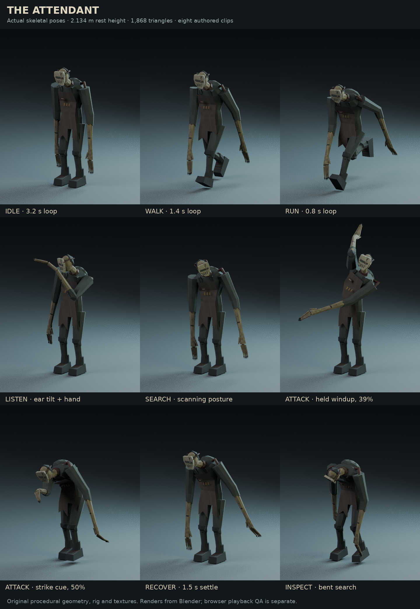

# Last Vehicle 1.8 — The Attendant

**A GingrSnaps Project** · Low-poly · Complete browser game and editable source

This update keeps the battery, repair, power, Security and vehicle-escape progression. It adds an original creature, a clearer attack cycle, more detailed searches, three story encounters, room dressing and sound layers. All runtime files are local; there is no engine installation, account, online AI service or subscription.

## Start or upgrade safely

1. In your older version, open Pause and **Export save**. Export settings too if you want a separate backup. Keep the old ZIP.
2. Extract the complete new ZIP into a new folder. Do not merge individual files from different versions.
3. On Windows, double-click `START_WINDOWS.bat`. On macOS/Linux use `sh START_MAC_LINUX.sh`. Python 3.10+ or Node.js 20+ is required; no extra packages are needed.
4. Keep the launcher terminal open and visit `http://127.0.0.1:8080/`. Reusing the same browser/address retains its local save. Stop your old server before starting the new one.
5. Confirm **v1.8** on the title screen. If you see an older version, hard-refresh; avoid clearing site data until your save is exported.
6. Choose Continue, or import your exported JSON save. All repair flags and settings remain compatible. Older saves do not replay already recorded impacts. A checkpoint may resume its latest unfinished story beat; it does not replay every missed earlier scene.
7. Choose **New game** to experience the complete new three-beat sequence. Your exported save remains a backup.

The hosted browser version, localhost version and itch.io each have separate browser storage. Transfer saves with Export/Import. The downloadable launcher serves a browser game; it is not a compiled Windows EXE.

## The new enemy

**The Attendant** is an original, hunched industrial creature with a damaged narrow mask, corroded head straps, torn apron, and elongated arms and fingers. It uses the same subdued low-poly style as the garage. Its shape, clothing, rig, grime textures and animations were authored for this project; it is not the previous human with a new filename.

The runtime GLB is **1,394,224 bytes**, **1,868 triangles**, with **38 deform joints** and **eight named clips**. Its rest height is approximately 2.134 metres. The rig, texture images and animation are embedded in one file, so a chase does not trigger an additional model download.



This contact sheet shows actual Blender-rendered poses. It is an asset preview, not a screenshot of the game or evidence of browser playback quality.

| Clip | Behavior in the game |
|---|---|
| Idle | A restrained breathing stance |
| Walk | Investigation and patrol, adjusted to movement speed |
| Run | Fast pursuit |
| Listen | Pause and tilt toward evidence; also used during safe startup grace |
| Search | Scan around the last observed location |
| Attack | Raised-arm warning, forward strike and follow-through |
| Recover | A visible opportunity to escape after a missed attack |
| Inspect | Bent search at a locker or damaged grille |

Only the current clip and any fading clip run once the blend settles. Attack and recovery poses follow the game clock explicitly. Pausing the game freezes their pose and damage window. Changing the frame cap should not make the attack run twice as fast.

## How pursuit works

The Attendant uses local rules rather than an online AI service. These rules deliberately limit what it knows.

- **Sight:** a facing cone, distance, player height and actual geometry determine visibility. A low vehicle may hide a crouched body while leaving a standing head visible. Display brightness does not change perception rules.
- **Hearing:** footsteps and machinery create an evidence position. Crouching is quieter than walking; sprinting is louder. Walls reduce hearing range.
- **Flashlight spill:** a visible portion of the beam can make it inspect that area. This is a short, geometry-checked approximation, not a simulation of reflected light or volumetric rendering. It records the beam clue, not your hidden coordinates.
- **Prediction:** consecutive visible sightings establish your direction. After you leave sight, it briefly looks ahead along that direction. It cannot continue tracking you through walls. An inaccessible prediction falls back to the last evidence.
- **Searching:** it checks nearby cover corners and room junctions. Medium/Hard can include lockers near the last evidence; Easy checks a locker only when it saw you enter.
- **Cleared locations:** a checked empty locker or search point is remembered for 45 active-play seconds. It then becomes eligible again.
- **Distractions:** the first successful siren/valve lure lasts nine seconds. Repeated use of the same source shortens that time, to a minimum of 2.5 seconds. A fresh visual chase takes priority.
- **Patrol:** it favors locations it has not visited recently. It uses the existing collision-aware pathfinder rather than walking straight through scenery.

Sensing is sampled at 10 Hz. Movement continues at the gameplay update rate. Path planning is limited to at most twice per second, and all navigation structures are prepared during loading. This is a bounded game AI; it is not a promise that every situation will look human or unpredictable.

### A fair, visible attack

When the creature is close enough and has clear sight, it commits to an attack direction. It raises an arm before moving forward. It does not rotate the strike continuously to follow a sideways dodge. A hit requires close distance, a forward-facing contact test, and unobstructed geometry during the strike window.

| Difficulty | Warning before lunge | Recovery after miss | Repeated-lure retention |
|---|---:|---:|---:|
| Easy | 0.90 seconds | 1.20 seconds | 88% per repeated use |
| Medium | 0.72 seconds | 0.95 seconds | 70% per repeated use |
| Hard | 0.58 seconds | 0.75 seconds | 55% per repeated use |

The lunge lasts 0.24 seconds. One attack can capture only once. Moving aside or getting solid cover between you and it can produce a miss. A capture has a short 0.42-second visual follow-through before the retry panel. The last safe objective checkpoint remains intact.

These values are editable in `dist/js/difficulty.js`. Start with Medium. For a less demanding first run, use Easy; the story and puzzle answers are the same.

## Three main story encounters

| Required action | Encounter | Consequence and guidance |
|---|---|---|
| Take the maintenance key in Security | The privacy blind lifts. The real creature winds up and hits the wired window behind the desk. | Glass holds; it must walk around the partition. A short grace interval lets you move. The key also unlocks the west service passage. |
| Collect the cable and fuse in Workshop | The adjacent service hatch springs open with a synchronized metal impact. | The loud impact can attract the actual enemy. The garage and service passage remain usable. |
| Restore the Electrical circuits | An auxiliary panel cover bangs open; a relay snaps and the garage changes to dimmer emergency lighting. | The exit power still works. Continue to the Security computer; the loose cover is not another puzzle. |

These are real room animations, not full-screen pictures. They are queued by completed tasks and play when you are nearby and not already in an attack, recovery, locker inspection, another interaction, a shelter or the car. A 12-second spacing rule prevents stacking the major beats. A very fast player who leaves the area while a beat is deferred can miss it; the game does not lock the camera or force a wait to manufacture a scare. Returning near the object allows a pending beat to play. New runs provide all three opportunities on the normal required route.

Completed impacts are recorded in saves. **J → Task → What changed in the garage** describes only the changes that actually happened. The journal remains quiet by default; it does not keep covering the screen with task cards.

Additional situations include a hanging lamp on the final return, a locker handle moving during an actual inspection, and a side-window strike if the creature is physically beside your car during entry. A distant enemy cannot trigger the window beat. Optional environmental scares wait for a quieter moment after pursuit; they cannot queue an endless chain of jumpscares.

## Environmental detail and lighting

Security now has a framed wired inspection window, a moving privacy blind, visible damage, a damaged camera head, paperwork and a warning that there is no night attendant. Workshop, storage and the utility rooms gain more public props, tyre stacks, cable junctions, drain gratings, wear marks and small work details. Existing interaction anchors and walking routes stay clear.

All new static details join the material/room/sector batching pass. The blind, cracked window, panel cover, creature, hands, doors and other moving objects remain separate. They are created during loading; firing a scare does not construct its meshes.

Lighting remains deliberately dark enough for the flashlight to matter. The seven-light arrangement is preserved: one ambient fill, two flashlight slots and four reusable ceiling slots. The electrical event changes intensity and prebuilt emissive materials. It does not add an expensive new light or a particle storm. **Reduced light changes** softens the relay pulse. There is no new forced camera shake.

Room visibility is conservative: the garage remains visible, as do the current room and adjacent west rooms through their passages. From the garage, all rooms remain available for ordinary frustum culling. Culling is updated at four samples per second and all geometry remains loaded in memory. This is not runtime asset streaming.

## Music and sound additions

Six additional local Ogg files total **638,654 bytes**:

| Runtime file | Purpose | Credited source |
|---|---|---|
| `unease.ogg` | Quiet exploration/search music layer | congusbongus, *A lurking evil* |
| `aftermath.ogg` | A brief quieter layer after pursuit breaks | congusbongus, *Lost in a bad place* |
| `creature-breath.ogg` | Sparse positional breathing during nearby listening/search | qubodup, *Ghost breath* |
| `creature-attack.ogg` | Distinct attack warning | Ogrebane, *Monster Sound Pack, Volume 1* |
| `creature-recover.ogg` | A quieter recovery vocal from a different recording | Ogrebane, same pack |
| `surge.ogg` | Electrical relay snap | Brian MacIntosh / BMacZero, *Electricity Sound Effects* |

The music edits are 40-second circularly crossfaded loops. All six files decode successfully and measured below clipping. Numerical analysis does not replace listening on speakers/headphones; no audible mix review was possible in this environment.

Music follows actual AI state. The unease bed steps aside during a chase or attack. After pursuit breaks, the aftermath layer can come forward briefly. Positional creature sounds use the existing wall muffling and room reverb. Music, ambience, SFX, interface volume and loud-effect strength remain separately adjustable. Night dynamic range is useful for lower-volume play.

Exact source URLs, original filenames, authors, processing, hashes and CC0 declarations are included in `dist/assets/attendant-audio-manifest.json`, `assets-manifest.json`, `CREDITS.md` and `licenses/`. The creature has its own original-art CC0 dedication; that dedication does not change the game's code or branding terms.

## Learn to change this build

The complete package includes `docs/Full_Code.md` with the full commented source, plus the real editable files. Change those files, save, then reload the local browser tab. Keep a backup before larger edits.

1. **Enemy balance:** open `dist/js/difficulty.js`. Change one value at a time. `attackWindup` makes the warning longer/shorter; `attackRecovery` changes the escape opportunity. `chase` sets pursuit speed. Avoid making the enemy faster than the player's sprint without adding another reliable escape option.
2. **Enemy decisions:** `dist/js/threat.js` owns evidence, perception, search candidates, movement and attacks. `canSee()` reads geometry; `beginSearch()` chooses evidence-based candidates; `tickAttack()` owns the damage window. Keep hidden player positions out of search selection.
3. **Scare timing:** `dist/js/encounters.js` handles queues, once-only save records and spacing. `Game.tickEncounters()` connects a beat to real room animation and sound. `Atmosphere.playSecurity()`, `playHatch()` and `playSurge()` animate the geometry. Put an impact sound at the contact callback, not at the start of the animation.
4. **Place objects:** edit `dist/js/atmosphere.js` for original details and `dist/js/props.js` for measured public models. Coordinates are metres, Y is up, and the north gate is near Z=0. Keep every interactive approach and the car's full escape footprint clear.
5. **Edit the creature:** optional Blender source is in `source-assets/attendant/attendant.blend`. Select the rig, use the Action Editor, and inspect the named actions. `build_attendant.py` regenerates the original asset from geometry/animation code. Blender 4.3 was used. The generator writes beside itself; run it in a copy, not over your only edited source.
6. **Export the creature:** preserve metre scale, ground-centred origin, eight clip names and embedded textures. Copy the GLB to `dist/assets/models/attendant.glb`. The supplied rig faces the controller's +Z direction after Babylon's loader conversion. The strike cue is normalized phase 0.50. If you change the animation, update its game-clock mapping too.
7. **Replace a sound:** put an appropriately licensed Ogg under `dist/assets/audio/`, retain its runtime name, and update the manifest hash and credit. `AudioMixer.load()` preloads it. Tune source gain conservatively before changing a bus slider. Do not assume that every file on a free-asset site has the same license.
8. **Change journal instructions:** use `tasks.js` for the shared task contract. Prerequisites, instructions, map destinations and prompts must describe the same action. Event observations are derived from saved encounter IDs in `journal.js`.

Run the offline checks after a substantive change:

```bash
npm test
npm run check
```

No `npm install` is required. Tests use Node's built-in runner and the bundled Babylon NullEngine. They verify logic and scene transforms; they do not establish GPU performance or real pointer-lock permissions.

## Full package versus itch.io package

- **LastVehicle_Browser_Complete.zip:** runtime, Python/Node launchers, editable creature source, all commented source, guides, tests, asset credits and verification notes.
- **LastVehicle_Itch_HTML5.zip:** only the deployable `dist/` contents, with `index.html` at the ZIP root. Upload as an HTML game and enable fullscreen. It has all runtime models/audio/licenses and does not need the Blender source or launchers.

The online browser build contains the same runtime files as the itch ZIP. Hosting success does not certify the game as ready for sale. A desktop wrapper or Steam release is a separate packaging/testing step; no EXE is included in this delivery.

## Performance and verification

The implementation avoids creating encounter geometry during gameplay, preloads the creature and audio, prepares navigation, keeps light identities stable, limits sensing/path planning, pauses inactive clips, batches static details, and culls unrelated rooms conservatively. It retains the FPS overlay, frame-time graph, adaptive resolution, render-scale controls, settings rollback and local hitch report.

**No zero-freeze or guaranteed FPS claim is made.** The preview browser currently cannot start because its sandbox cannot create its session path. Final WebGL appearance, pointer-lock permissions, audio balance, first-run pacing, exact playtime and real hardware frame times remain unverified. `VERIFICATION.md` records the automated evidence separately.

A focused manual release check:

1. Start a new Medium run with the FPS/frametime overlay enabled. Test free mouse-look in a standalone tab and the actual itch embed.
2. Verify off/on flashlight contrast in every room, and confirm its held model stays hidden while off.
3. Follow the actual task journal from car inspection through repair and exit. Watch the Security, Workshop and Electrical beats; try pausing during each animation.
4. Let the creature see you, break sight, hide without being seen, then test a witnessed locker entry. Repeat with a siren to compare first and repeated distraction time.
5. On each difficulty, stand close enough to provoke the raised arm, move sideways, and confirm a missed strike provides an escape window. Confirm walls block capture.
6. Listen to the attack warning and new layers with Music/SFX separated, then with Night mode and lower loud-effect strength.
7. Save, reload and import a backup before/after each objective. Completed parts and encounters must remain completed.
8. Open the gate, return to the car, enter at the driver door, pause mid-drive and resume to the ending. Confirm the studio credit and Credits screen.
9. Walk the same route twice with the built-in performance report. Compare first and second pass; record actual browser, hardware, settings and peak hitches before deciding what needs further optimization.

The 15–30-minute duration remains a first-play design target, not a measured playtest result.
